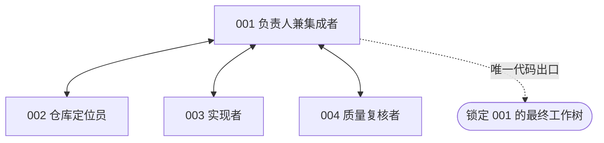
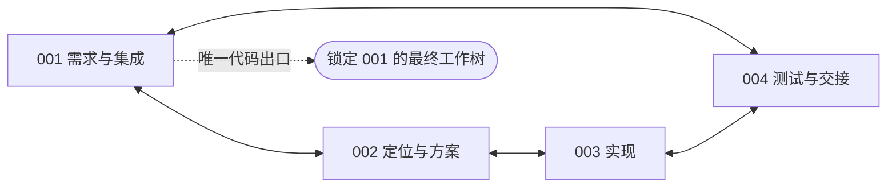
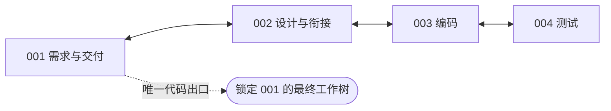
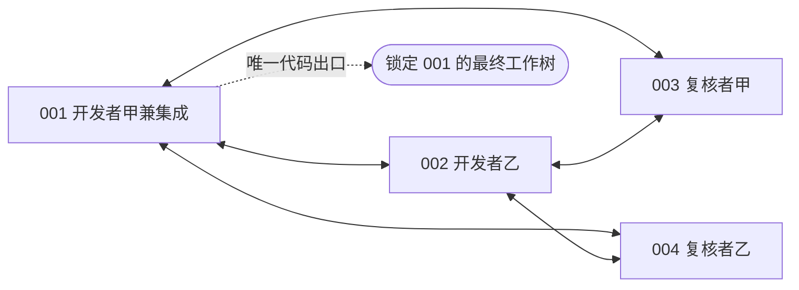
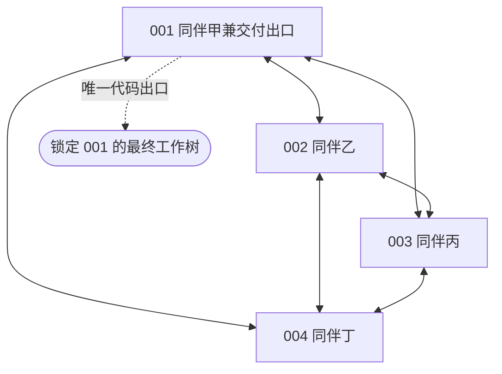
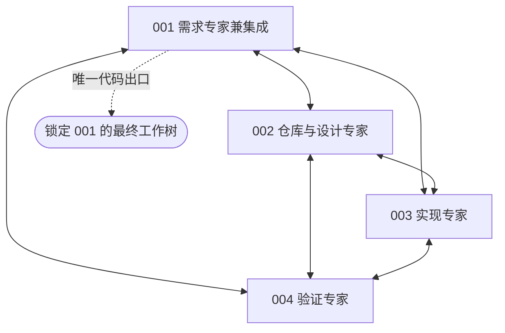

# 固定四成员 coding 组织对照审阅稿

新增六种固定组织，比较同一模型在不同分工、沟通和调度方式下的修复能力。**本轮只实现与离线验证，不调用模型、不启动评测；团队预算等待当前单模型 token 上限实验后确定。** 六组都建立在 OpenHands 与 ProWorkSim 受管 harness 上，论文提供组织思路，以下配置是适配当前仓库修复场景的对照，不是论文复现。

## 六组选择

| 条件 | 一句话说明 | 拟检验的主要取舍 |
| --- | --- | --- |
| CHIEF 集中负责人 | 负责人连接定位、实现、复核三名成员 | 集中协调能否抵消中转和管理开销 |
| SOP 职能流水线 | 按需求、方案、实现、验证顺序交接 | 明确交接能否减少遗漏，是否拖慢返修 |
| DIALOGUE 阶段对话链 | 相邻角色成对讨论，再进入下一阶段 | 对话澄清的价值是否超过重复交流成本 |
| REVIEW 开发复核返修 | 两名开发者与两名复核者反复检查修改 | 独立复核能否发现错误，是否挤占实现预算 |
| PEER 扁平同伴协作 | 四名同伴直接沟通，自主分工 | 自主分工是否有效，重复工作和冲突有多大 |
| COUNCIL 专家会诊 | 先多角度讨论，再集中实现与验证 | 专业视角能否改善方案，讨论是否过多 |

选择理由属于实验设计判断。Scrum的完整迭代管理、矩阵制的跨项目资源共享与单个issue修复距离较远；AutoGen是可承载多种结构的框架，不能单独算一种组织；CAMEL双角色暂留人数消融。主程序员制与职能分工分别合入CHIEF与SOP，避免重复设组。

## 六张关系图

每组固定4人，001至004分别对应`member_001`至`member_004`，四人的职责表对成员公开。**实线表示允许的直接消息、定向补丁交接与责任转交通路**，不是自动发送。公开任务板和已固定的公开版本是共同的间接信息通道；合法成员可按原规则读取公开版本，并需主动合并才能改动自己的工作树。未固定工作树和私有历史仍隔离，因此这些图不代表完整信息流。虚线是统一代码出口，不是第五个Agent。角色职责由提示规定，成员集合、通路和阶段调度由harness约束；复核者也保留共同的基础coding工具。

### 1 集中负责人

借鉴MAGIS的管理、定位、实现和QA角色。三名成员的定向协作经负责人；补丁固定、公开读取和主动合并继续遵守原harness规则。MAGIS原文允许按任务组织多个开发者，本组改为固定四人。[MAGIS原文](https://proceedings.neurips.cc/paper_files/paper/2024/file/5d1f02132ef51602adf07000ca5b6138-Paper-Conference.pdf)

### 2 职能流水线

借鉴MetaGPT的职能与标准交接：需求和方案传给实现者，验证者反馈并交还集成。环上双向通路允许返修；“阶段到了”不代表阶段产物合格。[MetaGPT原文](https://proceedings.iclr.cc/paper_files/paper/2024/hash/6507b115562bb0a305f1958ccc87355a-Abstract-Conference.html)

### 3 阶段对话链

借鉴ChatDev以角色对话连接设计、编码和测试。每个窗口只调度指定的一对成员，轮流行动，提示鼓励沿相邻通路交接。已固定的公开补丁仍可由合法成员直接读取并主动合并；代码采用不必逐级回传。[ChatDev原文](https://aclanthology.org/2024.acl-long.810/)

### 4 开发复核返修

两名开发者形成或整合补丁，两名复核者独立检查并向开发者反馈；复核者之间没有直接通路。复核意见不能替代测试证据，也不充当隐藏评分器。[现代代码复核研究](https://www.microsoft.com/en-us/research/publication/expectations-outcomes-and-challenges-of-modern-code-review/)

### 5 扁平同伴协作

借鉴自管理团队在共同边界内自主安排工作。四人按固定顺序轮转，允许彼此直接协作；001只是所有组共用的最终导出地址，没有额外派工权或观察权限。[自管理团队研究](https://pubsonline.informs.org/doi/10.1287/orsc.12.5.559.10094)

### 6 专家会诊

借鉴AgentVerse的专家讨论、行动和反馈，但固定四个职责，不招募、换人或投票查询隐藏成绩。与PEER使用相同全互联图，区别在专业提示和阶段窗口；同底座的角色标签不代表真实专业能力。[AgentVerse原文](https://proceedings.iclr.cc/paper_files/paper/2024/file/578e65cdee35d00c708d4c64bce32971-Paper-Conference.pdf)

## 与项目 harness 保持一致

- **同一执行基础**：继续使用OpenHands、HarnessPort和WorldCore；私有工作区及历史、版本引用、固定补丁的原有公开可见性、显式合并、同版本公开测试与正式提交均保留。组织层不增加bash旁路、自动广播、自动合并或额外答案来源。
- **同一团队额度**：四人共享总预算B，不是每人B。上下文131072、完整输入98304、单次输出32768；全队共同512次决定、512次模型尝试、512次公开测试，6小时软／6.5小时硬期限。通信、返修、回读和格式修正都消耗真实机会与token。
- **同一最终端点**：只锁定001的最终工作树算代码正确率，另报001最后合法提交的交付率；不从四人末态中挑最好补丁。其他成员的正确修改只有经合法集成才能进入最终候选。
- **同一统计口径**：比较组织条件的整体影响，不把角色、通路及调度同时变化的分差全称为图拓扑效应。后续逐题配对统计正确率、合法交付率、全队实际平均token及每成员消耗、通信和合并成本、冲突与重复工作；未知和未开始单列。

## 固定调度与后续实验

下表是循环的行动窗口，数字为真实工作机会数；多人窗口内部轮转。窗口长度是本次预设参数，尚无成绩支持其最优性。窗口到期仅切换调度，不证明阶段完成，也不会代替成员发送信息、测试或交付。等待／完成按原生命周期处理，不能借此免费复制工作或扩张预算。

当前实现采用四个独立会话、逐机会推进的确定性调度，不同时发起四次模型调用或四次公开测试。它用于实现组织对照规则；物理并行部署和吞吐尚未验证。

| 条件 | 每轮窗口顺序 |
| --- | --- |
| CHIEF | 负责人规划 2 → 仓库定位 4 → 负责人分派 1 → 实现 8 → 负责人集成 3 → 质量复核 4 → 负责人闭合 2 |
| SOP | 需求 3 → 定位与方案 3 → 实现 8 → 验证 6 → 集成交付 4 |
| DIALOGUE | 需求与设计对话 8 → 设计与编码对话 8 → 编码与测试对话 8 → 设计与交付对话 8 |
| REVIEW | 开发 8 → 独立复核 4 → 返修与集成 8 → 复核反馈 4 |
| PEER | 同伴轮转 4 |
| COUNCIL | 专家会诊 8 → 集中实现 8 → 验证反馈 4 → 集成闭合 4 |

可用任务池沿用固定版本Verified完整500题身份，不按已有成绩挑题。当前只准备六种组织条件，**模型、B、seed及正式执行矩阵尚未确定**，也未自动扩为“六组织×两模型×三预算”。单人参照须匹配最终选定的底座、团队总额度、公开环境及受管基础接口；若版本不同，应补同期S1，不能直接拿旧分数替代。

实现入口为[组织目录](../../src/proworksim/software_fixed_organization_v065.py)、[受管世界接入](../../src/proworksim/software_fixed_organization_world_v065.py)和[固定调度运行层](../../src/proworksim/software_fixed_organization_runtime_v065.py)。[准备脚本](../../tools/prepare_fixed_organizations_v065.py)只生成[六组配置](../../config/software-fixed-organizations-v065.json)和[待审阅实验计划](../../artifacts/software-fixed-organization-v065/preparation-r1/plan.json)，没有启动评测的子命令，也不继承当前实验的API预算与资源授权。图由同一目录生成，独立Mermaid文件见[图目录](diagrams/software-fixed-organization-v065/)，来源及适配边界见[一手资料记录](../../artifacts/software-fixed-organization-v065/sources-r1/facts.json)。

## 实现验证与审阅重点

已通过23项必要CPU机制检查，并完成一次真实OpenHands的四会话程序化集成：12次脚本响应、全队共12,204个人工token计数，验证共享预算、合法协作路径、私有历史、同版本测试和最终候选闭合。**这些计数不是实际模型消耗；本轮真实模型、API、GPU、Docker与正式评分调用均为0。** 验证记录保留初稿修正及适用边界，见[机制验证](../../artifacts/software-fixed-organization-v065/validation-r1/validation.json)和[最终补充](../../artifacts/software-fixed-organization-v065/validation-r1/final-addendum.json)。

本次可重点审阅六类组织的取舍、统一四成员设定、窗口配额及001统一出口。预算边界结果出来后，再确定正式模型、团队总预算和评测矩阵；当前不自动启动后续实验，也未修改正在运行的token上限实验文件。
