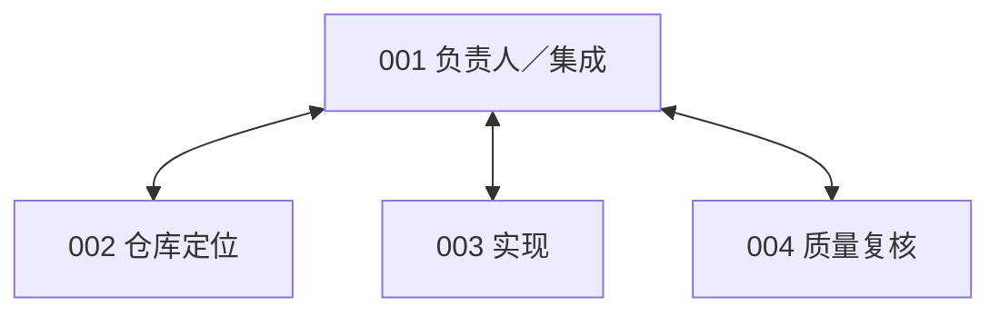
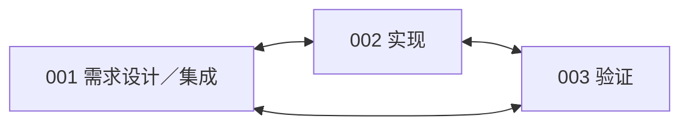
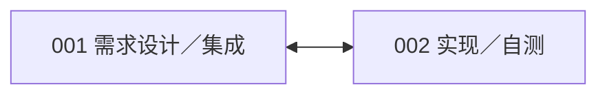
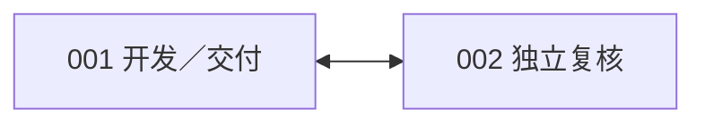
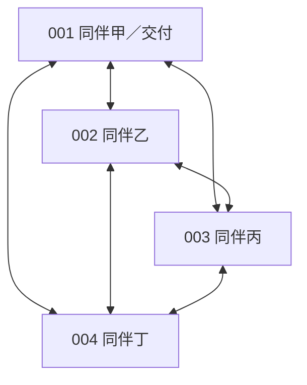
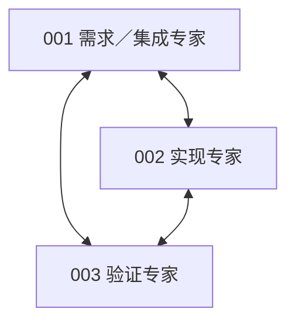

# 单模型评测结果与六类协作方案汇总

日期：2026年10月30日。Qwen的最新50题短评测已完成，三组正确率为54%、60%、64%；DeepSeek的两组500题面板仍有技术未知，须分别报告已有成绩与缺失结果。六类固定协作方案已实现，覆盖2至4人，尚未开展真实协作评测。

## 一 Qwen 50题短评测

三组使用同一个原始Qwen3.5-9B、思考模式、原生OpenHands单Agent，均为REF条件。主测为同一50题、12个仓库，每题从独立初态开始；上下文131072、单次输出32768、512次调用／决定、6小时软限保持一致。本表采用最后补评后的结果，不是完整500题成绩。

| 条件 | 执行方式 | 每题累计token上限 | 通过／50 | 正确率 | 每题实际平均token |
| --- | --- | ---: | ---: | ---: | ---: |
| BASE5M | 原执行方式 | 500万 | 27／50 | **54%** | 2,667,312 |
| FIX5M | 修复后的执行方式 | 500万 | 30／50 | **60%** | 3,547,718 |
| FIX10M | 同一修复方式 | 1000万 | 32／50 | **64%** | 5,695,758 |

各组50题评分与用量均完整，技术未知为0。token均为累计输入＋输出，包含重复输入与思考输出，不只是模型新写出的正文。

FIX同时修复思考字段到SDK的传递、明确公开解释器与测试入口，并加入预算内的有限停滞纠正和结束前自查。因此，BASE5M到FIX5M的变化代表这些修订的共同效果；不能归因于单一参数，也不能称为PROJECT与REF的接口比较。

修订后净增3题成功，再增加预算净增2题成功。逐题也存在反向变化：两次比较分别有6题转好／3题转差、4题转好／2题转差。**本面板观察到改善，但尚未测出稳定的能力上限。** 该50题面板已经用于开发和校准，不是独立确认集。

FIX10M预选12题的三轮成绩为8／12、7／12、7／12；三次成功次数为0、1、2、3的任务数分别是4、1、0、7。额外24回合不混入50题主结果。全部174回合评分已知，实际总消耗711,967,156 token。

更早的四预算档作为历史背景：50万、200万、500万、1000万分别为14／50、26／50、26／50、26／50，即28%、52%、52%、52%。这是187个原回合结果加13个独立恢复回合形成的混合来源补全视图；原首轮仍有13个未知，不能与上表同期三组混为一轮。

依据：[三组协议](software-benchmark-v062-protocol.md)、[主测与重复题单](../../artifacts/software-benchmark-v062/preparation-r1/panel.json)、[运行原件索引](../../runs/software-benchmark-v062/capability-probe-r1-20261026/coordinator-r2/run-summary.json)、[最后补评](../../artifacts/software-benchmark-v063/final-rescore-r1/summary.json)、[更早四档结案](software-benchmark-v061-final-recovery-r1.md)。

## 二 本次DeepSeek评测

两组均使用DeepSeek Flash思考模式、一个实际Agent，每题累计输入＋输出上限500万token；上下文131072、完整输入98304、单次输出32768。**两组的基础框架都是OpenHands**：REF使用原生工具与流程；PROJECT在此基础上加入ProWorkSim的受管工具、私有版本、测试证据及正式交付规则。

| 原始面板 | 代码通过 | 代码未通过 | 技术未知 | 未开始 | 已知结果通过率 |
| --- | ---: | ---: | ---: | ---: | ---: |
| REF，计划500题 | 333 | 58 | 95 | 14 | 333／391＝85.2% |
| PROJECT，计划500题 | 280 | 76 | 129 | 15 | 280／356＝78.7% |

**完整500题的最终正确率仍未确定。** 已确认成功占计划总量的下界分别为66.6%和56.0%；85.2%与78.7%仅描述已有明确评分的不同子集，不能直接把差值解释为项目接口损失。也不能将这两个500题面板的已知子集分数与Qwen的50题分数直接作公平排名。

PROJECT合法交付通过264题，未通过92题，技术未知129题，未开始15题。代码通过的280题中，16题没有合法交付，具体为：

- **15题Matplotlib发生接口故障**：公开测试前同步文件时，旧实现对非当前用户所有的文件执行chmod而报权限错误。73次测试调用全部未真正执行；15题都已固定最终版本，14题尝试提交但因缺少同版本真实测试证据被拒，另1题因测试通道故障结束。
- **1题pytest-5787被预算门截断**：同版本测试与补丁固定已完成，消耗4,883,127 token后，剩余额度不足以预约下一次模型请求，未能正式提交。

这16题主要反映接口实现缺陷与预算和交付流程的衔接问题，不能笼统视为模型忘记提交。补评可以确认最终代码正确，但不能补造当时的合法交付。

| 原始条件 | 实际有API调用的任务 | 用量完整任务 | 完整任务的平均实际token | 用量未定任务 |
| --- | ---: | ---: | ---: | ---: |
| REF | 447 | 429 | **1,915,458** | 18 |
| PROJECT | 444 | 433 | **2,264,569** | 11 |

以上均值包括用量完整的技术异常任务，不只包括成功任务；排除零调用任务，不代表整个500题组的精确均值。API预算总限额为1700元，沿用原账本，未决费用预约仍保留。

另有44个独立恢复回合：REF为15／21＝71.4%，PROJECT为16／23＝69.6%，均无评分未知；平均实际token分别为2,359,482和2,466,084。这些是预算中断任务的独立新尝试，单独报告，不覆盖首轮未知或混入首轮分母。

剩余209项待办已封存，未继续派发；Qwen保持暂停。依据：[DeepSeek收尾报告](software-benchmark-v102-deepseek-closeout-r1.md)、[评分机器摘要](../../artifacts/software-benchmark-v102/deepseek-final-accounting-r1/summary.json)、[token机器摘要](../../artifacts/software-benchmark-v102/deepseek-token-accounting-r1/summary.json)、[Matplotlib原始故障记录](../../runs/software-benchmark-v066/v064-continuation-r3/episodes/734/controller-output/managed-boundary.json)、[pytest预算记录](../../runs/software-benchmark-v066/v064-continuation-r3/episodes/657/result.json)。

## 三 六类固定协作方案

六组均基于OpenHands与同一ProWorkSim受管harness，是项目中的组织适配方案。**已完成实现及离线机制验证，真实协作评测尚未开始。** 人数修订后的配置如下。

| 方案 | 人数 | 核心分工 | 行动顺序 |
| --- | ---: | --- | --- |
| CHIEF 集中负责人 | 4 | 负责人、定位、实现、复核 | 负责人规划与分派，成员工作后由负责人集成、交付 |
| SOP 职能流水线 | 3 | 需求设计与集成、实现、验证 | 设计→实现→验证→集成，允许反馈返修 |
| DIALOGUE 阶段对话链 | 2 | 需求设计与集成、实现与自测 | 两人围绕设计、实现自测、交付确认逐阶段对话 |
| REVIEW 开发复核返修 | 2 | 开发兼交付、独立复核 | 开发→复核→返修→反馈 |
| PEER 扁平同伴协作 | 4 | 四名同伴，001兼最终交付 | 同伴轮转，自主分工与协调 |
| COUNCIL 专家会诊 | 3 | 需求与集成、实现、验证专家 | 先共同讨论，再集中实现、验证、集成 |

下列双向连线表示允许的直接消息、补丁交接和责任转交通路，不代表行动顺序或物理并行。001为统一最终交付成员。公开任务板和已固定补丁仍对团队可见，因此星形通信并不意味着其他成员完全看不到彼此的公开产物。

### CHIEF 集中负责人 4人

实现上只允许负责人和其余成员直接沟通，禁止成员间直接交接；调度依次安排规划、定位、实现、集成和复核窗口。

### SOP 职能流水线 3人

实现上三人可以相互反馈，但行动窗口按设计、实现、验证、集成依次推进；流水线限制的是工作次序，不是单向通信。

### DIALOGUE 阶段对话链 2人

实现上设三个阶段，两名成员在各阶段内轮流行动；没有自动代替模型发送消息或生成交接结果。

### REVIEW 开发复核返修 2人

实现上交替安排开发、复核、返修和反馈窗口。复核者是提示中的职责分工，仍可修改自己的私有工作区，没有额外只读权限。

### PEER 扁平同伴协作 4人

实现上四人全互联、固定轮转，自主选择工作。001仅承担共同的最终提交出口，不额外获得管理权或私有信息访问权。

### COUNCIL 专家会诊 3人

实现上先安排三人轮转会诊，再进入实现、验证和集成窗口。它与SOP的通信图相同，区别在于讨论阶段和行动配额；专家名称本身不代表已证明的能力优势。

### 六组共同实现

- **统一harness**：每人独立OpenHands会话、私有工作树与历史；固定补丁公开，采用其他成员产物必须显式合并。保留同版本测试、固定和正式提交规则。
- **结构真实约束**：程序强制成员数、通信边、行动窗口、禁止动态招募，以及仅001可正式提交；岗位职责主要通过提示表达。窗口到期只切换成员，不自动测试、合并或宣布成功。
- **团队总预算不倍增**：2／3／4人共享同一总额B；已设上下文131072、输入98304、输出32768，以及全队512次决定、模型尝试和公开测试上限。正式模型、B、seed与实验矩阵仍待确定。
- **统一评分出口**：代码端点评001闭合时的最终工作树，交付端点评001最后合法提交；不从多个成员候选中事后挑最好结果。
- **实施状态**：新版22项CPU控制通过，2人／3人SDK脚本会话控制通过；尚未调用真实模型开展协作评测。当前逐个工作机会推进，尚未验证物理并行的模型请求或测试部署。

未来六组同时改变人数、分工和调度，组间差异应解释为整套组织方案的效果，不能直接认定为单一通信拓扑的效果。

依据：[完整审阅稿](software-fixed-organization-v065-review.md)、[六组实际配置](../../config/software-fixed-organizations-v065.json)、[组织目录](../../src/proworksim/software_fixed_organization_v065.py)、[受管规则](../../src/proworksim/software_fixed_organization_world_v065.py)、[窗口调度](../../src/proworksim/software_fixed_organization_runtime_v065.py)、[新版验证记录](../../artifacts/software-fixed-organization-v065/validation-r2/validation.json)。
