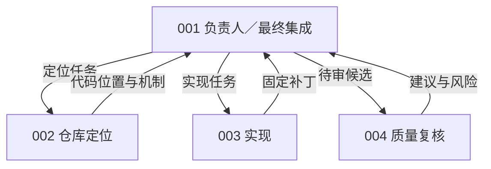
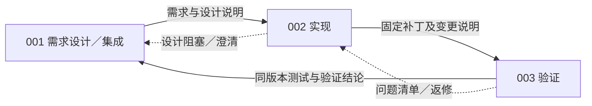
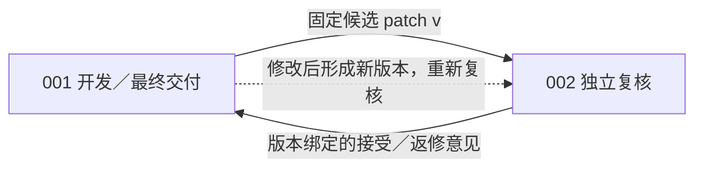
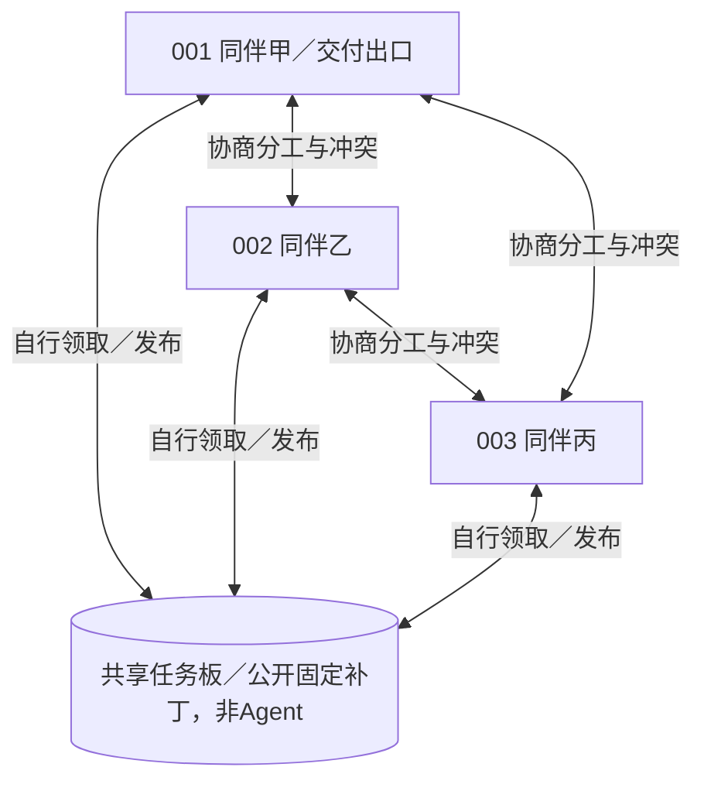
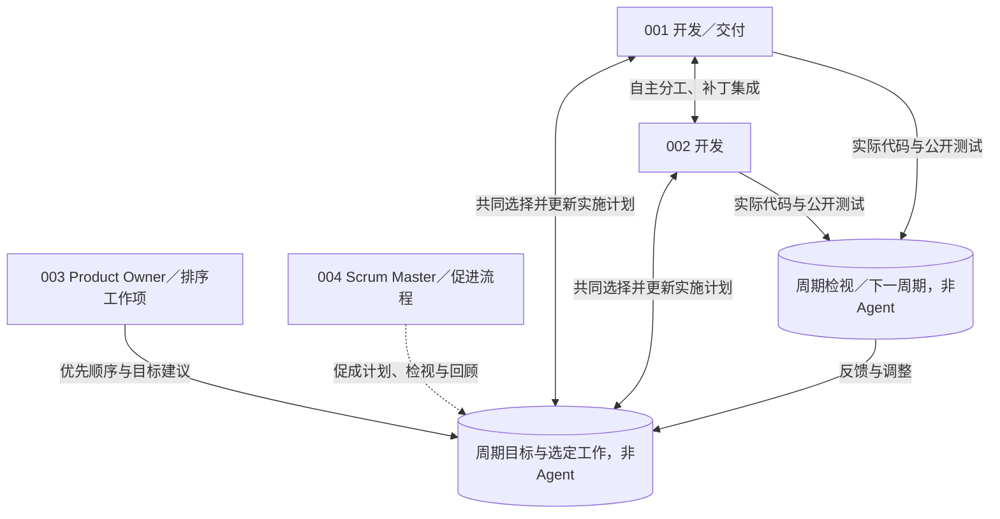
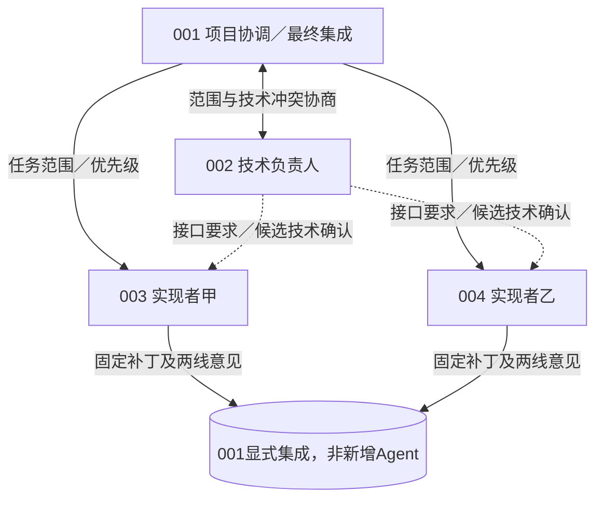

# 单模型评测结果与六类协作方案汇总

## 一 评测结果与实际消耗

| 模型与条件             | 每题累计token上限 | 代码通过／已评分 |      代码通过率 | 平均实际输入＋输出token | 用量均值样本数 |
| ---------------------- | ----------------: | ---------------: | --------------: | ----------------------: | -------------: |
| Qwen3.5-9B REF FIX5M   |             500万 |           30／50 | **60.0%** |     **3,547,718** |             50 |
| Qwen3.5-9B REF FIX10M  |            1000万 |           32／50 | **64.0%** |     **5,695,758** |             50 |
| DeepSeek Flash REF     |             500万 |         333／391 | **85.2%** |     **1,915,458** |            429 |
| DeepSeek Flash PROJECT |             500万 |         280／356 | **78.7%** |     **2,264,569** |            433 |

全部使用思考模式、单Agent；上下文131072、单次输出上限32768。Qwen两档为同一50题、12仓库的开发校准面板，采用相同FIX执行修订。DeepSeek两组各计划500题，表内通过率只使用已有官方评分的任务；未评分记录继续保留，不能将表内比例称为完整500题成绩。不同模型的题目覆盖也不同，不能据本表直接公平排名。

DeepSeek的REF和PROJECT都基于OpenHands：REF使用原生工具与流程；PROJECT增加ProWorkSim的受管工具、版本、测试证据和交付规则。**15道受同步故障影响但官方代码评分通过的Matplotlib题，已包含在PROJECT的280题中**；另1道受提交前预算门影响的pytest题也已计入。不能再次相加。项目合法交付仍单独记为264题，不改变代码通过数。

## 二 实际token差异的原因

### Qwen 5M与10M

平均消耗由354.8万升至569.6万，增加214.8万，增幅60.5%。**主要原因是调用轮数增加，每轮再次计入上下文，并非单次上下文上限变大。** 平均请求数从135.96升至217.84，增加60.2%；每次平均输入仅从25,476升至25,555 token，增加0.31%。平均输入增加210.3万，占全部用量增量的97.9%；平均输出仅增加4.49万。

预算放宽后，预算预约不足终止的任务从21题减少到15题，但额外消耗没有全部转化为修复收益：成功数只从30升至32；停滞终止从1增至4，另有1题达到调用上限。例如astropy-7671两档都成功，消耗却从135.6万增加到995.7万，请求从64增加到428。该例说明更大预算可能伴随大量未增加最终成功数的工作，不能把增加的token都视为有效推理。

输出达到32768且全部为思考的请求由44次增加到64次，仍是需要处理的适配风险；但这类请求的账单净增只占总体增量约1.54%，不是本轮两组平均差的主要来源。两档是独立初态运行：38题10M消耗更多，12题反而更少，不能把它们当成同一轨迹在5M处暂停后继续。

依据：[Qwen逐题用量分解](../../artifacts/software-benchmark-v103/token-difference-r1/qwen-summary.json)。

### DeepSeek REF与PROJECT

PROJECT平均消耗226.5万，比REF的191.5万高34.9万，增幅18.2%。其平均输入为223.5万，对比REF的187.6万；平均输出却更少，为2.98万对比3.99万。**差额集中在输入，而不是生成正文或思考输出更多。**

为避免两组用量样本不同造成误判，进一步比较双方都实际调用且账单完整的420道同题：REF平均192.0万，PROJECT平均227.6万，PROJECT仍高18.5%。平均请求数反而从58.17降到30.35；每次平均输入从32,325升至73,996 token，达到2.29倍。共同有评分结果的347题中，PROJECT平均消耗仍高20.6%。

这说明PROJECT每次决策携带的信息更重。受管工具说明、状态与历史呈现、上下文压缩方式及模型行为都可能参与其中；当前是总输入计量，尚未将各项独立分词或做消融，不能把全部18.5%归给某一条规则。原生shell一次还可组合多项操作，所以更少的API调用不代表完成了同样多的实际工作。

依据：[DeepSeek配对成本分解](../../artifacts/software-benchmark-v103/token-difference-r1/deepseek-summary.json)。

## 三 DeepSeek未通过任务与接口修订

已核查原始面板58道REF、76道PROJECT未通过任务，所有候选均成功应用，现有官方回执未标记基础设施失败。按测试结果，REF有49题仍未修好目标缺陷、4题仅出现既有功能回归、5题两者兼有；PROJECT相应为64、7、5题。这是官方测试分类，不能仅据此断言每题的根因都在模型。

**已证实的系统性影响有两项。** REF有16道未通过题因累计token预约不足结束，PROJECT有3道；预算截断不代表增加预算后必然成功。另有7道未通过的Matplotlib PROJECT题遭遇测试前同步权限故障，公开测试未能执行，与前述15道代码通过题属于同一个接口缺陷。它们的最终官方代码评分仍未通过，不能因接口出错就改计成功。

**公开测试的覆盖也有限。** 6道PROJECT题在最终版本的公开全库测试通过后，仍未通过官方验收：其中5道Django实际执行约1.58万至1.61万项测试，1道sklearn记录26767项通过。并非只跑了简单检查或引用旧版本测试；原仓库测试没有充分覆盖本题新增要求。抽样可定位到Django预取切片行为不完整、sklearn没有保留转换器输出索引、Django SSL参数传递方式不符等具体问题。生成中曾出现依赖错误，也不能自动解释最终评分失败；例如该SSL题最终已进入参数断言阶段。

双方都有官方结果的347道同题中，265题均通过、46题均未通过、28题仅REF通过、8题仅PROJECT通过。这个配对子集可辅助定位差异，但不替代完整500题面板。

接口修订使用新v103路径：复用已修正的原子文件同步，避免对未修改的外来属主文件执行chmod；测试前普通权限拒绝明确返回“未执行”，保留RPC通道供后续显式请求使用；保留nullable cursor参数恢复。另对DeepSeek PROJECT新增剩余预算输出上限：完整输入仍可容纳时，缩小实际输出预约，不再仅因凑不齐32768输出额度而立即停止。这不扩大500万预算，也不自动提交。**已通过7项接口CPU、8项预算CPU和1项SDK脚本集成控制，未部署或重新评测，不能宣称补回历史成功率。** [修订与验证说明](software-benchmark-v103-managed-interface-repairs-r1.md)

依据：[134道未通过题分类](../../artifacts/software-benchmark-v103/deepseek-failures-r1/summary.json)、[逐题明细](../../artifacts/software-benchmark-v103/deepseek-failures-r1/rows.json)、[同版本公开测试与官方断言证据](../../artifacts/software-benchmark-v103/deepseek-failures-r1/failure-findings.json)。原候选、成绩及历史交付记录保持原样。

## 四 六类协作方式的重新设计

新版保留集中负责人、产物流水线、开发复核和自管理团队，移除与其他组相近的DIALOGUE、COUNCIL，新增短周期自管理和双权责矩阵。人数为 **4、3、2、3、4、4人**。六组的核心分别是：**一个负责人决策、按产物顺序交接、对候选独立复核、平等成员自行领任务、按周期检视调整、项目与技术分权**。

这次按决策和交接机制重新设计，不能仅改提示中的岗位名称。**以下为新设计，尚未实现或评测；旧六组的代码与CPU验证只作为历史基础。** 图中编号节点是实际Agent，其余节点是任务、候选或流程状态，不增加成员。带标签的箭头表示决策、产物或反馈关系，不是完整的信息访问权限图。

### 1 集中负责人 CHIEF 4人

**来源：Baker的主程序员团队与Tao等的MAGIS。** 前者强调负责人承担整体技术责任，后者提供负责人、仓库定位、实现、质量复核的角色参考。[Baker作者综述](https://onlinelibrary.wiley.com/doi/abs/10.1002/0471028959.sof038)、[MAGIS，NeurIPS 2024](https://proceedings.neurips.cc/paper_files/paper/2024/hash/5d1f02132ef51602adf07000ca5b6138-Abstract-Conference.html)

001决定任务拆分、优先级及采用哪个补丁；002定位，003实现，004复核并向001提出建议。**只有一个最终组织决策中心**，复核者不另设独立批准权。负责人可以根据反馈随时重新分派，不要求走完固定职能流水线。

**待实现规则：** 跨角色任务分配和集成选择必须引用001的决策记录；执行者仍须接受责任，不能靠一条消息直接改变owner。已有星形通信限制可复用，但仅限制通信不足以实现集中决策。

### 2 产物交接流水线 PIPELINE 3人

**来源：Mintzberg的职能标准化协调与MetaGPT的SOP。** 本组将协作约束放在阶段产物及交接条件上。[组织设计研究](https://pubsonline.informs.org/doi/10.1287/mnsc.26.3.322)、[MetaGPT，ICLR 2024](https://proceedings.iclr.cc/paper_files/paper/2024/hash/6507b115562bb0a305f1958ccc87355a-Abstract-Conference.html)

001给出需求与设计说明，002实现并固定补丁，003对该版本验证，再交由001集成交付。**是否进入下一阶段由交接证据决定，不再只按固定轮数切人。** 缺少证据或发现问题时，明确退回对应阶段；001不能像CHIEF一样随意跳过交接。

**待实现规则：** 增加阶段状态及交接检查，绑定任务、patch和测试引用；阶段机会用尽只能记录阻塞，不能假定完成。这里检查产物身份和证据是否具备，不用隐藏答案自动判断设计正确性。

### 3 开发复核返修 REVIEW 2人

**来源：Bacchelli与Bird的现代代码复核研究，ICSE 2013。** 本组保留最小的作者与独立复核者分离。[原文](https://www.microsoft.com/en-us/research/publication/expectations-outcomes-and-challenges-of-modern-code-review/)

001自行定位、设计和实现，002只承担独立复核职责，给出接受或返修意见。**关键控制对象是一个具体代码候选**，没有单独的设计主管、任务派发层或完整阶段流水线。复核者可在自己的工作区运行检查，但最终交付代码由作者整合。

**待实现规则：** 新增绑定候选版本的复核状态；代码改动后旧接受意见失效。该组织要求最终候选经过002复核接受，复核不能代替原harness的实际测试与正式提交。岗位分工不等于给复核者增加只读文件权限。

### 4 自主管理同伴 PEER 3人

**来源：Wageman的自管理团队研究，Organization Science，2001。** 借鉴共同边界内的自主分工和横向协调；三人规模及下面的任务协议由本项目设计。[原文](https://pubsonline.informs.org/doi/10.1287/orsc.12.5.559.10094)

三名成员拥有相同的组织权限，自行从任务板领取工作、讨论冲突、发布和合并补丁。001只是固定的最终交付出口。**没有上级派工、强制复核角色或阶段交接门**，工作可以连续推进；与后面的SPRINT相比，也没有周期目标和固定检视点。

**待实现规则：** 三人对无主任务的领取、拆分和责任转交具有同等权限；已有owner的任务不能强占，交接沿用offer／accept。001不得获得专属任务排序或派工权；协议检查权限和责任状态，不替团队自动选择任务。

### 5 短周期自管理 SPRINT 4人

**来源：Schwaber与Sutherland的2020年《Scrum Guide》。** 本组是Scrum启发的单issue短周期适配，不能称完整Scrum复现。指南将工作排序、流程促进和开发自管理区分开，并未把Scrum Master设为派工经理。[官方指南](https://scrumguides.org/scrum-guide.html)

001、002是开发者，001兼交付；003担任Product Owner，负责题目范围内的工作项排序；004担任Scrum Master，促进计划、检视和回顾。**按预先固定的短周期共同设定目标、实施、检查产物，再调整下一周期。** 开发者自行选择具体分工和实现方式，PO与SM不能逐项指挥编码；目标不得删改原题验收要求。

**待实现规则：** 增加周期编号、目标、选定工作和检视记录，区分PO排序权与开发者计划权。周期内可调整实现计划，不能危及共同目标；范围变化须协商并留痕。周期长度用工作机会数事前固定，不能根据成绩临时延长；周期结束不会自动判定成功，也不禁止提前合法交付。

### 6 项目与技术双权责 MATRIX 4人

**来源：Galbraith，Matrix Organization Designs，Business Horizons，1971。** 借鉴项目协调与专业职能两条责任线。当前只有一个issue，因此仅做双权责的缩小适配，不宣称覆盖完整跨项目矩阵制。[作者网站原文](https://jaygalbraith.com/wp-content/uploads/2024/03/galbraithmatrix1971.pdf)

001负责工作范围、优先级和最终集成，002负责技术接口与一致性要求，003、004承担实现。**项目和技术决定分开，任何一方都不能单独覆盖另一方。** 实现者仍各自拥有明确任务；出现进度与技术要求冲突时，由001和002显式协商，不能自动退化为一个负责人拍板。

**待实现规则：** 每项任务仍只有一个owner，另记录项目范围确认和绑定候选版本的技术确认。进入最终集成前两类记录必须一致；冲突没有解决则保持阻塞，消耗的协调时间和token照实计量。它与CHIEF的区别在于两个独立的决策责任，而非多画一个主管节点。

### 与现有harness的关系

六组继续共享OpenHands与ProWorkSim基础接口、私有工作树和历史、公开固定补丁、显式合并、同版本实际测试及正式提交。每组共用同一团队预算B，不按人数倍增；只锁定001的唯一最终代码候选，另报合法交付。组织阶段或复核未完成也不能取消原题、删除失败回合，或在多个成员末态中挑选最好补丁。

新增决策、交接和复核记录属于组织层状态；不能创造额外bash入口、读取私有历史或接入隐藏评分。公开任务板及已固定补丁仍全员可见，图中没有画出的关系不代表信息隔离。沟通、返修和管理调用均计入原团队总预算。成员人数固定，但任务分配可按各组机制变化；不动态招募或替换。

旧v065已实现的成员、通信边、固定窗口和提交出口可以复用；**新方案所需的决策权限、产物交接门、版本复核、周期状态和双责任协商尚未实现**。旧22项CPU结果不证明新设计已通过。正式模型、预算、周期长度与机会配额仍待冻结；六组同时改变人数与组织机制，应比较整套方案，不能把分差直接称为纯拓扑效应。

不再单列ChatDev／CAMEL式对话组，以免与两人复核或阶段流水线继续重叠；AgentVerse式会诊也不再单列。AutoGen是可承载不同组织的框架，不作为第七种固定组织。后续实现应先用不调用模型的机制控制证明：集中派工、交接阻塞、复核过期、平等领取、周期检视、双权责冲突各自产生不同的执行行为，再开展同预算比较。

[现有实现与新设计的对应说明](software-fixed-organization-redesign-20261030.md)；[旧六组历史审阅稿](software-fixed-organization-v065-review.md)。
