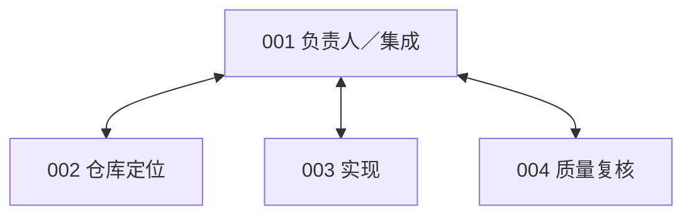
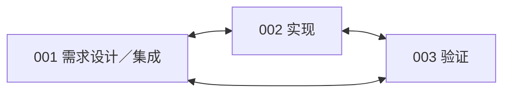
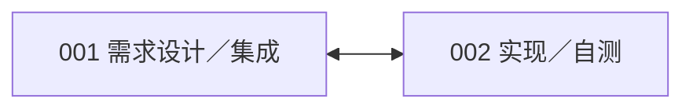
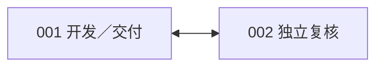
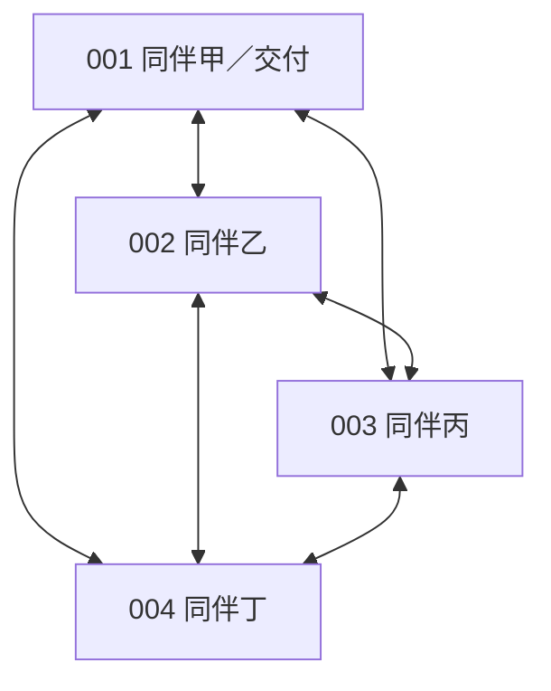
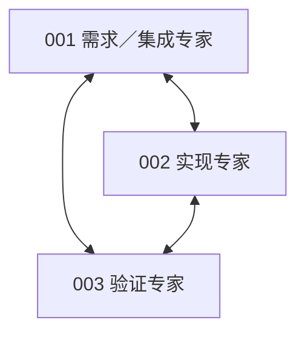

# 单模型评测结果与六类协作方案汇总

## 一 评测结果与实际消耗

| 模型与条件             | 每题累计token上限 | 代码通过／已评分 |      代码通过率 | 平均实际输入＋输出token | 用量均值样本数 |
| ---------------------- | ----------------: | ---------------: | --------------: | ----------------------: | -------------: |
| Qwen3.5-9B REF FIX5M   |             500万 |           30／50 | **60.0%** |     **3,547,718** |             50 |
| Qwen3.5-9B REF FIX10M  |            1000万 |           32／50 | **64.0%** |     **5,695,758** |             50 |
| DeepSeek Flash REF     |             500万 |         333／391 | **85.2%** |     **1,915,458** |            429 |
| DeepSeek Flash PROJECT |             500万 |         280／356 | **78.7%** |     **2,264,569** |            433 |

全部使用思考模式、单Agent；上下文131072、单次输出上限32768。Qwen两档为同一50题、12仓库的开发校准面板，采用相同FIX执行修订。DeepSeek两组各计划500题，表内通过率只使用已有官方评分的任务；未评分记录继续保留，不能将表内比例称为完整500题成绩。不同模型的题目覆盖也不同，不能据本表直接公平排名。

DeepSeek的REF和PROJECT都基于OpenHands：REF使用原生工具与流程；PROJECT增加ProWorkSim的受管工具、版本、测试证据和交付规则。**15道受同步故障影响但官方代码评分通过的Matplotlib题，已包含在PROJECT的280题中**；另1道受提交前预算门影响的pytest题也已计入。不能再次相加。项目合法交付仍单独记为264题，不改变代码通过数。

## 二 实际token差异的原因

### Qwen 5M与10M

平均消耗由354.8万升至569.6万，增加214.8万，增幅60.5%。**主要原因是调用轮数增加，每轮再次计入上下文，并非单次上下文上限变大。** 平均请求数从135.96升至217.84，增加60.2%；每次平均输入仅从25,476升至25,555 token，增加0.31%。平均输入增加210.3万，占全部用量增量的97.9%；平均输出仅增加4.49万。

预算放宽后，预算预约不足终止的任务从21题减少到15题，但额外消耗没有全部转化为修复收益：成功数只从30升至32；停滞终止从1增至4，另有1题达到调用上限。例如astropy-7671两档都成功，消耗却从135.6万增加到995.7万，请求从64增加到428。该例说明更大预算可能伴随大量未增加最终成功数的工作，不能把增加的token都视为有效推理。

输出达到32768且全部为思考的请求由44次增加到64次，仍是需要处理的适配风险；但这类请求的账单净增只占总体增量约1.54%，不是本轮两组平均差的主要来源。两档是独立初态运行：38题10M消耗更多，12题反而更少，不能把它们当成同一轨迹在5M处暂停后继续。

依据：[Qwen逐题用量分解](../../artifacts/software-benchmark-v103/token-difference-r1/qwen-summary.json)。

### DeepSeek REF与PROJECT

PROJECT平均消耗226.5万，比REF的191.5万高34.9万，增幅18.2%。其平均输入为223.5万，对比REF的187.6万；平均输出却更少，为2.98万对比3.99万。**差额集中在输入，而不是生成正文或思考输出更多。**

为避免两组用量样本不同造成误判，进一步比较双方都实际调用且账单完整的420道同题：REF平均192.0万，PROJECT平均227.6万，PROJECT仍高18.5%。平均请求数反而从58.17降到30.35；每次平均输入从32,325升至73,996 token，达到2.29倍。共同有评分结果的347题中，PROJECT平均消耗仍高20.6%。

这说明PROJECT每次决策携带的信息更重。受管工具说明、状态与历史呈现、上下文压缩方式及模型行为都可能参与其中；当前是总输入计量，尚未将各项独立分词或做消融，不能把全部18.5%归给某一条规则。原生shell一次还可组合多项操作，所以更少的API调用不代表完成了同样多的实际工作。

依据：[DeepSeek配对成本分解](../../artifacts/software-benchmark-v103/token-difference-r1/deepseek-summary.json)。

## 三 DeepSeek未通过任务与接口修订

已核查原始面板58道REF、76道PROJECT未通过任务，所有候选均成功应用，现有官方回执未标记基础设施失败。按测试结果，REF有49题仍未修好目标缺陷、4题仅出现既有功能回归、5题两者兼有；PROJECT相应为64、7、5题。这是官方测试分类，不能仅据此断言每题的根因都在模型。

**已证实的系统性影响有两项。** REF有16道未通过题因累计token预约不足结束，PROJECT有3道；预算截断不代表增加预算后必然成功。另有7道未通过的Matplotlib PROJECT题遭遇测试前同步权限故障，公开测试未能执行，与前述15道代码通过题属于同一个接口缺陷。它们的最终官方代码评分仍未通过，不能因接口出错就改计成功。

**公开测试的覆盖也有限。** 6道PROJECT题在最终版本的公开全库测试通过后，仍未通过官方验收：其中5道Django实际执行约1.58万至1.61万项测试，1道sklearn记录26767项通过。并非只跑了简单检查或引用旧版本测试；原仓库测试没有充分覆盖本题新增要求。抽样可定位到Django预取切片行为不完整、sklearn没有保留转换器输出索引、Django SSL参数传递方式不符等具体问题。生成中曾出现依赖错误，也不能自动解释最终评分失败；例如该SSL题最终已进入参数断言阶段。

双方都有官方结果的347道同题中，265题均通过、46题均未通过、28题仅REF通过、8题仅PROJECT通过。这个配对子集可辅助定位差异，但不替代完整500题面板。

接口修订使用新v103路径：复用已修正的原子文件同步，避免对未修改的外来属主文件执行chmod；测试前普通权限拒绝明确返回“未执行”，保留RPC通道供后续显式请求使用；保留nullable cursor参数恢复。另对DeepSeek PROJECT新增剩余预算输出上限：完整输入仍可容纳时，缩小实际输出预约，不再仅因凑不齐32768输出额度而立即停止。这不扩大500万预算，也不自动提交。**已通过7项接口CPU、8项预算CPU和1项SDK脚本集成控制，未部署或重新评测，不能宣称补回历史成功率。** [修订与验证说明](software-benchmark-v103-managed-interface-repairs-r1.md)

依据：[134道未通过题分类](../../artifacts/software-benchmark-v103/deepseek-failures-r1/summary.json)、[逐题明细](../../artifacts/software-benchmark-v103/deepseek-failures-r1/rows.json)、[同版本公开测试与官方断言证据](../../artifacts/software-benchmark-v103/deepseek-failures-r1/failure-findings.json)。原候选、成绩及历史交付记录保持原样。

## 四 六类固定协作方式

以下来源均来自此前提供的组织方式清单，按当前coding任务做固定人数适配，并非原论文的完整复现。每小点的图、分工和实现对应同一个方案。双向线表示允许的直接消息、补丁交接和责任转交通路；行动顺序在各点中说明，不由箭头暗示。各图001为最终交付成员，公开任务板与固定补丁仍是团队共同信息通道。

### 1 集中负责人 CHIEF 4人

**来源：Tao等，MAGIS，NeurIPS 2024**，采用负责人、仓库定位、开发与质量复核四类角色，体现所列主程序员团队的集中协调思路。[原文](https://proceedings.neurips.cc/paper_files/paper/2024/hash/5d1f02132ef51602adf07000ca5b6138-Abstract-Conference.html)

本组由001规划、分派与集成，002定位，003实现，004复核。程序强制星形直接通信和对应行动窗口；成员的公开固定补丁仍可相互查看。固定四人及星形边界是项目适配，不将原论文的动态开发者安排原样搬入。

### 2 职能流水线 SOP 3人

**来源：Mintzberg的职能分工与标准化协调，以及Hong等的MetaGPT，ICLR 2024。** 借鉴按职责和标准作业流程交接工作的方式。[组织设计来源](https://pubsonline.informs.org/doi/10.1287/mnsc.26.3.322)、[MetaGPT原文](https://proceedings.iclr.cc/paper_files/paper/2024/hash/6507b115562bb0a305f1958ccc87355a-Abstract-Conference.html)

本组将设计与集成合并给001，002实现，003验证。三人均可双向反馈，调度按设计→实现→验证→集成推进；流水线约束行动窗口，通信并非只能单向流动。

### 3 阶段对话链 DIALOGUE 2人

**来源：Qian等，ChatDev，ACL 2024**，借鉴通过角色对话串联设计、编码和测试阶段的chat chain。[原文](https://aclanthology.org/2024.acl-long.810/)

本组压缩为001需求设计与集成、002实现与自测，在设计、实现自测、交付确认三个阶段内轮流行动。阶段调度由程序执行，消息与交接仍由Agent实际发起；未复现论文完整角色集合。

### 4 开发复核返修 REVIEW 2人

**来源：Bacchelli与Bird，Expectations, Outcomes, and Challenges of Modern Code Review，ICSE 2013**，借鉴开发与复核分离、根据反馈返修的工作闭环。[原文](https://www.microsoft.com/en-us/research/publication/expectations-outcomes-and-challenges-of-modern-code-review/)

001开发并交付，002独立复核；程序交替安排开发→复核→返修→反馈窗口。复核是角色提示，不额外禁止其修改自己的私有工作区；复核意见不能代替同版本测试。人类复核研究也不直接证明本组LLM协作收益。

### 5 扁平同伴协作 PEER 4人

**来源：Wageman，How Leaders Foster Self-Managing Team Effectiveness，Organization Science，2001**，借鉴团队在共同目标与设计边界内自主安排工作和责任。[原文](https://pubsonline.informs.org/doi/10.1287/orsc.12.5.559.10094)

四名成员全互联，按固定顺序轮转，自主决定分工。001只兼任最终交付出口，不获得额外管理权或私有信息访问权。四人全连接图与轮转配额属于项目设计，而非该人类研究给出的算法。

### 6 专家会诊 COUNCIL 3人

**来源：Chen等，AgentVerse，ICLR 2024**，借鉴专家角色配置、协同决策和反馈迭代。[原文第2节](https://proceedings.iclr.cc/paper_files/paper/2024/file/578e65cdee35d00c708d4c64bce32971-Paper-Conference.pdf)

001负责需求与集成，002负责实现，003负责验证。程序先安排共同会诊，再进入实现→验证→集成窗口；成员和角色固定，不动态招募或替换。其通信图与SOP相同，差别在讨论阶段和行动配额，不照搬原论文coding实验的通信结构。

六组共同使用OpenHands与ProWorkSim受管harness：每人独立会话、私有工作树与历史；固定补丁公开，采用他人成果须显式合并。全队共享一份预算B，不随人数倍增；只评价001的唯一最终代码候选，并另记合法交付。成员数、通信边、调度窗口及提交权限由程序强制，岗位职责主要由提示表达。

新版已通过22项CPU控制及2人／3人SDK脚本会话控制，尚未开展真实协作评测；当前按工作机会依次推进，未验证模型请求或测试的物理并行。正式模型、团队预算与实验矩阵仍待确定。六组同时改变人数、分工和调度，未来分差应解释为整套方案的效果。

实现依据：[六组配置](../../config/software-fixed-organizations-v065.json)、[组织目录](../../src/proworksim/software_fixed_organization_v065.py)、[受管规则](../../src/proworksim/software_fixed_organization_world_v065.py)、[调度](../../src/proworksim/software_fixed_organization_runtime_v065.py)、[机制验证](../../artifacts/software-fixed-organization-v065/validation-r2/validation.json)。
