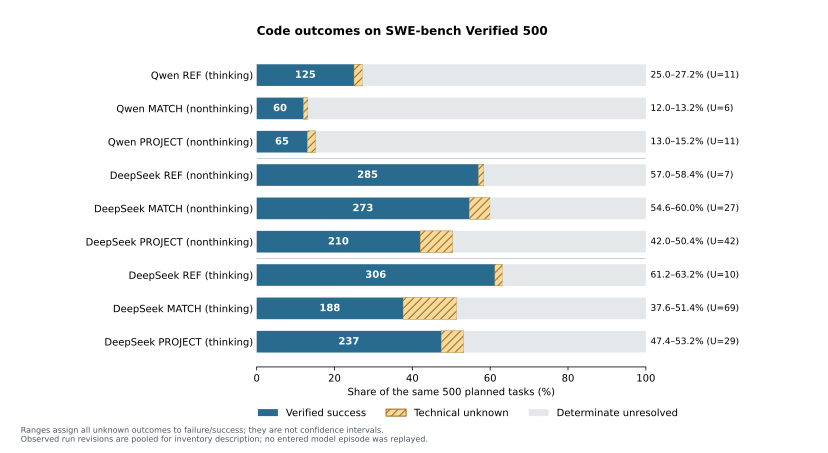

# 九组实验结果与 ProWorkSim 环境影响分析 r1

日期：2026-10-23，Asia/Shanghai。本文汇总已结束的 Qwen 三组、DeepSeek 六组，以及已完成的有限异常处理。分析只读取已保存记录，没有重新启用模型、GPU、训练或评测任务。

## 结论先行

本轮可以支持三项不同的判断：

1. **Qwen 的显著下降主要出现在 REF→MATCH。** 该变化同时包含思考模式、上下文、输出、采样、数值后端和请求时限；MATCH→PROJECT 的代码结果没有显示同样量级的额外净下降。
2. **DeepSeek 非思考模式存在明确的项目执行层损失。** 同资源的原生 MATCH 已知成功 273 题，PROJECT 为 210 题。即使将全部未定结果按最有利于 PROJECT 的方式补齐，PROJECT 仍至少低 4.2 个百分点。这是本轮“项目环境确实影响解题能力”最强的整组证据。
3. **思考模式与短输出限制、历史处理存在显著交互。** DeepSeek 原生 MATCH 思考组出现大量截断、空摘要及工具历史异常。PROJECT 思考组观测结果高于该 MATCH，但完整面板差值范围跨零，不能据此认证项目接口更优。

**项目的设计对象是多智能体协作，而本轮测量的是这套协作型环境由单人使用的表现。** 它保留了成员隔离、任务责任、版本化产物、定向信息、团队预算和可审计交付。能够确认的是这些机制的具体执行语义，以及 S1 条件下的接口负担；本轮没有真实伙伴，不能估计分工、交叉检查、成果复用或并行推进的团队收益，也不能把 PROJECT 分差直接称为“多智能体协作损失”。

项目环境的影响还体现在交付和成本：65／210／237 个 PROJECT 代码成功中，分别有 17／38／52 个最终版本缺少该版本的合法交付证据；项目组 API 输入缓存命中明显更低。代码质量、交付闭合、接口实施缺陷和运行成本必须分别报告。

## 1. 任务、口径与运行版本

全部条件使用 SWE-bench Verified 官方 test 固定版本 `78f471bf655a3137b2e8a75af1501690ec009ec3` 的同一 500 题，覆盖 12 个仓库，其中 Django 231 题。九组是 4,500 个计划槽，不是 4,500 个不同问题。均为一个实际 Agent，没有项目训练适配器、额外解题 Agent 或训练更新。

Qwen 使用原始 Qwen3.5-9B 检查点。DeepSeek 使用官方 API 别名 `deepseek-flash`；本地账本中 82,875 条有响应身份的记录均报告同一 `system_fingerprint=e72d3c7f663d3e1383b00b3884cb4501`，另两条历史响应未知不能纳入这个断言。提供方指纹不是可校验的权重哈希。

代码结果统一取事前规定结束边界后、可信静止时锁定的唯一最终工作树，由官方评分器评分。**PROJECT 即使未正式提交，最终工作树仍可以取得代码成功。** 项目合法交付另记 `R_delivery`，要求最后合法提交的证据及该提交的官方判定；REF、MATCH 无此合同，交付列不适用。

运行中存在已披露修订。Qwen 1,500 槽实际 binding 分层为 r3/r4/r5/r6/r7/kernel-r6 的 3/14/3/19/1,149/312 槽，原队列明确标记混合运行版本。DeepSeek 存在前缀计数、原思考字段、金额预约等适配修订；末尾少数评分又使用独立 r6 执行修订。以下是**完整计划面板的累计审计结果**，保留逐槽来源，不能视作所有题从头到尾均执行同一个程序的单版本结果。

原结果和异常没有被覆盖。22 个原评分未知端点完成同候选恢复；只有六个有充分零模型调用证据的前置失败槽独立接续首次模型执行，其中三个形成新候选并完成首次评分。没有重采已经进入模型的失败回合。

## 2. 九组代码结果

每组分母固定为 500。下表“未定”包含生成未形成可信候选和评分未形成明确结果；**不是正常失败**。“结果范围”将全部未定分别按失败和成功补齐，是缺失结果的逻辑边界，不是 95% 置信区间，也不使用已闭合子集比率替代完整面板。

| 模型／模式 | 条件 | 已知成功 | 确定未解决 | 未定：生成＋评分 | 500 题结果范围 |
| --- | --- | ---: | ---: | ---: | ---: |
| Qwen：REF 思考 | REF | 125 | 364 | 7＋4＝11 | 25.0%—27.2% |
| Qwen：非思考 | MATCH | 60 | 434 | 4＋2＝6 | 12.0%—13.2% |
| Qwen：非思考 | PROJECT | 65 | 424 | 4＋7＝11 | 13.0%—15.2% |
| DeepSeek 非思考 | REF | 285 | 208 | 2＋5＝7 | 57.0%—58.4% |
| DeepSeek 非思考 | MATCH | 273 | 200 | 20＋7＝27 | 54.6%—60.0% |
| DeepSeek 非思考 | PROJECT | 210 | 248 | 36＋6＝42 | 42.0%—50.4% |
| DeepSeek 思考 | REF | 306 | 184 | 6＋4＝10 | 61.2%—63.2% |
| DeepSeek 思考 | MATCH | 188 | 243 | 66＋3＝69 | 37.6%—51.4% |
| DeepSeek 思考 | PROJECT | 237 | 234 | 28＋1＝29 | 47.4%—53.2% |

全库存现有 4,327 个生成闭合、173 个生成技术未知，4,288 个明确代码评分、39 个代码评分未知。这里不计算九组混合通过率。各组同题独立重复未开展，本轮也不能作为生成稳定性认证。

来源：[逐题 CSV](../../artifacts/software-benchmark-v055/final-result-analysis-r1/slot-results.csv)、[分组汇总](../../artifacts/software-benchmark-v055/final-result-analysis-r1/summary.json)、[异常恢复原汇总](../../artifacts/software-benchmark-v055/exception-reconciliation-r1/final-summary.json)。

## 3. 三种条件实际改变了什么

| 条件 | 实际 Agent／接口 | 上下文与单次输出 | 研究含义 |
| --- | --- | --- | --- |
| REF | OpenHands SDK/tools 1.49.6 原生 Agent/Conversation；Terminal、FileEditor、TaskTracker、Think、Finish；原生历史摘要 | 总窗口 131,072，输入上限 98,304，完整输出上限 32,768 | 预先选定的外部参照配置；不是已找到的官方 Qwen9B 论文复现包 |
| MATCH | 与 REF 相同的工具、system 模板、终端执行和 condenser 算法 | 总窗口 18,432，输入上限 16,384，完整输出上限 2,048 | 将原生接口置于项目的推理及可匹配资源配置 |
| PROJECT | ProWorkSim 实际 S1 World、受管工具、Γ1 观察组织、分页及合法交付流程 | 与相应 MATCH 相同 | 测量项目定制执行层整体影响，包含工具、说明、历史、执行和交付 |

共同上限为每题 500,000 输入＋输出 token、128 次实际模型尝试、128 次 Agent 决定、90 分钟软期限和 100 分钟硬期限。Agent 与原生 condenser 共用账本；思考 token 也占输出和总预算。模型开始新请求前预约完整输入与最大输出，余额不足时可在尚余少量 token 的情况下停止。

Qwen REF 是 vLLM 0.32.0、开启思考、temperature 0.6／top_p 0.95／top_k 20；MATCH 与 PROJECT 是 CalibrationActor 的 BF16 骨干／FP32 输出头、关闭思考、0.7／1／0。REF 单次请求配置为 1,800 秒，MATCH／PROJECT 为 600 秒。因此 Qwen 的 REF→MATCH **不能拆成纯上下文损失或纯输出长度损失**。

DeepSeek 每个 arm 分思考和非思考。思考组发送 `thinking=enabled, reasoning_effort=high`，不发送不适用的 temperature；非思考 REF 为 temperature 0.6，MATCH／PROJECT 为 0.7。官方 API 不提供本批可用的 seed/top_k 控制，实际不发送这些字段。2,048 是思考与最终动作共享的完整输出上限，不是思考后另外赠送 2,048 个答案 token。

所有条件都没有浏览器、联网搜索、MCP 或子 Agent。原生 terminal 只能在隔离工作区中使用本地能力。隐藏参考修复、官方验收和评分反馈只在评测侧，不接入 PROJECT 的公开测试。

精确配置、历史来源和 schema 证据见 [条件事实表](software-benchmark-v055-condition-interface-facts-r1.md)。

## 4. 项目环境的规则与接口：能力、成本和缺陷分别看

| 项目维度 | 原生 REF／MATCH | PROJECT 的当前实际规则 | 已观察影响与解释强度 |
| --- | --- | --- | --- |
| 仓库定位 | 可用持久 shell 组合 ls/find/grep/脚本，在一次工具调用中跨文件筛选 | 文件列表最多 40 项且受 4,096 字符界限；读取最多 180 行／4,096 字符；`search_file` 仅对一个 UTF-8 文件做字面匹配，无仓库级 grep 工具 | Qwen PROJECT 的 12,977 个记录动作中，7,703 个是 list_files（59.36%），其中 7,626 个带 cursor。定位／翻页实际占用了大量动作；这是动作占比，不是 token 份额或已证明的分数损失份额 |
| 单次行动 | 工具执行本身串行，但一个 shell 命令可组合多次搜索、修改和测试 | 普通响应必须恰好一个合法工具调用；格式拒绝也计入机会和费用 | 相同 128 次模型调用不是相同工作机会。Qwen 有 258 次空 cursor 引起的 minLength 拒绝，说明导航参数与模型行为之间存在实际摩擦 |
| 文件修改 | 编辑器与 shell 能操作多文件、脚本、二进制及权限 | 已支持写入、唯一替换、新建、删除、改名；文本编辑限 UTF-8；没有任意 binary-write、chmod 或 symlink-create | 不能继续把“无法新增／删除／改名”当成本轮低分原因。完整保留二进制／链接／模式与允许模型创建或编辑这些对象是两件事 |
| 运行与验证 | 可选择公开测试子集，执行最小复现和仓库内合法脚本 | run_tests 使用事前配置入口，无任意命令／自选 argv；最多 32 次 | 正常 PROJECT 回合实际最多测试 Qwen 4／Deep 非思考 5／思考 2 次，32 次配额没有触顶。应考察固定入口、验证粒度和反馈取得，而非将当前分差归为测试次数配额太小 |
| 输出与历史 | terminal 也可能截断大输出；原生 LLM condenser 总结历史 | 测试正文每页 3,072 字符，需要继续读取；Γ1 去重、引用及完整轮次投影，没有新增原生 condenser | 项目增加翻页成本，同时避免了本批原生短输出思考 condenser 的一类空摘要问题。两种效果可能同时存在，不能只把分页当作无条件负效应 |
| 代码差异查看 | shell git diff／原生编辑器的实际功能 | 受管 diff_workspace | **发现 schema 与执行器不一致**：正式 schema 仍允许 offset/max_chars/source_reference，而实际执行器只接 cursor；Qwen／Deep 非思考／Deep 思考的正常闭合轨迹分别记录 3／103／260 次 unexpected keyword。模型使用已公开参数却被拒绝属于实施缺陷，不是应由模型遵守的设计限制 |
| 最终交付 | 原生 finish 后锁定最终树 | staff_done 不自动提交；需要同版本公开测试→固定补丁→显式提交 | 对已有正确代码有可直接计数的闭合缺口，见下一节。要求的是该版本运行过公开测试，不要求公开测试全部为绿 |

本轮已取消旧 200 文件／2 MB 来源限制。当前默认准入为文件数量不限、总源码 1 GiB、单文件 256 MiB，新增／删除／重命名能力已在正式模型成绩之前修复并冻结。没有证据支持把旧缺陷当成这九组的当前能力边界。

导航成本也有明显的模型差异：DeepSeek 非思考／思考正常 PROJECT 回合的 list_files 仅为 116／138 次，不能把 Qwen 的 59.36% 当作所有模型的固定分页代价。Qwen 的 1,339 次 search_file 显式拒绝中，1,328 次路径不存在、11 次路径不规范；普通无命中返回的是成功结果和空 matches。路径选择错误与“搜索之前必须知道单文件路径”的接口条件共同存在，不能把所有拒绝改称执行器故障。

必须另外区分真正的执行完整性异常：例如原 DeepSeek 生成未知中 54 个“同一工作机会第二次决定”中止，与可返回反馈的普通格式拒绝不同。前者未取得可信最终候选，保留未知；后者可能经后续行动恢复，不能把每次格式拒绝都算成一次任务失败。工具、分页、版本和交付规则的设计取舍，也不能与这些实施不一致混为一类。

操作频数、真实请求 schema 与执行器签名、格式分类和停因的详细来源见 [执行机制证据](software-benchmark-v055-score-gap-evidence-r1.md)；其正常闭合机制频数覆盖原首轮 4,324 个回合，新增三个有限恢复闭合结果在主计分中单独连接。

## 4.1 面向多智能体协作的组织层：引入了什么、实际影响是什么

原生 REF／MATCH 的执行单元是一个 Agent 加一个工作区；PROJECT 另外显式建模成员、责任、私有版本、消息、固定产物、交付和团队资源。这些机制服务于多人协作中的隔离、归属和可信记录。单人条件仍继承了组织层，但并未因此获得团队协作收益。

| 引入的机制 | 实现规定的作用 | 本轮 S1 的状态与影响 |
| --- | --- | --- |
| 成员身份、私有工作区与权限 | 共享源基线，各成员在自己的版本化副本探索；发布的是确定版本，后续私有修改不会自动传播 | 实际只有 member_001；出生、退休和委派工具被移除，不能招募伙伴。隔离和版本规则仍存在，避免模型仅凭自述改变来源或权限 |
| 可选任务板与责任协议 | 自主拆任务、领取、修订和版本化依赖；责任转交需 offer／accept，消息不自动变更 owner | 可直接编辑并用 fix_patch(task_ids=[]) 固定，不必先建立任务板。本轮没有跨成员分工，不能把任务管理步骤写成所有修复的强制成本 |
| 定向消息与受限信息 | 消息、补丁交接有接收者；事件回读按身份授权；私有历史只含自己实际见过的记录 | 通信及责任转交工具仍可见，recipient 甚至枚举 001–006，但实际 registry 仅有 001；发送要求另一个 live 成员，因此没有合法协作对象。可见 schema 比实际可执行范围更宽 |
| 固定补丁与显式合并 | 绑定作者、基线、源版本、内容身份；合并遵循三方规则，保留冲突和来源 | 可以发布自己的产物；本轮没有真实跨成员补丁复用或冲突集成。固定版本仍是合法交付的前提之一 |
| 同版本测试、固定、提交 | 防止用旧版本或合并前测试证明新版本；工作树、公开补丁和交付分别记账 | 最后编辑后仍需完成新版本闭合；staff_done 不自动提交。已观察到正确最终代码缺同版本交付证据，能够直接量化这一缺口 |
| 团队预算与真实工作机会 | 模型、测试和工作机会统一计量；组织操作、回读和格式修正也消耗实际资源 | N=1 时一个成员使用全额预算；不存在分配给其他模型的预算消耗，但管理与回读仍可能挤占其修复机会。相同调用上限不意味着相同操作量 |
| 审计记录与私有工作台 | 区分客观世界事件与模型笔记／todo；记录 actor、版本、操作、责任与测试证据 | 能定位“代码已修好但未交付”、非法参数和来源问题；为后续协作归因和学习提供记录基础，但本轮没有验证训练或长期信用分配收益 |

**33 个可见工具并不等于 33 个同等可用能力。** 当前为 27 个世界工具＋4 个私有工作台工具＋staff_wait／staff_done；原生为五个工具，但一个 shell 命令可以组合多项工作。PROJECT 中 send_message、handoff_patch、offer_transfer、accept_transfer、decline_transfer 保留了协作语义，却没有本轮可用的跨成员对象。其说明和 schema 确实进入模型输入；因此可能增加选择复杂度，但未测过移除这些入口后的边际 token 或分数变化，不能仅用工具数量推导损失。

实际使用记录进一步限定了归因。下表复用原正常闭合 PROJECT 的 496／464／472 题摘要；数字是进入受管执行的调用次数，不是独立任务数。它不覆盖生成技术未知，也不把派发前格式拒绝算成已执行世界动作。

| 操作 | Qwen | DeepSeek 非思考 | DeepSeek 思考 |
| --- | ---: | ---: | ---: |
| 创建／领取／归还任务 | 7／5／1 | 0／0／0 | 0／0／0 |
| 修订任务、声明／解除依赖 | 0 | 0 | 0 |
| 跨成员消息、补丁交接、责任转交、补丁合并 | 0 | 0 | 0 |
| 固定补丁 fix_patch（其中显式拒绝） | 121（4） | 345（12） | 267（6） |
| 正式提交 submit_integration（其中显式拒绝） | 113（4） | 312（8） | 227（0） |
| 私有历史搜索（其中显式拒绝） | 29（11） | 508（133） | 387（146） |
| 私有历史原文回读 | 0 | 27 | 8 |

因此，本轮没有证据把低分解释为大量实际“成员沟通／任务转交开销”。跨成员协作没有发生；直接观察到的成本主要位于代码定位和回读、受管工具与历史处理、版本发布及交付闭合。任务板是可选机制，两个 DeepSeek PROJECT 条件根本未执行这些任务板操作；其分差不能归因于反复建任务或维护依赖。未使用的协作 schema 可能造成认知或输入负担，但这只是待消融解释。

这些机制有实质用途，不应因为单人基准分数而一概取消。例如私有版本和明确合并使成员能分别探索而不实时覆盖彼此；同版本证据防止错误归因；任务责任与事件记录为分析谁实际完成何种工作提供依据。不过，是否减少重复劳动、是否提高多人完成率、是否值得其协调费用，均需要真正团队条件才能回答。当前结果只给出进入团队前的单人成本与能力基线。

后续若评价协作价值，应在相同总团队预算、同题和同一环境版本下比较 S1 与多成员条件，保留代码及交付双端点，记录实际并行时间、通信费用、固定补丁接受／合并、冲突、重复工作和贡献来源。组织负担应通过单独的可见工具／闭合协议消融定位；不能同时放宽资源、改变工具再把提升全称为协作收益。本次只提出识别方法，没有启动额外实验。

事实及源码见 [协作环境组成与 S1 边界](software-benchmark-v055-collaboration-environment-facts-r1.md)，频数及统计边界见 [协作操作成本](../../artifacts/software-benchmark-v055/score-gap-evidence-r1/collaboration-operation-costs.json)。

## 5. 项目环境的整组净影响：同题配对证据

下表差值均为 PROJECT−MATCH。共同可判子集只作辅助诊断，未替代完整 500 题。

| 模型／模式 | 已知成功数之差／500 | 完整 500 题差值边界 | 共同可判题数 | PROJECT 独胜／MATCH 独胜 |
| --- | ---: | ---: | ---: | ---: |
| Qwen 非思考 | ＋1.0 pp | −0.2～＋3.2 pp | 485 | 42／37 |
| DeepSeek 非思考 | −12.6 pp | **−18.0～−4.2 pp** | 434 | 33／75 |
| DeepSeek 思考 | ＋9.8 pp | −4.0～＋15.6 pp | 405 | 55／25 |

DeepSeek 非思考的负向结果最明确：共同可判题中 MATCH 独胜远多于 PROJECT 独胜，完整未定边界也全部小于零。仓库分层中有七个仓库的差值上界仍严格小于零，另两个上界为零；并非仅由单个 Django 仓库净差造成。但小仓库样本数很小，不能把分层方向称为对所有未来仓库的保证，也不能改用仓库等权平均替换既定 500 题主面板。

这里确认的是**实际项目执行层这一组合的净差异**。无 shell、定位分页、固定测试入口、历史投影、schema 实施错误和预算机会均可能共同参与；本轮没有逐项消融，不能把 −12.6 pp 全部分配给某一条规则。

Qwen 的 MATCH 和 PROJECT 已知分数接近，不能据此说所有接口限制无代价；更可能的解释之一是两组共同的短输出、非思考和数值／时间配置已构成主要瓶颈。这个“共同瓶颈”解释符合配置和停因，但仍是解释性推断。

DeepSeek 思考组中 PROJECT 相对 MATCH 的观测优势，与“项目不用原生 LLM condenser，避开一部分短输出思考压缩故障”相容。该组还有不同的未知比例、提示和工具规则，完整边界跨零，故不能把 +9.8 pp 当成 Γ1 或受管接口的确定收益。

来源：[全部配对表](../../artifacts/software-benchmark-v055/final-result-analysis-r1/paired-comparisons.json)、[仓库分层](../../artifacts/software-benchmark-v055/final-result-analysis-r1/repository-strata.csv)。

## 6. 交付约束的实际影响

| PROJECT 条件 | 代码成功 | 合法交付成功 | 最终成功代码具有同版本合法交付 | 最终成功代码缺该版本合法交付 |
| --- | ---: | ---: | ---: | ---: |
| Qwen | 65 | 48（500 题的 9.6% 已知下界） | 48 | **17／65＝26.2%** |
| DeepSeek 非思考 | 210 | 173（34.6%） | 172 | **38／210＝18.1%** |
| DeepSeek 思考 | 237 | 185（37.0%） | 185 | **52／237＝21.9%** |

Qwen 的 17 个、DeepSeek 思考的 52 个都没有合法提交；DeepSeek 非思考为 37 个没有提交、另 1 个最终版本没有合法交付，但较早合法提交也通过了官方评价。该题为 `sympy__sympy-21847`，最后树 v5 与合法提交 v3 的内容身份不同。因此 210−173＝37 不能完整表示“最终正确版本未交付”的 38 个。

本批已知记录中没有观察到 code=0 且 delivery=1。未知仍保留：Qwen／Deep 非思考／Deep 思考的生成未知分别为 4／36／28，Deep 非思考另有 3 个交付评分未知。正常闭合且没有合法提交属于交付失败，不是评分待运行。

这说明交付流程确实让一部分正确代码没有形成项目认可的最终版本交付。由于三组代码端点本身允许未提交树评分，PROJECT 的代码下降与上述交付缺口是不同问题；不能只修复“自动提交”就声称已经弥补 MATCH→PROJECT 的代码解题差距。

来源：[逐版本交付交叉表](../../artifacts/software-benchmark-v055/final-result-analysis-r1/project-delivery.json)。

## 7. 资源配置与思考输出如何参与分差

Qwen REF→MATCH 的已知成功下界下降 13.0 pp，完整差值边界为 −15.2～−11.8 pp。共同可判 485 题中，REF 独胜 79 题、MATCH 独胜 14 题，下降明确，但同时变动字段很多，无法由本轮拆出独立贡献。

也不能把 Qwen 下降直接解释为大量答案撞到 2K 截断：正常 MATCH 中 Agent 输出恰达 2,048 的只有 23 次，PROJECT 为 18 次；MATCH 的调用中位数为 40，REF 为 24，且 MATCH 的 491／496 个正常回合触发 condenser。它更提示历史压缩、输入预算、非思考和数值／等待条件的共同变化；没有单因素实验，不能从该相关模式确定唯一原因。

原正常闭合摘要中，Qwen REF 的 493 题有 469 题因下一次完整输入＋输出预约不足结束；MATCH 的 496 题同样有 469 题。PROJECT 的 496 题中有 335 题因总 token 预约不足、16 题因 context 边界停止，另有 36 题触发排队期限。预算终止也可能留下成功代码，这些频数是工作过程证据，不是失败题数。它们说明受限调用机会和宿主等待真实参与了本轮，不能把所有低分都说成底座完全没有修复能力。

DeepSeek 非思考 REF 与 MATCH 的完整差值边界为 −3.8～＋3.0 pp，共同可判 469 题中双方各独胜 50 题。该模式下没有足够证据证明压缩到 MATCH 资源后产生确定净损失。

DeepSeek 思考 REF→MATCH 的完整边界为 −25.6～−9.8 pp，下降明确；MATCH 内思考−非思考边界为 −22.4～−3.2 pp。已有具体过程证据：

- 原正常闭合的 434 个 MATCH 思考任务中，405 个触发 condenser。2,867 次压缩中有 484 次空 content、875 次 `finish_reason=length`，空摘要涉及 236 题。原非思考 MATCH 的 1,347 次压缩没有空 content 或 length 结束。
- MATCH 思考原 66 个生成未知中，37 个是工具参数 JSON 解析错误，36 个末响应因 length 结束；这些末响应 73,812 个完整输出 token 中有 68,456 个是 reasoning。另有 15 个工具消息配对、10 个 reasoning 历史问题。
- PROJECT 思考的正常闭合样本中，4,037 次可恢复格式拒绝覆盖 458 题；其中 3,359 次要求完整非截断 choice，3,343 次输出恰好达到 2,048 token。拒绝调用的 reasoning 占完整输出约 98.79%。非思考对应 318 次拒绝中仅 2 次属于截断类。

这些记录支持：2,048 完整输出限制下，high thinking 会与最终工具参数、摘要正文争用输出，压缩和格式恢复又额外消耗机会。它并不证明把输出单独调大就一定提升多少分，也不能把真实的 SDK 历史配对、思考字段遗漏或工作机会实施缺陷全部归给模型。

REF 条件中思考−非思考边界为 +2.8～+6.2 pp，说明“思考模式本身普遍变差”不符合本轮结果。应分析思考模式与实际资源、历史及接口的组合。

## 8. 项目环境还有成本影响

下表只使用已报告用量，PROJECT 两组各有一笔历史用量未知，未填零。统一峰价费用按本轮冻结的每百万输入 miss 2 元、hit 0.04 元、完整输出 8 元重新计算，用于排除实际运行时段折扣差异；它不是提供方账单。

| DeepSeek 条件 | 已知总 token（百万） | 输入缓存命中率 | 已结账本金额（元） | 已知用量统一峰价（元） |
| --- | ---: | ---: | ---: | ---: |
| REF 非思考 | 181.68 | 94.4% | 30.47 | 42.92 |
| MATCH 非思考 | 190.93 | 90.9% | 47.43 | 66.67 |
| PROJECT 非思考 | 194.17 | 56.1% | 129.47 | 183.86 |
| REF 思考 | 183.10 | 93.9% | 42.84 | 60.53 |
| MATCH 思考 | 209.23 | 87.4% | 103.56 | 145.58 |
| PROJECT 思考 | 215.41 | 60.5% | 187.19 | 263.75 |

PROJECT 非思考与 MATCH 的已知总 token 接近，但输入未命中显著更多，统一峰价约为 2.76 倍；思考模式约为 1.81 倍。缓存未命中可以解释账目构成上的大部分差别；是否主要由 Γ1 重排、动态状态前缀或具体轨迹差异导致，需要逐请求前缀对照，不能仅由费用倒推单一原因。

六组正式槽含失败／有限恢复的已结费用共 540.95914106 元，另有资格准备 0.05128168 元，总计 541.01042274 元；历史未知和补充预约 10.48576 元使总承诺为 551.49618274 元，低于 2,000 元上限。Qwen 正常闭合 REF／MATCH／PROJECT 的已知 token 为 220,155,984／238,442,731／204,964,046，覆盖 493／496／496 题；原 15 个生成未知的成本不能填零，也不能把这三个数写成完整 1,500 题总消耗。

来源：[提供方账本统计](../../artifacts/software-benchmark-v055/final-result-analysis-r1/provider-accounting.json)、[统一峰价和缓存比较](../../artifacts/software-benchmark-v055/final-result-analysis-r1/environment-cost-comparison.json)。

## 9. 能确认什么、下一步应验证什么

**已确认的事实**包括：DeepSeek 非思考 PROJECT 的完整结果边界低于 MATCH；有大量正确最终代码缺该版本合法交付；存在真实 schema／执行器不一致；Qwen 的导航动作占比较高；短输出思考有截断与空摘要；项目输入缓存命中更低。

**具有机制依据但未单独量化的解释**包括：无跨文件搜索、分页与单动作规则增加定位成本；固定测试入口降低验证灵活性；Γ1 在短输出思考下避开原生 condenser 的部分失败，同时带来不同的信息保留和缓存行为；共同资源瓶颈压低 Qwen MATCH／PROJECT。没有逐项消融，不能给这些机制各分配一个“损失百分点”。

后续优先级应为：

1. 先修复公开 schema 与执行器参数不一致、同一工作机会二次决定等实施缺陷，并让游标的缺省／空值规则更清晰；不改变治理目的。
2. 在受管边界内改善仓库级搜索和批量定位，保留权限、分页、版本绑定和审计；不必直接开放不受管 shell。
3. 单独验证可选择的公开测试／最小复现入口；与扩大模型输出或改历史算法分开，以免再次混合因素。
4. 为同版本测试、固定和提交设计更清楚的受管闭合动作，保留原证据要求；代码端点与交付端点继续同时报告。
5. 对思考模式只做预先固定的输出／condenser 或历史处理消融，再检查质量、无效动作与成本，不能依据本轮分数不断调参后混报。

以上是分析建议，本次没有实施这些新接口变更或开启新实验。后续修订必须独立标识，原成绩保持；这 500 题已用于校准和问题定位，不应再冒充调整后方案的独立确认材料。

统计未给出“完整单版本总体正确率”的置信区间：当前仍有未定结果、多个运行修订，任务也是固定且仓库不均衡的面板。缺失边界、逐题配对、仓库分层和同版本交付证据分别回答不同问题，不能互相替代。全部分析脚本、CSV、JSON 与图均随报告保存。
