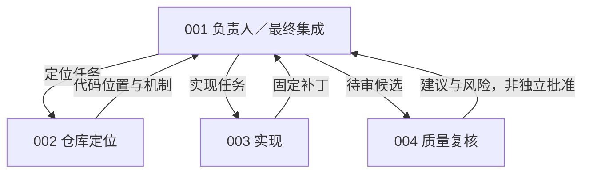
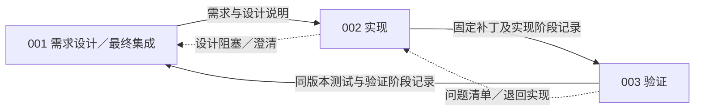
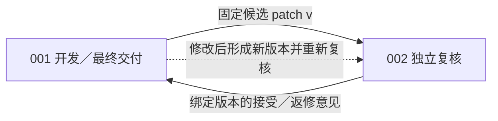
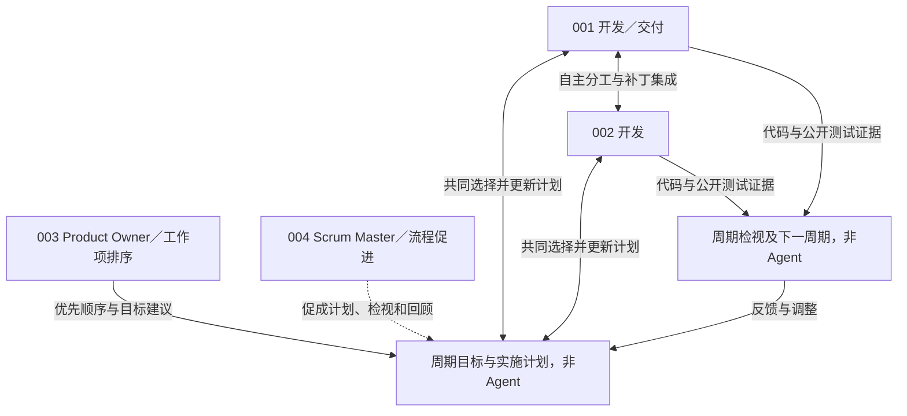
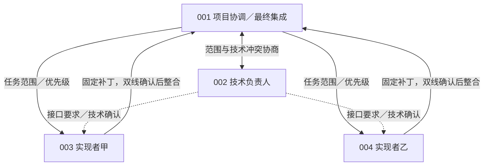

# 五组通过率与token消耗：分组原因分析

2026年11月5日更新。按用户给出的五种组织架构，将来源、关系图、同题比较和机制分析整合到各组小节。沿用v136口径：排除技术未定、未启动及全部现金截止回合，保留68项；达到团队5M token边界的可信回合仍计入。没有新增模型调用、测试、评分或运行环境变更。

**主要发现：token增量主要表现为调用轮数增加；代码失败则有两条不同路径——成员工作未进入最终候选，以及候选本身没有修对或引入回归。不能把这些都概括为“提交手续多”。** REVIEW在这个子集里略高于同题单Agent，本身不属于相对对照通过率更低的一组。

41道代码失败中，**20道最终补丁为空**（PIPELINE13、MATRIX6、SPRINT1），另外21道有修改但未通过官方验收。空补丁不等于所有成员都没有写代码；下文的具体轨迹显示，部分修改停留在伙伴工作区。

## 1. 同题通过率与token对比

token单位为**万／回合**，包含整个团队的输入、输出及摘要。S1为同题PROJECT单Agent，双方都以OpenHands为基础；团队新增成员私有状态、角色权限和组织规则。所有成员共享5M，不是每人5M。

| 组织          | 保留题数 | 团队代码通过率 | 同题S1通过率 |    团队平均token |  同题S1平均token |              增幅 |
| ------------- | -------: | -------------: | -----------: | ---------------: | ---------------: | ----------------: |
| CHIEF，4人    |       10 |    4/10，40.0% |  6/10，60.0% | **497.61** | **240.78** | **+106.7%** |
| PIPELINE，3人 |       17 |    3/17，17.6% | 11/17，64.7% | **345.92** | **215.32** |  **+60.7%** |
| REVIEW，2人   |       16 |   11/16，68.8% | 10/16，62.5% | **440.00** | **211.68** | **+107.9%** |
| SPRINT，4人   |       11 |    6/11，54.5% |  7/11，63.6% | **497.37** | **225.13** | **+120.9%** |
| MATRIX，4人   |       14 |    3/14，21.4% |  8/14，57.1% | **497.27** | **256.39** |  **+94.0%** |

每行按同题配对，不同行题集不同，五组共同仅2题。因此可比较每组相对其同题S1的差异，不能把这五个百分比当作完整50题成绩或均衡的组织排名。S1与团队还存在部署修订、恢复政策等差别，不能据此隔离纯组织拓扑的因果效应。[筛选规则及全部成本](software-benchmark-v136-cash-excluded-organization-comparison.md)

## 2. token为什么增加

| 组织     | 平均API调用：团队／S1 | 调用倍数 | 每次平均输入：团队／S1，万token |
| -------- | --------------------: | -------: | ------------------------------: |
| CHIEF    |          99.30／44.20 |   2.25倍 |                      4.99／5.43 |
| PIPELINE |          68.06／40.59 |   1.68倍 |                      5.06／5.28 |
| REVIEW   |          84.69／39.81 |   2.13倍 |                      5.17／5.30 |
| SPRINT   |         101.36／42.00 |   2.41倍 |                      4.89／5.34 |
| MATRIX   |         102.57／48.57 |   2.11倍 |                      4.83／5.26 |

五组每次输入都比同题S1稍短，累计用量却更高。按“调用次数×每次用量”分解，主要增量来自**更多次请求，每次继续携带该成员的上下文**。团队输入占总token约99.58%–99.67%，输出仅约0.33%–0.42%；摘要调用占总token约0.32%–0.54%。因此本轮主要不是回答写得过长，也不是摘要本身占用了大部分预算。

这些额外调用包含成员各自定位代码、实现、公开测试、复核和组织操作。私有历史与工作区意味着伙伴状态需要通过合法消息和补丁交接进入另一成员的工作过程；它们不会自动共享全部认识或修改。但本次没有逐条测量语义重复工作，**不能把全部增量都算成通信或重复劳动**。把某次工具调用对应的整个请求token视为该工具的净成本同样不成立。[分组token分解](../../artifacts/software-benchmark-v137/token-causes-r1/summary.json)

CHIEF、SPRINT和MATRIX保留的回合全部达到5M边界，因此平均用量接近497万还受到本次筛选规则影响：较早现金停止的回合已被排除。它说明这些留下的团队运行没有在预算前闭合，不代表继续增加预算一定提高正确率。

## 3. 按协作架构分别比较

以下五图均表示**预设的组织关系与目标流程，不是本轮已经完整发生的协作链**。所有组仍使用OpenHands及ProWorkSim受管harness；成员私有修改须显式交接、整合，唯一最终代码候选来自001。来源提供组织机制的参考，固定人数、工具、版本确认和预算规则是本项目的适配，不构成原论文或人类组织的完整复现。

### 1 集中负责人 CHIEF，4人

**来源与设计。** Baker的主程序员团队强调负责人承担整体技术责任；MAGIS提供Manager、Repository Custodian、Developer、QA四类角色参考。本组由001统一决定拆分、优先级和采用哪个补丁，002定位、003实现、004复核；复核是建议，不另设独立批准权。设计希望由专业支持减轻负责人的工作，同时保留一个最终决策中心。[Baker作者综述，2002](https://onlinelibrary.wiley.com/doi/abs/10.1002/0471028959.sof038)；[MAGIS，NeurIPS 2024](https://proceedings.neurips.cc/paper_files/paper/2024/hash/5d1f02132ef51602adf07000ca5b6138-Abstract-Conference.html)

**与同题单Agent相比：** 4/10对6/10，少通过2题，差−20.0个百分点；平均token为497.61万对240.78万，增加106.7%。代码通过4题中，2题完成合法交付。

**设计与实际的差距。** 10题中没有执行显式派工`org_assign_task`或补丁整合`integrate_patch`，63次消息尝试有38次被拒。预设的“负责人调度支持成员、再集中整合”未形成可追踪的完整链条。不过文字建议仍可能被采纳，不能把没有合并记录等同于伙伴没有贡献。

**token花在哪里、为何未转化为更高成绩。** 负责人只使用28.2%的团队token，平均140.16万；其余分配给定位、实现和复核。全队每题约51.7次文件定位，API调用99.30次，对照44.20次。总投入增加，但负责人的直接调用用量较少，伙伴帮助又需要有效传回。6道失败全部有非空补丁：4题目标未修好、1题同时产生回归、1题目标修好却破坏旧行为，例如Pytest-10081。因此问题既包括集中协调未充分执行，也包括实际代码错误，不能只靠补交手续解决。

**本组判断。** 当前没有观察到专业分工弥补额外成本；应优先检查任务身份、消息和负责人整合路径。它与PIPELINE的区别在于负责人可灵活调度，而不是必须逐阶段交接；不能用本轮执行不充分来否定集中负责人模式本身。[逐题与失败证据](../../artifacts/software-benchmark-v137/chief-pipeline-causes-r1/summary.json)

### 2 产物交接流水线 PIPELINE，3人

**来源与设计。** Mintzberg讨论以工作过程、产出及技能标准化协调；MetaGPT把SOP和中间产物用于多角色软件协作。本组据此构造001设计→002实现→003验证→001集成交付的闭环，阶段推进由交接证据决定，问题可退回处理。设计希望靠清楚的产物接口减少临时协商；三个角色及严格版本门是本项目的具体实现。[Mintzberg，1980](https://pubsonline.informs.org/doi/10.1287/mnsc.26.3.322)；[MetaGPT，ICLR 2024](https://proceedings.iclr.cc/paper_files/paper/2024/hash/6507b115562bb0a305f1958ccc87355a-Abstract-Conference.html)

**与同题单Agent相比：** 3/17对11/17，少通过8题，差−47.1个百分点；平均token为345.92万对215.32万，增加60.7%。3题代码通过均有合法交付；主要缺口已经出现在最终代码端点。

**设计与实际的差距。** 14道失败中13道最终补丁为空。这些回合共用4414万token，约占本组75%的用量。已核实Sphinx-7889、Pytest-7571：002写出非空补丁，003也实际整合过，但修改没有回到001；001仍是初始版本，原锁和评分补丁均为空，排除了这两例的评分传输丢补丁。Sphinx-7889的003公开测试两次8/8，却未完成验证阶段记录就停止；伙伴公开测试通过不能替代最终官方验收。

**token花在哪里、为何未转化为更高成绩。** 实现者使用62.9%的token，最终集成者20.0%，平均仅69.28万；API调用68.06次，对照40.59次。Pytest-7490又显示普通`handoff_patch`与组织阶段记录并非一回事：002只交补丁、未记录实现阶段，003就没有后续调度。12/17题最终停在协议阻塞，也解释了为什么本组用量较低不能视作高效；其中3题已有正确交付，不能把阻塞标签一律算成失败。

**本组判断。** 最突出的问题是“阶段产物没有完成端到端汇总”，不是缺少多人编码投入。相比CHIEF，强制阶段接口减少了自由调度，却增加了漏掉一次记录就停止推进的风险；应优先把阶段状态、所需证据和回到001的集成责任呈现清楚。[交接链和候选哈希](../../artifacts/software-benchmark-v137/chief-pipeline-causes-r1/cases.json)

### 3 开发复核返修 REVIEW，2人

**来源与设计。** Bacchelli与Bird研究现代代码复核的实际期望与效果。本组借鉴开发与独立复核分离：001自行定位、设计、实现和交付，002围绕具体候选提供接受或返修意见。它不设独立设计主管或派工层；固定两人及同版本接受门是项目适配，不是原论文规定。[Bacchelli与Bird，ICSE 2013](https://www.microsoft.com/en-us/research/publication/expectations-outcomes-and-challenges-of-modern-code-review/)

**与同题单Agent相比：** 11/16对10/16，净多通过1题，差+6.25个百分点；平均token为440.00万对211.68万，增加107.9%。11题代码通过中9题交付通过。它在本子集中略高于对照，不能归入“所有多人组都更低”。

**设计与实际的差距。** 16题中14题有成功整合记录，14题有审查记录，开发—复核闭环较常实际发生。但5道失败仍包括3题未修好目标、2题修好目标后产生回归：Pytest-6197破坏模块包层级，Xarray-4687在标量`where`路径产生`NoneType`错误。独立复核没有保证覆盖这些回归。

**token花在哪里、为何收益有限。** 开发者与复核者分别使用50.2%／49.8%的token；平均调用84.69次，对照39.81次，复核投入接近再运行一个开发者的量级。55次消息还有41次被拒。另有公开测试呈现问题：Pytest嵌套自测产生多份报告，收集器按“必须恰好一份”返回`unknown_collection`，包括stdout显示测试通过的执行；这可能增加判读负担，影响分数的程度尚未测定。

**本组判断。** 相比三阶段流水线，控制对象更集中于同一候选，成果较容易回到作者；现有记录支持这种流程较常运转，不证明净多1题由复核单独造成。平均用量已是S1的2.08倍，当前应定位复核覆盖、版本接受和反馈问题，而不能仅凭68.8%宣称协作效率提高。[成绩与具体案例](../../artifacts/software-benchmark-v137/review-sprint-causes-r1/summary.json)

### 4 短周期自管理 SPRINT，4人

**来源与设计。** 2020年《Scrum Guide》区分PO的目标与待办排序、SM的流程促进，以及开发者的自管理。本组由001／002开发，001兼交付，003为PO，004为SM，尝试以短周期计划、实施、检视和回顾推进单issue。它是缩小适配，不能称完整Scrum复现；PO和SM不是逐项派工的编码经理。[Scrum Guide 2020](https://scrumguides.org/scrum-guide.html)

**与同题单Agent相比：** 6/11对7/11，少通过1题，差−9.1个百分点；平均token为497.37万对225.13万，增加120.9%。6题代码通过中仅1题合法交付，小样本代码差距有限，交付缺口更突出。

**设计与实际的差距。** 11题只有1题成功启动Sprint，13次固定补丁有12次被拒，43次治理操作有19次拒绝。Xarray-4687中002已编辑至v8、两次公开测试2/2通过，却因Sprint未启动无法固定补丁；001没有编辑，最终候选为空。伙伴版本未经官方评分，不能补记成功，但可以确定成果流转被项目阶段门阻断。

**token花在哪里、为何未转化为更高成绩。** PO与SM合计使用27.7%的token，开发者72.3%；协作动作占27.9%，API调用101.36次，对照42次，达到2.41倍。全部11题耗至5M；4道非空失败仍是目标行为未满足，另5道正确代码缺合法交付。资源投入既用于实施，也用于状态查询、治理与闭合，不能把角色用量全部当成纯管理浪费。

**本组判断。** 当前首先暴露的是短周期协议的可执行性。尤其“SM记录启动后才能固定补丁”是项目附加门槛，**不是Scrum官方规定**；官方也未把Sprint Review设为发布价值的门。应分别分析自管理分工和本项目阶段门的成本，不能把本轮流程卡住直接归责于Scrum。[实际版本与拒绝记录](../../artifacts/software-benchmark-v137/review-sprint-causes-r1/case-events.json)

### 5 项目与技术双权责 MATRIX，4人

**来源与设计。** Galbraith的矩阵组织结合项目线与职能线。本组把它缩小为单issue的项目协调与技术责任双线：001管范围、优先级和最终集成，002管技术接口与一致性，003／004实现。项目与技术意见不能被另一方单独覆盖；候选版本、任务修订绑定的双线接受，是本项目的操作化规则，不是原文直接规定的工具协议。[Galbraith，1971作者存档原文](https://jaygalbraith.com/wp-content/uploads/2024/03/galbraithmatrix1971.pdf)

**与同题单Agent相比：** 3/14对8/14，少通过5题，差−35.7个百分点；平均token为497.27万对256.39万，增加94.0%。3题代码通过全部没有合法交付。

**设计与实际的差距。** 11道失败中6道最终补丁为空。Xarray-4966中003的v5公开测试18/18并成功固定，但001整合时因缺双线接受被拒；之后只有技术接受，没有补齐项目接受并重新整合，001最后仍是基线。这个顺序有事件证据，说明修改确实卡在集成链，不能说是导出丢失，也不能认定伙伴版本已官方正确。14题仅2次正式提交、均被拒，6次整合有4次拒绝，任务板62次操作有40次拒绝。

**token花在哪里、为何未转化为更高成绩。** 001、002和两名实现者分别使用约23.8%、23.0%、53.2%的token；001平均118.35万。全队每题约53.6次定位操作、102.57次API调用，对照48.57次；多角色工作需要额外完成两条确认线才能汇总。其他5道非空失败又包括4道目标未满足、1道回归，例如Sphinx-8265把`Tuple[int, int]`变为`Tuple[(int, int)]`；因此双线确认困难并非所有失败的唯一原因。

**本组判断。** 相比CHIEF的单一负责人，矩阵保留了独立技术责任，却增加了确认一致性要求。本轮没有显示这些投入被代码成绩抵消；应先查清候选、任务修订、两线意见和整合动作怎样可靠衔接，再判断双权责本身是否有收益。[分类与轨迹证据](../../artifacts/software-benchmark-v137/matrix-causes-r1/summary.json)；[具体案例](../../artifacts/software-benchmark-v137/matrix-causes-r1/cases.json)

## 4. 问题汇总

按**token消耗、协作缺陷、系统性缺陷**三部分组织。同一回合可能涉及多个问题，不能把各行相加为失败占比；修订方向也不代表已经验证的提分效果。

### 4.1 token消耗

核心问题是：**总投入增加，但没有相应增加有效修复与交付。** 以下数字均来自本版68个保留回合。

| 问题 | 具体表现 | 对优化的指向 |
|---|---|---|
| **调用轮数明显增加** | 平均调用为同题S1的1.68–2.41倍，token增加60.7%–120.9%；单次输入反而略短，输入约占总token的99.6% | 优先检查信息复用、无进展调用及工具反馈；不能把全部增量当作通信或重复劳动 |
| **实际用量分散到多个角色** | 全队共享5M，并未按人数增加。CHIEF负责人用28.2%，MATRIX最终集成者用23.8%；REVIEW复核者用49.8% | 让定位、实现和复核投入有效进入最终产物；用量份额不等于贡献份额，也不是预算被硬性均分 |
| **耗到上限仍未闭合** | 48/68回合达到团队token边界；CHIEF、SPRINT、MATRIX保留回合全部如此。REVIEW同题仅净多通过1题，平均用量约2.08倍 | 让模型及时识别无进展与未完成的交付步骤，再验证预算调整；不能由截止直接推断增加token必然成功 |

### 4.2 协作缺陷

这里指**本轮协作流程的实际执行缺口**，包括组织规则与接口的可用性问题，不等于每条权限或版本拒绝都是系统bug。

| 问题 | 涉及组别与证据 | 修订方向 |
|---|---|---|
| **伙伴成果没有汇总到最终001** | PIPELINE、SPRINT、MATRIX分别有13、1、6个最终空补丁。已核案例中，伙伴写了代码，但没有完成回到001的整合；不代表20题全是同一断点 | 明确最终集成责任，展示补丁所在成员、版本及尚缺步骤，保持唯一候选规则 |
| **阶段推进和确认链难以完成** | PIPELINE普通交接不能替代阶段记录；SPRINT仅1/11题启动、12/13次固定补丁被拒；MATRIX4/6次整合被拒 | 明示合法下一步和缺失证据，检查阶段门的必要性及状态转换是否清楚 |
| **任务身份与角色操作频繁出错** | CHIEF未执行显式派工或整合；CHIEF、REVIEW消息拒绝分别38/63、41/55次，已有未知任务身份等错误 | 改进任务ID发现、角色权限说明与纠错反馈；目前不能认定工具错拒了合法请求 |
| **代码正确却没有合法交付** | 27个代码通过回合中12个未交付：CHIEF2、REVIEW2、SPRINT5、MATRIX3，均在token边界结束 | 呈现当前版本缺少的测试、接受、固定或提交证据，让模型能在结束前安排闭合；不事后自动提交补记成功 |

### 4.3 系统性缺陷

区分**当前68回合中观察到的实现缺陷**和**已从本版统计排除的历史执行故障**。后者仍需要记录，但不能用于解释当前表格中的代码失败比例。

| 缺陷 | 证据与影响 | 当前状态／处理方向 |
|---|---|---|
| **公开测试报告不能正确处理嵌套会话** | 当前样本中已见于REVIEW、PIPELINE的Pytest任务。合法嵌套会话产生多份报告，被“必须恰好一份”的收集器归为`unknown_collection`，模型缺少明确测试结论 | **已确认、尚未修复，优先处理。** 区分顶层与嵌套会话并绑定命令来源，不能简单累加报告；分数影响未量化 |
| **大仓库初始化内存峰值过高** | 历史24项初始化OOM未纳入当前68回合；流式哈希修订后仍有3项新阶段OOM | **只完成局部修订，不能称全部解决。** 后续检查完整状态构造与持久化峰值，并在有界环境验证 |
| **正常闭合候选的导出字段错配** | 历史163份正常闭合候选被宿主导出路径误标异常，造成大批结果无法及时评分 | **已修订并完成原候选恢复、补评。** 保留正式闭合与导出分支的回归控制，不再列为当前待评分问题 |
| **评分环境身份绑定不一致** | MATRIX／Requests-1921在评分前报冻结环境变更，未取得有效官方回执；该项已从当前统计排除 | **仍未解决，恢复准备未执行。** 按当前范围重新绑定环境与请求，保留原候选，不绕过身份校验 |

当前应优先修复测试反馈，并理顺成果汇总和交付闭合。另21个非空候选仍存在未修好目标或引入回归的问题，不能强行全部归入协作或系统性缺陷；修复上述机制也不意味着这些代码会自动正确。历史未定分类及恢复状态保留在[补评终态报告](software-benchmark-v134-post-rescore-organization-analysis.md)。

## 5. 对修订工作的指向

当前最明确的优先项是 **PIPELINE／MATRIX／SPRINT的成果汇总与合法下一步提示**：让模型清楚知道普通交接、组织阶段记录、双线接受与最终集成之间还缺什么。指定最终候选来自001的测量规则本身没有在本次统计中改动；伙伴公开测试通过不能直接替代最终官方结果。

其次是 **Pytest嵌套测试报告的呈现**。已有证据表明“多份报告即unknown”的规则过粗；后续应区分顶层与嵌套会话，而不是直接把所有报告的通过数相加。CHIEF和REVIEW还需要关注消息中的有效任务身份，以及修复目标行为后对原有行为的回归检查。[收集器源码证据](../../artifacts/software-benchmark-v137/review-sprint-causes-r1/public-observer-source.json)

这些是由具体记录支持的修订方向，不是已验证的改进收益。当前68题中41道代码失败，一部分是最终候选没有修改，一部分是修改不正确；另有12道代码正确却未合法交付。三类问题必须分别处理，不能统称模型弱、预算低或提交规则导致低分。
