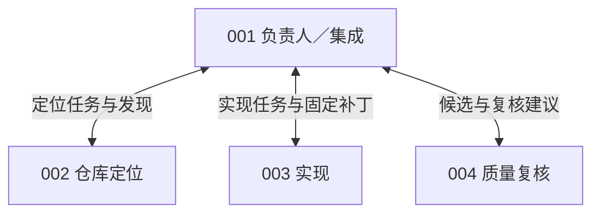
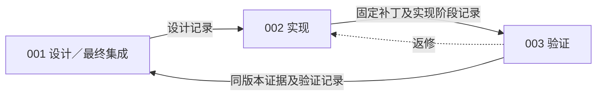
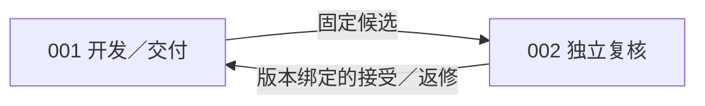
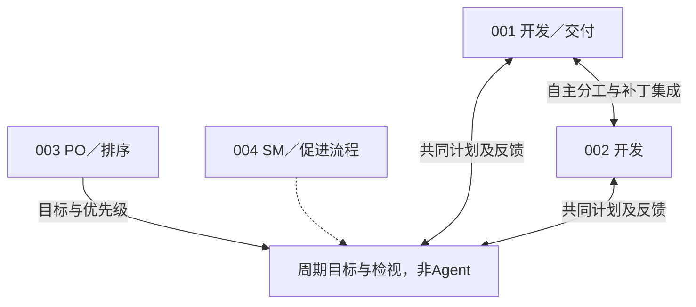
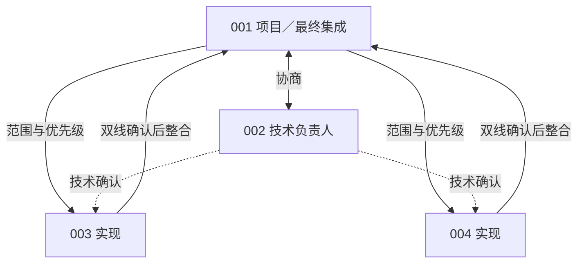

# 近期实验详细汇总：预算、环境接口与固定协作

汇总日期：**2026年11月6日，Asia/Shanghai**。本报告综合已归档的实验、补评和分析证据，覆盖从累计token预算诊断，到单Agent接口修订，再到五种固定组织的比较。最近一批实际队列于11月5日结束；v133—v140主要是统计、来源核验和原因分析，不能当作新增模型实验。

## 阅读摘要

目前最清楚的结论有五点：

1. **较小预算会明显限制继续工作的机会，但扩大预算不是充分条件。** Qwen的50题恢复视图从0.5M的28%升到2M的52%；旧执行条件下5M、10M仍为52%。修订执行方式后，FIX5M／FIX10M达到60%／64%，实际平均token增加60.5%，只净多通过2题。
2. **项目接口修订后，单Agent与REF的差距有所收窄，但尚未完全消失。** 最新恢复后结果为REF 36/50、PROJECT 33/50；PROJECT平均多用10.87% token。同题48题的旧／新PROJECT比较为27过→31过，平均token下降21.10%，但这是多项修订、新运行及恢复政策的联合变化。
3. **多人通信与协调需要真实预算。** 在用户指定的筛选后68回合中，团队平均token比各自同题S1高60.7%–120.9%；显式协调占受管动作11.26%–28.80%。私有上下文、信息回读、版本交接和确认共同消耗预算，不能只统计消息字数。
4. **预算与协作未完成相互关联。** 48/68回合触及团队5M边界；12个代码正确但未交付的回合全部属于此类，20个空候选中也有12个在此边界结束。不过PIPELINE另有协议阻塞回合仍有大量名义余量，因此两种机制不能互相替代解释。
5. **尚有明确系统缺陷和流程适配问题。** 嵌套Pytest报告识别、成果回到001的整合路径、阶段及版本确认值得优先处理。与此同时，非空补丁中也存在目标未修好或回归；不能把所有失败都归为预算或系统问题。

本报告各表都注明任务与用量分母。**思考／非思考、50题／500题、恢复后结果／原首次尝试、完整面板／筛选子集不能混成一个排行榜。**

## 1. 实验轮次与关系

| 阶段 | 研究问题 | 实际范围及模型 | 本报告采用的结果 |
|---|---|---|---|
| 早期0.5M参照，v055 | 原预算是否限制能力发挥？ | REF／MATCH／PROJECT；Qwen及DeepSeek两种模式，每条件计划500题 | 仅用REF预算截止统计作为背景 |
| Qwen预算梯度，v056—v061 | 扩大累计预算后是否改善？ | 原始Qwen3.5-9B、思考、REF；同50题×0.5M／2M／5M／10M | 187份原轨迹及13份获授权独立恢复组成的补全视图 |
| Qwen执行修订，v062—v063 | 修正执行缺口后，5M和10M表现如何？ | 同50题、同原始Qwen；FIX5M／FIX10M；预选12题追加两次重复 | 两组50题主测及独立重复诊断；按用户要求不重列BASE5M成绩 |
| DeepSeek大面板，v064—v103 | 强模型进入项目接口后的表现与消耗 | Flash思考；REF／PROJECT各500题、5M；另44个独立恢复 | 原500题终态与44恢复分开；剩余异常封存 |
| 非思考接口评测，v105—v128 | 对齐与修复能否改善PROJECT？ | Flash非思考；固定50题，先两轮REF／PROJECT，再重测PROJECT并恢复未定 | 初测、对齐快照、最终恢复视图分阶段列出 |
| 固定组织，v131—v132 | 固定多人结构相对S1的效果 | Flash非思考；同50题×五组织，共250个团队回合 | 原计划审计视图及用户指定的68回合主分析 |
| 机制分析，v133—v140 | 分数、成本、流程与预算如何关联？ | 读取上述已归档记录 | 没有新增模型回合，不额外累加实验次数 |

原v064曾规划2模型×2接口×3预算、共12组完整500题评测，随后DeepSeek缩减为5M，Qwen全量队列暂停。**不能把这份最初计划写成已经完成的12组全量结果。** 0.5M的200题SWE-smith方案等早期准备计划也不计入本报告已完成样本。

下文使用的50题来自固定的12仓库校准面板，已反复用于预算和接口开发；它不是新的独立确认集。不同条件、恢复和重复运行不会增加“不同任务数”。

## 2. 条件、平台与统计口径

### 2.1 REF、PROJECT和团队组是什么

| 条件 | 基础框架 | 额外限制或组织机制 | 核心测量 |
|---|---|---|---|
| REF单Agent | 原生OpenHands | 原生工具与生命周期，使用该轮冻结的提示、历史和资源设置 | 最终唯一代码候选的官方通过率 |
| PROJECT S1 | OpenHands＋ProWorkSim受管接口 | 单动作工具、观察及分页、版本化修改、公开测试证据、固定与正式交付 | 代码正确率＋合法交付率 |
| 固定组织团队 | 同一受管基础上的多个私有成员会话 | 分工、定向消息、补丁交接／集成、角色和组织状态；固定总预算 | 最终001候选的代码正确率、合法交付与全队成本 |

早期MATCH仍使用原生OpenHands，只将推理和资源设置改成与PROJECT可匹配的条件。它用于区分运行设置与定制执行层；后续50题主线采用REF／PROJECT，不将旧MATCH成绩混入新版本。

### 2.2 近期主要共同设置

- 原始Qwen3.5-9B无项目训练适配器；DeepSeek使用Flash，思考与非思考单列。API模型服务不等同于可按本地权重摘要锁定的检查点。
- 较大预算阶段的上下文131,072、完整输入上限98,304、单次输出上限32,768；累计输入＋输出预算另设，不能把上下文窗口当作整题预算。
- Qwen FIX两档、后续非思考50题及团队条件采用512次模型尝试／Agent决定、6小时软限和6.5小时硬限；其他历史版本按各自原方案。摘要、纠错和结束自检继续记入原预算。
- 团队的5M由所有成员共享，没有按人数翻倍。模型、工具、历史及组织操作都消耗真实机会；同队采用单写者轮转，跨题48路并发不代表题内四人同时工作。
- 生成结束后锁定唯一候选再评分，隐藏验收不反馈给模型。PROJECT另评分合法提交；代码和提交版本不同时按各自证据处理。
- 模型API直连，求解接口没有联网搜索答案入口；公开测试与官方隐藏评分分别管理。环境修订及原候选补评保留独立身份，不事后挑选最好成员或最好补丁。

### 2.3 本报告采用的三个分母

**评分分母**是已有可信官方结果的任务数；**用量分母**是该表选定、用量可完整核算的回合数；**计划分母**是事前固定的50或500题。三者不总相同。未知不是模型失败，未调用也不能以0 token混入平均求解成本。

用户要求协作主表剔除未定与现金截止，本报告沿用该口径。原计划覆盖和被排除费用仍在审计部分保留。所有“可能范围”仅表示未定结果带来的上下界，不是置信区间。

## 3. Qwen：扩大预算与执行修订

### 3.1 为什么开展预算梯度

早期每题0.5M的500题REF中，Qwen有469题、DeepSeek非思考266题、思考286题因累计预算截止；合计1021/1500，68.1%。很多回合尚未达到模型调用次数上限，就不足以预约下一次输入与输出。它证明预算阻止了继续尝试，不证明每个失败都能靠更多token解决。[早期预算报告](software-benchmark-v055-ref-budget-constraint-audit-r1.md)

### 3.2 旧执行方式下的四档结果

下表为v061补全视图，每档50题。平均token单位为万，包含输入与输出。

| 单题上限 | 代码通过 | 平均实际token | 预算截止回合 | 原生主动结束 |
|---|---:|---:|---:|---:|
| 0.5M | 14/50，28% | 43.56 | 44 | 4 |
| 2M | 26/50，52% | 151.76 | 23 | 21 |
| 5M | 26/50，52% | 236.30 | 7 | 36 |
| 10M | 26/50，52% | 336.77 | 5 | 34 |

0.5M→2M的成绩提高且截止减少；再增加预算，平均实际用量继续上升，但通过数相同。相同通过数不等于逐题结果相同，也不能据此宣布达到模型能力上限：旧执行路径仍有思考字段映射、公开测试入口和停止策略等问题。

这200个采用结果含187份原轨迹及13份获授权的新初态恢复，旧异常保留，不能冒称200个原首次尝试全部取得正常结果。[预算梯度与恢复证据](../../artifacts/software-benchmark-v140/prior-experiments-r1.json)

### 3.3 修订执行路径后：FIX5M与FIX10M

FIX联合修订了思考字段投影、公开解释器／测试入口、统一验证提示，以及有界卡住纠正和首次结束自检。它们都消耗原题预算，不增加Agent，不把隐藏评分作为反馈。

两档从各自独立初态运行，不是同一条轨迹在5M处接着跑到10M。与v061历史成绩相比，还同时改变了seed及执行策略，不能把52%到60%／64%的差全部归为某一项修复。

| 指标 | FIX5M | FIX10M |
|---|---:|---:|
| 主测题数 | 50 | 50 |
| 代码通过 | **30/50，60%** | **32/50，64%** |
| 平均输入token／万 | 346.37 | 556.68 |
| 平均输出token／万 | 8.40 | 12.89 |
| **平均总token／万** | **354.77** | **569.58** |
| 平均模型请求数 | 135.96 | 217.84 |
| 预算预约不足停止 | 21 | 15 |
| 正常结束 | 28 | 30 |

FIX10M比FIX5M平均多用214.80万token，增加60.55%；通过数净增2题。逐题为28题双方通过、16题双方失败、4题仅10M通过、2题仅5M通过。平均单请求输入几乎相同，用量增加主要体现为请求次数增加60.22%；输入约占新增token的97.91%。这是一项成本—结果权衡，不能把增加的实际消耗都视为有效进展。

预选12题的FIX10M三次运行分别通过8、7、7题；0/3、1/3、2/3、3/3成功分别为4、1、0、7题。重复诊断未混入50题主测，也未以“三次任一成功”替代单次正确率。它规模有限，不能作为稳定性认证。

Astropy-14995的原FIX10M评分日志编码异常经v063保留候选补评后判为通过，形成上述32/50终态；没有为此重跑模型。按用户此前要求，本汇总不重新列BASE5M成绩。[v062方案](software-benchmark-v062-protocol.md)；[v063补评](software-benchmark-v063-diagnostic-diff-rescore-r1.md)

## 4. DeepSeek思考模式：完整500题计划的历史收尾

该轮为REF／PROJECT各500题、单Agent、每题5M，思考模式。原候选补评和可信终稿恢复已合入，仍缺少部分结果。这里的“有效子集通过率”不替代完整500题成绩。

| 条件 | 已确认代码通过 | 已知代码未通过 | 评分结果覆盖 | 有效子集通过率 | 平均token／万 | 用量分母 |
|---|---:|---:|---:|---:|---:|---:|
| REF | 333 | 58 | 391/500 | 85.2% | 191.55 | 429 |
| PROJECT | 280 | 76 | 356/500 | 78.7% | 226.46 | 433 |

REF还有95项技术未知和14项未开始，PROJECT为129和15。完整面板仅能确定REF成功下界66.6%、可能范围66.6%–88.4%；PROJECT下界56.0%、范围56.0%–84.8%。两组可评分子集不同，不能用85.2%减78.7%直接估计接口损失。

同题347个结果明确的任务中，双方通过265题、双方失败46题，仅REF通过28题、仅PROJECT通过8题。相应REF293/347、PROJECT273/347，净差20题；这个共同已知子集仍受可运行性选择影响。

用量均值分母429／433包含一些生成曾异常但用量完整的任务，与评分分母391／356不同。取两组用量均完整的同420题，平均为REF192.02万、PROJECT227.55万，PROJECT高18.50%。该轮PROJECT调用次数较少，却每次输入更长：平均每次约7.40万输入，REF约3.23万。**这一轮的成本机制与后面的多人组不同，不能都概括为“调用更多”。**

PROJECT原面板有264题合法交付通过，16个代码正确的最终版本缺相应合法交付。曾补评通过的15道Matplotlib题已包含在280内，不能再加15。

### 4.1 独立44回合恢复

获授权的44个预算中断题新尝试另列：

| 条件 | 独立恢复回合 | 代码通过 | 平均token／万 |
|---|---:|---:|---:|
| REF | 21 | 15/21，71.4% | 235.95 |
| PROJECT | 23 | 16/23，69.6% | 246.61 |

这些是特定中断集合的新采样，不是随机新面板，不能回填原首次500题。PROJECT的交付通过计数也是16/23，但相同计数不证明完全相同的题或版本。

用户随后要求封存余下异常。待办209个原任务包括79个零API任务、102个已调用但缺可信终稿、28个环境未准入；原面板还保留44个已有独立恢复结果的旧未知，所以首轮未定总数253与待办209并不矛盾。原1700元是跨该账本实际组别和尝试的现金上限，不是每组新额度，也不是实际花费。[历史收尾报告](software-benchmark-v102-deepseek-closeout-r1.md)；[用量与恢复口径](../../artifacts/software-benchmark-v140/prior-experiments-r1.json)

## 5. DeepSeek非思考50题：接口对齐与修复后的结果

### 5.1 三个阶段不能合成一轮首次成绩

以下各条件仍计划50题。阶段未定保留，平均token的分母单列。

| 阶段 | 条件 | 代码通过／未通过 | 尚未判明 | 平均总token／万 | 用量分母 |
|---|---|---:|---:|---:|---:|
| 初测，v105—v109 | REF | 30／11 | 9 | 234.59 | 49 |
| 初测，v105—v109 | PROJECT | 21／20 | 9 | 289.69 | 49 |
| 对齐后快照，v111—v114 | REF | 33／13 | 4 | 211.58 | 48 |
| 对齐后快照，v111—v114 | PROJECT | 27／21 | 2 | 287.08 | 48 |
| 最终预定恢复选择，v128 | REF | **36／14** | **0** | **201.78** | **50** |
| 最终预定恢复选择，v128 | PROJECT | **33／17** | **0** | **223.72** | **50** |

初测两组及对齐阶段REF的用量均值包含部分可计量中断；对齐阶段PROJECT的48项均正常闭合。最终均值取预定恢复选择，分母与终态类型不同，不能直接把整个序列的均值变化当成同一种处理的效应。表中的v111—v114是严格原端点快照，停止树的补充分数不混入，未运行Requests任务也不补作失败。

修订主要经过三层：v110对齐结束自检、来源绑定摘要与公开测试入口；v117—v120处理受管执行、历史／参数恢复、JSON键顺序等执行问题；v123、v125—v127再按明确授权处理现金中断、未首次调用和保留候选评分。后来v130的路径说明、零测试判定与公开依赖修订进入团队组，但不能回写成v128已采用的单人设置。

### 5.2 最终REF与PROJECT

| 指标 | REF S1 | PROJECT S1 |
|---|---:|---:|
| 代码通过率 | **36/50，72%** | **33/50，66%** |
| 平均输入token／万 | 199.77 | 222.87 |
| 平均输出token／万 | 2.02 | 0.85 |
| 平均总token／万 | **201.78** | **223.72** |
| 合法交付通过 | 不适用 | 33/50 |

PROJECT平均多消耗10.87%，主要差在输入。逐题为双方通过28、仅REF通过8、仅PROJECT通过5、双方失败9，净差3题。PROJECT的33道代码通过也有交付通过，其中32题为同版本，Pylint-6528两个不同版本分别通过，不能全部称“同一最终树已提交”。

REF最终选择由46个旧有效回合、2次原未调用首次运行、2次独立新尝试构成。PROJECT由23次首次生成、27次获授权独立重跑中正常闭合的18次，以及其余9题再次独立恢复的结果构成；这18次也重新调用了模型，不是原会话续接。选择规则由阶段预先确定，未按新旧分数择优；仍应称**恢复后对照**，不能改称原50题各一次完整首测。

### 5.3 同题修订前后比较

在旧对齐PROJECT已经有结果的48题上，修订后PROJECT通过31题，旧版27题；双方通过24、仅旧版3、仅新版7、双方失败14。平均token从287.08万降至226.49万，减少21.10%。这比跨不同覆盖分母的比较更有解释力，但同时发生了多项修订、新seed及恢复策略变化，不是某个单独接口修复的因果增益。

旧被替代中断仍消耗REF已知673.71万token、PROJECT至少1875.91万token，后者另有1次旧调用用量未知。将这些已知成本按50题分摊，实际投入变为REF215.26万／题、PROJECT至少261.24万／题，不能从费用中删除。[最终对照](software-benchmark-v128-final-ref-project-comparison.md)；[阶段与同题48题证据](../../artifacts/software-benchmark-v140/single-agent-history-r1.json)

## 6. 五种固定组织：任务完成率与成本

### 6.1 实验设计与主表选择

五组使用Flash非思考、固定50题、各组独立100元、全队每题共享5M，共250个计划团队回合。主比较对象为上述PROJECT S1；原生REF仅作更外层参照。

按用户指定，主分析剔除61项未定和全部121项现金截止，保留68回合。现金截止无论是否通过都剔除，其中包括37个代码通过及4个官方交付通过回合，避免只删失败题。达到token边界仍保留，因为它属于原单题计算上限。

| 组织 | 人数 | 保留题数 | 团队代码通过率 | 同题S1通过率 | 团队平均token／万 | 同题S1平均token／万 | token增幅 |
|---|---:|---:|---:|---:|---:|---:|---:|
| CHIEF | 4 | 10 | **4/10，40.0%** | 6/10，60.0% | 497.61 | 240.78 | +106.7% |
| PIPELINE | 3 | 17 | **3/17，17.6%** | 11/17，64.7% | 345.92 | 215.32 | +60.7% |
| REVIEW | 2 | 16 | **11/16，68.8%** | 10/16，62.5% | 440.00 | 211.68 | +107.9% |
| SPRINT | 4 | 11 | **6/11，54.5%** | 7/11，63.6% | 497.37 | 225.13 | +120.9% |
| MATRIX | 4 | 14 | **3/14，21.4%** | 8/14，57.1% | 497.27 | 256.39 | +94.0% |

每行比较同一批题目；不同行组成不同，五组共同仅2题，不能按百分比直接排名。68项只占原计划的27.2%，筛选与任务顺序、现金耗尽及运行状态有关，并非随机抽出的新面板。

REVIEW的16题中，2题仅团队通过、1题仅S1通过，净多1题；其他四组相对同题S1分别净少2、8、1、5题。REVIEW全部16题用量除以通过数，为每个确认成功约640.00万token，同题S1约338.69万，仍高约89.0%。

### 6.2 分组织解释

以下图为**设计架构，不代表每条协作链都实际完成**。来源启发组织机制，固定人数、版本接受门与工具协议均为本项目适配。

**CHIEF，4人：一个负责人协调专业支持。** 借鉴Baker主程序员团队和MAGIS角色，QA提供建议而不是独立批准。

10题中未执行显式派工或补丁整合，63次消息有38次拒绝；负责人只用28.2%的token。6道失败全部有非空修改，其中存在未修目标与回归，说明既有协调执行不足，也有真实代码错误。没有显式整合不代表文字建议毫无贡献。当前4/10对6/10，未见专业支持抵消额外调用成本。[Baker作者综述](https://onlinelibrary.wiley.com/doi/abs/10.1002/0471028959.sof038)；[MAGIS](https://proceedings.neurips.cc/paper_files/paper/2024/hash/5d1f02132ef51602adf07000ca5b6138-Abstract-Conference.html)

**PIPELINE，3人：以阶段产物推进工作。** 借鉴职能标准化协调与MetaGPT SOP，001既负责设计，也负责最终集成。

14道失败中13道最终补丁为空，这些回合消耗约4414万token。已核Sphinx-7889、Pytest-7571中，002补丁到了003，却没有回到001；Pytest-7490只做普通交接而缺组织阶段登记。实现者用62.9%的token，最终集成者20.0%。较低均值也受协议阻塞提前结束影响，不能视作高效。它首先暴露端到端产物汇总问题，而不是缺少编码投入。[Mintzberg](https://pubsonline.informs.org/doi/10.1287/mnsc.26.3.322)；[MetaGPT](https://proceedings.iclr.cc/paper_files/paper/2024/hash/6507b115562bb0a305f1958ccc87355a-Abstract-Conference.html)

**REVIEW，2人：作者与独立复核者围绕一个候选闭环。** 借鉴现代代码复核研究，不设额外派工层。

16题中14题有成功整合、14题有审查记录；开发与复核分别用50.2%和49.8%的token。代码通过净多1题，但5道失败仍包括3题目标未修、2题引入回归，不能据此确认稳定协作收益。55次消息41次被拒，反馈与身份操作仍有成本。[Bacchelli与Bird，ICSE 2013](https://www.microsoft.com/en-us/research/publication/expectations-outcomes-and-challenges-of-modern-code-review/)

**SPRINT，4人：两名开发者自主分工，PO排序、SM促进周期。** 这是Scrum启发的单issue适配，不是完整Scrum复现。

11题仅1题启动Sprint，13次固定补丁有12次拒绝；PO／SM用27.7%的token，开发者72.3%。Xarray-4687中伙伴已有公开测试通过的修改，却因未启动无法固定，001最终仍空；该伙伴版本未官方评分。6道代码通过中5道在token截止时未交付。启动后才能固定是项目门槛，并非Scrum官方要求，不能把其影响直接归给Scrum。[Scrum Guide 2020](https://scrumguides.org/scrum-guide.html)

**MATRIX，4人：项目与技术双线责任。** 借鉴矩阵组织的双线协调；单issue、四人及同版本双接受属于项目实现。

11道失败中6道最终补丁为空；6次整合有4次拒绝，2次正式提交均被拒。Xarray-4966伙伴补丁已有公开测试证据，但只补齐技术接受，没有完成项目接受和再整合，001最终仍基线。其余失败也有实际代码错误与回归；3道代码正确题全部在token边界结束且未交付。[Galbraith，1971](https://jaygalbraith.com/wp-content/uploads/2024/03/galbraithmatrix1971.pdf)

五组完整案例、角色用量及来源边界见[分组详细分析](software-benchmark-v137-group-failure-and-token-analysis.md)。伙伴公开测试通过不能补记为官方成功，也不能事后择优导出其他成员版本。

## 7. token、通信与预算：共同解释框架

### 7.1 为什么不能只说“调用次数增加”

本轮多人组每次平均输入比同题S1略短，却有1.68–2.41倍的调用；输入约占总token99.6%。实际机制包括直接通信和交接、每成员分别理解仓库、历史随请求重复输入、版本和阶段协调。缓存输入仍计入本轮token预算，不能只数消息输出文字。

| 组织 | 平均消息工具调用／回合，含拒绝 | 协调动作占受管派发动作 | 对应完整请求token占总量 |
|---|---:|---:|---:|
| CHIEF | 6.30 | 11.26% | 11.54% |
| PIPELINE | 0.65 | 14.55% | 11.54% |
| REVIEW | 3.44 | 14.24% | 12.59% |
| SPRINT | 8.09 | 28.80% | 22.75% |
| MATRIX | 4.00 | 18.13% | 16.48% |

协调包括消息、补丁交接／整合、任务读取与管理、责任转交、组织状态和治理。历史操作另列。此处采用v139补入`read_task`的新分类，旧原件不改。

**最后一列不是净通信成本。** 它计入发起协调动作时的整个请求，包含其他历史；工具返回和通信内容又可能出现在后续编码请求中。不能把该比例直接当作“删除通信就能节省多少token”。

Xarray-4966有直接重复信息获取证据：四名成员读取同一初始文件，后来三人读取同一补丁版本，返回内容有1948字符共同重叠。它证明信息没有自动共享，但独立复核也可能合理需要这些内容，字符重叠不是可节省token估计。成员数与组织方式同时变化，未识别人数单独的线性或平方成本规律。[协调成本证据](../../artifacts/software-benchmark-v139/coordination-cost-r1/summary.json)

### 7.2 预算截止与协作未完成

| 组织 | 保留回合 | token边界结束 | 其他停止 |
|---|---:|---:|---|
| CHIEF | 10 | 10 | 0 |
| PIPELINE | 17 | 5 | 12项协议阻塞 |
| REVIEW | 16 | 8 | 8项成员停止／无可达事件 |
| SPRINT | 11 | 11 | 0 |
| MATRIX | 14 | 14 | 0 |
| 合计 | **68** | **48，70.6%** | **20** |

这里是5M token准入／预约边界，不是已排除的现金截止，也不要求实际花费恰好5,000,000。触及上限并不等于失败，一部分已形成正确交付。

12个正确但未交付回合全部在token边界结束；20个空候选中12个在该边界结束、8个因协议阻塞。另一方面，PIPELINE的12个协议阻塞回合平均用282.83万，仍有217.17万token名义余量，10项余量至少100万。名义余额不能保证动作合法或现金准入，但说明它们不是由token上限直接终止。

对已核实的预算截止未闭合案例，应表述为**当前预算约束下，确认、整合或交付没有完成**，不能把所有协议阻塞或代码错误都套入这一解释。通信协调可能加快预算消耗，协议阻碍可能增加往返，而预算截止终止继续尝试的机会；现有记录不足以分离各自贡献，也不能保证追加预算成功。[预算交叉统计](../../artifacts/software-benchmark-v139/budget-overlap-audit-r1/summary.json)

### 7.3 代码与交付不能混为一个端点

| 组织 | 代码通过 | 官方交付通过 | 代码通过但未合法交付 |
|---|---:|---:|---:|
| CHIEF | 4 | 2 | 2 |
| PIPELINE | 3 | 3 | 0 |
| REVIEW | 11 | 9 | 2 |
| SPRINT | 6 | 1 | 5 |
| MATRIX | 3 | 0 | 3 |
| 合计 | **27** | **15** | **12** |

其余41个代码失败又分为20个最终空候选、21个非空但官方未通过候选。这些结果类别应分开；不能把12个未交付加进41个代码失败，也不能把21个实际代码错误全部归为接口或预算。

## 8. 系统性问题、协作问题及修复状态

| 问题 | 影响及直接证据 | 已完成处理／尚存边界 |
|---|---|---|
| 思考响应与执行提示适配 | 旧Qwen路径的思考字段、公开解释器及验证入口存在执行缺口 | FIX协议已联合修订并运行；仍有长输出截断，不能称已达到能力上限 |
| 受管历史／参数与JSON恢复 | 曾造成回合中断、合法对象被键顺序校验拒绝 | v117—v120修复并经后续运行采用；原已调用异常通过明确独立恢复处理，未抹去旧费用 |
| 文件参数说明和零测试判定 | `read_file.path`说明被共享声明污染；旧公开测试可能零通过却报告通过 | v130已修订并进入团队环境；未对v128旧成绩倒填新收益 |
| 嵌套Pytest报告识别 | 多个合法测试会话报告被按“必须恰好一份”归为未知，已见于当前团队案例 | **仍待修复**；须区分顶层与子会话，不能直接累加或把旧官方失败改成成功 |
| 最终成果回到001 | 部分伙伴修改已产生，确认、阶段记录或整合链未走完 | **流程与接口适配问题仍在**；与预算截止可能共同作用，未证明所有拒绝都是实现bug |
| 正常候选导出字段错配 | 163份正常闭合候选被导出路径误标异常 | v132已修订、保留原候选恢复并补评；不是重新生成163题 |
| 初始化内存峰值 | 24项初始化OOM；流式哈希后仍有3项新阶段OOM | 仅解决局部峰值，**未证明整个大仓库初始化已修好**；这些回合不在68题主分析中 |
| 评分环境绑定与外部依赖 | Requests-1921冻结环境身份不一致；1766环境控制未合格；Pytest-10081评分还有安装与候选导入问题 | 相关未知仍保留；后续恢复准备未执行，未新增API预算 |

协作消息拒绝、阶段门和版本确认首先是可用性及执行问题；正确执行规则也可能让模型难以闭合，不能据拒绝次数直接认定系统错拒。真实代码错误、协议阻碍和技术故障应分别记录。

## 9. 原计划覆盖、实际费用与资源收尾

### 9.1 五组织原250回合的审计视图

此表仅保留覆盖完整性，不替代前述68回合主比较。

| 组织 | 已确认通过 | 已确认未通过 | 未定 | 原50题可能范围 |
|---|---:|---:|---:|---:|
| CHIEF | 14 | 26 | 10 | 28%–48% |
| PIPELINE | 5 | 39 | 6 | 10%–22% |
| REVIEW | 24 | 13 | 13 | 48%–74% |
| SPRINT | 16 | 24 | 10 | 32%–52% |
| MATRIX | 5 | 23 | 22 | 10%–54% |

合计64通过、125未通过、61未定。61项为41生成故障、18未开始、2评分未知；并非61项都在排队等一个评分请求。请求执行结束和“全部结果已知”是两回事。原计划上除REVIEW外四组的最高可能值低于S1的66%，这是原计划视角，不能换作68子集的总体结论。

### 9.2 费用与被排除用量保留

| 账本／口径 | 上限或范围 | 已结算 | 不确定预约 | 说明 |
|---|---|---:|---:|---|
| 非思考50题多阶段共用账本 | 累计389.7945248元 | 364.67765008元 | 10.48576元 | 覆盖多轮及恢复；阶段快照不能相加 |
| 五组织五个独立账本合计 | 各100元，合500元 | 497.14751836元 | 1.387838元 | 不能将筛掉的回合费用删除 |
| 历史思考大面板账本 | 累计1700元授权上限 | 本报告不另估算 | 旧预约保留 | 涉及原计划其他实际组别及尝试，不把上限当实花 |

最新S1采用回合的费用REF11.11424284元、PROJECT184.70528776元，不能仅凭token差解释这么大的现金差；缓存和计价时段差异显著。两项是各自所选回合费用，不应再加到已包含它们的整本账本上。

五组织已知实际token共**584,225,267**：主分析保留303,295,681，排除部分仍有280,929,586。相应保留回合已结算261.29537740元，被排除部分235.85214096元。MATRIX不确定预约另保留，不能当实际用量0。

### 9.3 最近批次结束证明

组织队列于**2026年11月5日02:35:20北京时间**结束，归档进度显示生成活动、评分活动和待评分均为0；194个评分请求由191个代码候选及3个异版本交付候选构成，不是194个独立任务。清理错误为空，本批专用资源组已释放。

这些是归档终态证明，不是持续监控声明。本次汇总只读取已有证据，没有启动模型、评分、容器或训练，没有新增预算或修改共享服务器。[组织终态、费用与来源](../../artifacts/software-benchmark-v140/organization-summary-r1.json)

## 10. 综合判断与后续重点

**预算：** 早期0.5M明显限制继续尝试；增加到5M／10M后仍有执行和质量问题，更多token不必然按比例增加成功。多人场景尤其需要同时测通信协调成本和截止时流程进度，不能把同总预算条件下的结果直接当作无预算约束的能力上限。

**接口：** 同题PROJECT修订前后存在改善，说明执行层值得修复；最终仍与REF有3题净差。但同时变更的工具、提示、历史、恢复策略与新采样使单项因果尚未分离。已确认的测试报告识别问题应先修，再评估其影响。

**协作：** REVIEW的简单候选复核链较常运行，其条件子集净增1题却伴随约两倍token；其他结构存在成果汇总、阶段门和双线确认障碍。当前更适合描述为“模型在这些受管组织协议下的执行表现”，不能判定原论文、人类组织或多Agent协作普遍无效。

后续工作的先后关系应是：先修已有明确实现缺陷和不可达／不清晰的阶段接口；再补齐通信、重复读取、角色成本及闭合进度测量；最后在同一新版harness和明确预算下比较S1与团队。若另测预算梯度，需要同时保留固定总预算的效率问题和较充分预算的能力问题。人数、组织结构、提示和预算不应全部同时更换后把差异归为某一因素。

本报告只提出这些修订方向，没有启动新实验。旧50题已多轮用于开发校准；任何后续独立确认，应另行固定任务与协议。

## 11. 主要证据索引

- [Qwen预算、重复诊断及历史DeepSeek500题](../../artifacts/software-benchmark-v140/prior-experiments-r1.json)：各轮真实均值、恢复来源、配对结果、原评分引用与哈希。
- [非思考50题阶段与最终对照](../../artifacts/software-benchmark-v140/single-agent-history-r1.json)：六行阶段数据、同题48比较、输入／输出、现金与旧中断成本。
- [五组织综合证据](../../artifacts/software-benchmark-v140/organization-summary-r1.json)：原250与筛选68、费用、通信分类、预算交叉、具体病例和资源清理。
- [五组织分组详细报告](software-benchmark-v137-group-failure-and-token-analysis.md)：来源、五张完整设计图、工具及版本案例、问题分类。
- [完整补评终态](software-benchmark-v134-post-rescore-organization-analysis.md)与[筛选口径](software-benchmark-v136-cash-excluded-organization-comparison.md)：保留原计划分母和排除清单。

文中多轮均使用同题或恢复后的结果，不能把所有行当作彼此独立样本，也不能把统计版本号当作独立实验次数。各原件、失败、中断和费用均继续保留，汇总不覆盖它们。
