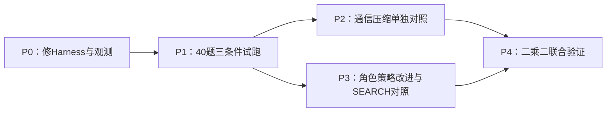
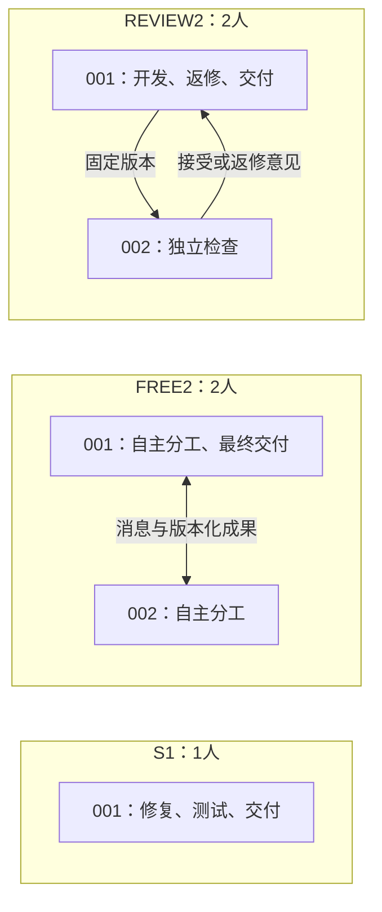

# 后续实验：先修复协作闭环，再分别研究角色与通信

本轮按用户提供的路线推进，近期工作是 **P0工程修复＋40题的S1／FREE2／REVIEW2试跑**。用户已批准新增API总预算400元。现在取得的是CPU机制验证和试跑准备结果，尚无新的真实模型成绩。

## 1. 为什么改变路线

前五种组织实验同时改变人数、角色和协议，且存在现金截断、初始化OOM、候选导出及测试证据问题。仅比较筛选后的通过率，不能可靠判断组织本身好坏。旧报告和原始结果保留，新实现不回写旧分数。

新路线将问题拆开：先确认两个成员能把成果交付到最终版本，再比较自由分工与固定复核；随后分别检验通信压缩和角色策略改进，最后才联合作用。此次不重启五组织大面板、不训练权重、不启用Contribution或PPO。

## 2. 本轮修复内容及证据边界

| 问题 | 新实现 | 当前证据／仍需核验 |
|---|---|---|
| 嵌套pytest的内部结果混入外层，或零测试误报通过 | 每次测试会话拥有独立ID、父子关系和开始／结束记录；根会话决定总体判定；重复阶段去重，未完成／collection失败／零测试／全跳过分别标识 | 28项核心CPU控制、10项实际actor接线控制、3项缓存SymPy实际测试通过；尚不代表所有历史解释器已重新运行 |
| 伙伴成果未显式回到最终成员 | 固定产物、领取到私有版本、同版本测试、复核意见、最终集成形成可追溯链；状态工具显示实际负责人和下一步 | 三组真实OpenHands SDK脚本闭环通过，双人控制包含002的非同值代码被001显式采用；不是模型完成率 |
| 旧组织阶段门造成无谓阻塞 | FREE2不继承PIPELINE／SPRINT／MATRIX的阶段或批准门；REVIEW2只保留明确的独立复核要求 | CPU机制和SDK闭环通过；FREE2无需先通过固定复核才能交付 |
| 初始化同时保留巨大JSON／字符串副本 | 新版本使用低峰值JSON复制、流式读写与摘要；保留原JSON归一化、字节及身份规则 | 20项CPU控制通过；大仓库完整容器初始化的实际峰值仍待零模型诊断，不宣称OOM全部解决 |
| 把发消息等同于收到、把固定补丁等同于采用 | 新侧录区分发送、实际收到、进入后续模型输入、采用、同版测试、复核及最终来源链 | 15项观测控制及三组真实SDK脚本通过；摘要后没有精确原文对应关系的呈现统计保持未知 |
| Requests评分旧身份／TLS超时、pytest离线安装 | 新scope绑定的新manifest；离线构建依赖核验；仅有已证双向EOF才正常收口，不能以交换过字节代替完整传输 | CPU控制已覆盖身份与失败分支；对应环境仍须真实gold／empty控制，不将旧技术未知直接改成成功 |

公开测试细节见[测试修复说明](software-benchmark-v141-public-test-repair.md)。观测证据见[observation-r1](../../artifacts/software-benchmark-v141/observation-r1/summary.json)，状态／交接证据见[role-handoff-r1](../../artifacts/software-benchmark-v141/role-handoff-r1/summary.json)。CPU脚本的预设响应与token不是实际API消费。

## 3. 三个条件具体差在哪里

三组都使用**OpenHands私有会话＋ProWorkSim受管工具和交付规则**。S1不是原生REF；本次目的是在相同项目环境里识别增加成员及固定角色的影响。

- **S1：一个成员。** 001自行定位、修复、测试、固定和提交。没有隐藏伙伴；不暴露仅跨成员有效的消息／交接／责任转移工具。
- **FREE2：两个自由协作成员。** 001、002具有相同基础操作能力，允许自行声明责任、分工、交换和采用成果；不预设经理、开发或复核岗位。001是固定最终导出端点，属于测量和交付约定，不赋予额外任务指挥权。独立复核可用但非强制。
- **REVIEW2：开发者＋复核者。** 001负责修复和最终交付，002对一个具体固定版本独立检查并接受或退回。接受必须有实际采用和同版本公开测试证据。001修改后原接受失效；不能以作者自评代替独立复核。

宿主不会替成员复制代码、合并补丁、接受复核、执行公开测试或提交。`org_status`只展示事实和合法后续操作；任务板仍是可选的，不能新增必须建任务才能修改代码的前置负担。

## 4. 40题试跑协议

| 项目 | 固定设置 |
|---|---|
| 题目 | 已有公开50题池中按仓库分层预选40题，12个仓库，每仓库最多4题；选择函数不读取历史成绩 |
| 条件 | S1、FREE2、REVIEW2各40，共120回合；每题相同本地seed，独立初态 |
| 模型 | DeepSeek Flash，非思考；记录实际返回模型与fingerprint，API不保证权重永远不变 |
| 上下文／输入／输出 | 131072／98304／32768 tokens；共同采样设置 |
| 团队预算 | 每题全队输入＋输出最多5,000,000，成员、摘要、结束自检均共用；不按人数复制 |
| 其他机会限制 | 512次attempt／decision；软时限6小时，硬时限6.5小时；记录先命中的边界 |
| 总token上界 | 600,000,000，属于120回合预算之和，不是预计消耗 |
| 现金 | 新独立账本共400元，三组共享；不借旧账本，不自动扩额，不是每组400元 |
| 调度 | 题目顺序及每题条件顺序预先随机固定；组间公平准入；生成与评分异步 |
| 排除项 | 本轮不增加重复、不做压缩策略比较、不做角色RSI、不训练、不用联网搜索获取解答 |

题单：[冻结panel](../../artifacts/software-benchmark-v142/pilot-design-r1/panel.json)。抽样seed为20261106141，顺序seed为20261106142，panel SHA256为`dcdec0b4eb4b657a44b80dc5b5008713f5075a9aa31a6d22c2c96b53fe173159`。

已有50题和完整Verified材料均曾用于开发，**本次40题是工程校准集，不是独立确认集，也不能称完整SWE-bench Verified分数**。不按看到的成绩换题或提前宣布能力结论。

400元有现金硬门，但不保证120回合均能用满5M。单次API调用先按输入上界及输出上限、峰值单价预约，收到明确用量才结算；不确定请求保留预约且不自动重试。共享账本的7项CPU控制覆盖跨组三份视图仍只有400元、并发门、未知隔离、精确身份、团队5M和旧账本拒绝。

截至2026-11-06核对，官方Flash峰值单价为每百万缓存命中输入0.04元、未命中输入2元、输出8元，非高峰减半；Flash账户并发上限2500。我们受本机任务环境资源限制，拟最多16个生成团队，而非以API并发上限作为服务器准入。计费使用实际请求时段与账本回执，不把上述价目换算成保证完成成本。[官方价格](https://api-docs.deepseek.com/zh-cn/quick_start/pricing/)、[官方并发说明](https://api-docs.deepseek.com/quick_start/rate_limit/)。

## 5. 如何判断是否值得进入下一阶段

P0的CPU控制通过后，还须确认实际打包来源、三组隔离环境和代表性大仓库的零模型诊断，以及评分环境资格。发生局部环境未知时保留原题、继续独立任务；出现共享来源、账单或资源清理完整性故障时暂停新派发。不得自动重采已调用模型的题，也不以旧缓存名义复用已消费的容器身份。

P1关注能否可信测量：每次模型请求与全队预算对应、关键成果闭环可追溯、代码与交付均有明确端点、实际支出可追溯、所有未完成有原因。不以某组分数达到某数值作为工程合格门，也不将脚本闭环通过解释为协作有效。

新主报告保留每组计划40题、已启动／已闭合／有效评分／各类未定。现金截断、token边界、模型未修好、协议阻塞、技术未知分别列出。若完整结果未定，报告确认成功数下界与未知范围；共同有效子集仅作辅助，不能再次删除现金中断和未知后当作主成绩。

## 6. token与协作成本怎样统计

1. **真正收费的总量：** 按唯一provider请求累计输入＋输出，缓存命中是输入的子集，不重复加；按成员、agent／condenser、任务、组拆分，失败和中断也计入。分别报全部已调用回合均值、有效评分回合均值、中位数及分位数，写清分母。
2. **通信正文：** 用冻结的本地tokenizer统计消息正文、接收及实际呈现次数；正文token不是完整chat请求token，不额外加到API总量。没有精确来源的摘要呈现保留未知，不能报告为零通信。
3. **反复阅读：** 按源版本、文件、hash及区间识别同成员重复与跨成员重叠；独立复核需要的重复不能自动算浪费。结合后续采用与测试判断用途。
4. **成果利用：** 伙伴发布、接收机会、实际采用、采用后测试、最终集成分别计数。主`R_use`聚焦最终001对伙伴代码的采用链；001自身代码被002审查另报，不混作伙伴代码复用。
5. **归因限制：** 角色多时总输入可能因重复背景、工具schema、私有历史、往返和测试反馈增加。此次先测量这些量及其共现，不仅按消息数推断净成本；净通信收益／损失需要后续受控比较。

代码正确率与合法交付率同时报告。最终工作树和最后合法提交可能不是同一版本，只有hash一致时才共用评分；两者不同则分别评分。最终代码通过但未合法交付不能一概归因于沟通，需检查剩余预算、最后修改、测试、固定和复核证据。

## 7. 后续阶段的设计边界

**P2通信压缩：** 冻结选定组织及模型后比较C0原始消息、C1通用摘要、C2角色相关摘要＋精确来源引用＋授权回读。压缩与回读使用同一团队token池。除完成率／交付率，还比较实际总token、回读、来源保真和错误采用；正式开跑前冻结非劣效容忍δ及分析方法。不能只看消息长度下降。

**P3角色策略改进：** 可改对象是结构化角色职责、消息路由、求助／切换／复核触发与交接／接受／返修规则；模型权重、工具权限、官方评分器、任务与总预算保持。FREE2、固定REVIEW2、普通SEARCH和RSI-ROLE2分开；SEARCH与RSI匹配候选数、开发评价次数和搜索预算，使用多个独立搜索链。所有开发选择仅看开发集，确认集不得反向调策略。这里的RSI不等同于改一句prompt，也不启动强化学习。

**P4联合比较：** 在两条机制各自有可核验证据后做角色改进×通信压缩的二乘二，不把同期改动后的总提升归给单一机制。

后续开发约200题、独立确认300–500题、约20%重复诊断都是路线目标。当前没有声明这些新材料已备齐或统计功效已满足；需按仓库隔离、来源接触史和预算另行冻结。400元仅用于本轮120回合试跑及同池真实开销，不自动授权后续阶段费用。
