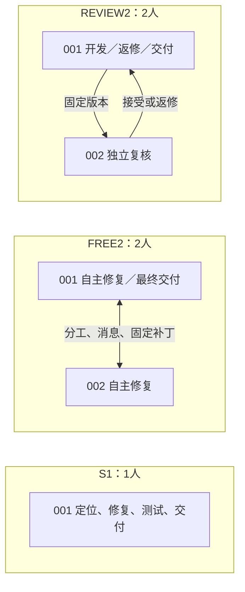

# 本轮实验报告：单人与双人协作的40题对照

报告日期：2026年11月8日（Asia/Shanghai）。实验采用v142题单，实际生成与恢复覆盖v143／v146，最终评分修订至v154；v155仅整理结果，没有启动新的模型实验。本轮不进行训练。

## 1. 主要结果

**固定5M团队预算下，双人协作没有显示出稳定的整体优势。** REVIEW2代码正确率最高，但比S1仅净多通过1题；FREE2反而少通过3题。两种双人方式都消耗了更多token，合法交付率也低于S1。

本轮最值得注意的是**约99.6%的token为累计输入，包含反复携带的上下文；双人增加了调用次数，但重复输入的具体份额尚未直接量化**。REVIEW2比FREE2更省token、代码结果也更好，提示明确的复核分工比自由协作更值得继续检查；40题结果仍不足以证明其普遍优越。

| 条件 | 人数 | 代码正确率 | 合法交付率 | 平均总token（万） | 比S1增加 |
|---|---:|---:|---:|---:|---:|
| S1 | 1 | 27/40＝67.5% | 25/40＝62.5% | 277.16 | — |
| FREE2 | 2 | 24/40＝60.0% | 22/40＝55.0% | 457.93 | +65.2% |
| REVIEW2 | 2 | 28/40＝70.0% | 23/40＝57.5% | 416.57 | +50.3% |

上述平均token只统计最终选定的每组40个完整回合。旧21个中断尝试的消耗另列在费用部分，既不混入这些均值，也不从整批成本中删除。输入包含缓存命中部分；缓存token不能再次加到输入与输出总和中。

**这是一份恢复后完整面板的结果，不是原120回合一次运行全部正常完成的结果。** 原99个正常回合保留：S1为40题，FREE2为29题，REVIEW2为30题；首轮分别确认27、18、22题代码通过。另21个技术中断（FREE2 11题、REVIEW2 10题）由新的独立初态恢复；没有对正常代码失败挑选更好的重跑成绩。pytest6197的一个恢复候选单列为实际执行确认的代码失败，详细依据见第6节。

## 2. 三种条件究竟有什么不同

三组均建立在 **OpenHands＋ProWorkSim受管工具、私有工作区及交付规则** 上。S1是本轮项目环境里的单人基线，不是原生REF。

- **S1，一人独立完成。** 001负责定位、修改、公开测试、固定补丁和提交；不暴露仅跨成员有效的协作工具。
- **FREE2，两人自由协作。** 两个成员均可参与修复，自行商定分工并交换版本化成果；不预设负责人或固定复核门。001是事前固定的最终导出成员，不因此获得额外指挥权。
- **REVIEW2，开发与独立复核。** 001负责修复与交付，002检查具体固定版本，给出接受或返修意见；作者修改后旧接受失效，正式交付需要相应版本的复核与测试证据。

三组保留相同的允许代码树、受管修改与公开测试入口、隐藏评分隔离。宿主不替成员复制或合并伙伴代码，也不代为复核、测试或提交。题内采用单写者轮转，跨题并发；因此本轮测量固定总预算下的协作质量与token效率，不能据此宣称双人并行缩短了修复时间。

## 3. 任务、预算和评分口径

| 项目 | 本轮固定设置 |
|---|---|
| 任务与条件 | 同40题、12仓库，S1／FREE2／REVIEW2各40题；各自独立初态 |
| 模型与采样 | 请求模型`deepseek-flash`，非思考；temperature＝1、top_p＝1 |
| 单次上下文／输入／输出上限 | 131,072／98,304／32,768 token；各成员保留自己的上下文 |
| 整题预算 | **全队共享5,000,000输入＋输出token**；成员、摘要、结束自检共用，不按人数翻倍 |
| 其他限制 | 全队512次决定／HTTP尝试；6小时软限、6.5小时硬限；单请求最多1,800秒 |
| 运行与评分 | API直连，求解工具无联网搜索答案入口；生成与隐藏官方评分异步、反馈隔离 |

三组沿用同一摘要策略（`LLMSummarizingCondenser`，`max_size=80`、`keep_first=4`），每个成员独立维护历史。结束自检每成员至多一次，所以S1最多一次、双人最多两次，但共同预算不增加。这些是所测执行方式的一部分，不能把两组差异简化成只增加一个相同的模型调用。

本地seed用于题目身份与配对，不传给供应商，因此不保证API生成可确定性复现。首轮7375个正常响应均记录相同返回模型及fingerprint；恢复账本未保存返回model／fingerprint，只保留响应ID、usage与哈希；已核的一个恢复controller记录与首轮fingerprint一致，但本次未对恢复响应做全覆盖身份核验。请求参数一致，不等于对底层模型权重的严格冻结。

题目来自已使用过的50题开发校准池，按仓库分层预选40题，覆盖12个仓库、每仓库不超过4题；选择函数不读取历史成绩。题单与seed在正式成绩出现前固定。不过，这些来源已经用于开发，**本轮不是独立确认集，也不是完整SWE-bench Verified的500题分数**。

代码正确率评估生成结束后锁定的唯一最终候选；合法交付率评估最后合法提交及项目流程证据。两个版本不同时分别判断，不能把两项均值的差全部解释成流程损失；只有最终代码与合法提交同树时才复用一次官方评分。

| 代码正确率比较（A－B） | 仅A通过 | 仅B通过 | 差值 | 仓库聚类95%描述区间 |
|---|---:|---:|---:|---:|
| FREE2－S1 | 2题 | 5题 | -7.5个百分点 | [-23.1, 8.8]个百分点 |
| REVIEW2－S1 | 3题 | 2题 | +2.5个百分点 | [-5.4, 11.4]个百分点 |
| REVIEW2－FREE2 | 5题 | 1题 | +10.0个百分点 | [0.0, 21.6]个百分点 |

区间以仓库为单位配对重采样20,000次，seed＝202611080155；抽中的仓库保留该仓库全部题目，再计算通过率差。它仅描述这一已暴露40题面板的抽样波动，不能消除恢复时段、API版本或开发集重复使用的偏差。两种双人方式相对S1的区间都跨0，REVIEW2相对FREE2的区间下端也为0；不据名次宣称已确立稳定优势。逐仓库结果和合法交付的配对统计保留在附件。

## 4. token消耗与协作方式的实际影响

| 条件 | 平均输入（万） | 平均输出（万） | 中位总token（万） | 平均API请求数 | 平均每请求输入token |
|---|---:|---:|---:|---:|---:|
| S1 | 275.98 | 1.18 | 271.39 | 51.23 | 53,876 |
| FREE2 | 455.98 | 1.95 | 495.59 | 85.35 | 53,425 |
| REVIEW2 | 414.89 | 1.67 | 453.13 | 78.72 | 52,702 |

请求数包含Agent与摘要调用。FREE2比S1多调用66.6%，但每请求输入约少0.8%；REVIEW2多调用53.7%，每请求输入约少2.2%。因此，账面增幅主要表现为**更多次携带当前上下文的请求**，而不是单次请求更长或输出长篇推理。这个“请求次数×平均输入”的拆分是用量恒等关系，并不自动证明每个额外请求都是通信。

缓存命中只占输入的12.5%／14.3%／14.4%；其token仍计入共同5M上限。摘要调用自身只占总token约0.64%／0.63%／0.59%，不能把大部分消耗解释成“摘要收费”；但摘要对后续输入的净节省，本轮没有单独消融。

额外消耗也不只是失败题拖长造成：在双方都通过的22题上，FREE2平均439.79万token，S1为221.71万，增加98.4%；REVIEW2与S1共同通过的25题上为396.45万对247.77万，增加60.0%。这些是事后共同成功子集的辅助诊断，不替代完整40题主比较。

将失败回合成本也摊入每个代码通过任务，S1／FREE2／REVIEW2分别需要**410.60万／763.21万／595.10万token**。REVIEW2比FREE2平均少用9.0% token、净多通过4题，但相对S1尚未体现更好的token效率。

### 通信、重复读取和工具交互

三组分别暴露32／38／38个工具；双人还要处理成员身份、消息、补丁交接和各自历史。FREE2第二成员占全队实际token的48.2%，REVIEW2复核成员占38.2%。这些是伙伴的全部工作成本，不应全部称为通信成本。

| 最终选定回合中的记录（每组40题） | S1 | FREE2 | REVIEW2 |
|---|---:|---:|---:|
| 明确触及token预算门 | 7（17.5%） | 30（75.0%） | 17（42.5%） |
| 成功发送消息次数 | 0 | 50 | 82 |
| 被工具接受的文件读取次数 | 559 | 773 | 631 |
| 被工具接受的测试调用次数 | 177 | 273 | 269 |
| 模型动作格式反馈次数 | 58 | 146 | 126 |
| 派发后的显式工具拒绝次数 | 49 | 87 | 69 |

调用次数不是独立任务数；测试调用被接受不等于测试通过。格式反馈、拒绝和角色协调都会消耗后续工作机会，但拒绝可能是正确执行参数／权限规则，不能据次数直接判定系统错拒。

FREE2／REVIEW2发送的消息正文分别为24,282／26,412个本地tokenizer计数token。**这些只是单次正文体量，不是消息反复进入模型输入后的总成本**，不能据其占全部API用量很小就说通信成本可忽略。跨成员同版本、同文件区间的重叠读取分别约34.10万／23.43万字符，也不等于重复prompt token，更不能一律认作浪费：独立复核本来需要检查同一代码。

现有观测还不能给出“增加的token中多少百分比纯属通信”的可信数值。较稳妥的判断是：更多成员带来了更多调用、两套私有上下文、跨成员阅读与协调；这些共同推高输入累计。仅按消息数或成员数归因，都不够。

重复输入有实际侧录支撑：三组分别有556／765／630个读取事件被识别进入模型输入，累计呈现6,302／7,536／6,329次。不过**117/120回合没有完整的呈现来源覆盖**，这些只能是已观察次数的下界，不能恢复全部重复输入token，也不能精确划分哪些是通信、哪些是必要代码阅读。

### 分条件看具体问题

**S1：基线仍有预算与交付收尾问题。** 7题触发预算门，其中2题最终代码正确却没有通过的合法交付。因此这类缺口不是双人协作独有，也不能仅靠取消通信规则解决。

**FREE2：自主分工没有自动转成更有效的代码整合。** 30题触及预算门，中位消耗已达495.59万token。001明确采用002补丁共7次，分布于6题；这说明显式代码复用链覆盖有限，但不能据此否定其他题中的建议或验证贡献。例如`SymPy-19954`中，001采用002补丁后得到的最终版本确实通过；然而较早的合法提交也已通过，仍不能据这个案例证明伙伴造成了成功。

**REVIEW2：本面板上比自由协作省token，但交付流程容易在预算尾部断开。** 比FREE2多通过4题、少用9.0% token；与S1相比却只多通过1题。5题最终正确代码均未形成合法提交：有的尚未固定候选，有的停在返修或复核之前，也有作者在接受后再次修改而未重新闭合。`Astropy-13579`临尾交接明确因接收者剩余共享预算不足被拒；`pytest-10081`已经取得复核接受，但后来改到新版本，旧接受不能替新版本完成交付。

逐题交叉后，三组代码正确但合法交付失败为2／2／5题，反向“最终代码失败但合法交付通过”为0。**这9题全部有明确预算截止记录：其中7题没有合法提交，另外2题提交的是较早且官方未通过的版本。** 后两题是S1的`Matplotlib-22865`、FREE2的`pytest-7490`。因此预算与闭合缺口高度共现，但不能保证再加token就一定交付。

也存在有足够实际执行证据的代码失败。REVIEW2的`Seaborn-3187`进行了12次公开测试，部分选择器通过，完整检查和官方评分仍未通过。其同成员、同版本、同选择器的额外重复仅1次，不能把12次都叫无意义重复，也不能把局部测试通过当成整题已修好。相关逐题证据见[具体病例](../../artifacts/software-benchmark-v155/mechanism-analysis-r1/cases.json)。

## 5. 成本与恢复开销

金额采用本项目API账本的已结算字段，token采用成功响应中的实际usage；没有将未定预约当作已知实际用量。

| 成本口径 | 回合数 | 已知实际token | 已结算金额 |
|---|---:|---:|---:|
| 最终选定S1 | 40 | 110,863,257 | 98.73486428元 |
| 最终选定FREE2 | 40 | 183,171,343 | 159.99524840元 |
| 最终选定REVIEW2 | 40 | 166,627,134 | 145.18733620元 |
| **最终主表合计** | **120** | **460,661,734** | **403.91744888元** |
| 被独立恢复替代的旧中断尝试 | 21 | 23,437,749，另有请求用量未知 | 19.98978688元 |
| **全部真实尝试合计** | **141** | **484,099,483，属于已知用量下界** | **423.90723576元** |

旧21个未定请求另保留7.252874元预约；450元累计上限下剩余18.83989024元。21个完整恢复回合已包含在主表内，不能把其80.34645796元再加一遍。预留的第二轮恢复身份没有实际调用。

现金上限由400元增加至450元。已结算金额、尚未确定的费用预约和可用余额分别报告；未定预约不是已证实支出，也不能当作可再次花费的余额。不同组运行时段、缓存命中及请求内容不同，因此人民币差异不能只用token数量解释。

本轮没有因现金不足而剔除最终题目。生成与评分恢复均保留独立身份，旧停止树的补充评分不进入本报告主成绩。

## 6. 系统问题、修复结果与剩余边界

| 问题 | 本轮证据与处理 | 可以得出的结论 |
|---|---|---|
| API异常放大成整队停止 | 原7396请求中21异常：19个500／503、2个ValueError；放大为21/120回合未知。新传输增加有限退避、冷却和分阶段诊断，另完成21次独立恢复 | 存在本地健壮性缺陷；不能将双人组的异常率直接归因协作，因为故障时S1已结束调用 |
| 正常闭合被导出ID校验误标未知 | 新恢复ID未被旧导出器接受；从已正常结束、保留的工作状态纯补导出 | 修复了结果导出问题，未重新生成或选择代码；原raw的21项未知保留但不代表最终21项仍未完成 |
| Requests评分通道与环境绑定 | 分别修复空闲超时误判、环境清单与实际容器构造类错配；新gold／empty控制合格后同候选补评 | 最后两份Requests候选均正式通过，不是模型工作区或参考答案泄露修订 |
| pytest评分离线构建缺依赖 | 向自有评分容器提供6份固定本地wheel，原官方安装命令不变；gold过、empty不过 | 环境问题已消除；之后出现的候选导入错误须与环境故障区分 |
| 复核观测规则与执行规则冲突 | 6个REVIEW2回合产生7条侧录错误：执行层允许在同版本测试实际执行后接受候选，但侧录将accept与该公开测试通过绑定 | 错误被隔离，未改变模型动作；6题中4题最终代码与交付均通过，但侧录完整性降级。**这一观测缺陷仍待修复** |
| 观测与身份记录尚不完整 | 恢复账本缺返回model／fingerprint；21个恢复回合有事件侧录但未完成观测finalize | 可核算实际用量与结果，仍不能完整识别净通信成本或排除所有时间／版本混杂 |

最终120项代码结果包含119份可解析官方报告及1项严格证据支持的候选执行失败；没有把尚未评估的题删除后计算通过率。

pytest6197的10219候选需要单独说明：评分侧离线构建修复后，实际安装和补丁应用成功，但候选的`src/_pytest/python.py`只剩未定义名称`placeholder`，官方测试入口因导入该文件而报错。原包装层仍记`technical_unknown/null`，原官方字段为`resolved=false`、`infra_failure=false`且没有可解析测试成绩。本报告保留这些原值，以`candidate_execution_failed`单列有实际执行证据的候选失败，没有伪造正常官方测试报告。

本次进一步核查了该回合的控制器记录：第43条outcome记录中，`member_001`发出`write_file(path="src/_pytest/python.py", text="placeholder")`，工具成功执行并提交为v3；返回的版本与文件哈希和最终候选一致。因此可将这次破坏定位到已记录的模型工具决定，而不是导出器改写。为什么选择这个动作、是否原拟后续补写，现有证据没有回答，不作推测。

恢复批次1772次真实API请求均正常结算，没有实际触发新的HTTP重试。因此有限重试与冷却机制具有CPU故障注入验证，但本轮不能估计它在真实500／503故障下的恢复成功率。旧两项`ValueError`缺少足够诊断字段，其具体原因仍不能唯一确定。

## 7. 结论与后续重点

1. **S1仍是本轮更节省token的基线。** REVIEW2只净多通过1题，却多耗50.3% token；FREE2多耗65.2%且少通过3题。不能将更高的名义最高分直接称为更好的协作方案。
2. **若继续比较双人结构，REVIEW2比FREE2更值得作为候选。** 它在这40题上同时具有更高代码通过率和更低token消耗，但独立复核增加了合法交付的闭合要求，仍需解决预算截止时的收尾问题。
3. **优化重点应针对重复输入与有效工作机会。** 需要减少无效往返、参数修正与重复读取，并测量消息／历史的实际呈现成本；只缩短消息正文，未必能解决约99.6%输入占比下的整体消耗。
4. **预算、流程与真实代码错误须分开处理。** 9题最终正确代码没有形成通过的合法交付且都遇到预算截止；这支持检查交付时机和预算分配，但不能保证增加预算就能修好其余失败题。`placeholder`覆写等实际错误也不能继续填成网络未知。
5. **下一轮先补观测缺口。** 记录每次实际返回模型身份、统一复核侧录与执行语义、补齐恢复回合的观测收口，再分别消融通信呈现或交付规则；不同时放宽预算、改变接口和组织后把所有增益归于某一因素。

本轮没有旧harness同期对照，因此不能把与历史五种组织实验的差异全部归为P0修复收益。既有人数、工具与流程差异，也有新运行和恢复时段差异。未来若开展新的确认评测，需要另选未用于调试的题目；本报告不启动额外实验，也不恢复训练。

## 证据与复算

- [逐题结果与实际消耗CSV](../../artifacts/software-benchmark-v155/final-report-r1/episodes.csv)、[完整逐题JSON](../../artifacts/software-benchmark-v155/final-report-r1/episodes.json)：120个选定回合、旧身份、恢复来源、代码及交付依据。
- [统计汇总](../../artifacts/software-benchmark-v155/final-report-r1/summary.json)：分组、仓库、同题配对、聚类区间、成员／摘要成本及旧中断费用。
- [协作机制证据](../../artifacts/software-benchmark-v155/mechanism-analysis-r1/summary.json)：预算截止、消息、工具、读取和观测范围；[覆写来源证据](../../artifacts/software-benchmark-v155/mechanism-analysis-r1/pytest6197-model-write-provenance.json)、[复核观测冲突](../../artifacts/software-benchmark-v155/mechanism-analysis-r1/observer-error-evidence.json)。
- [方法审计](../../artifacts/software-benchmark-v155/method-audit-r1.json)、[原试跑协议](software-benchmark-v142-pilot-protocol.md)、[独立恢复协议](software-benchmark-v146-independent-recovery-plan.md)、[最终三项补评](software-benchmark-v154-three-score-recovery.md)。
- 复算命令：`.venv/bin/python tools/analyze_role_pilot_results_v155.py`。读取保留的账本和回执，不调用模型或重新评分。
