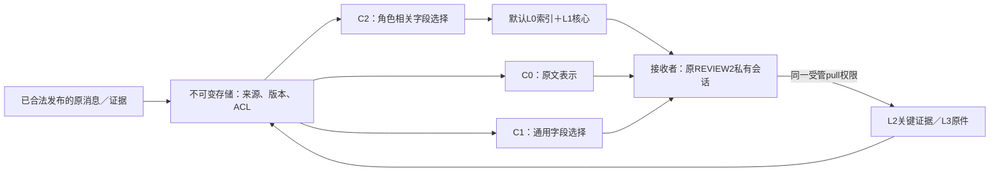

# Communication Pilot V1：审计修订与冻结范围

日期：2026年11月8日。依据用户提供的《通信优化实验协议V1》及本轮明确回复修订。**本文件是协议与实现准备记录，不是72个模型回合的运行回执。当前只完成零模型P0工程控制；P1未准入、未启动，尚无新API现金预算。** 不恢复训练或本地模型权重。

## 1. 保持的实验问题

固定REVIEW2：001开发、返修及最终交付，002独立复核；基础仍为OpenHands＋ProWorkSim受管环境。比较相同题目下C0原始通信、C1通用结构化摘要、C2角色感知分层通信。研究的是默认信息呈现，不新增自主成员，不改变发送与路由规则、角色权限或历史摘要算法。

这里“发送规则不变”指不新增路由／时机优化策略，不保证三个独立模型运行会生成完全相同的消息序列。不同呈现导致的后续行为变化属于处理效果，应记录；不能事后替换消息以强行对齐。

| 固定项 | 设置 |
|---|---|
| Agent模型 | DeepSeek Flash非思考；temperature=1、top_p=1 |
| 上下文／输入／输出 | 131,072／98,304／32,768 token |
| 历史 | 原LLMSummarizingCondenser，max_size=80、keep_first=4，各成员私有历史 |
| 团队总预算 | 每题全队5,000,000输入＋输出，成员、历史摘要、压缩器及模型回读共用 |
| 机会与时间 | 全队512次决定／HTTP尝试；软6小时、硬6.5小时；单请求1,800秒 |
| 结果 | 唯一最终候选的代码正确率、最后合法提交的交付率分别统计 |
| 主要效率 | 全队实际输入及总token；压缩和回读不是免费操作 |

## 2. 根据审计明确的计量层次

三种覆盖率必须分开，不能互相替代：

1. **请求原件与字节来源。** 保存实际序列化JSON、身份、哈希及来源段位置；SDK按事件ID与转换顺序绑定，不能搜索相同文字后猜来源。八类主来源互斥，未知保持未知。
2. **本地token来源估算。** 使用固定本地tokenizer进行分片估算，报告分片边界可能改变分词；messages／tools之外的传输参数不用于抬高输入覆盖率。完整字节映射不等于供应商token精确映射。
3. **供应商实际总账。** 每个物理请求的usage为输入／输出权威值；缓存命中是输入子集，重试独立记账，未知预约不当作实际费用，也不按比例分摊给来源类别。

协议原有98%／2%／单请求p95 5%阈值保留，并分别输出本地估算门与供应商精确门。**当前不能将供应商精确门视为通过。** 如以后决定采用“API总量精确、来源级估算”的机制筛选口径，需要明确修订该门；本轮没有自动放宽。[P0准入报告](software-benchmark-v156-p0-admission-report.md)

生命周期分别记录produced、published、delivered、presented、retrieved、behaviorally_used、validated、incorporated_into_delivery。摘要只证明摘要自身被呈现，不证明其父原文均被接收者看到；呈现、理解、采用和验证不能混成一个事件。

消息正文输出、接收端暴露、回读、重复呈现和压缩器成本均是分析子账。它们可能重叠，**不能与Team总账再次相加**。混合摘要、复合代码等无法精确追溯到具体伙伴内容时保持未知，不用“出现过伙伴消息”就把整个输入归为通信。

## 3. C0／C1／C2当前实现

| 条件 | 呈现机制 | 压缩模型 |
|---|---|---|
| C0 | 不做语义压缩，保留原始发布内容与合法引用 | 不调用 |
| C1 | 固定通用字段的结构化呈现 | 模型选择可核验的来源片段 |
| C2 | L0索引＋L1角色核心信息；L2关键证据、L3完整材料按需读取 | 模型根据接收者职责选择／排序有依据的片段 |

C1／C2共用压缩服务设置：非思考、temperature=0.2、top_p=1、输出上限512；各自固定prompt，C2请求实际携带接收角色。渲染后的L1／通用摘要也检查512本地token上限；L0另计实际呈现成本。压缩器无工具，不作为第三名自主成员。

**本版选择可核验的抽取与重排，不实施任意自由改写。** 模型返回来源fact ID，宿主按不可变原文切片渲染。关键事实、失败与unknown必须保留；schema、版本、引用、计数或字段缺失时回退原文，已花费的压缩费用不退款。没有可信完整事实分片的自然语言消息保持原文，不能把`facts_complete`随意置真。

这些是已经通过CPU控制的机制组件。将真实消息发布、分层回读、压缩服务与原生团队账本连接成P1部署仍需冻结验证，不能把当前原型称为已可运行的72回合队列。

还须在运行绑定中明确旧接口的**最近4条消息／每条500字符预览**：不能悄悄将C0扩为全文默认推送，再称其为原有基线。当前底层renderer返回原文对象，不代表已决定取消运行层预览。本次不改既有接口；P1冻结时须记录实际默认展示范围，三组拥有相同的合法原件回读权限，不增加私有历史／测试日志访问权。C0必须重新运行，不能复用v155的REVIEW2分数。

## 4. 用户已批准的题单修订

Verified500仅有1道Flask题，无法同时满足24题、12仓库且每库最多2题。用户明确选择保留Verified与24题，并允许一个仓库3题。

- 最终为**Flask 1、Requests 3、其余10个仓库各2题**；没有引入非Verified任务。
- 两波各12题；第一波12仓库，第二波11仓库。这是显式批准的仓库分布例外，不伪称每波都覆盖12仓库。
- 24题×C0/C1/C2各一次＝72个团队回合、144个成员席位；不是每题每条件重复3次。
- 来源、题目、seed、条件顺序及两波安排已冻结，不读取模型成绩抽样。每波六种条件排列各出现两次。
- 24题中21题不在v155的40题里，但全部Verified500已有历史模型调用记录；因此**仍是历史暴露的开发性pilot，不是独立确认集**。

[已批准题单](../../artifacts/software-benchmark-v156/communication-design-r1/approved-panel.json)的公开冻结投影SHA256：`a09db3d553af1baf365b3d7c0efc8d29b589cd2c50aff67a6cfbd0c4470591b8`。[原始选择回复](../../artifacts/software-benchmark-v156/communication-design-r1/user-panel-decision.json)仅授权题单修订，不授权模型启动或现金支出。

## 5. 分析与停止规则

主比较是C2－C0、C2－C1的同题差；保留24题分母和全部状态，按仓库分层。24题只做机制筛选，不作总体优越性或正式非劣效声明。第一波只检查测量、账目与执行完整性，不能看分数后改C2或换题。

Peer Exposure下降而Team Input不降，不能称净效率改善。费用包括压缩器重试、fallback及接收者后续回读；未定费用和中断尝试保留。压缩预约不足可回退原文；账本完整性故障不能被当作普通预算不足吞掉。

保真审计预先固定事实类别、版本和风险要求。关键交接全部审阅，普通交接至少25%随机双人盲审；包内不暴露条件标签和最终成绩。原文与原始候选保持，不用最终隐藏测试反馈修订压缩输出。具体审阅者及审阅包生成属于P1准备，当前没有虚构已完成的盲审结果。

## 6. 启动前仍需要什么

1. 解决供应商精确来源门，或经明确同意修订为可识别的估算级机制试跑口径。
2. 冻结真实通信／pull／压缩成本与团队预算的部署绑定、默认预览及24题运行环境资格。
3. 明确新的API现金预算与P1启动确认。旧450元账本不自动转成本轮预算。

理论上限72×5M＝3.6亿输入＋输出token，压缩器包含其中；不是预计消耗，更不是已经批准的现金。以上条件未满足前保持`dispatch_enabled=false`，不启动模型实验。
