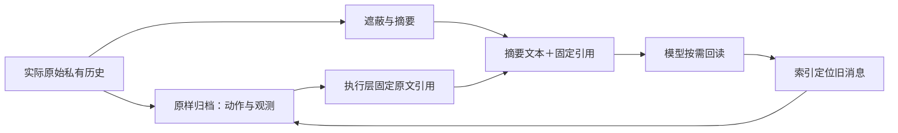

# v176：摘要后原文仍可找到的工程修复

日期：2026-11-09。范围：修复v175 Replay发现的恢复缺口，**零新增API，不替换旧实验结果**。

## 问题

v175的M1、M2用引用替换旧观测，回读库中保留原文。M3还会摘要旧前缀，摘要生成器可能省略这些引用；同时，原库只保存观测，没有保存被摘要删除的助手动作。于是“服务器还存着部分原文”与“模型能找到完整历史”并不等价。

在G0的48点中，23点共208条旧观测没有完整原文或可见引用；G1没有彻底消除问题。这个问题可以靠执行层修复，不依赖模型记住所有引用。

## 实现

`software_context_recovery_v176.py`提供 `HistoryEvidenceStore` 和 `apply_recoverable_summary`：

1. 核对原输入与遮蔽视图属于同一私有历史；非观测消息不得变化，遮蔽观测必须匹配原存储和引用。
2. 封存被摘要前缀的**原始助手动作＋原始工具／环境观测**，保留工具调用与结果的闭合关系。
3. 在摘要之外附带固定 `ctx` 引用。该引用由执行层生成，摘要文本不能将它省略。
4. `context_read`仍只读取同点、同回合、同成员已见过的材料；不增加仓库权限、执行命令或读取其他成员私有状态。
5. 原文首部返回消息范围与字符偏移索引，下一次读取可以直达指定旧动作或结果，不必先顺序展开整个前缀。
6. 摘要连同固定索引必须比原前缀更短，否则保持M1视图。摘要缺省不代表事件从未发生，旧材料也不证明当前版本。

新模块没有热改v175付费执行器，也没有直接启动完整任务。后续部署必须持久化新store并使用新读取类；只把提示文案换成“可以回读”不构成完整接入。

## 验证

4项CPU控制通过：不含任何引用的生成摘要仍可找回原始动作和结果、跨成员访问拒绝、索引成本参与防膨胀判断、改变原动作或替换未见过的观测会被拒绝。测试覆盖按索引直接读取目标消息。

另将46份真实G0／G1摘要原样用于零API检查，46份原始前缀逐页恢复后与原输入完全一致，消息偏移逐项匹配；45份采用，1份因附带引用后不再更短而回退M1。完整展开3–23页、中位13页，保留实际读取成本，不能承诺两次读取即可恢复全部材料。

这证明了存储、权限、索引和原文恢复机制，不证明修复提高模型正确率，也不替代长任务中的回读、再摘要和返工测量。

证据：[CPU及46份原摘要控制](../../artifacts/software-benchmark-v176/summary-recovery-controls-r2/summary.json)。实现：`src/proworksim/software_context_recovery_v176.py`；测试：`tests/test_context_recovery_v176.py`；真实历史控制：`tools/check_context_recovery_v176.py`。
