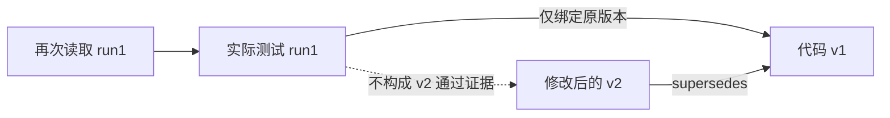

# 私有工作图与三条件上下文实验设计

本设计实现审计要求的单Agent离线P0。它沿用ProWorkSim受管OpenHands接口，增加历史索引和呈现层，不增加工具权限，也不读取未向成员呈现的仓库、测试或评分材料。实际离线结果见[准入报告](software-benchmark-v196-work-graph-p0-report.md)。

## 1 实现边界

图构建器是无文件、无网络、无World访问的纯Python模块。调用者提供实际已经呈现的请求前缀、原始消息位置、当前步骤和成员范围；图只从这些材料构建。离线工具负责校验原始payload哈希，并从以前真实呈现过的消息恢复旧观察。不同任务、不同成员、不同实验组不共享图。

本轮只接入离线回放与CPU控制，提供未来运行接入入口`update_and_project`。原v193运行包、历史策略、日志、结果、补丁和账本不改；没有把离线原型冒充已经部署到新模型队列。

## 2 身份与来源

| 对象 | 身份和约束 |
| --- | --- |
| Source | 回合、成员、原消息位置、消息哈希；记录首次可见步骤 |
| Action | 同一私有范围内的tool_call_id；同ID改变工具或参数则报冲突 |
| Observation | 原消息位置与消息哈希；投影不同的合法已见版本分别留存 |
| TestRun | 回合、成员、report_id；多次读取合并，真实重新执行不合并 |
| Version | object_id、version_id；可见files_sha256不允许冲突 |
| Code | 文件实体按路径；符号按路径、版本、片段哈希、名称和片段行号 |
| Artifact | 操作、patch_id／delivery_id；绑定可见源版本 |

TestRun另绑定已见operation_id、正文哈希、文件哈希、选择器、实际命令和环境字段。未见字段保持缺失。不能只凭“同版本、同选择器”合并真实重跑，也不能在缺少命令／环境信息时认定两次执行完全等价。

每个保留字段记录来源消息、JSON指针，必要时记录字符区间。原动作中的参数可作为“声明的测试选择器”，不能冒称为解析后的实际命令；只有反馈中完整出现的argv才能标为实际观察到的命令。字段在呈现前重新从来源恢复核对。

同报告多页新增字段并入同一事件，同值字段合并来源。测试结果、版本等不可变字段冲突时不静默取最后一次。`validation_status`属于呈现时适用性标签，允许保留来源后更新标签；这不改变原测试的passed值。

## 3 图关系及其证明强度

| 关系 | 可确认的含义 | 不能推导的含义 |
| --- | --- | --- |
| contains | 已见代码片段包含某符号；或报告列出某测试 | 完整仓库已被索引 |
| calls | 可解析片段含某调用表达式 | 运行时分派一定到某定义 |
| imports | 可解析片段含某导入语句 | 导入解析和环境一定正确 |
| tests | 已选／报告中出现的路径或测试位置 | 对代码的真实运行覆盖 |
| modifies | 成功工具结果与原修改动作相连 | 修改必然正确 |
| validates | 某实际执行绑定某版本上的选定公开测试 | 全部测试或隐藏验收通过 |
| supersedes | 已见当前版本转移 | 旧测试自动适用于新版本 |
| derived_from | 已见产物绑定原版本 | 产物已经通过最终验收 |
| depends_on | 只允许Inferred候选依赖 | 自动升级为确定因果关系 |

`observed_in`只用于追溯动作和来源，不参加相关性遍历。`validates`与`supersedes`也不作为遍历捷径，防止整个工作区版本成为连接所有信息的中心。

模块到文件的解析只看已经出现过的路径；即便目前只匹配到一个文件，仍标Inferred。AST只解析可见片段，嵌套函数体内调用不会归到外层函数。片段不能解析时留存原文和失败记录，不访问磁盘补全文件。

## 4 版本与失效

当前版本只来自成员观察中的工作区版本，或成功代码修改的结果；在没有初始版本时，可用首次非补丁read_file的版本。后来出现的旧消息投影不能覆盖更晚的版本证据。读取旧测试报告不会改变当前版本。



代码升级后，旧版本的静态／执行关系留在图里，但不参与当前依赖查询。历史事件仍可因与当前路径相关而被选择，其卡片明确标为`historical_version`，且`text_is_not_new_validation=true`。无法确定版本的错误卡为`unknown`。目前没有根据文件未变而自动沿用旧AST的推断；这会降低召回，但避免无证据继承关系。

## 5 三条件的共同候选池

候选只来自当前窗口以外、确实被替换为原文引用的观察。若同一事实已完整出现在最近窗口，不再重复加入卡片候选。一个实际测试执行最多一个候选，但它可以整合多页信息。

候选字段和卡片渲染对K-v2、G相同，逐点计算候选池哈希证明一致。两组都最多8卡、768本地Token／卡、4096本地Token附加毛额、98,304完整输入。卡片优先放失败名称、错误、位置、路径、命令／选择器、改动片段，再放计数等；未入选字段、整卡预算拒绝和位置冲突记录原因。相同内容在不同请求中再次出现，仍按再次呈现计量。

K-v2按类型优先级、时间排序。G的焦点来自最近三个已经执行的相关动作；找不到时使用最近成功修改，再找不到才使用任务材料中的显式路径。焦点不来自下一动作、参考补丁或最终得分。

G最多遍历两跳，冻结分值为直接路径40、一跳25、两跳12、当前版本8、关键失败6、其他证据2；推断关系乘0.5。没有位置但属于当前版本的失败可按兜底规则进入。分值不能绕过版本、权限或来源约束。

去边诊断保留候选池、焦点、版本规则、预算和渲染，只关闭关系遍历。它是离线诊断，不是新增的真实模型实验组。

## 6 异常回退与原文读取

`update_and_project`将索引维护与视图输出连接起来。图完整性异常时，故障索引在该私有回合内禁用，后续请求回退M1-5并记录原因；不重新生成模型内容，不修改源消息，不改变最近五轮。图选择阶段异常也回退M1-5。跨成员／回合访问直接拒绝，不能通过回退获得另一成员历史。

原文由已有`SourceLabeledHistoryReader`保存，引用绑定私有范围与原消息，分页恢复不会把不同版本拼成新事实。观察字段引用原文；动作参数引用仍完整保留的tool_call_id。不会为了回读额外开放bash或仓库读取权限。

若M1-5本身已经超过完整输入容量，图不会偷偷缩短保护窗口或取消容量门；由既有框架处理正常容量终止。此次48点没有发生该情况。

## 7 离线实验复现

预定计划在`artifacts/software-benchmark-v196/p0-plan-r1/plan.json`，48个点在`fixed-points-r1/manifest.json`。规范结果为`offline-graph-r4`；r1至r3为保留的工程修订记录，不与r4混算。

```bash
# 纯CPU机制控制
.venv/bin/python -m pytest -q tests/test_context_graph_v196.py

# 需要复算时使用新的输出身份；不覆盖已完成r4
LITELLM_LOCAL_MODEL_COST_MAP=True OPENHANDS_SUPPRESS_BANNER=1 \
  .venv/bin/python tools/run_offline_scorer_v096.py \
  tools/replay_work_graph_v196.py --revision independent-reproduction
```

复算器仅在本进程设置两核亲和与低优先级，不改变服务器策略。Tokenizer来自既有本地冻结文件，无模型权重加载或下载。完整图、视图、原文库及逐字段证明gzip存于`runs/software-benchmark-v196/`；Git保留实现、固定计划、摘要、引用哈希、CPU日志和报告。

独立核验程序单独解析实际源消息与AST，不调用选择器重建期望结果。它检查源哈希及首次可见步骤、节点范围、测试与版本、最终卡片文本与字段、原文恢复，以及旧版本依赖未被用于当前查询。这种来源一致性验证不能替代人工标注“哪些依赖对修复确有必要”。

## 8 P1后续协议草案

仅在原型接线、测量和公开测试环境准入完成，并明确新的现金额度后，再冻结任务与seed。目标仍为24题、至少12仓库，A=M1-5、B=M1-5K-v2、C=M1-5G各一次；预选6题对A／C各追加一次，共84回合，每回合5M输入加输出，总上限420M。该上限不是预计消耗或本轮运行授权。

优先避开v181至v195用于真实模型执行的任务，无法避开时标为开发性扩展；整个Verified更早的曝光也需保留。候选池、原文访问、模型模式、工具、初态、预算、单次输入输出和最终评分一致。共同的求解侧环境修复须在首回合前冻结，不在看到中期分数后修改图或换题。

主要结果仍分代码正确率与合法交付率；主测与重复分开，按任务配对、仓库保留层级。效率同时计实际输入输出、图维护与查询CPU／内存、压缩与回读费用。信息质量需独立标注必要依赖、版本错误、遗漏和错误采用，不能用图边数量或最终成功反推准确率。

本轮观察到图边只在2/48点改变选择，因此进入P1前应先确定哪类依赖值得验证、怎样衡量遗漏，避免将单纯路径筛选称为图收益。原M1-5保留为强基线；REVIEW2、通信路由、角色变化、RSI和训练均不在当前实施范围。
