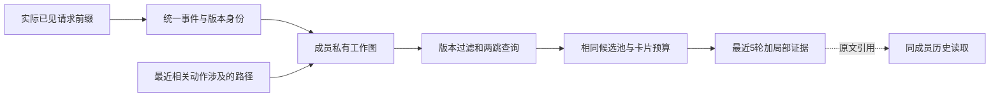

# 图驱动上下文管理离线实验与准入报告

**关键事件去重、诊断信息、版本隔离和图原型已经实现，12题的48个固定历史决策点均通过来源与权限核验。图方法的额外价值仍未得到充分验证：相对修复后的关键卡片，输入量仅下降0.81%；去掉依赖边后，仅2/48个决策点改变选择。**

本轮为v196纯离线P0。按审计要求，只复用历史材料和运行CPU控制；新增模型调用、API费用、容器、GPU操作均为0，没有改变共享服务器配置。没有启动24题三条件或84回合真实评测，也没有转用上一轮剩余现金。

## 1 这一轮比较什么

三种方法读取同一份历史前缀，保留相同的最近5个完整工具周期、动作链、原有提示和工具权限。较早观察始终保存原文并保留私有回读引用。

| 条件 | 默认额外呈现哪些旧信息 |
| --- | --- |
| M1-5 | 不加卡片，只保留旧观察的原文引用 |
| M1-5K-v2 | 修复身份和诊断字段后，按事件类型优先级、再按时间选择卡片 |
| M1-5G | 从最近相关动作涉及的路径出发，通过至多两跳图关系选择相关卡片 |

K-v2与G使用同一候选事件池、同一渲染器、同一原文访问权限；每次最多8张卡、单卡768个本地估计Token、附加卡片总额4096，完整输入仍不超过98,304。4096是相同上限，并不要求两组填满。三种视图均继承131,072上下文和32,768输出的原配置含义，但本轮没有发出推理请求。

材料是v193主测中全部12条M1-5轨迹，覆盖12仓库。每条按请求序列的25%、50%、75%、末尾固定4点，点位在生成比较视图前冻结。轨迹总长只用于离线抽样，不进入选择器；每个点的图只接收当时及此前真正呈现过的消息。各条件仍沿用原轨迹，因此只测信息呈现，不能据此计算新的成功率或完整任务Token。

来源限定为实际API请求payload及其投影索引。旧观察只能按原消息位置和哈希，从此前真实呈现的请求恢复；没有读取未来响应、最终补丁、隐藏评分、完整仓库快照或尚未呈现的公测RPC正文来补图。结果分类使用旧评分，但在独立复盘程序中完成，不输入选择器。

## 2 修复了哪些具体问题

1. **测试执行与报告回读统一身份。** 以私有回合、成员和report_id标识实际执行，逐步绑定可见operation_id、代码版本、文件哈希及报告正文哈希。同一报告的不同页并入同一TestRun，字段取并集；相同版本、相同选择器的真实重跑仍保留不同report_id。已知身份冲突不会静默合并。环境指纹或完整命令未呈现时仍标为未知，不能声称拥有完整的执行等价键。
2. **卡片保留可行动信息。** 从已见页面抽取失败测试名、错误片段、位置、实际argv或原动作中声明的选择器；代码改动保留路径、原动作中的新旧文本摘录，以及已经读取的diff和原文引用。没有看到的字段不补写。补充了SymPy测试标题解析，并修复转义换行被误认成路径前缀的问题。
3. **版本失效规则明确。** 旧测试记录保留，但仅验证其绑定版本上的已选公开测试；旧报告回读不能把当前工作区退回旧版本。代码变化后，旧版本静态关系退出当前依赖查询。未观察到逐文件连续性时，保守按整个工作区版本失效，而不假设未读文件没有变化。
4. **索引异常不阻断求解。** 新的update_and_project入口遇到索引完整性异常时，禁用本回合故障索引并回退M1-5；原文和最近窗口保留。跨成员或跨回合请求仍拒绝访问。它已经通过CPU控制，尚未接入新一轮真实SDK部署。

12条历史实际可见前缀包含60个不同测试执行实体、101个执行／回读来源。它们合并为60个实体，而不是101张独立测试卡；不同页可能提供新信息，不能把两数之差全部称为浪费。原v195统计61次实际测试执行；差额为Seaborn最后一次请求之后的测试，本轮不把它的反馈倒灌到已经结束的输入前缀。

| 可见来源覆盖 | 数量 |
| --- | ---: |
| 失败执行实体 | 28 |
| 已能提取具体失败测试名 | 14/28 |
| 已能提取错误片段 | 18/28 |
| 能保留命令或声明的测试选择器 | 28/28 |
| 代码变化保留路径 | 73/73 |
| 代码变化另有文本或diff摘录 | 62/73 |

失败名覆盖不是100%。部分历史页只展示报告目录、计数、警告或截断片段；删除／重命名等操作也未必有替换文本。这里不把来源缺失伪装成压缩器已经保留了全部关键诊断。完整原文在权限允许范围内仍可回读。

## 3 图记录事实并区分推断

节点包括任务、代码文件／符号、测试／实际执行、动作／观察、产物／版本。每个节点与每条边都有成员范围、首次可见步骤和来源消息。图按新的已见事件增量更新；同一消息重复进入请求不会重复生成实体。

**Confirmed仅表示有来源支持的执行事实或静态语法。** 例如“这段可见函数中写了调用表达式”，不等于运行时一定调用该目标；测试路径出现，也不等于具有运行时覆盖证据。模块名到已见文件的匹配、候选符号解析及假设依赖一律为Inferred。没有模型推断调用或GNN。

共尝试解析126段已经看到的Python片段，其中44段可由AST完整解析。其余不强行补成完整代码。本轮建立的是观察范围内的局部图，不是完整仓库调用图；所有未解析片段的原文仍保留。

查询使用预先冻结的类型／相关性分值。失效、版本和权限属于硬约束，不因相关性高而覆盖。图关系没有被用于改变角色、工具权限、发送时机、收件人或历史摘要算法。

## 4 相同历史上的Token与信息保留

下表是48个固定请求的本地官方Tokenizer配方估计，包含相同工程余量；不是供应商usage，也不是48个完整模型回合的消耗。卡片毛额与最终输入净差不同，因为卡片替换了原引用标记。

| 条件 | 48点输入合计 | 平均每点输入 | 相对M1-5 | 卡片毛额 | 卡片呈现次数 |
| --- | ---: | ---: | ---: | ---: | ---: |
| M1-5 | 1,634,188 | 34,045.6 | +0.00% | 0 | 0 |
| M1-5K-v2 | 1,685,217 | 35,108.7 | +3.12% | 59,950 | 250 |
| M1-5G | 1,671,529 | 34,823.5 | +2.28% | 44,362 | 196 |
| G去边诊断 | 1,670,159 | 34,795.0 | +2.20% | 42,667 | 187 |

G比K-v2少13,688个输入Token（-0.81%），卡片由250降至196（-21.60%），卡片毛额减少26.00%。但G仍比M1-5多2.28%的输入。少放卡片是直接事实，“省下的是不必要信息”还不是已经验证的结论。

| 保留情况 | K-v2 | G |
| --- | ---: | ---: |
| 失败测试卡呈现 | 40 | 25 |
| 具体失败名字段呈现 | 46 | 30 |
| 当前版本卡 | 51 | 50 |
| 明确标为历史版本的卡 | 169 | 138 |
| 版本未知卡 | 30 | 8 |
| 同一请求重复测试实体／来源校验错误／超容量 | 0／0／0 | 0／0／0 |

这些数字是字段与呈现次数，可以在不同请求中重复计数，不是独立任务数或必要事实召回率。G同时减少了失败测试卡，可能省去无关失败，也可能漏掉后来有用的证据；当前没有独立的必要依赖标注来区分二者。

## 5 真正依赖图关系的选择很少

K-v2与G在32/48点的有序选择不同，但不能把这32点全归于图边。保留同一候选池、版本过滤和路径焦点，只关闭依赖边查询后，G仅有2/48点发生选择变化，总共多选9张卡。其余46点与去边诊断完全相同。

| 决策点 | 图关系带来的额外信息 | 证据边界 |
| --- | --- | --- |
| Astropy-12907 第12请求 | 额外保留modeling/core.py的一个代码观察 | 已见import语句，加模块到已见路径的Inferred匹配 |
| Seaborn-3187 第29请求 | 从临时测试路径关联到scales.py，增加8项代码／修改／diff／错误信息 | 同样依赖Inferred模块匹配；旧版本信息仍标历史，不变成当前测试证据 |

这9张卡没有增加失败测试卡数量。合成控制能够验证“相关失败通过依赖被保留”的机制，但历史12题没有显示这项机制已经普遍产生关键诊断收益。因此，**当前差异主要来自局部路径筛选，不能声称显式依赖图已经优于独立卡片，更不能据此扩大到组织协同优化。**

## 6 四类历史结果的复盘

全部12题均纳入：M1-5独有成功1题、旧K独有成功1题、两组都成功9题、两组都失败1题。这里的K是上一轮M1-5K，不能与尚未做真实评测的K-v2混称。下面四例用于解释机制，完整12题见[案例数据](../../artifacts/software-benchmark-v196/retrospective-cases-r1/cases.json)。

| 类别与任务 | M1-5实际Token／请求 | 旧K实际Token／请求 | 旧K卡片呈现／重复 |
| --- | ---: | ---: | ---: |
| sphinx-doc__sphinx-8721，仅M1-5成功 | 2,769,345／82 | 4,969,987／126 | 588／15 |
| sympy__sympy-13091，仅旧K成功 | 2,727,994／73 | 4,993,299／112 | 553／28 |
| astropy__astropy-12907，都成功 | 1,550,716／47 | 775,870／25 | 46／0 |
| mwaskom__seaborn-3187，都失败 | 4,991,230／113 | 4,966,934／108 | 575／123 |

**Sphinx。** M1-5在页面生成入口增加限制后通过；旧K扩大viewcode改动，最终目标测试及两项原有测试未通过，并触及5M门。29张不同来源卡首次呈现之后的下一动作中，11次读文件、11次读测试报告；其中2次是同报告的即时回读。这支持“卡片并未结束进一步的信息查找”，不证明是哪张卡引发了返工。

**SymPy。** 旧K实现覆盖更完整，最终通过；M1-5遗漏unknown type比较测试。旧K多用39次请求、约226.53万Token，仍有28次完全相同字段的额外卡片呈现。两条轨迹都没有context_read。M1-10预选重复也能从失败翻为成功，因此旧K独有成功不能作为某个历史事件必不可少的证据。

**Astropy。** 两组均成功，旧K只用25次请求、77.59万Token，低于M1-5的47次、155.07万。它没有同报告重复卡片。这个例子说明旧K并非每题都会多花Token；不同实现轨迹的重要性不能被整体均值掩盖。本次图在这题确实增加一个相关代码观察，但没有重新运行模型，不能据此解释旧K的成功或提速。

**Seaborn。** 两组均触及5M，M1-5只剩relational图例路径失败，旧K两条目标路径都失败。旧K有123次重复卡片呈现，但两组都缺少完整修复，不能把失败全归于重复文本，也不能保证加额就能成功。新图在这题增加的是历史代码信息；没有证据表明它能弥补尚未覆盖的修复路径。

上述首次呈现后续动作按卡片来源计数，多个卡片可对应同一请求；“随后读取／修改”只是时间关联，不等于模型采用了卡片。四类复盘均不依据最终成绩反推历史事实的重要性。

**与v190／v191的关系。** 之前pytest-10051的139个被遮蔽旧观察可从真实历史恢复，但没有context_read；不同方法采用了不同日志handler修复路径。Matplotlib-24149的M1-10只用约75万Token即因单次输入容量停止，并非5M不足；v191又定位到公测证据明细绕过分页。本轮继承已修复的短页头，不重新把这些容量故障归给图选择。详见[原P0审计](software-benchmark-v191-critical-context-p0-report.md)和[原结果报告](software-benchmark-v190-context-pilot-report.md)。

## 7 CPU成本与验证边界

最终一次离线实验核对500个实际历史输入，恢复26,169次旧观察呈现；48个点×三主条件及去边诊断，共192份视图。单次完成墙钟71.62秒、进程CPU71.62秒，进程峰值RSS约247.7MiB，包含本地Tokenizer、源payload、验证器和临时视图，不是纯图内存。

500步中，规范事件构建累计4.619秒，含依赖关系的图构建累计4.749秒。末态12张图未压缩JSON合计37.81MiB，最大单图9.13MiB；图中包括来源原文。查询、Tokenizer和序列化另计在进程总成本内。

开发中保留r1至r3的结果和对应源码哈希：r2修订过期边过滤，r3修订转义路径及SymPy失败标题解析；r4增加独立校验强度和图构建异常回退控制后作为规范结果。四次离线复算合计285.75进程CPU秒，累计工具墙钟285.81秒（有交叠，不能当作整个开发的实际历时），派生图与视图文件合计约123MiB；CPU控制未单独做精密计时。不是四次模型试跑，不能选择其中最有利的一版当确认结果；所有修订均未调整冻结的选择权重或点位。

22项CPU控制全部通过，覆盖不同测试执行身份、同报告不同读取、版本替代、推断降级、关联与无关历史、候选池一致、原文分页、跨成员拒绝、索引异常回退及确定性。独立校验模块不导入图构建器或选择器，直接检查实际payload见证、字段原值、AST语法、版本边与最终呈现文本；它是独立实现的程序核验，不是外部人工审计或必要依赖金标准。

## 8 准入决定和下一步

**P0工程控制通过；P1本次不启动。** 当前足以保留M1-5G为候选原型，但尚不足以证明图边的增量收益。下一步应先对已见依赖做独立标注，明确“少放无关信息”和“漏掉有用信息”的区别，再决定是否投入24题三条件的真实机制评测。

正式运行前还需：将新入口与真实SDK请求、context_read及usage捕获完成零API接线验证；冻结新题单、seed和现金预算；单独检查求解侧公开测试环境。Requests-5414的httpbin夹具递归、trustme／mocker依赖和隔离网络问题属于求解环境准入，图不会替它们修复。本轮没有宣称这些环境已重新通过。

审计提出的24题×3条件加12次预选重复，共84回合、每回合5M、理论420M总上限，仍为后续设计。它需要新的预算安排，不能自动动用旧约75元余额。暂不进入REVIEW2图协作、路由调整、RSI或训练。

## 9 复核入口

- [冻结离线计划](../../artifacts/software-benchmark-v196/p0-plan-r1/plan.json)与[48点清单](../../artifacts/software-benchmark-v196/fixed-points-r1/manifest.json)。
- [完整统计与逐点证据](../../artifacts/software-benchmark-v196/offline-graph-r4/summary.json)、[准入决定](../../artifacts/software-benchmark-v196/p0-admission-r1/decision.json)、[实现与后续协议](software-benchmark-v196-work-graph-design.md)。
- [工作图](../../src/proworksim/software_context_graph_v196.py)、[视图选择与回退](../../src/proworksim/software_context_selection_v196.py)、[独立校验](../../src/proworksim/software_context_graph_check_v196.py)、[CPU控制](../../tests/test_context_graph_v196.py)。
- [离线复算](../../tools/replay_work_graph_v196.py)、[历史案例复盘](../../tools/audit_graph_cases_v196.py)、[报告生成](../../tools/write_work_graph_report_v196.py)。原请求、版本、补丁和评分保持原样。
