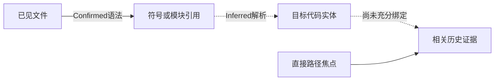

# 依赖关系感知上下文选择实验报告

**本轮不支持扩大当前图方法的真实模型实验。Confirmed关系驱动的G3与不使用图边的G2，在全部48个决策点、三个预算档上选择完全相同；相对独立事件保护G1，G3还遗漏了更多被盲审标为必要的旧证据。**

已完成v197离线修订、两路独立AI盲审、第三路盲审仲裁、五组消融与历史动态图回放。新增被测模型API、容器、GPU操作均为0；没有改动共享服务器配置。审阅由Codex子代理完成，平台未提供其独立Token／费用账单，不能把审阅计算成本写成0。本报告没有新的代码正确率或合法交付率。

## 1 五组分别保留什么

| 条件 | 做法 | 回答的问题 |
| --- | --- | --- |
| G0 | M1-5，最近5轮完整观察加旧观察原文引用 | 不加历史卡片的基础表现 |
| G1 | K-v2，按事件类型与时间选择 | 独立关键事件保护能保留什么 |
| G2 | 路径焦点与版本约束，不遍历依赖边 | 路径筛选本身有什么影响 |
| G3 | G2加关系类型条件化查询，只走Confirmed边 | 确认关系是否提供额外选择价值 |
| G4 | 同上，再允许明确标记的Inferred关系 | 推断关系有什么收益和风险 |

五组共用v196的规范事件、候选池、卡片渲染、来源权限和原文回读，保留相同动作链、近期窗口、系统说明与工具。每点附加预算分别为1024、2048、4096个本地估计Token；主比较预定为4096，最多8张卡，单卡最多768，完整输入上限98,304。不是根据标注或成绩挑预算。

材料仍是12题的48个固定历史决策点；没有新增独立任务。主比较共720份视图，另外四项预定单组件诊断各48份，共912份离线视图。不同点的历史可以重叠，不能当成48道独立任务或912次模型试验。

本轮将原统一两跳遍历改成按执行状态区分的关系路径：代码阶段看contains/calls/imports，测试阶段看报告与测试关系，版本阶段看修改与产物来源。G3绝不把Inferred改称Confirmed。共同约束仍包括权限、原文来源、版本失效和原始历史保存；相关性分值不能覆盖这些约束。

## 2 独立标注及其局限

两名隔离的AI审阅者按顺序检查每点当时可见的任务、近期观察和历史候选；完成一点即封存。它们不能读取实验选择、图查询规则、其他审阅者、未来响应或最终评分。第三名AI审阅者再查看同点前缀与双方分歧，独立仲裁。规则与查询策略在汇总标签之前冻结，没有根据标签调整权重。

这是**AI辅助参考标注，不是人工金标准**。审阅者来自同类模型，可能存在相关偏差；候选全集也来自共同规范事件，不能据此证明规范事件已覆盖所有必要事实。模型本身可能具有先验知识，流程隔离不等于能证明不存在记忆影响。

| 标注情况 | 结果 |
| --- | ---: |
| 每位初审覆盖 | 48点、617个候选事件 |
| 初审四分类一致率 | 85.41% |
| 必要／非必要二分类 Cohen κ | 0.7225 |
| 必要项正类一致率 | 72.73% |
| 非空必要集合平均Jaccard | 0.6833（10点） |
| 分歧及处理 | 90项已仲裁，事件标签未定0项 |
| 仲裁后标签 | 必要8、有用192、当前决策不相关417 |

κ和Jaccard均达到事前0.60的准入线。由于必要项稀少，不能只报99.03%的二分类一致率；正类一致率与Jaccard更能显示实际一致程度。8项必要旧事件分布于8个决策点、6道任务，其余40点没有额外旧事件被判为必要。这不表示任务本身不需要信息，而是当前问题、近期观察和保留动作已经提供了很多信息。

仲裁覆盖标签为：37点有明确跨文件材料、16点有失败与修改关系、40点有版本变化，均达到至少12点的目标。这些类别重叠，也包含Issue自带的历史追踪；不等于37点具有当前版本的执行覆盖证明，更不等于图已正确解析所有关系。

审阅中发现原始Issue和后续同位置消息投影的引用歧义。已逐点核实Issue来自第0步首次呈现的消息1，并追加原消息哈希和JSON指针；旧标签没有回改。另有一条以brief.json:issue明确引用的关系，保留其原空索引并通过来源附录解析。

## 3 相同4096上限下的主结果

**必要旧事件召回**的分母是上述8项，而不是全部任务知识；**证据精确率**指所选卡片中被标为必要或有用的比例。它们衡量默认卡片选择，不等于卡片中每个必要细节都完整呈现，更不等于模型理解、使用或修复成功。所有方法仍能回读相同原文。G0不额外选卡，所以这个局部指标为0，不代表G0整体上下文缺少全部必要信息。

| 条件 | 必要旧事件召回 | 证据精确率 | 关键失败保留 | 输入Token估计合计 | 卡片数 | 不相关卡片 |
| --- | ---: | ---: | ---: | ---: | ---: | ---: |
| G0 | 0/8（0.00%） | — | 0.00% | 1,634,188 | 0 | 0 |
| G1 | 7/8（87.50%） | 33.60% | 100.00% | 1,685,217 | 250 | 166 |
| G2 | 3/8（37.50%） | 37.43% | 20.00% | 1,670,159 | 187 | 117 |
| G3 | 3/8（37.50%） | 37.43% | 20.00% | 1,670,159 | 187 | 117 |
| G4 | 3/8（37.50%） | 37.24% | 20.00% | 1,671,529 | 196 | 123 |

G2／G3比G1少放63张卡、输入估计少约0.89%，精确率略高；但必要旧事件从7/8下降到3/8，5项必要失败仅保留1项。**少放的信息并不全是冗余，现有路径筛选同时漏掉了关键诊断。** 按任务先平均再汇总，G1必要事件召回为83.33%，G2／G3为50.00%，方向不变；这仍只是6题含必要旧事件的小面板结果。

G4只比G3多选9张卡，其中3项被标为有用、6项不相关，没有补回任何遗漏的必要事件。不能把新增卡片或图边数量当作收益。

## 4 漏掉的信息具体是什么

| 决策点 | G2／G3遗漏的必要旧证据 | 直接机制 |
| --- | --- | --- |
| Requests P018 | requests/models.py中ASCII前导点主机绕过IDNA分支的具体实现 | 当前焦点转向urllib3和测试文件，旧源文件被路径筛选排除 |
| Sphinx P024 | 当前版本完整公开套件130项失败的报告 | 无路径失败进入候选，但排序较低，被8卡上限挤出 |
| Seaborn P046 | 百万级数值仍显示1.0–3.0的具体失败输出 | 旧临时测试路径不在当前焦点 |
| Seaborn P047 | ScalarFormatter、1e6偏移量与实际标签的诊断记录 | 旧诊断文件不在当前焦点 |
| Seaborn P048 | 当前全套公开测试6项失败，与最新子集2项失败的差别 | 全套失败关联路径不在最新选定测试焦点 |

这里既有路径资格筛选问题，也有必要失败被排序和卡片数量挤出的问题，不能统称为Token预算不足。卡片已标记历史版本时，保留旧失败是为了说明尚未解决的限制，不能把它改成当前版本通过或失败的证明。此处没有据隐藏成绩倒推“必要”。

四项单组件诊断进一步区分原因：

| 诊断条件 | 必要旧事件召回 | 输入Token估计 | 说明 |
| --- | ---: | ---: | --- |
| 去掉路径资格筛选及路径加分，保留其余排序 | 8/8 | 1,682,255 | 全局候选中存在所需信息，当前路径条件会漏掉它 |
| 仅取消当前版本的软加分 | 3/8 | 1,670,159 | 本面板未改变选择；没有关闭版本真实性硬约束 |
| 增加任务文本中的显式路径／符号检索 | 4/8 | 1,678,093 | 补回Requests源码，仍未解决多数失败证据遗漏 |
| 任务检索再加Confirmed边 | 4/8 | 与上一行相同 | 图边仍无额外贡献 |

这些是事前冻结的离线诊断，不是根据结果调出的新正式算法。去掉路径条件的8/8是值得检验的开发线索，不能直接宣称它提高真实任务完成率。

## 5 质量与预算的关系

| 预算上限 | G1召回／精确率 | G2与G3召回／精确率 | G4召回／精确率 |
| --- | --- | --- | --- |
| 1024 | 75.00%／30.20% | 37.50%／39.53% | 37.50%／40.00% |
| 2048 | 87.50%／34.19% | 37.50%／36.72% | 37.50%／36.56% |
| 4096 | 87.50%／33.60% | 37.50%／37.43% | 37.50%／37.24% |

G1从1024增至2048时补回一项必要事件；再增至4096没有继续增加召回，反而增加不相关卡。G2／G3三个预算档始终3/8，说明扩大附加Token上限不能解决资格筛选和排序问题。完整质量—成本数据可从[CSV](../../artifacts/software-benchmark-v197/annotated-results-r1/quality-cost.csv)复绘；Token为固定请求的本地估计，不是新供应商usage或整回合成本。

## 6 为什么Confirmed边没有发挥作用

12张末态图包含492条calls、160条imports等Confirmed语法关系，但没有一条边的两端同时绑定到两个不同的明确文件路径。调用表达式一般止于“调用引用”，导入一般止于“模块引用”；从引用解析到真正的代码实体仍主要是Inferred。不能为了让G3有结果，就把这些解析假设改成Confirmed。

在48次状态查询中，G3总共到达233个非起点节点，但可对应到的11项候选事件原本已由直接路径覆盖，新增候选为0。候选主要挂在文件、观察或测试事件上；到达一个符号节点不等于能找到另一项相关历史。这指向**引用解析、候选与代码实体的绑定、失败证据选择**三个实际缺口，单纯增加跳数或图节点数量不足以证明改进。

独立依赖标注共有123次必要关系记录，但多数使用函数、测试集合、版本或复合实体表述。当前严格按明确文件路径映射的诊断只能对应2条跨文件关系，G3／G4均为0/2；另121条属于符号级、版本级或尚不能唯一映射的关系，**不能把0/2写成完整依赖召回率为0**。下一轮须先把关系标注绑定到稳定实体ID、来源片段和逐跳证据，再评价完整路径覆盖；不能用模糊名称匹配补成“正确边”。

## 7 动态维护与成本

从来源事件日志重新逐步构建了500步历史，恢复全部48个冻结图快照，哈希完全一致；后续新事件没有改变先前快照。该回放累计CPU约5.81秒。新增可见代码触发调用关系更新；仅见局部replace片段时只更新版本与失效状态，不假装已经读取了新文件全貌。

11项新增CPU控制通过：五组候选一致、三档预算、Confirmed／Inferred分离、按关系类型查询、旧边失效、近期窗口保持、任务检索不访问未见实体、权限拒绝、异常回退、快照不可变、新调用可见性及指标空分母／不确定性处理。这是单成员历史回放与合成工程验证，不是在线Agent、伙伴补丁采用或角色变化的验证。

912份视图计算墙钟127.78秒、进程CPU127.78秒，峰值RSS约232.9MiB，包含Tokenizer与输入／输出对象。查询顺序复用了分词缓存，因此不能用G3较短的程序计时宣称它比G2更快。图维护、视图计算与审阅成本分别记录，没有把CPU秒和Token相加成虚构的统一成本。

原始实验、两路初审、仲裁、分歧及历史快照均保留。独立审阅成本未获平台计量；本轮没有向DeepSeek发请求或消费旧API余额。所有文件操作与CPU限制仅作用于本项目普通用户进程。

## 8 准入决定与后续修订重点

| 准入项 | 结果 |
| --- | --- |
| 来源、权限、版本、CPU工程控制 | 通过 |
| 两路AI标注一致性 | 达到冻结门槛；不等于人工金标准 |
| G3在相同预算下优于G2 | 未通过：选择与指标完全相同 |
| 启动72个主回合或更大模型试验 | 本轮不启动 |

后续优先修订的不是模型规模或Token上限，而是：**保留全局关键失败，避免当前路径独占选择；建立源代码实体到历史证据的明确绑定；为静态解析关系定义可核验的证明范围；将依赖标注转换为来源绑定的实体与路径记录。** 当前G3不应直接扩大，也不应继续用更复杂传播掩盖实体解析缺口。

这些修订需要在新冻结的开发决策点上验证，不把本轮617个标签反复调参后的成绩当独立确认。只有关系本身在等预算下显示增量价值，再做真实单Agent任务；之后才进入固定REVIEW2的上下文与通信对照。组织、权限、成员数量、发送时机、训练和RSI均未在本轮改变。

## 9 文件与复算

- [冻结协议](../../artifacts/software-benchmark-v197/protocol-r1/plan.json)与[查询策略](../../artifacts/software-benchmark-v197/query-policy-r1/policy.json)。
- [完整标注统计与准入结果](../../artifacts/software-benchmark-v197/annotated-results-r1/summary.json)、[912份视图索引](../../artifacts/software-benchmark-v197/ablation-r1/summary.json)、[必要事件遗漏](../../artifacts/software-benchmark-v197/essential-case-audit-r1/rows.json)。
- [独立初审A](../../artifacts/software-benchmark-v197/reviewer-A-r1/)、[独立初审B](../../artifacts/software-benchmark-v197/reviewer-B-r1/)、[仲裁原件](../../artifacts/software-benchmark-v197/adjudicator-r1/)、[Issue来源附录](../../artifacts/software-benchmark-v197/annotation-provenance-addendum-r1/issue-sources.json)。
- [图结构诊断](../../artifacts/software-benchmark-v197/graph-structure-r1/summary.json)、[动态回放](../../artifacts/software-benchmark-v197/dynamic-replay-r1/summary.json)、[实施说明](software-benchmark-v197-dependency-query-design.md)。
