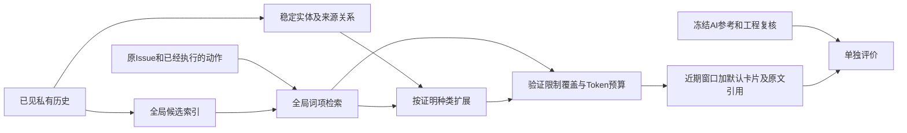

# 全局证据发现与稳定实体实现说明

本轮按v197审计实施P0工程与P1离线开发准备。用户已将人工审阅方式改为“你自行审阅”，因此交付的是主助手AI工程复核及来源记录，不是人工金标准。结果与限制见[报告](software-benchmark-v198-global-evidence-report.md)。

## 1 两条相互独立的数据流

求解条件的开发只读实际已见前缀；评价另读旧AI标注和本次复核记录。检索器不接收必要标签、最终评分、参考补丁、下一步动作或尚未呈现的测试正文。

原v196/v197文件不改。v198源码、计划、当前代码、实验实际使用的源码分别留存；已有v197报告的用户编辑也不覆盖。

## 2 全局候选与共同约束

基于已有M1-5投影恢复实际曾呈现的旧观察，原位置和消息哈希必须一致。保留全部原规范事件，并补充搜索、状态、笔记和其他工具观察。当前窗口、原始问题和动作仍按原方式保留；较早内容可通过已有私有context_read恢复。

词项检索为确定性BM25，k1=1.2、b=0.75，查询仅取原Issue及最近3个实际动作。路径匹配只加2分，当前版本加1分，失败测试加2分，时间用于平分时排序。它不是向量检索或模型摘要，也不跨成员读取数据。

G1采用事件类型和时间排序；G2至G4采用共同检索和覆盖约束。G3增加来源明确的实体／证据联系，G4再允许标记为Inferred的静态解析候选。图只调整已合法发现候选的组织，不决定候选能否存在。

主预算4096，敏感性1024／2048；单卡最多768，完整输入最多98,304。共同取消8卡硬上限。原文引用不等于原文已经呈现；卡片里的摘录始终绑定原字段和字符区间。

## 3 覆盖约束的准确含义

G2至G4优先保留每个精确选择器最后一次未成功的实际测试记录，若后来同一选择器已有成功记录，则不再把旧失败作为此项强制提示。同选择器的不同真实运行不合并，仍保留不同report_id。

这表示“最后观察到的验证状态需要提示”，并不表示某个缺陷尚未修复。不同版本、不同测试范围和未知环境不能混称为相同执行。缺少选择器时使用独立执行身份，不猜测两次未知运行等价。未执行报告可以留作历史，但不建立validates关系，也不进入实际失败保护集。

这条规则也可能保护故意失败的诊断探针或环境异常，因此不是语义必要性金标准。保护项超过预算时输出best effort和明确的未覆盖清单；保留原文入口，不假称约束满足，不中断其他离线点。

## 4 实体身份与代码片段

| 实体 | 身份与边界 |
| --- | --- |
| Repository／Commit | 仓库及实际基线SHA，只作身份元数据 |
| Version | 基线commit加私有工作区引用；编辑版本不是新Git commit |
| File | 仓库、私有版本和路径；路径被提及不等于完整内容已见 |
| Symbol | 完整可见文件上的限定名、签名、版本与路径 |
| Reference | 无法确定限定名或目标的片段／引用，明确未解析 |
| TestDefinition | 已报告测试名称的稳定身份；body_seen标明是否见过函数体 |
| TestRun | 回合、成员、report_id；实际重跑保留独立身份 |
| Observation／Artifact／Task | 原消息与哈希、产物版本、issue与根任务身份 |

物理索引键还包含私有回合和成员，避免不同尝试的同名v2或相同路径发生混淆。当前实现保守处理成功read_file的内容；没有自动从所有写入、动态导入、重导出或别名恢复完整定义。未映射只说明当前解析器无法唯一绑定，不是证明原始历史不存在该实体。

同一路径、同一私有版本的字符区间可以拼接。区间缺口、总长度冲突或重叠文字不一致都不能当成完整文件。只在完整文本可解析时建立限定名和签名；同名方法通过类／函数作用域区分。不会把去缩进的局部方法伪装成顶层函数。

## 5 关系证据与适用性

关系保留端点、来源消息、字段或拼接后行区间、基线commit、私有版本、首次可见步骤和适用性。语法引用只证明文本中出现该表达式；模块到文件的静态匹配仍为Inferred，不能证明运行时分派或Issue因果。

`valid_from`记录证据的可见起点，`valid_until`仅在后续版本转换已有证据时填写。旧版本可能在首次回读时就已经过期，因此`valid_until=null`不能理解为当前有效；当前适用性由精确workspace_reference比较决定。历史证据依然保存，不继承为新版本测试通过。

123条旧关系逐一尝试绑定，限定名、版本或实际报告不足时保留Reference及候选／未解析原因。只有端点都绑定且存在对应来源边，才列为已获直接关系证据；AI标注文本本身不生成Confirmed边。

## 6 评价与输出级边界

旧8项必要事件及617项标签只能作为开发回归参考。新增候选无标签时，精确率下界把它们视为未获正例支持，上界允许它们为正；这是缺失标签范围，不是统计置信区间。

本轮还单列事件卡片的字面事实探针。事件被选中、原文可回读、关键事实实际出现在默认卡片、模型实际使用信息，是不同阶段。没有真实模型调用就不能宣称完成后两项行为验证。旧标签评价原文，不能直接作为默认卡片的完整保真标签。

## 7 留出与后续阶段

留出r2固定12任务、10仓库，排除已用于v175选定点、v181和v193上下文开发的Issue。Sphinx-8593因源结构检查时打印过问题开头被提前剔除，替换为固定哈希顺序选择的Sphinx-9698，原清单保留。此处理发生在任何留出轨迹或评分读取之前，与成绩无关。

这些任务更早参与过开发／校准，因此只能说相对本阶段查询开发任务隔离，不能声称完全未暴露。留出当前仅有身份清单，尚无新独立标注、运行环境准入或真实模型评测。

本轮没有扩展图传播深度，没有引入GNN、角色变化、责任分派、通信路由、RSI或训练。下一阶段首先修正默认内容与必要源片段的对齐，并验证状态去重；科学门通过后才考虑留出评估及新预算下的真实任务。

## 8 文件入口

- [实体实现](../../src/proworksim/software_evidence_entities_v198.py)、[全局检索实现](../../src/proworksim/software_global_evidence_v198.py)、[CPU控制](../../tests/test_global_evidence_v198.py)。
- [离线运行器](../../tools/run_global_evidence_v198.py)、[端点映射](../../tools/map_evidence_annotations_v198.py)、[开发评分](../../tools/score_global_development_v198.py)、[报告生成](../../tools/write_global_evidence_report_v198.py)。
- [冻结方案](../../artifacts/software-benchmark-v198/protocol-r1/plan.json)、[实验原源码封存](../../artifacts/software-benchmark-v198/development-source-r1/manifest.json)、[留出r2](../../artifacts/software-benchmark-v198/holdout-reservation-r2/manifest.json)。

离线运行器拒绝覆盖完成的开发摘要。复算应使用新的派生输出身份，并明确使用实验封存版还是包含后续边界控制的当前代码。原报告、旧标注、过去模型回合及全部结果不改写。
