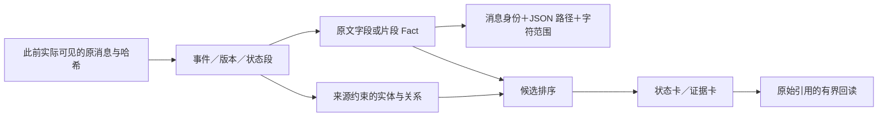

# v199 实现与证据附录

本附录服务于 [主报告](software-benchmark-v199-fact-context-report.md)，规范版本 r4，2026-11-11。以下指标只描述历史开发视图。

## A. 三级数据与来源规则



Fact 字段为 id、event_id、kind、name、value、origins、version、semantic_location、status、presentation_role。每个 origin 包含 source_id、message_index、message_sha256、channel、pointer、可选字符 span／调用下标。相同值但不同含义（如 executed=False 与 passed=False）不合并。精确文件／报告位置可合并同一事实的来源；不靠相似文本认定身份。

状态身份按工作空间版本、测试覆盖、交付、任务、消息、交接及个人笔记／todo 建立。只有连续相同状态段归并；只增长的历史条目计数另列为 occurrence_counter，数值与原文保留。TestRun 按实际 report 身份合并页与回读；同选择器重跑、不同版本执行仍是不同 TestRun。代码按私有作用域、完整版本和路径归组，不把另一版本片段拼入当前定义。

成功完整写入必须同时有真实调用参数与成功回执、路径和 source_reference；只写在计划里或失败写入不能构成定义来源。修改后的工作空间版本不是新 Git commit。静态 ImportAlias 为 Reference；静态可解析候选仍不证明运行时调用。

两种卡使用共同硬限。历史状态可显示，但须带版本／superseded 状态；历史测试不证明当前代码正确。每张卡保留替换位置的原始引用以及实际选中事实的来源引用。没有使用生成摘要作为新事实来源。

## B. 冻结的选择算法

- 查询：原 issue 与最近 3 个实际动作。BM25 k1=1.2、b=0.75；当前路径匹配加 2、当前版本加 1；失败状态本身不额外加检索分。
- E2/E3/E4 的保护：同精确 selector 最近实际执行且未成功的记录。保护不足显式报告，不把更旧成功当覆盖新版本的成功。
- Fact 默认优先级：counts100、passed99、显式 assert False95、异常／警告90、诊断输出85、断言上下文80、完整可见函数75、控制链72、分派表70、失败测试名60、语句40；同类再按词法相关性及稳定身份排序。已完整引用的同来源子片段不重复引用。
- E4：从前 8 个检索起点沿一条当前有效 Confirmed 的 declares／references／reports_test 边寻找非起点实体，给其已在共同候选池内的事件加 1。它改变排序资格，不引入此前未见材料；不把全局 Version 节点当全仓桥梁，不用 Inferred 边。
- 最近 5 个工具周期、原始行动链、输入工具定义及权限不变。附加卡片总预算 1024／2048／4096，单卡 768，全输入 98304，无固定卡片数上限。

这些规则在各修订首次运行前冻结。r2/r3/r4 的具体工程原因和源码快照分别保留；最终不得复用 r1 图自奖励解释收益。

## C. 19 条事前冻结的事实参考

| 事实 | 原文／值 | 来源消息 | E3 直接显示 | 合法回读 |
| --- | --- | --- | --- | --- |
| P007-F01 | 185 | 111 | 是 | 是 |
| P007-F02 | 2 | 111 | 是 | 是 |
| P007-F03 | DeprecationWarning | 114 | 是 | 是 |
| P018-F01 | if not unicode_is_ascii(host): | 26 | 否 | 是 |
| P018-F02 | elif host.startswith(u'*'): | 26 | 否 | 是 |
| P024-F01 | 130 | 218 | 是 | 是 |
| P040-F01 | assert_array_equal(eclf1.predict(X), eclf2.predict(X)) | 51 | 是 | 是 |
| P040-F02 | clf4 = KNeighborsClassifier() | 51 | 是 | 是 |
| P040-F03 | assert_raise_message(ValueError, msg, eclf3.fit, X, y, sample_weight) | 51 | 是 | 是 |
| P041-F01 | _separable(transform.left) | 11 | 是 | 是 |
| P041-F02 | '&': _cstack | 11 | 否 | 是 |
| P041-F03 | return _operators\[transform.op\](sepleft, sepright) | 11 | 是 | 是 |
| P046-F01 | \['1.0', '1.5', '2.0', '2.5', '3.0'\] | 140 | 是 | 是 |
| P046-F02 | assert labels == \[\"1.0\", \"2.0\", \"3.0\"\] | 140 | 否 | 是 |
| P047-F01 | ScalarFormatter | 173 | 否 | 是 |
| P047-F02 | OFFSET NOW '1e6' | 173 | 是 | 是 |
| P047-F03 | USE_OFFSET True | 173 | 否 | 是 |
| P047-F04 | assert False | 173 | 是 | 是 |
| P048-F01 | 6 | 317 | 是 | 是 |

4 条为结构化计数字段，15 条为字面文本片段。直接覆盖按来源身份和指针／区间校验，不能仅靠相同数字或文字在其他位置出现。原字段的父结构包含相同子值时可算覆盖；错误来源或截断片段不算。合法恢复还要求引用实际出现在该方法输入中，不能仅凭后台存储有原文。

所有参考事实在候选清单中均可定位，所有文本目标都有原文区间；这只是既知开发参考上的覆盖。事实是否普遍必要、遗漏其他必要事实与无关 Fact 比例没有独立全量标注，故不报告虚构的 Fact Precision。

9 次 CPU reader 调用均按 8192 字符上限回读并拼回原件，未发送给模型。Agent 使用率为未测量，不能写成 100% 恢复或 0% 使用成功。

## D. 123 条关系：覆盖与限制

56/246 端点唯一绑定；187 未解决、3 歧义。8 条直接关系均属于有执行来源的测试—版本关系；1 条仅两端绑定；114 条未映射。48 个最终实体注册表与用于关系复核的注册表哈希一致，复用该复核不会混用实现。

| 失败／限制分类（可重叠） | 端点数 |
| --- | --- |
| 引用范围含不完整文件片段，不能直接确定完整限定名 | 86 |
| 引用来源中未建立该名称的完整定义 | 55 |
| 外部库或动态目标未取得定义／运行时绑定 | 5 |
| 存在多个兼容实体／版本 | 3 |
| 描述性端点，尚不是单一实体身份 | 111 |
| 引用含增量修改，当前完整定义构建器未重建文件 | 41 |
| 多对象或含排除版本的复合标注 | 36 |
| 同名定义存在，但不在引用来源／版本范围 | 4 |
| 表达式或动态分派，不能直接当实体 | 19 |
| 可见别名与端点相关，但运行时目标仍未证实 | 4 |
| 当前端点形式不支持或缺少身份依据 | 2 |

分类可重叠，属于当前解析器与引用范围的诊断，不是已经证明的唯一根因。描述性／复合标注需先拆成可核查实体，不能随意从一句话挑出想要的部分。partial 或增量修改来源未被当前完整定义解析器覆盖，不代表原任务模型不知道该代码。4 条相关别名未解决不是所有别名失败；外部／动态对象不能仅由 AST 升为 Confirmed。

每条关系的完整原标注、两端实体或失败引用、逐跳边、版本、证据片段和确认状态均在 [relation-review-r2/summary.json](../../artifacts/software-benchmark-v199/relation-review-r2/summary.json)。411 段诊断引用已经逐段按原消息哈希、指针及字符范围复核。下面列全部 123 条，保留原标注索引：

| 条目 | 原标注端点 | 端点状态 | 关系证据／限制 |
| --- | --- | --- | --- |
| P001-0 | xarray/core/indexes.py:PandasMultiIndex.create_variables → xarray/core/indexing.py:PandasMultiIndexingAdapter | unresolved／unresolved | 引用范围含不完整文件片段，不能直接确定完整限定名 |
| P001-1 | PandasMultiIndexingAdapter.__array__ → pandas.MultiIndex.get_level_values | unresolved／unresolved | 引用来源中未建立该名称的完整定义；引用范围含不完整文件片段，不能直接确定完整限定名；外部库或动态目标未取得定义／运行时绑定 |
| P001-2 | xarray/core/indexing.py:PandasMultiIndexingAdapter → xarray/core/indexing.py:PandasIndexingAdapter | unresolved／unresolved | 引用范围含不完整文件片段，不能直接确定完整限定名 |
| P002-1 | selected stack/index tests → v2 | ambiguous／bound | 存在多个兼容实体／版本；描述性端点，尚不是单一实体身份 |
| P003-0 | v2:PandasMultiIndexingAdapter.__array__ → numpy.asarray | unresolved／unresolved | 引用来源中未建立该名称的完整定义；外部库或动态目标未取得定义／运行时绑定 |
| P003-1 | selected public tests → v2 | ambiguous／bound | 存在多个兼容实体／版本；描述性端点，尚不是单一实体身份 |
| P004-0 | xarray/tests/test_dataset.py:TestDataset.test_stack_preserves_index_dtype → Dataset.stack / Dataset.unstack | unresolved／unresolved | 引用含增量修改，当前完整定义构建器未重建文件；引用范围含不完整文件片段，不能直接确定完整限定名；多对象或含排除版本的复合标注；描述性端点，尚不是单一实体身份 |
| P004-1 | test-report-265ad3e9f1e82f5853c6a01f → patch-2 / delivery-2 / v3 | bound／unresolved | 多对象或含排除版本的复合标注；描述性端点，尚不是单一实体身份 |
| P005-0 | Basic.__ne__ → Basic.__eq__ | unresolved／unresolved | 引用含增量修改，当前完整定义构建器未重建文件；引用来源中未建立该名称的完整定义 |
| P005-1 | Expr.__ge__/__le__/__gt__/__lt__ → _sympify / relational constructors | unresolved／unresolved | 引用范围含不完整文件片段，不能直接确定完整限定名；多对象或含排除版本的复合标注；描述性端点，尚不是单一实体身份 |
| P006-0 | Expr.__lt__ → Basic.has / Basic._has | unresolved／unresolved | 引用来源中未建立该名称的完整定义；多对象或含排除版本的复合标注；描述性端点，尚不是单一实体身份 |
| P006-1 | Basic._has → Basic._has_matcher / Basic.__eq__ | unresolved／unresolved | 引用含增量修改，当前完整定义构建器未重建文件；引用来源中未建立该名称的完整定义；引用范围含不完整文件片段，不能直接确定完整限定名；多对象或含排除版本的复合标注；描述性端点，尚不是单一实体身份 |
| P006-2 | test-report-3922ccc77ea510a5f6ddfca2 → v6 | bound／bound | 有逐条来源关系证明 |
| P007-0 | test_expr_ordering_delegates_to_reflected → assert (x < f) is True | unresolved／unresolved | 同名定义存在，但不在引用来源／版本范围；描述性端点，尚不是单一实体身份；表达式或动态分派，不能直接当实体 |
| P007-1 | test_ordering_delegates_to_reflected_method → Foo.__gt__ / Expr.__lt__ | bound／unresolved | 多对象或含排除版本的复合标注；描述性端点，尚不是单一实体身份 |
| P007-2 | v7 failing assumptions evaluation → sympy/assumptions/sathandlers.py → collections.MutableMapping | unresolved／bound | 描述性端点，尚不是单一实体身份 |
| P007-3 | focused failed test → v8 (not v10) | unresolved／unresolved | 描述性端点，尚不是单一实体身份；多对象或含排除版本的复合标注；表达式或动态分派，不能直接当实体 |
| P008-0 | focused test-report-bf7e745d604616efcc6c96c5 → v15 | bound／bound | 有逐条来源关系证明 |
| P008-1 | v16 broad report → patch-2 / delivery-2 | bound／unresolved | 多对象或含排除版本的复合标注；描述性端点，尚不是单一实体身份 |
| P009-0 | Run.__init__ (jobs == 0) → _cpu_count | unresolved／unresolved | 描述性端点，尚不是单一实体身份；表达式或动态分派，不能直接当实体；引用范围含不完整文件片段，不能直接确定完整限定名；引用来源中未建立该名称的完整定义 |
| P009-1 | _cpu_count → _query_cpu | unresolved／unresolved | 引用含增量修改，当前完整定义构建器未重建文件；引用来源中未建立该名称的完整定义；引用范围含不完整文件片段，不能直接确定完整限定名 |
| P010-0 | _cpu_count → _query_cpu | unresolved／unresolved | 引用来源中未建立该名称的完整定义；引用范围含不完整文件片段，不能直接确定完整限定名 |
| P010-1 | Run.__init__ → _cpu_count | unresolved／unresolved | 引用来源中未建立该名称的完整定义；引用范围含不完整文件片段，不能直接确定完整限定名 |
| P010-2 | 5 selected tests → v2 | bound／bound | 有逐条来源关系证明 |
| P011-0 | _cpu_count → _query_cpu | unresolved／unresolved | 引用含增量修改，当前完整定义构建器未重建文件；引用来源中未建立该名称的完整定义；引用范围含不完整文件片段，不能直接确定完整限定名 |
| P011-1 | v2 public test-report-c349ec9b405acdce7694ab03 → v3 repair | bound／unresolved | 描述性端点，尚不是单一实体身份 |
| P012-0 | _cpu_count → _query_cpu | unresolved／unresolved | 引用含增量修改，当前完整定义构建器未重建文件；引用来源中未建立该名称的完整定义；引用范围含不完整文件片段，不能直接确定完整限定名 |
| P012-1 | selected jobs/cpu/parallel tests → v3 / patch-2 / delivery-2 | bound／unresolved | 多对象或含排除版本的复合标注；描述性端点，尚不是单一实体身份 |
| P014-0 | Blueprint.__init__ name checks → Blueprint.name assignment | unresolved／unresolved | 描述性端点，尚不是单一实体身份；引用范围含不完整文件片段，不能直接确定完整限定名 |
| P015-0 | Blueprint.__init__ → ValueError for falsy name | unresolved／unresolved | 引用含增量修改，当前完整定义构建器未重建文件；引用来源中未建立该名称的完整定义；描述性端点，尚不是单一实体身份 |
| P015-1 | tests/test_blueprints.py run → patch-1 / v2 | unresolved／unresolved | 描述性端点，尚不是单一实体身份；多对象或含排除版本的复合标注 |
| P016-0 | Blueprint.__init__ → empty-name ValueError | unresolved／unresolved | 引用来源中未建立该名称的完整定义；描述性端点，尚不是单一实体身份 |
| P016-1 | 59-test blueprint report → v2 delivery-1 | bound／unresolved | 描述性端点，尚不是单一实体身份 |
| P017-0 | PreparedRequest.prepare_url → _get_idna_encoded_host | unresolved／unresolved | 引用来源中未建立该名称的完整定义；引用范围含不完整文件片段，不能直接确定完整限定名 |
| P018-0 | prepare_url → _get_idna_encoded_host | unresolved／unresolved | 引用来源中未建立该名称的完整定义；引用范围含不完整文件片段，不能直接确定完整限定名 |
| P018-1 | test_invalid_url\[InvalidURL-http://.example.com\] → urllib3.util.connection.create_connection | unresolved／unresolved | 表达式或动态分派，不能直接当实体；外部库或动态目标未取得定义／运行时绑定；引用来源中未建立该名称的完整定义 |
| P018-2 | failed regression → v3 | unresolved／bound | 描述性端点，尚不是单一实体身份 |
| P019-0 | test_invalid_url\[http://.example.com\] → requests.get / InvalidURL expectation | unresolved／unresolved | 引用含增量修改，当前完整定义构建器未重建文件；表达式或动态分派，不能直接当实体；引用范围含不完整文件片段，不能直接确定完整限定名；多对象或含排除版本的复合标注；描述性端点，尚不是单一实体身份 |
| P019-1 | PreparedRequest.prepare_url → host.split('.') | unresolved／unresolved | 引用含增量修改，当前完整定义构建器未重建文件；引用来源中未建立该名称的完整定义；表达式或动态分派，不能直接当实体 |
| P019-2 | broad URL test errors → fixture/network setup | unresolved／unresolved | 描述性端点，尚不是单一实体身份 |
| P019-3 | issue regression / broader URL run → v4 | ambiguous／bound | 存在多个兼容实体／版本；多对象或含排除版本的复合标注；描述性端点，尚不是单一实体身份 |
| P020-1 | test_invalid_url → InvalidURL exception type | unresolved／unresolved | 引用来源中未建立该名称的完整定义；描述性端点，尚不是单一实体身份 |
| P020-2 | prepare_url → host.split('.') | unresolved／unresolved | 引用来源中未建立该名称的完整定义；表达式或动态分派，不能直接当实体 |
| P020-3 | InvalidURL parameterized regression → v4 | unresolved／bound | 描述性端点，尚不是单一实体身份 |
| P021-0 | sphinx/builders/html/__init__.py:gen_pages_from_extensions → sphinx/ext/viewcode.py:collect_pages | unresolved／bound | 可见别名与端点相关，但运行时目标仍未证实；引用范围含不完整文件片段，不能直接确定完整限定名 |
| P021-1 | doctree_read → env._viewcode_modules / collect_pages | bound／unresolved | 多对象或含排除版本的复合标注；引用含增量修改，当前完整定义构建器未重建文件；描述性端点，尚不是单一实体身份 |
| P021-2 | HTML persisted _viewcode_modules → later EPUB collect_pages | unresolved／unresolved | 引用含增量修改，当前完整定义构建器未重建文件；描述性端点，尚不是单一实体身份 |
| P021-3 | EPUB builder → HTML builder collection event | unresolved／unresolved | 描述性端点，尚不是单一实体身份；引用范围含不完整文件片段，不能直接确定完整限定名 |
| P022-0 | test_viewcode / test_viewcode_epub_default → v5 | unresolved／bound | 多对象或含排除版本的复合标注；描述性端点，尚不是单一实体身份 |
| P022-1 | test_viewcode → app.builder.build_all / generated HTML assertions | unresolved／unresolved | 引用来源中未建立该名称的完整定义；引用范围含不完整文件片段，不能直接确定完整限定名；多对象或含排除版本的复合标注；描述性端点，尚不是单一实体身份 |
| P022-2 | remaining public failure → v6 | unresolved／bound | 描述性端点，尚不是单一实体身份 |
| P023-0 | tests/test_ext_viewcode.py:test_viewcode → app.builder.build_all / generated module HTML assertions | bound／unresolved | 多对象或含排除版本的复合标注；描述性端点，尚不是单一实体身份 |
| P023-1 | test-report-048503c14bf9e4ce7cda9a84 → test_viewcode call phase on v6 | bound／unresolved | 描述性端点，尚不是单一实体身份 |
| P023-2 | current failing test call → v6 | unresolved／bound | 描述性端点，尚不是单一实体身份 |
| P024-2 | test_viewcode_epub_default → fresh EPUB absence checks | unresolved／unresolved | 同名定义存在，但不在引用来源／版本范围；描述性端点，尚不是单一实体身份 |
| P024-3 | full test report → v7 | bound／bound | 有逐条来源关系证明 |
| P024-4 | EPUB builder name / default configuration → collect_pages guard | unresolved／unresolved | 多对象或含排除版本的复合标注；描述性端点，尚不是单一实体身份 |
| P025-0 | Axes.hexbin C-supplied accumulation → reduce_C_function | unresolved／unresolved | 引用含增量修改，当前完整定义构建器未重建文件；描述性端点，尚不是单一实体身份；引用范围含不完整文件片段，不能直接确定完整限定名；引用来源中未建立该名称的完整定义 |
| P025-1 | selected hexbin tests → v2 | bound／bound | 有逐条来源关系证明 |
| P026-0 | C-supplied hexbin branch → reduce_C_function(empty bin) | unresolved／unresolved | 描述性端点，尚不是单一实体身份；引用范围含不完整文件片段，不能直接确定完整限定名；表达式或动态分派，不能直接当实体 |
| P026-1 | selected hexbin tests / patch-1 / delivery-1 → v2 | bound／bound | 有逐条来源关系证明 |
| P027-0 | test_mincnt_independent_of_C / test_mincnt_one_keeps_single_point_hexagons → Axes.hexbin | unresolved／unresolved | 多对象或含排除版本的复合标注；描述性端点，尚不是单一实体身份；引用来源中未建立该名称的完整定义 |
| P027-1 | focused regression tests → v4 | unresolved／bound | 描述性端点，尚不是单一实体身份 |
| P027-2 | hexbin mincnt=None → empty-bin reducer call | unresolved／unresolved | 描述性端点，尚不是单一实体身份；引用范围含不完整文件片段，不能直接确定完整限定名 |
| P028-0 | v4 focused tests → Axes.hexbin explicit mincnt 1/2/3 | unresolved／unresolved | 描述性端点，尚不是单一实体身份 |
| P028-1 | v6 selected tests / patch-2 / delivery-2 → final source diff | bound／unresolved | 描述性端点，尚不是单一实体身份 |
| P028-2 | mincnt=None → reduce_C_function(\[\]) | unresolved／unresolved | 当前端点形式不支持或缺少身份依据；表达式或动态分派，不能直接当实体 |
| P028-3 | temporary issue regression → v4 (not current v6 whole tree) | unresolved／unresolved | 描述性端点，尚不是单一实体身份；多对象或含排除版本的复合标注；表达式或动态分派，不能直接当实体 |
| P029-0 | DatabaseCache._base_set → DatabaseCache._cull | bound／bound | 两端已绑定；缺少要求的关系语义证明 |
| P029-1 | DatabaseCache._cull → connection.ops.cache_key_culling_sql / cursor.fetchone | bound／unresolved | 多对象或含排除版本的复合标注；描述性端点，尚不是单一实体身份 |
| P030-0 | _perform_cull_test → cache.set / cache.has_key | unresolved／unresolved | 引用来源中未建立该名称的完整定义；引用范围含不完整文件片段，不能直接确定完整限定名；多对象或含排除版本的复合标注；描述性端点，尚不是单一实体身份 |
| P030-1 | DBCacheTests.test_cull / DBCacheWithTimeZoneTests.test_cull → v2 | unresolved／bound | 多对象或含排除版本的复合标注；描述性端点，尚不是单一实体身份 |
| P030-2 | removed DELETE → missing size cull | unresolved／unresolved | 引用含增量修改，当前完整定义构建器未重建文件；描述性端点，尚不是单一实体身份；引用范围含不完整文件片段，不能直接确定完整限定名 |
| P031-0 | _cull boundary row → conditional DELETE | unresolved／unresolved | 引用含增量修改，当前完整定义构建器未重建文件；描述性端点，尚不是单一实体身份 |
| P031-1 | DBCacheTests and DBCacheWithTimeZoneTests → v3 | unresolved／bound | 描述性端点，尚不是单一实体身份 |
| P032-0 | DatabaseCache._cull → connection.ops.cache_key_culling_sql | unresolved／unresolved | 同名定义存在，但不在引用来源／版本范围；引用来源中未建立该名称的完整定义 |
| P032-1 | existing _perform_cull_test → cache set / has_key | unresolved／unresolved | 描述性端点，尚不是单一实体身份；引用范围含不完整文件片段，不能直接确定完整限定名；多对象或含排除版本的复合标注 |
| P032-2 | 112-test report → v3 delivery-1 | bound／unresolved | 描述性端点，尚不是单一实体身份 |
| P032-4 | row=None → skip boundary DELETE | unresolved／unresolved | 当前端点形式不支持或缺少身份依据；描述性端点，尚不是单一实体身份 |
| P033-0 | visit → os.DirEntry.is_dir / recurse / visit | unresolved／unresolved | 引用来源中未建立该名称的完整定义；引用范围含不完整文件片段，不能直接确定完整限定名；多对象或含排除版本的复合标注；描述性端点，尚不是单一实体身份；外部库或动态目标未取得定义／运行时绑定 |
| P034-0 | visit recursion → os.DirEntry.is_dir() | unresolved／unresolved | 引用含增量修改，当前完整定义构建器未重建文件；描述性端点，尚不是单一实体身份；引用范围含不完整文件片段，不能直接确定完整限定名；表达式或动态分派，不能直接当实体；外部库或动态目标未取得定义／运行时绑定 |
| P034-1 | pathlib/collection selected tests → v2 | bound／bound | 有逐条来源关系证明 |
| P035-0 | visit → entry.is_dir / recurse / recursive visit | unresolved／unresolved | 引用来源中未建立该名称的完整定义；多对象或含排除版本的复合标注；描述性端点，尚不是单一实体身份 |
| P035-1 | pathlib/collection test run and delivery → v2 | bound／bound | 有逐条来源关系证明 |
| P036-0 | test_collect_sub_with_symlinks → symlink_or_skip / testdir.runpytest | unresolved／unresolved | 引用来源中未建立该名称的完整定义；引用范围含不完整文件片段，不能直接确定完整限定名；多对象或含排除版本的复合标注；描述性端点，尚不是单一实体身份 |
| P036-1 | visit → directory symlink traversal | unresolved／unresolved | 引用来源中未建立该名称的完整定义；描述性端点，尚不是单一实体身份 |
| P036-2 | focused file-symlink plus pathlib selection → v2 | unresolved／bound | 描述性端点，尚不是单一实体身份 |
| P036-3 | test collection → pathlib.visit | unresolved／unresolved | 描述性端点，尚不是单一实体身份；引用范围含不完整文件片段，不能直接确定完整限定名；引用来源中未建立该名称的完整定义 |
| P037-0 | _BaseVoting.fit sample_weight validation → has_fit_parameter(step, 'sample_weight') | unresolved／unresolved | 描述性端点，尚不是单一实体身份；引用范围含不完整文件片段，不能直接确定完整限定名；表达式或动态分派，不能直接当实体 |
| P037-1 | VotingClassifier.fit / VotingRegressor.fit → _BaseVoting.fit | unresolved／unresolved | 多对象或含排除版本的复合标注；描述性端点，尚不是单一实体身份；引用范围含不完整文件片段，不能直接确定完整限定名；引用来源中未建立该名称的完整定义 |
| P037-2 | _BaseVoting.fit → _parallel_fit_estimator | unresolved／unresolved | 引用来源中未建立该名称的完整定义；引用范围含不完整文件片段，不能直接确定完整限定名 |
| P038-0 | _BaseVoting.fit → has_fit_parameter / _parallel_fit_estimator | unresolved／unresolved | 引用来源中未建立该名称的完整定义；引用范围含不完整文件片段，不能直接确定完整限定名；多对象或含排除版本的复合标注；描述性端点，尚不是单一实体身份 |
| P038-1 | voting test report → v2 delivery-1 | bound／unresolved | 描述性端点，尚不是单一实体身份；引用范围含不完整文件片段，不能直接确定完整限定名 |
| P038-2 | _BaseVoting.set_params → _set_params('estimators',...)  | unresolved／unresolved | 引用来源中未建立该名称的完整定义；引用范围含不完整文件片段，不能直接确定完整限定名；描述性端点，尚不是单一实体身份；表达式或动态分派，不能直接当实体 |
| P039-0 | test_sample_weight → VotingClassifier.fit/predict/predict_proba | unresolved／unresolved | 引用来源中未建立该名称的完整定义；引用范围含不完整文件片段，不能直接确定完整限定名 |
| P039-1 | _BaseVoting.fit → _parallel_fit_estimator | unresolved／unresolved | 引用来源中未建立该名称的完整定义；引用范围含不完整文件片段，不能直接确定完整限定名 |
| P040-0 | sklearn/ensemble/voting.py → sklearn/utils/validation.py:has_fit_parameter | bound／unresolved | 引用范围含不完整文件片段，不能直接确定完整限定名 |
| P040-1 | _BaseVoting.fit → _parallel_fit_estimator / estimator.fit | unresolved／unresolved | 引用来源中未建立该名称的完整定义；引用范围含不完整文件片段，不能直接确定完整限定名；多对象或含排除版本的复合标注；描述性端点，尚不是单一实体身份 |
| P040-2 | sample_weight test selection → v2 | unresolved／bound | 描述性端点，尚不是单一实体身份 |
| P040-3 | test_sample_weight → VotingClassifier.fit (non-None estimator combinations) | unresolved／unresolved | 引用来源中未建立该名称的完整定义；引用范围含不完整文件片段，不能直接确定完整限定名；描述性端点，尚不是单一实体身份；表达式或动态分派，不能直接当实体 |
| P041-0 | separability_matrix → _separable -> _operators\['&'\] -> _cstack | bound／unresolved | 多对象或含排除版本的复合标注；描述性端点，尚不是单一实体身份；表达式或动态分派，不能直接当实体 |
| P041-2 | test_cstack → _cstack | bound／unresolved | 同名定义存在，但不在引用来源／版本范围；可见别名与端点相关，但运行时目标仍未证实 |
| P042-0 | _separable(CompoundModel) → _operators\['&'\]/_cstack with ndarray operands | unresolved／unresolved | 表达式或动态分派，不能直接当实体；引用范围含不完整文件片段，不能直接确定完整限定名；描述性端点，尚不是单一实体身份 |
| P043-0 | test_nested_compound_separable → separability_matrix flat/nested models | unresolved／unresolved | 引用含增量修改，当前完整定义构建器未重建文件；引用来源中未建立该名称的完整定义；描述性端点，尚不是单一实体身份 |
| P043-1 | _separable(CompoundModel) → _cstack ndarray branch | unresolved／unresolved | 表达式或动态分派，不能直接当实体；引用范围含不完整文件片段，不能直接确定完整限定名；描述性端点，尚不是单一实体身份 |
| P043-2 | 12-test passing run → v4 / patch-1 / delivery-1 | bound／unresolved | 多对象或含排除版本的复合标注；描述性端点，尚不是单一实体身份 |
| P044-0 | _separable CompoundModel recursion → _cstack right ndarray block | unresolved／unresolved | 引用含增量修改，当前完整定义构建器未重建文件；描述性端点，尚不是单一实体身份；引用范围含不完整文件片段，不能直接确定完整限定名 |
| P044-1 | test_nested_compound_separable → v7 public matrix behavior | unresolved／unresolved | 引用含增量修改，当前完整定义构建器未重建文件；引用来源中未建立该名称的完整定义；描述性端点，尚不是单一实体身份 |
| P044-2 | v7 report → patch-2 / delivery-2 | bound／unresolved | 多对象或含排除版本的复合标注；描述性端点，尚不是单一实体身份 |
| P045-0 | temporary offset test → Continuous._setup signature | unresolved／unresolved | 描述性端点，尚不是单一实体身份；可见别名与端点相关，但运行时目标仍未证实 |
| P045-1 | ContinuousBase._setup → formatter.format_ticks / get_offset | unresolved／unresolved | 引用来源中未建立该名称的完整定义；引用范围含不完整文件片段，不能直接确定完整限定名；多对象或含排除版本的复合标注；描述性端点，尚不是单一实体身份 |
| P046-0 | test_offset_labels_show_true_values → Continuous._setup large-value labels | bound／unresolved | 描述性端点，尚不是单一实体身份；可见别名与端点相关，但运行时目标仍未证实 |
| P046-1 | initial diagnostic _get_scale → _tick_params initialization | unresolved／unresolved | 描述性端点，尚不是单一实体身份 |
| P046-2 | current _setup offset handling → formatter.set_useOffset(False) | unresolved／unresolved | 引用含增量修改，当前完整定义构建器未重建文件；描述性端点，尚不是单一实体身份；表达式或动态分派，不能直接当实体 |
| P046-3 | large-label and small-label assertions → v11 | unresolved／bound | 描述性端点，尚不是单一实体身份 |
| P047-0 | PseudoAxis formatter probe → ScalarFormatter get_offset/get_useOffset | unresolved／unresolved | 描述性端点，尚不是单一实体身份 |
| P047-1 | v22 formatting change → set_useOffset / private _offset | unresolved／unresolved | 引用含增量修改，当前完整定义构建器未重建文件；描述性端点，尚不是单一实体身份；多对象或含排除版本的复合标注 |
| P047-2 | offset and small-value regressions → v22 | unresolved／bound | 描述性端点，尚不是单一实体身份 |
| P048-0 | ContinuousBase._setup → formatter.get_offset -> numeric :g labels | unresolved／unresolved | 引用含增量修改，当前完整定义构建器未重建文件；引用来源中未建立该名称的完整定义；多对象或含排除版本的复合标注；描述性端点，尚不是单一实体身份 |
| P048-1 | Temporal → ContinuousBase._setup | unresolved／unresolved | 引用来源中未建立该名称的完整定义；引用范围含不完整文件片段，不能直接确定完整限定名 |
| P048-2 | focused v29 reproduction → large-label substring and small-label list | unresolved／unresolved | 描述性端点，尚不是单一实体身份 |
| P048-3 | full suite / four-module subset → v30 | unresolved／bound | 多对象或含排除版本的复合标注；描述性端点，尚不是单一实体身份 |
| P048-4 | temporary offset regression → v29 | unresolved／bound | 描述性端点，尚不是单一实体身份 |

## E. 工程准入、成本与复现

| 门 | 结果 | 依据 |
| --- | --- | --- |
| G1 | PASS | 19 reference facts and15 textual spans have exact source locations; necessity is AI development reference only |
| G2 | PASS | TestRun, TestDefinition and private workspace Version identities remain distinct |
| G3 | PASS | 522 added events map to237 groups; raw occurrences retained; counter-only reads merge while real transitions persist |
| G4 | PASS | All selected values independently recover from observed source; no generated paraphrase |
| G5 | PASS | Version-scoped edges and historical labels checked; stale edges cannot justify current query |
| G6 | PASS_WITH_LIMIT | Every graph bonus requires a sourced current edge; eligible candidate counts by budget={1024: 1, 2048: 1, 4096: 1}; no efficacy claim |
| G7 | PASS | 187 unresolved and3 ambiguous endpoints remain explicit; no forced Confirmed relation |
| G8 | PASS | 19/19 references recoverable in every final condition/budget; bounded CPU reader verification is not Agent use |

21 项 CPU 控制涵盖：警告／stdout／故意失败区分、函数与控制链片段、连续状态与 A-B-A、版本隔离、测试分页与真实重跑、代码版本归一、同值不同字段、五条件共享事实、来源恢复、篡改拒绝、成功写入与失败写入、历史不可变、同下标不同来源、重复子片段、跨成员拒绝、预算不足、引用区间、结构化字段、原位置回读保留、呈现计数、图边证据与失效过滤。

最终 720 视图逐项检查 6,229 次来源值，0 权限／版本／预算错误；未满足保护的低预算记录单列，不能称硬限错误。首次开发控制中的失败为测试夹具短观察／首观察不应遮蔽、权限异常类型等断言修正，日志原样保留。

规范运行命令（已执行，完成目录禁止覆盖）：

```bash
LITELLM_LOCAL_MODEL_COST_MAP=True OPENHANDS_SUPPRESS_BANNER=1 .venv/bin/python tools/run_offline_scorer_v096.py tools/run_fact_context_v199.py --revision-r4
.venv/bin/python tools/score_fact_context_v199.py --revision-r4
.venv/bin/python tools/audit_fact_context_v199.py
.venv/bin/python -m pytest -q tests/test_fact_context_v199.py
```

不要为了复算而覆盖 r1–r4 或自动重跑模型。源码快照位于 `artifacts/software-benchmark-v199/development-source-r4/`，大体积原文／视图位于 `runs/software-benchmark-v199/development-r4/`，轻量指标含路径与哈希。

主实现：[事实模型与选择](../../src/proworksim/software_fact_context_v199.py)、[实体来源](../../src/proworksim/software_evidence_bindings_v199.py)、[独立事实覆盖判据](../../src/proworksim/software_fact_metrics_v199.py)、[执行器](../../tools/run_fact_context_v199.py)、[评分](../../tools/score_fact_context_v199.py)、[关系复核](../../tools/map_fact_relations_v199.py)、[最终审计](../../tools/audit_fact_context_v199.py)。

最终结果是工程通过、开发对照完成、科学增量门不通过。没有打开留出内容，没有新 API、Docker、GPU、训练或共享服务器修改；过去现金账本未动。审阅为主助手 AI，依用户此前明确指定；不冒称人工或独立专家审查。
