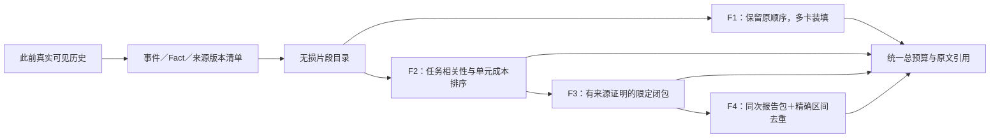

# v200：实现、逐项覆盖与后续接口附录

对应[主报告](software-benchmark-v200-fact-budget-report.md)，2026-11-12。算法不是按这19个参考ID配置；以下表格只由冻结视图事后计算。

## A. 默认事实覆盖

| 参考事实 | 原值／片段 | F0 | F1 | F2 | F3 | F4 |
| --- | --- | --- | --- | --- | --- | --- |
| P007-F01 | 185 | 是 | 是 | 是 | 是 | 是 |
| P007-F02 | 2 | 是 | 是 | 是 | 是 | 是 |
| P007-F03 | DeprecationWarning | 是 | 是 | 是 | 是 | 是 |
| P018-F01 | if not unicode_is_ascii(host): | 否 | 是 | 是 | 是 | 是 |
| P018-F02 | elif host.startswith(u'*'): | 否 | 是 | 是 | 是 | 是 |
| P024-F01 | 130 | 是 | 是 | 是 | 是 | 是 |
| P040-F01 | assert_array_equal(eclf1.predict(X), eclf2.predict(X)) | 是 | 是 | 否 | 否 | 否 |
| P040-F02 | clf4 = KNeighborsClassifier() | 是 | 是 | 否 | 否 | 否 |
| P040-F03 | assert_raise_message(ValueError, msg, eclf3.fit, X, y, sample_weight) | 是 | 是 | 是 | 是 | 是 |
| P041-F01 | _separable(transform.left) | 是 | 是 | 是 | 是 | 是 |
| P041-F02 | '&': _cstack | 否 | 是 | 是 | 是 | 是 |
| P041-F03 | return _operators\[transform.op\](sepleft, sepright) | 是 | 是 | 是 | 是 | 是 |
| P046-F01 | \['1.0', '1.5', '2.0', '2.5', '3.0'\] | 是 | 是 | 是 | 是 | 否 |
| P046-F02 | assert labels == \[\"1.0\", \"2.0\", \"3.0\"\] | 否 | 是 | 是 | 是 | 是 |
| P047-F01 | ScalarFormatter | 否 | 是 | 是 | 是 | 否 |
| P047-F02 | OFFSET NOW '1e6' | 是 | 是 | 是 | 是 | 否 |
| P047-F03 | USE_OFFSET True | 否 | 是 | 否 | 否 | 否 |
| P047-F04 | assert False | 是 | 是 | 否 | 否 | 否 |
| P048-F01 | 6 | 是 | 是 | 是 | 是 | 是 |

结构化值通过 JSON 指针验证；跨多个呈现片段的文本必须以精确区间并集完整覆盖，缺一段不计完整。相似词、别的测试执行、另一版本相同代码不自动成为本来源的事实。近期窗口、动作链、未改原文及附加卡片分别计量，并集只计一次。

## B. 预算与辅助指标

| 预算 | 条件 | 输入 token | 卡片 | 已选来源依赖闭合／触发 | 复核样本相关／无关／未知 | 未标注 Fact 呈现数 |
| --- | --- | --- | --- | --- | --- | --- |
| 1024 | F0 | 1669332 | 77 | 0/0 | 1/1/1 | 282 |
| 1024 | F1 | 1674276 | 83 | 0/0 | 2/0/1 | 259 |
| 1024 | F2 | 1671093 | 112 | 0/0 | 1/1/2 | 334 |
| 1024 | F3 | 1671093 | 112 | 0/0 | 1/1/2 | 334 |
| 1024 | F4 | 1671262 | 98 | 2/2 | 1/1/1 | 293 |
| 2048 | F0 | 1703225 | 134 | 2/2 | 2/2/1 | 553 |
| 2048 | F1 | 1713796 | 142 | 4/4 | 1/1/1 | 546 |
| 2048 | F2 | 1708842 | 200 | 2/2 | 3/2/1 | 623 |
| 2048 | F3 | 1708842 | 200 | 2/2 | 3/2/1 | 623 |
| 2048 | F4 | 1710080 | 176 | 2/2 | 3/2/1 | 559 |
| 4096 | F0 | 1763407 | 243 | 8/8 | 2/4/1 | 1167 |
| 4096 | F1 | 1785919 | 271 | 8/8 | 2/3/1 | 1097 |
| 4096 | F2 | 1780128 | 315 | 8/8 | 4/2/1 | 1252 |
| 4096 | F3 | 1780128 | 315 | 8/8 | 4/2/1 | 1252 |
| 4096 | F4 | 1784441 | 305 | 2/2 | 3/2/1 | 1097 |

源限定关系总目录仅8个单元级链接。F4主档2/2只代表已呈现触发项的闭合，不代表覆盖了全部8个链接；F0–F3主档是8/8。不要用较小条件分母制造“依赖完整率提高”。未标注数是逐点不同Fact ID的呈现次数，不是独立事实总数或错误数。总体Fact Precision保持未定，不能将小样本比例外推。

## C. 24项补充复核

| 条目 | 原事件层 | 事实相关性判断 | 说明 |
| --- | --- | --- | --- |
| S01 P012 | useful | relevant | 读取cpu_shares是CPU份额计算的输入；与jobs=0有关，但该单语句不证明最终边界处理。 |
| S02 P030 | useful | irrelevant | 当前问题是空查询结果的索引，日期取得分支不解释该失败。 |
| S03 P043 | useful | relevant | 当前版本公测记录的validation_status有来源；verified不等于已隐藏验收或所有测试通过。 |
| S04 P045 | useful | unknown | 这是日期格式器分支，当前问题针对数值偏移；可能用于兼容性检查，单凭分支不能确认必要性。 |
| S05 P024 | useful | relevant | 同插件的HTML输出断言可辅助区分回归失败，属于历史证据，不直接证明EPUB根因。 |
| S06 P046 | useful | unknown | 单独return视图范围缺少完整函数角色，可能涉及PseudoAxis诊断，不能从行文本确定必要性。 |
| S07 P010 | useful | irrelevant | 参数预处理异常与CPU份额返回0没有已见直接关系，不能因同文件就默认保留。 |
| S08 P028 | useful | relevant | C缺省时的构造与题目对比C分支有关；历史语句不替代当前验证。 |
| S09 P020 | irrelevant | relevant | 原事件标签是irrelevant，但当前版本passed值有验证含义；可能重复，不能直接继承事件标签。 |
| S10 P047 | irrelevant | unknown | 差异来自旧临时测试的刻度数量预言；可帮助发现预言过严，但不能据此认定修复失败。 |
| S11 P020 | irrelevant | irrelevant | 认证字符串初始化未解释ASCII空标签异常；相邻代码不自动重要。 |
| S12 P005 | irrelevant | relevant | 富比较函数中的_sympify与TypeError处理可用于分析未知类型及反射分派，事实粒度不同于旧事件标签。 |
| S13 P047 | irrelevant | unknown | 旧临时断言的1.5/2.0差异可能是预言错误，不是已确定的数值偏移缺陷。 |
| S14 P021 | irrelevant | unknown | 观察只有不完整for头，来源真实但不足以恢复循环语义。 |
| S15 P043 | irrelevant | unknown | _cdot测试可能提供邻近算子回归背景，但缺少直接连接到当前_cstack缺陷的证明。 |
| S16 P038 | irrelevant | irrelevant | 仅ToolRejection类型缺少请求参数和原因，单独呈现不能定位代码问题。 |
| S17 P045 | unlabelled | irrelevant | considered_files=1是孤立检索计数，不说明匹配或失败原因。 |
| S18 P008 | unlabelled | irrelevant | 固定成员身份是重复结构元数据；权限仍由共同硬约束保留。 |
| S19 P022 | unlabelled | irrelevant | 工作台协议版本不是该issue的诊断内容。 |
| S20 P046 | unlabelled | irrelevant | 结果字符上限是工具元数据，不是格式器的实际诊断值。 |
| S21 P027 | unlabelled | irrelevant | 工作台协议版本重复，不提供hexbin行为证据。 |
| S22 P007 | unlabelled | irrelevant | 私有笔记的非权威性声明应由共同协议保留，重复展示不是任务新事实。 |
| S23 P001 | unlabelled | unknown | 41个被考虑文件只表明某次搜索规模；缺少搜索范围与匹配结果时不评必要性。 |
| S24 P048 | unlabelled | irrelevant | 孤立对象ID缺版本及结果，不能作为代码正确性证据；完整身份由卡片及来源保留。 |

样本固定种子20261112200，在首次结果之前按旧事件类别分层抽样；类别是抽样依据，不是事实正确标签。复核为主助手AI，非双人专业人工审阅。所有必要性结论仍是开发判断，未知不强填。

## D. 可复现实现



F0原样复用v199 r4 E3。F1–F4使用共同渲染器和片段目录。字符串默认按360个本地value token切片，为768上限内的元数据留空间；总预算按实际拼接后的卡片文本计算，包含分隔符，完整输入另测。不修改原先已经可见的文本或动作。

F1沿用v199的事件保护顺序及组内PRIORITY。F2先保留实际失败选择器的counts／passed／selector最小来源状态，再按任务相关性层级、BM25分数除以独立单元成本平方根、类型和稳定身份排序。BM25 k1=1.2，b=0.75。独立单元成本不是装入已占用卡片后的精确边际成本，这是本轮已记录的局限。

F3仅使用当前有效、已记录来源的reports_test及精确完整定义declares对应。测试身份通过同次执行状态限定，完整函数摘录通过对应文件身份限定；没有放宽运行时调用和跨文件因果确认。F4在此基础上将同次报告的状态、selector及一个诊断一起请求预算；同时将同一来源坐标的已呈现字符从后续片段剔除。冲突字节拒绝合并；不同TestRun、成员或版本不合并。

已执行命令：

```bash
LITELLM_LOCAL_MODEL_COST_MAP=True OPENHANDS_SUPPRESS_BANNER=1 .venv/bin/python tools/run_offline_scorer_v096.py tools/run_fact_budget_v200.py
.venv/bin/python tools/score_fact_budget_v200.py
.venv/bin/python -m pytest -q tests/test_fact_budget_v200.py
```

完成目录禁止覆盖，失败、来源快照和全部负向结果保留。大体积原文与视图在`runs/software-benchmark-v200/development-r1/`；指标文件保存路径和哈希。最终新增字节冲突防护在运行后通过CPU控制，另对9657对实际重叠源做一次一致性核验，未改写测量数据。当前源码与实际测量源码的区别见[防护记录](../../artifacts/software-benchmark-v200/postrun-source-guard-r1/summary.json)。

主要代码：[选择与渲染](../../src/proworksim/software_fact_budget_v200.py)、[运行器](../../tools/run_fact_budget_v200.py)、[独立指标](../../tools/score_fact_budget_v200.py)、[CPU控制](../../tests/test_fact_budget_v200.py)。

## E. 后续统一接口与未启动阶段

当前真实入口为成员私有`FactInventory`、带源证明的`EvidenceBindings`、请求payload、同作用域reader和预算；scope包含episode/member，版本、权限、事实来源先于排序验证。角色未作为本轮变化变量，不因接口参数可扩展就宣称有角色感知收益。

下一阶段的成员视图合同应显式携带`episode_id/member_id/task_id/role/workspace_reference/budget`及可访问来源集合；角色仅能在已有权限内调整信息呈现，不能使其他成员未公开材料变可见。产物采用、review、handoff必须来自真实harness事件，而非模型自述。

| 阶段 | 核心比较 | 本轮状态 |
| --- | --- | --- |
| v201任务级离线确认 | 冻结F0/F1，另立事实标注和隔离来源；必要时保留F2负例 | 未打开留出轨迹或评分 |
| v202真实单Agent | 默认呈现、实际回读、采用、最终修复／交付及总成本 | 未启动API，未设新预算 |
| v203维护机制 | Static／Event-driven／Periodic Rebuild；签名、调用方、测试重跑、提交失效和快照成本 | 仅协议，不宣称已运行对照 |
| v204固定REVIEW2 | 原始／图条件化通信×原始／图条件化上下文；同总团队预算 | 未启动团队回合 |
| 后续联合改进 | Graph Builder、Maintainer、Organization Policy、Information Policy及配对反馈 | 保留研究目标，未执行RSI或训练 |

动态图维护要另测双成员分别修改依赖文件、伙伴采用补丁、责任转移时的版本与来源变化。真实更新正确率、过期边、漏更新、延迟和范围必须与本轮静态离线视图区分；CPU合成控制不能替代真实任务效果。
