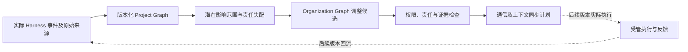

# v202：证据驱动的项目图与组织映射设计

日期：2026-11-12。依据用户提供的 v201 审计修订；本版本完成语法事实提取、项目状态回放和最小组织映射原型。实验结果见[本轮报告](software-benchmark-v202-project-graph-report.md)。

## 1. 研究路线与本轮边界

研究对象调整为“项目状态变化怎样影响团队责任与信息需求”。事实卡是提供证据的组件，不再单独以增加卡数作为优化目标。



实线部分是本轮实现或 CPU 验证的路径；虚线部分尚未接入真实多 Agent 执行。项目图和组织图是状态，通信和上下文是根据状态生成的视图及动作；不另造独立优化目标互不约束的第三、第四张图。

本轮没有外层策略学习、候选策略竞争、训练、真实团队调度或新 API 调用。固定启发式生成候选不等于“协同进化已经实现”。v200 F1 源码及 v201 留出结果保持冻结；不将已见 Pylint 缺陷修复后重新算成独立确认收益。

## 2. 语法事实：完整表达式与来源边界

Python 使用 LibCST 1.9.0 提取语法节点及 UTF-8 字节范围，Tree-sitter 0.26.1／Python grammar 0.25.0 提供增量语法树与局部节点定位，Python AST 提供完整文件中的符号和 import 结构。依赖安装在项目 `runs/software-benchmark-v202/dependencies-r1`；通过清华 PyPI 镜像直连取得，没有修改共享 Python 环境。

四个比较条件：

| 条件 | 实际实现 | 不代表什么 |
| --- | --- | --- |
| A0 | v200 沿用的旧 `code_spans` 源码片段提取组件 | 没有重新运行完整 F1 排序、预算或模型 |
| A1 | LibCST 完整小语句、函数和类节点 | 不保证每个嵌套子表达式独立成事实 |
| A2 | A1 加绑定目标、赋值右侧、Boolean 分支、调用、条件表达式、推导式等 | 语法子结构不自动具备 Issue 必要性 |
| A3 | Tree-sitter 节点及对应原始字节范围 | 本轮只接入 Python grammar，未验证多语言 |

`Fact` 保存语法类型、身份、成员与任务范围、路径、私有版本、来源哈希、字节范围、父事实和完整性；`EvidenceSpan` 单独保存来源及精确范围。多个事实可以对应同一原文，不能以相同来源为由合并为一个不可拆分卡片。

字节范围针对从原始工具 JSON 解码得到的源码字符串 UTF-8 编码，不是整个网络 JSON 包的字节偏移。上层来源保留原消息哈希和读取区间；两种坐标不得混用。

完整文件必须由完整写入参数与成功回执，或同成员、同路径、同版本、从 0 到声明总长度的无缝读取区间支持。冲突区间、跨版本拼接和篡改哈希拒绝。部分代码可以提供精确局部语句，但完整性始终标为 Partial，不推断缺失的限定作用域，也不创建假完整文件。

例如 Pylint 旧遗漏现在可表示为：完整的局部 Assign 原文、赋值目标、Boolean 右侧和两个 Comparison 子项。原读取是部分文件，因此这些对象仍为 Partial；“局部语句闭合”与“整个文件完整”是不同字段。

## 3. Project Graph：版本、事件和测试证据

### 3.1 状态身份

| 对象 | 身份与语义 |
| --- | --- |
| Repository／Commit | 冻结任务元数据中的仓库及真实 base commit SHA |
| Version | 任务、成员和 Harness `object_id/version_id`；明确不是 Git commit |
| File／Symbol | 已观察文件内容及其来源版本；完整文件才解析限定符号 |
| Fact／EvidenceSpan | 可逐字核验的语法事实和来源证据 |
| Issue／Task | 问题与明确任务记录；任务依赖来自声明，不从代码名称猜测 |
| TestDefinition | 实际调用 selector 的身份，不能冒充未观察到的测试函数体 |
| TestRun／FailureEvidence | 一次实际执行报告及其版本、范围、结果；回读分页不是新执行 |
| Artifact／Adoption | 作者的固定产物与接收者采用记录，保留原作者 |
| Delivery | 实际提交的版本；不据此推断官方评分通过 |

同一报告回读只补充来源或可见失败片段。报告身份被不同版本、不同结果或冲突计数复用时拒绝。测试边只能对实际执行版本及 selector 有效；版本变化后旧记录仍保留，但不能当作当前验证。通过一个公开测试范围不等于整仓库正确。

采用伙伴补丁需要先有面向该接收者的发布记录。采用产生接收者自己的 Version；合并后的源码若未实际读取，记为未知，不直接复制作者的工作树或测试结论。职责迁移不会改写产物作者。

### 3.2 事件与更新

支持 Issue 进入、权威工作区版本、文件观察／完整写入／未知变更／删除／重命名、实际测试、产物固定／发布／采用、提交、任务及显式依赖。拒绝操作和不完整工具 JSON 也入事件流，但不伪造成功状态。

历史适配器只读取 v201 已经打开的 12 个 S1 任务前缀，按来源实际首次出现顺序处理。相同工具观察在后续请求中再次出现只记一次世界事件。观察中完整源码不足的成功 replace 或 merge 只使相应文件内容失效；不知道变更路径时，保守失效该成员的已知文件。未解释的工作区版本跳转也不能沿用旧文件。

本轮没有下载完整仓库来填充模型未曾见过的信息。历史回放的图只表示“当时已经可见的项目材料”，不代表完整仓库图；未绑定的依赖也不能据此判为不存在。

事件提交先在隔离副本计算新状态、语法树和图；任何一步失败都不提交。成功后追加事件和图快照。Tree-sitter 编辑前复制旧树；旧树、旧快照及旧事件不被覆盖。事件 ID 同内容重放幂等，异内容复用拒绝。

### 3.3 PG0–PG3 条件

| 条件 | 更新规则 |
| --- | --- |
| PG0 | 累积初始版本可见材料；第一次已有成员工作区换版后冻结图 |
| PG1 | 每个事件后重分析全部当前可见文件并重建图 |
| PG2 | 缓存每个文件的语法／事实子图，仅重分析来源或内容变化的文件；运行状态及跨文件引用重新投影 |
| PG3 | PG2 加变化前后静态 import 候选关系的逆向可达影响范围 |

增量的当前粒度是文件；完整文件的 Tree-sitter 树支持真实编辑范围增量解析，但 LibCST 对变化文件重新分析。运行状态投影、静态 import 重新连接和快照复制仍有开销，不能称整个系统只处理几个变化节点。

同形标识符替换可能不改变 Tree-sitter `changed_ranges`；实现同时保留实际字节编辑范围，避免把这种修改当成无变化。缺失、删除、重命名和语法错误都必须更新图，不能留下旧符号。

语法包含、声明和原始 import 文本属于 Confirmed syntax；跨文件 `may_import` 与影响范围始终为 Inferred。当前没有实现跨语言调用解析、完整控制流、函数内 def-use 或运行时因果证明。ARISE 式切片、CodePlan 式完整依赖分析仍是后续扩展，不在本轮复现范围。

PG1 只是同一个已观察材料投影的结构参考。PG2/PG3 与它一致只能排除增量维护差错；不能证明共同解析器已覆盖所有程序语义。因此额外用手工控制的版本、测试、采用、文件变化和故障注入断言检查语义。

## 4. 最小 Organization Mapping 与同步接口

原型保持两名成员，显式保存任务 owner、责任路径和必要交接。项目事件只产生解释性候选：

| 触发证据 | 候选 | 处理边界 |
| --- | --- | --- |
| 显式任务依赖跨 owner，且缺少交接约定 | AddHandoff | 已存在交接时不重复建议 |
| 最近八个事件内同路径被不同成员至少写三次，涉及多个任务 | Merge | 没有完整新责任方案时验证不通过 |
| 同一任务至少三条 blocked 记录、仍阻塞，且至少两个下游依赖 | Reassign | 仅启发式候选，不宣称最优分工 |
| 至少两次明确版本／接口冲突 | AddReviewer | 不能将普通测试失败自动视为组织冲突 |

此外定义 Split、RemoveHandoff、ReassignIntegration 的验证入口，尚没有为所有操作设计成熟的候选生成策略。未完成任务不得失去 owner；新 owner 必须存活且具备所需受管工具；移除交接需要明确的依赖删除证据。Merge／Split 需要完整 ownership plan。真实责任转交仍需现有 Harness 的 offer／accept 和证据交接，候选验证不会绕过这些规则。

同步接口返回收件人及可见事实清单：自己的私有事实可保留；伙伴事实需要面向该收件者的发布回执，并继续携带原作者来源和版本。不会把别人私有历史中的引用复制成自己的访问权限。`sent/presented/read/used` 均保持 false，CPU 路由计划不冒充已经发生的通信或采用。

这部分是 v203/v204 的接口雏形，不是 O0–O3 组织策略比较，更没有证明重构减少返工或提高任务正确率。

## 5. 后续阶段及准入

1. **v203：责任映射实验。** 在明确代码／任务依赖的材料上比较固定组织、仅项目图更新、项目图驱动组织候选及带验证反馈的候选。先固定两人；检查真实 offer／accept、责任覆盖和版本绑定的交接闭环。补上当前静态依赖解析的覆盖限制。
2. **v204：信息同步实验。** 分离组织变化、通信路由和上下文呈现的效果。记录信息何时发布、送达、呈现、回读和实际采用；同时计入额外构图、压缩、回读和返工成本。
3. **后续真实模型验证。** 工程准入后另行冻结任务、预算和基线。先比较代码正确率与合法交付率，再判断 token 和时间净收益；不能用本轮离线语法召回代替模型成绩。
4. **外层策略改进。** 必须有可复现的反馈目标、候选约束、跨任务继承和独立评估；不恢复模型训练，不把普通状态更新包装为学习。

## 6. 相关工作的核对与设计来源

以下是机制来源和边界说明，不是原创性证明，也不是完整复现。只引用实际论文与官方文档，不依据附件中的图片标题判断论文身份。

- **ToCoMAS**：将工具对应的任务拓扑、责任域、交接及记忆可见性联合考虑，也涉及结构策略演化。不能将其概括为简单静态任务图。我们需要证明真实代码／测试／产物事件驱动的项目图，能否在已有机制之上提供独立增量；当前尚未证明。[原论文](https://arxiv.org/abs/2609.37953)
- **RepoAtlas**：选择、投影和刷新仓库视图，随探索阶段调整表示。借鉴的是视图刷新条件，不把视图变化直接等同于完整项目状态与责任变更。[原论文](https://arxiv.org/abs/2609.16936)
- **CodePlan**：增量依赖、潜在影响分析和编辑计划是本轮 PG3 的设计参考。本轮只实现静态 import 候选闭包，没有复现其完整规划器。[Microsoft Research](https://www.microsoft.com/en-us/research/publication/codeplan-repository-level-coding-using-llms-and-planning-2/)
- **ARISE**：语句级表示和函数内定义—使用关系说明了后续语义依赖需要达到的粒度。本轮的完整语法节点不等同于数据流切片。[原论文](https://arxiv.org/abs/2605.03117)
- **EvoMAS**：结构配置及反馈驱动候选演化可作为未来外层策略比较对象。本轮没有复制其演化搜索。[ICML 2026 会议录](https://proceedings.mlr.press/v306/hu26bg.html)
- **AsynCodeBench**：依赖满足和交接评价与终局结果分开，支持我们将世界事件、交接闭环与任务成功分开计量。[原论文](https://arxiv.org/abs/2609.32662)
- **Context as a Tool**：主动上下文管理提供保留与压缩信息的相关参照；本轮尚未比较其真实任务效果。[ACL Anthology](https://aclanthology.org/2026.findings-acl.1032/)
- **解析工具依据**：LibCST `ByteSpanPositionProvider` 提供源码字节范围；Tree-sitter 支持编辑旧树后增量解析，本轮复制旧树以保护快照。[LibCST 元数据文档](https://libcst.readthedocs.io/en/latest/metadata.html)、[Tree-sitter 增量解析文档](https://tree-sitter.github.io/tree-sitter/using-parsers/3-advanced-parsing.html)

## 7. 实现文件与复现

- [语法事实与来源拼接](../../src/proworksim/software_syntax_facts_v202.py)
- [项目图状态及增量维护](../../src/proworksim/software_project_graph_v202.py)
- [组织候选与同步计划](../../src/proworksim/software_organization_mapping_v202.py)
- [材料和历史适配器](../../tools/project_graph_materials_v202.py)
- [离线实验程序](../../tools/run_project_graph_v202.py)
- [CPU 语义控制](../../tests/test_project_graph_v202.py)

测试命令：

```bash
PYTHONPATH=runs/software-benchmark-v202/dependencies-r1:src \
  .venv/bin/python -m pytest -q tests/test_project_graph_v202.py
```

原实验材料、源码和运行结果分版保存。r1 默认 Python 3.14 forkserver 需要本地监听端点，被沙箱拒绝，未执行测量；r2 仅改为显式 fork 子进程，不监听端口，材料和算法未改变。实验程序拒绝覆盖已有测量目录；复测应另设版本，不删除旧结果后重跑。
