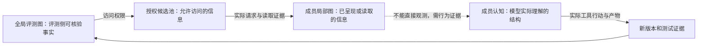

# 角色感知上下文与动态图干预的后续设计

本设计依据 v203.2.1 真实观测和 v203.2.2 审计修订后续比较。当前只开展旧轨迹分析与CPU修复控制；以下模型实验尚未启动，也没有转用旧预算。

## 为什么先分清信息问题和组织问题

两个成员可能职责分配合理，却因为没看到伙伴的最新补丁而重复工作。这时应改善信息呈现；直接转交责任会把信息问题混成组织问题。反之，即使两人都掌握完整信息，职责仍可能冲突，这才需要评估组织调整。

因此分别记录工作依赖 D、当前未满足的协作需求 N、组织失配 M。一次正常交接即可满足的依赖，不算组织失配。失配类型继续保留依赖满足、责任冲突、责任缺口、协调瓶颈和验证职责五类，但不将代码冲突或测试失败直接映射为阳性。

## 固定双人流程下比较上下文

| 条件 | 直观含义 | 变化范围 |
|---|---|---|
| K0 原有上下文 | 按现有Harness方式保留、摘要和呈现历史 | 仅上下文策略保持原样 |
| K1 通用相关性 | 从当前成员有权访问的信息中，优先保留与当前任务最相关的证据 | 不采用角色特定排序 |
| K2 角色感知 | 在同一候选池里，进一步考虑此刻是开发、复核还是交付，以及责任区域和当前版本 | 只改变选择／排序 |

例如复核者优先看到准确候选差异、版本绑定测试和未解决风险；开发者优先看到定位依据、返修意见和待修改位置。两者都不能获得对方未发布的私有历史，也不免费得到评测侧隐藏材料。

K0、K1与K2共用修复并准入后的同一测试／观测bundle，K0不复用历史损坏的测试接线。K1与K2固定相同的信息权限、候选池、每次信息总预算、输出上限和团队预算；记录实际长度、回读与摘要成本。保留相同角色、通信规则、工具、历史摘要算法和交付规则，避免同时改变多个因素。模型实际选择何时发送消息可能随上下文改变，作为结果记录，不强制时点一致。默认呈现、按需回读和重复输入均计入实际成本；不能只报选中卡片长度。

先在旧轨迹上做权限、版本及必要证据控制；旧12题只用于设计校准。新的真实面板、重复种子与现金额度须在启动前冻结，不能从旧任务中挑出有利题目作为独立确认。评价证据保留、过期版本误用、伙伴成果采用、复核检出、全队Token、官方代码与合法交付；缺少反事实时不把日志相关性当作收益。

## 动态组织的三个正式候选条件

| 条件 | 怎样决定组织 | 回答的问题 |
|---|---|---|
| O0 固定组织 | 只观测，保持REVIEW2 | 固定流程基准 |
| O1 普通事件驱动 | 使用实际失败原因、版本状态、工作量、依赖解除等信息决定合法调整 | 不依赖图结构的强基线 |
| O2 图驱动 | 同等信息下，根据项目—组织关系决定合法调整 | 图结构有没有额外价值 |

O2−O1检验图驱动的增量收益；O2−O0检验完整方法相对固定组织的收益。只更新项目图但不改变输入或行为的被动条件，归入图质量与成本实验，不期待其直接提升代码分数。本定义取代旧协议中的五条件正式比较建议，但不改写旧实验含义。

三组固定人数、模型、工具权限、初态、总体资源和独立复核／交付规则。O1与O2拥有相同合法动作集合：Reassign、Split、Merge、AddHandoff、AddReviewer。AddReviewer在固定人数下指增加已有成员的复核职责，不是增加第三个模型席位；不能通过动作名绕开权限或预算。

需先具备独立失配参考、合法动作编译与回滚、版本及上下文转移验证。随后依据阳性率、任务差异、仓库相关性与预算做模拟功效规划；本轮不预定24＋12题或直接复用旧12题作确认。所有未知与预算截止保留在计划分母，多个独立种子与任务配对、仓库层级一并分析。

## 三种工作图不能混为一谈

评测侧知道某个补丁存在，并不说明伙伴已看到；有权读取的候选池也不等于已实际呈现的局部记录。请求中出现某个事实，更不说明模型理解或采用。离线恢复的完整原件可以帮助审计，但不能免费加入K2或O2的模型输入。当前理论区分不等于已实现可靠的认知读出器。

## 执行顺序

先完成本轮自然事件链、辅助盲审与测试接线修复，再补独立人工参考。K0/K1/K2作为不改变组织的独立支线；O0/O1/O2等待组织识别与执行准入。旧150元余额不自动续用，新增真实实验须另定范围和预算；本轮无训练。
