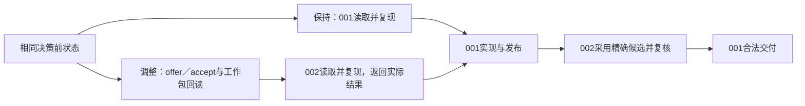

# 组织调整可执行性与分支对照准备报告

日期：2026年11月16日。阶段：v203.2.5／v203.3.1。

**本轮完成审计要求的零 API 工程与机制工作。** 本批FIFO入口已通过正常链和运行中永久故障控制；决策语义已修正；一次工作包转移已证明能改变实际执行成员；四个受控状态的八条分支均完成原受管交付。尚未验证真实模型的组织调整收益，也未启动付费配对续跑。

研究入口从“先找到组织做不了的事”调整为：**同一工作状态下，合法改变工作安排是否比保持原状更有价值？** 不再把确证失配阳性设为所有干预探测的前提。旧108窗标签和此前成绩保持不变。

## 1. 本轮做了什么

| 工作 | 结果 | 可以支持什么 |
|---|---|---|
| 本批FIFO正常链 | 真实SDK→FIFO→确定性替身；隔离Actor执行测试，继续修改、复核、交付及同步 | 本批正常执行链可连续工作 |
| 运行中永久故障 | 首次公开测试前注入执行器缺失错误；后续预约、FIFO请求、动作重放均为0 | 停止门覆盖运行中故障，不再只依赖终态拒绝 |
| 决策三轴 | 新校验器接受“有问题但保持组织”，区分可行性及证据不足 | 不再通过改写状态标签来迁就动作选择 |
| 单次诊断工作包转移 | 真实offer／accept后，诊断读取和首轮测试从001转为002 | 改变了工作承担，而不只是图标签 |
| 受控分支起点 | 四个受控状态分别复制同一完整世界状态和私有控制历史 | 在确定性机制控制中可形成一致起点 |
| 前瞻SDK检查点 | 保存两个真实私有会话、预算、调度与工作区；43个文件校验一致 | 保存机制可用；尚不代表新SDK实例可无损续跑 |

未新增外部模型调用或API费用；未使用GPU。两个新建非root容器均已清理，各限2 CPU／4 GiB，network=none、drop ALL，无宿主挂载、监听端口或新卷。FIFO仅创建在本批目录，结束后删除；没有改共享服务器配置或既有服务。

## 2. 正式路径的窄准入已收敛

本批入口为 `tools/run_organization_admission_v203_2_5.py`。采用原有 `FifoModelTransport`、帧格式、序号核验和响应封装，新建批次自有普通用户FIFO服务，再接现有 `ManagedRPC` 和隔离Actor。后端明确为确定性替身，不读取API密钥、不建立HTTP监听、不触达外部模型。

这是本批新的主机控制器入口，不是重启旧生产服务，也不声称复跑旧Docker-exec模型桥全部部署细节。下一批若改变入口、任务解释器或后端，需要针对差异准入；无需再次完整重做上一轮八轮诊断。

| 路径 | FIFO请求数 | 其中脚本化生成响应 | 测试与闭合 |
|---|---:|---:|---|
| 正常 | 105 | 26，包含1次摘要 | 4次公开测试：1失败、3通过；独立复核、合法提交、候选锁定和最终同步完成 |
| 永久故障 | 28 | 7 | 首次公开测试时注入永久执行器故障，任务尚未终结；后续预约0、FIFO请求0、动作重放0 |

这里的“生成响应”是确定性脚本产生的协议响应，不是外部模型调用，也不能作为真实Token消耗。故障控制比较故障瞬间和停止后的完整团队预算快照，确认没有新预约，而不仅是“后来没有完成的API返回”。

正常路径的4次测试还逐一核验了正确成员后续真实请求中的报告ID、原件哈希、版本、通过状态及计数。非法选择器、文件已存在的拒绝另以必要CPU控制验证：均未调用Actor，后续读取仍可进行。普通断言失败在正常FIFO链中已经证明不会导致永久停止。

新增FIFO服务还补充了一个直接恢复性检查：确定性后端意外异常时返回一次错误回执，避免静默等满1800秒；没有自动重试。该增补只做一个针对性CPU测试，没有重复运行已通过的容器正常链。

**本批入口的上述工程事项可以关闭。** 这不是全系统容错认证，也不保证尚未选定的全部基准任务环境。后续真正的阻断点转为检查点续接与新实验预算，不再围绕旧缓存故障反复扩大验证。

## 3. 新决策语义

旧 `validate_mismatch()` 保留原样用于解释历史材料。新 `software_organization_decision_v203_3_1.py` 将以下轴分开：

| 轴 | 内容 |
|---|---|
| 状态 | 组织约束缺口、潜在效率机会分别为PRESENT／ABSENT／UNKNOWN |
| 可行性 | FEASIBLE／INFEASIBLE／UNKNOWN |
| 行动 | NO_CHANGE／INTERVENE／ABSTAIN，并附理由 |

已验证的有效情况包括：已知存在缺口，但剩余预算不足、切换代价过高、预期收益不足或没有合法替代方案，因此NO_CHANGE。它不会被改标为ABSENT。

效率探测可以在尚无失配阳性、尚未知收益时进行，但必须有合法动作证据，并明确收益未被证实。ABSTAIN用于证据不足，不能拿来代替已明确的预算或合法性判断。新定义不意味着旧97个ABSENT现在变成阳性。

## 4. 最小组织动作究竟改变什么

本轮只实现**转交一个尚未完成的公开诊断工作包**：001原先负责诊断；调整分支由001提出转移、002接受，发送版本和待办绑定的工作包，002完整回读后承担代码定位及公开复现。001等待诊断结果，再承担实现。保持分支仍由001完成这段诊断。

转移改变了诊断执行者和实现的依赖等待，没有增加成员、工具权限、隐藏事实或免费诊断器。代码实现与最终交付仍为001；最终复核仍为002。002参与过诊断，因此**不宣称其完全独立于问题分析过程**；本控制只保证其没有编写或重新发布最终实现代码，并满足原协议的同版本复核条件。

首版不支持实现代码工作包转给002后再让002自审，也不以001重新发布来洗掉实际贡献来源。Split、Merge、增加成员、动态角色增删均未接入。该动作空间较小，但已能检验职责调整是否真正改变工作执行。

## 5. 四个受控状态和八条分支

四个状态在分支结果出现前写入题单，保留稳定负例和可能不值得调整的情况。它们参考四个历史任务的**公开题意与来源身份**，涉及Django、SymPy、Sphinx三个仓库；原仓库初始大文件已归档，本轮没有恢复或运行这些仓库代码。

因此，以下是**公开任务启发的缩小机制类比**，不是四道原SWE-bench题，也不是跨三个真实仓库取得的完成率。路径提示和初始树哈希只作为来源索引，不能冒充本轮读取了原文件。

| 受控状态 | 实际差别 | 保持分支动作数 | 调整分支动作数 |
|---|---|---:|---:|
| 新依赖 | `sample.py`依赖`helper.py`，实现前需联合复现 | 9 | 14 |
| 工作分布 | 001另有接口检查任务，诊断可以委派 | 10 | 15 |
| 明确恢复路径 | 简单代码语法缺陷，责任清晰；不是历史集成冲突重演 | 9 | 14 |
| 稳定推进 | 已有正确作者候选，002已采用，等待验证 | 6 | 11 |

四对的首轮测试执行者均从保持分支的001变为调整分支的002。八支各执行3次公开测试并完成受管交付，代码实现者和最终复核者未交换。

**能得到的结论是动作确实可执行，不能得到模型组织收益。** 两分支后续响应由确定性控制程序规定；本轮没有官方隐藏评分，不能把8／8受管闭合写成算法成功率。

调整分支每次多5个工具动作：提出转移、接受、发送工作包、完整回读、返回诊断结果。这是可见的协调成本，之后应计入双方模型输入输出及工具机会；当前没有真实Token账单，不把动作数换算成Token，也不以脚本执行时间判断净收益。

控制过程中，最初将同基线多次补丁采用混入状态构造，触发了原有集成冲突和复核拒绝；改为在世界初始化前定义受控基线，没有放宽世界规则。稳定状态又分别拒绝了无变化写入、无变更发布；最终正确复用已有候选。修正稳定状态时复用前三个状态已完成的6条分支，只补该状态2条。

最终复核发现旧小型fixture按退出码手工生成计数，不能准确表达语法错误导致的收集失败。因此最终r6统一换为已经验证的r5留存执行器和真实pytest journal，重新执行8支以核验这项实质反馈变化；表中为r6结果，旧控制及失败记录保留。这里没有修改正式Harness判定，也没有将收集失败编成“一个断言失败”。

## 6. 检查点与历史起点的边界

受控分支复制的是完整世界版本、私有控制历史、待办、测试状态、预算及调度状态，不只复制Git树。两分支干预前具有相同内容身份，后续写入隔离。篡改检查点内容会被拒绝。

历史观察包和终态归档没有被自动承认为可续接的决策前检查点。本轮没有从未来输出拼接早期历史；这不等于断言历史恢复永远不可能，只是它尚无完整恢复证明。

另完成真实SDK的前瞻保存控制：两名成员各执行一次脚本化读取后，在无在途请求的机会边界保存；两个私有会话、原始SDK事件及摘要目录、模型账本、世界版本和调度数据共43个文件复制一致。首次实现发现通用 `runtime.snapshot()` 仍沿用单模型transport字段，不适用于当前团队owner；新导出器直接保存多成员真实调度字段，不伪造单模型对象。

**已验证保存，尚未验证实际SDK配对续跑。** 新请求身份、恢复后的时钟、会话重建和下一次输入一致性仍需专门接线。保存工件明确标注 `SDK_continuation_qualified=false`，不会因文件齐全就允许付费续跑。

## 7. 下一轮实验安排

首先完成新检查点的SDK恢复与两分支下一请求一致性控制，再冻结4个合法续跑状态。这里不要求事先判定哪个动作一定有正收益；只要求事实来源完整、无已知永久环境故障、保持与调整均合法，且动作确实改变执行。

首次付费探测仍建议4状态×2分支×2次重复，共16个短续跑。它们只有4个决策状态，不是16个独立任务。预算上限和每支剩余Token需随实际检查点及新现金预算冻结，当前未启动。旧130元账本及31.25543296元余额不转用。

比较同时报告合法交付与官方代码端点、双方实际输入输出、迁移及回读、测试、返工和墙钟成本。不用隐藏评分中途挑候选，也不因结果不利临时改动作或补样。

有可重复的局部差异后，再进入O0固定、O1强事件驱动、O2双图驱动；O1／O2使用同样合法事实、动作空间和总预算。还需比较“一开始选一次组织”与“任务内继续调整”，分离静态分工和动态适配收益。跨任务更新则与相同候选数量、验证预算的普通搜索比较，淘汰候选费用也计入。本轮不训练模型权重。

## 8. 证据与实现

- [汇总及准入状态](../../artifacts/software-benchmark-v203-3-1/release-r1/summary.json)
- [正常FIFO链](../../artifacts/software-benchmark-v203-2-5/fifo-admission-r1/normal/admission.json)；[运行中故障](../../artifacts/software-benchmark-v203-2-5/fifo-admission-r1/permanent-fault/running-fault-result.json)
- [八分支控制](../../artifacts/software-benchmark-v203-3-1/action-controls-r6/summary.json)
- [真实SDK检查点保存](../../artifacts/software-benchmark-v203-3-1/prospective-checkpoint-r2/summary.json)
- [新决策与实验配置](../../config/v203-3-1-organization-value-probe.json)

必要CPU检查共10项通过：决策语义7项、检查点与普通拒绝2项、FIFO异常返回1项。原标签与旧实验结果没有修改；所有新结果保留独立版本和失败控制记录。
