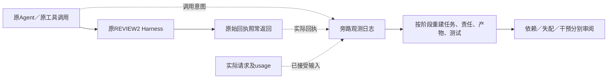

# v203.2：被动观测、阶段证据与完整交付控制

本轮依据用户提供的《v203.1实验审计与后续方案》修订，日期为2026-11-12。**完成的是被动观测工程、历史完整生命周期重放及CPU控制；尚未开展新的前瞻性模型试跑，也没有证明组织调整能提高任务成绩。** 审计末尾明确未授权新的模型调用、训练或预算消费，本轮新增被测模型请求、Token和API费用均为0。

## 1. 本轮结论

1. **“工具没展示给模型”不能解释旧36题的零依赖声明。** 2,330份Agent原始请求全部包含`declare_dependency`、`offer_transfer`、`accept_transfer`及其描述。但满足所查基础条件的机会少：声明22次请求、仅1题；接受转移没有待接受提议。基础条件成立不代表所有组织规则都允许调用，更不代表应该调用。
2. **只看前40次动作确实漏掉许多后期阶段。** 对同36题的2,150条派发动作重放后得到148个阶段点，其中43个在第40次动作之后。发布、集成和提交的首次出现尤其靠后。这证明观察窗口不足，尚不能证明后期存在组织失配。
3. **责任转移后的完整工程闭环已经通过CPU验证。** 接任者完成修改，原固定交付人001整合，经过原REVIEW2复核规则后提交，再通过独立微型验收。任务负责人转成002没有自动转移最终交付权。
4. **依赖、失配和干预需求已拆成三个判断。** 两种依赖确认控制仅支持预注册定义和受限执行比较，不会把补丁采用、工具准入成功或测试失败直接变成组织调整理由。
5. **真实失配样本仍待采集。** 本轮不重标旧36题、不把148个阶段点当148题，也不把CPU作者构造的正例当自然SWE阳性。下一批仅预留12个任务身份、覆盖10仓库，未启动模型；这些仓库都在整个研究历史中出现过。

规范汇总：[发布清单](../../artifacts/software-benchmark-v203-2/release-r1/summary.json)。旧结果保持原样，参见[v203.1报告](software-benchmark-v203-1-observability-report.md)。

## 2. 工具暴露与真实操作机会

取v203.1冻结的36个不同任务，逐份核对原始请求引用的字节数和SHA-256。共2,386份请求，其中2,330份Agent请求，56份摘要或其他请求，未发现引用校验错误。以下统计的分母是Agent请求；同一题重复请求不是独立任务。

| 操作 | Schema及描述实际出现 | 所查基础条件成立的请求／题数 | 旧原始响应实际调用 |
|---|---:|---:|---:|
| 声明依赖 `declare_dependency` | 2,330／2,330 | 22／1 | 0 |
| 提议转交 `offer_transfer` | 2,330／2,330 | 284／16 | 0 |
| 接受转交 `accept_transfer` | 2,330／2,330 | 0／0 | 0 |

三者在36题中均可见。工具名称在System字段和最新观察中的**精确字符串**出现次数均为0；这不意味着输入没有介绍工具，函数描述本身已经进入请求，也不代表不存在用其他措辞表达的说明。

基础条件分别检查：声明者有当前任务且另有可见任务；转出者有任务且有另一个可接收工作的成员；接受者有指向自己的待接受提议。进一步核对22个声明机会，没有一份请求同时呈现两个具有不同非空负责人的任务。因此，不能把22次等同于22次明确的跨成员任务依赖处理机会。

这仍然不是完整的逐请求合法性模拟。原实现还要求：固定组织的通信边和当前调度成员合法；任务与提议revision一致；CHIEF／MATRIX目标分派或范围审批有效；SPRINT的阶段、开发者身份和工作项提议符合约束；依赖声明不能形成非法关系。相关原实现哈希保存在审计结果中。

已有替代路径也必须保留：成员可以直接读取和采用公开固定补丁，不一定先发送`handoff_patch`；领取／归还可以改变任务承担者，但不能冒充双方接受的原子转移；组织分派意见本身不是任务所有权。因而“没有某工具调用”不能推出“没有协作”或“没有潜在依赖”。

证据：[工具审计](../../artifacts/software-benchmark-v203-2/tool-exposure-r1/summary.json)、[声明机会补核](../../artifacts/software-benchmark-v203-2/tool-exposure-r1/declaration-opportunity-detail.json)。

## 3. 被动观测实现及边界

新增[被动观测器](../../src/proworksim/software_passive_observer_v203_2.py)，通过可选包装层监听原Harness调用和模型请求完成边界。**未增加模型工具，未改原工具Schema、提示、权限、发送时机、角色调度、摘要策略或最终交付规则。** 实际接线经过原Harness CPU控制；模型入口仅经过脚本传输控制，尚未部署到新真实API队列。

记录内容包括任务创建、领取、分派和归还，所有权有效区间，文件变化，固定产物作者及发布，消息发送，事件回读，产物读取与采用，转交提议／接受／拒绝，精确版本测试、复核意见和正式交付。发布、呈现、读取、采用、复核和交付分别保留，不能互相替代。

| 容易混淆的事实 | 本轮处理 |
|---|---|
| 任务创建者与当前负责人 | 分开保存；任务所有权不推断文件所有权 |
| 负责人变化与历史贡献 | 保留有效区间、原事件和原作者，不回写历史 |
| 消息发出与接收方看到 | `Sent`和`Presented`分开；后者要求请求及usage见证 |
| 摘要预览与实际读取原文 | 事件回读、产物读取另记，不推断理解或采用 |
| 复核接受与测试通过 | 保留复核决定及原测试证据；接受不制造一次新测试 |
| 旧版本测试与当前版本证据 | 当前版本改变后，旧测试不标为当前有效 |
| 代码失败、工具拒绝与组织失配 | 不自动互相归因；原因不明保持Unknown |

图仅保留工作层所需的任务、成员、版本、产物和证据关系，没有把整个代码AST展开为业务图。阶段快照属于评测侧全局观测，不代表每个Agent都见过其中的私有信息；未来策略使用前还必须按接收者权限筛选。

日志采用哈希链及落盘后更新投影；重复观测键不会重复生成派生事件。观测写入错误保留待写队列和错误，不重放世界动作，也不替换原工具结果。截断尾部可以只读恢复完整前缀，原坏尾保留。**这些控制不等于跨进程“恰好一次”保证：进程退出前尚未落盘的队列、部分写入后的新段接续及长期内存开销，仍需真实部署准入验证。** 持续观测故障应使测量状态标为不完整，不得通过重新执行模型动作来补日志。

### 阻塞归因

冻结七类原因：上游依赖、环境故障、预算耗尽、正常等待、工具失败、模型失败、未知。分类只使用明确状态或原拒绝代码，不凭错误文本猜测语义。原记录没有可信的任务级Blocked／Unblocked证据时，只记操作拒绝／后来同操作成功；不会把所有拒绝都提升为任务阻塞。

历史107条拒绝中，60条可归到明确的工具／协议拒绝，47条仍Unknown。这里的`Tool Failure`包含参数、权限、流程拒绝，**不等于60个系统bug，更不等于60道失败题**；`Model Failure`只在明确格式反馈边界使用，也不等于一般代码能力不足。

## 4. 阶段观察实验

完整重放仍用原36题、五种组织模式和12仓库，取消“只看前40动作”的观察上限。历史来源只能恢复已记录的过程；某阶段未出现就记缺失，不补造阶段，也不根据最终成绩换题。

| 阶段 | 实际操作化定义 | 观察到的任务数 | 首次出现在第40动作之后 |
|---|---|---:|---:|
| T0 | 冻结的公开题目、初始成员与组织配置 | 36 | 0 |
| T1 | 首次成功创建或领取任务 | 23 | 1 |
| T2 | 首次实际内容变化的接受编辑 | 29 | 6 |
| T3 | 首次固定产物发布或读取他人产物 | 14 | 10 |
| T4 | 首次实际执行失败的公开测试 | 25 | 12 |
| T5 | 首次集成、接受责任转移，或失败测试后的编辑 | 15 | 9 |
| T6 | 首次提交尝试之前 | 6 | 5 |
| 合计阶段点 | 同题可出现多个阶段 | 148 | 43 |

T1不强称任务已完成拆解或全部认领；T3发布不证明对方收到；T4失败不推断代码还是环境原因；T5“测试失败后编辑”仅是时间顺序，未证明因果返工；T6可以对应被拒绝的提交，不等于最终成功提交前。T6快照及索引只绑定提交意图，不包含其未来结果。阶段名称不保证严格按编号出现。

历史共保留2,150条派发工具动作。派生事件包括91次消息发送、15次定向交接、48次工作事件回读、38次产物读取、7次采用、139次实际测试记录、4次成功交付回执。它们是事件次数，不是独立任务数；成功交付回执也不是官方测试通过率。此旧面板没有`org_review_patch`成功记录，不能以本轮CPU控制的2条复核记录填补。

43／148约29.1%的所选阶段点超过旧窗口；首次产物阶段10／14、集成或返工阶段9／15、提交意图5／6超出窗口。**可以据此确认旧审阅存在阶段覆盖不足；不能据此把原23个No-Change改为失配阳性。** 本轮没有新的组织失配标注，也没有计算检出率、Recall或F1。

首次恢复完整源树及投影累计使用406.80 CPU秒。之后从冻结帧补齐初态、来源和消息字段的r4投影使用0.87 CPU秒；r5仅追加复核事件投影。两者工作量不同，不能称数百倍提速，也不能当作在线观测开销。未来恢复脚本已避免在非修改动作前重复计算全树preimage，但没有据此宣称已实测加速。

规范证据：[r5汇总](../../artifacts/software-benchmark-v203-2/lifecycle-r5/summary.json)、[36份阶段及原帧归档](../../artifacts/software-benchmark-v203-2/lifecycle-r5/snapshots)。全部材料已经曝光，不能再次作为新的独立确认集。

## 5. 依赖确认与完整交付控制

### 5.1 两种确认机制

新增[依赖检查器](../../src/proworksim/software_dependency_checks_v203_2.py)。结构性确认检查**事前冻结的独立任务定义**：谁生产哪项产物、谁明确需要它。执行性确认比较同一消费者、同一代码主体、同一环境与测试入口，只改变指定产物，检查失败到成功、精确版本采用及真实任务身份绑定。

CPU控制使用原Harness中的真实`repair`和`other`任务。比较开始前把生产任务归001、消费任务归002，并修订描述；此设置不计为一次有收益的组织干预。消费者`sample.py`保持不变；只有`helper.py`的OFFSET由0变1，采用后由相同消费者运行相同公开测试，由失败变成功。17次Harness调用、2次实际微型pytest；执行比较内任务负责人不变，没有调用依赖声明或双方转移工具。

两种检查均通过，消费者代码变化及非独立定义的反例被拒绝。但这仍是作者构造的受限控制：没有证明自然SWE任务具有同样的前置关系，没有排除其他正确解决路径，没有证明组织失配，也不保证任意外部传入定义的语义真实。预注册来源本身需要可信管理，不能只凭一个布尔字段当人类金标准。

证据：[规范r2结果](../../artifacts/software-benchmark-v203-2/dependency-checks-r2/summary.json)、[事前定义](../../artifacts/software-benchmark-v203-2/dependency-checks-r2/frozen-contract.json)、[执行见证](../../artifacts/software-benchmark-v203-2/dependency-checks-r2/execution-witnesses.json)。

### 5.2 原REVIEW2完整交付

在原两成员、固定001交付的Harness上完成以下脚本控制：

1. 001形成部分成果，公开测试失败；固定产物并提出转交，002接受`repair`。
2. 002实际读取完整迁移包及必要文件，采用旧产物，修复、测试并发布新产物。
3. 002直接提交被原固定交付权限拒绝；001仍承担`other`，其责任没有被转走。
4. 001采用并测试002的产物，记录复核，再固定最终集成版本；缺少原最终复核时提交仍被拒绝。
5. 002采用、测试并复核001的最终固定版本；001提交成功。
6. 将锁定内容放入独立CPU验收目录，验证预先规定的`OFFSET=1`、`sample.value()=2`，通过。

共33次真实Harness调用、4次实际公开微型pytest、1次独立CPU验收；两成员工具Schema前后哈希一致。原始68条日志完整，重放结果一致，T0—T6全部出现。另一次脚本模型边界检查确认请求和返回对象未改，但不是供应商API调用。

这里通过的是**原协议的复核与交付门**。002参与过代码修改，虽然最终固定补丁作者是001，但不能据此宣称复核者从未贡献这些代码。原规则要求复核者不同于固定产物作者，代码贡献层面的完全独立复核仍未验证。独立CPU验收也不是SWE-bench官方评分。

证据：[实际控制r2](../../artifacts/software-benchmark-v203-2/passive-delivery-r2/summary.json)、[完整回执](../../artifacts/software-benchmark-v203-2/passive-delivery-r2/receipts.json)、[原日志补投影的复核记录r3](../../artifacts/software-benchmark-v203-2/passive-delivery-r3/summary.json)。r3只读旧日志，没有重做控制或新增模型尝试。

## 6. 三层判断和下一阶段准入

已冻结[标注结构](../../artifacts/software-benchmark-v203-2/taxonomy-r1/schema.json)及[格式校验器](../../src/proworksim/software_assessment_schema_v203_2.py)：

- 依赖六类：代码结构、产物、任务前置、验证、资源、协调。
- 失配五类：依赖满足失配、责任冲突、责任缺口、协调瓶颈、验证职责失配。
- 依赖与失配分别取PRESENT／ABSENT／UNKNOWN；行动另取NO_CHANGE／ABSTAIN／INTERVENE。

只有依赖不能产生干预；有依赖而组织足够应允许NO_CHANGE。没有明显代码依赖但验证责任缺失，可以单独形成失配候选。未知不当负例，NO_CHANGE需要其范围内的依据。格式校验不替代独立审阅或干预效果验证。

后续路线按审计调整为：先完成真实REVIEW2被动观测Pilot，再做v203.3独立失配识别；有足够证据后才进入v204组织干预，随后才做v205通信／上下文同步。当前未优化O4、未启动O0—O4效果比较，也没有进入v204。

### 已准备的Pilot身份

[预留清单](../../artifacts/software-benchmark-v203-2/pilot-preparation-r1/plan.json)为12个不同Verified任务、10仓库，采用固定顺序和公共元数据选取，排除列明的近期开发与旧50题。没有读取候选的旧轨迹或参考修复来挑选“容易出现阳性”的题。

这只是身份预留：环境尚未准入、模型／SDK部署未冻结、现金账本未创建，也没有声明其满足跨模块修改或自然失配阳性等内容覆盖。整个研究早期已经使用Verified全500题，因而这批不是全研究历史未见题，**全历史未见仓库数为0**。若正式要求新仓库确认，应另选任务来源；不能在本轮无声换数据集。

候选预算仍为每队5M，总上限60M输入加输出Token，只是未来方案参数，不是预计消耗或已获现金额度。12题Pilot、24题开发和12题留出是三个阶段；重复使用Pilot就不能把它称为独立留出。

真实试跑前剩余事项：明确新的模型运行与现金范围，确定来源隔离要求，冻结实际模型／SDK／源码；验证当前环境及资源边界；把现有请求原件与usage捕获接到被动入口；验证连续运行、记录故障与恢复分段；按题保存阶段缺失和测量不完整状态。各题只观测，不强制依赖声明、不增加工具、不改变组织策略。

未来v203.3需要独立软件工程审阅，隐藏算法预测、后续执行和最终成绩。AI可以整理和提供辅助参考，但本轮不新增人类金标准，也不把此前AI一致意见升级为人工确认。真实阳性不足时继续报告不足，不为了计算Recall或F1改造标签。

## 7. 验证、修订记录与资源

观测器和分类结构共16项CPU测试通过，按新增实现分批执行12＋2＋1＋1项；没有重复跑整个历史测试集。覆盖接口不变、错误旁路、去重、截断恢复、篡改拒绝、版本过期、提交前快照、已接受输入、分类分离及复核／测试分离。

另有两个原Harness机制控制：完整交付控制和依赖执行比较。规范结果共6次公开微型pytest＋1次独立CPU验收；包括保留的依赖r1开发控制，本轮实际总计8次公开微型pytest＋1次独立验收。不存在新的官方SWE评分、GPU／Docker使用、训练、root操作或共享主机配置变化。

过程中的问题保持原件：[修订清单](../../artifacts/software-benchmark-v203-2/revision-history-r1/summary.json)。阶段投影r2误把首个意图当初态，出现未知成员错误，改为显式前置INITIAL；交付r1因临时目录缺失在世界动作前失败；依赖r1仅绑定抽象任务名，r2补为真实Harness任务身份。这些是本轮工程准备错误，不填成模型失败。r4补齐普通消息，r5补独立复核投影，旧原帧和原成绩不改。

本轮结果支持“可以更准确地收集和保留组织证据”，尚不支持“已经发现足够真实组织失配”或“动态图组织重构有效”。新前瞻性采集尚未执行，是下一步需要完成的科学验证。
