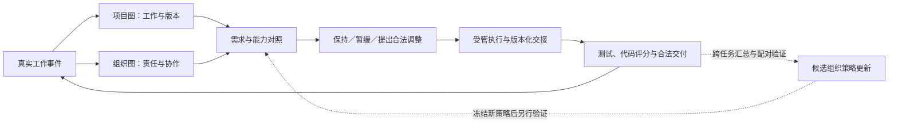

# 动态组织适配研究修订与后续实验安排

日期：2026年11月16日。依据用户提供的 v203.2.3 审计修订。

研究主线调整为：**从真实工作中发现组织不能满足的需求，选择合适的组织调整，再用真实结果改进后续组织策略。** 通信、上下文和版本管理继续保留，作为支撑成员协作的 Harness 能力。停止扩大 K0／K1／K2 比较，也不将角色感知排序单独作为核心创新。

本轮执行零 API 工程验收和历史分析。旧账本累计费用上界98.74456704元，剩余31.25543296元不转用；没有重跑旧11回合，没有增加付费模型尝试，也不恢复训练。

## 1. 三个问题分别验证

| 问题 | 直观解释 | 必须保留的区分 |
|---|---|---|
| 工作需求是什么 | 某个补丁需要伙伴采用、某个版本需要独立验证、两个模块需要协调 | 有依赖不等于组织失配 |
| 当前组织能否处理 | 现有成员有无责任、权限、交接与验证能力 | 尚未完成不等于无能力；普通通信能解决时不必重组 |
| 改组织是否有增益 | 调整后是否更容易合法交付，成本是否合理 | 单次调整后成功不能证明调整导致成功 |

项目图保存任务、代码区域、依赖、产物、版本和验证关系；组织图保存成员、责任区域、任务所有权、交接及复核关系。组织策略读取两者及时间状态，输出保持原状、证据不足暂缓、有需求但不可执行，或合法调整方案。

图中上方闭环是**任务内调整组织**；虚线是**跨任务改进策略**。当前并未证明任何一层具有收益。

## 2. v203.2.4 先验收执行链

验收链为 Actor → 工作树同步／封存 → 公开测试 → 正确成员收到结果 → SDK继续行动 → 同版复核 → 合法提交 → 唯一候选锁定与最终同步。

采用固定小型仓库、真实 OpenHands SDK、脚本化响应及真实 pytest。脚本化响应验证软件执行过程，不代表模型自主完成任务。测试 Actor 仅运行在本批新建隔离容器内，非root、2 CPU／4 GiB、无网络、无宿主挂载、drop ALL。原测试、复核、交付判定不放宽。

| 控制 | 要检验的行为 |
|---|---|
| F1 缓存 | 无参、显式None经规范化后使用同一预加载对象 |
| F2 封存 | 删除上传到本批容器的私有源码后仍可运行公开测试 |
| F3 反馈 | Actor结果的成员、版本、数量及报告身份进入对应成员后续请求；完整原件另行保留 |
| F4 连续工作 | 错误代码测试失败，后续修改、复测和复核连续进行 |
| F5 分类 | 正常断言失败与测试设施启动失败分开；后者未知计数不填0 |
| F6 永久故障 | 传输失效后停止后续机会，不消耗剩余预算反复调用 |
| F7 最终版本 | 最后合法提交、锁定候选及同步树一致；后续不能再改候选 |
| F8 恢复 | 已知完成的请求复用已有回执，不重复执行世界动作；未知执行状态不能盲目重放 |

初版诊断采用归档传输；补充控制已接入生产 `ManagedRPC` 和真实分块接收器，通过Docker附着流及主机私有管道连接真实 SDK 与 Actor执行器。**分块协议已验证，正式服务的完整FIFO调度部署仍未准入。** 新任务解释器与正式部署仍需在新冻结版本中验证。验收细节见[本轮工程与历史分析报告](software-benchmark-v203-2-4-and-v203-3-offline-report.md)。

## 3. v203.3-A 历史组织需求分析

沿用 v203.2.1 的12题及 v203.2.2 原件链，保留其既有环境缺陷标记。不会把这12题统称为完全无故障样本。

新增记录包括需求、当时可用的职责／操作、开始与结束的原件引用、截断状态、是否通过普通操作得到满足。未完成的区间保留右删失；没有确证组织失配时，不计算“失配持续时间”。时间采用控制器采集墙钟，包含排队与执行，不等于成员纯工作时间。

对 v203.2.3 每个回合以首次实际测试执行器 `FileNotFoundError` 的原始回执作为截止点，只允许引用其**之前**可核验的过程证据。更早的无效测试选择拒绝不会被误认为该系统故障。故障后的代码、消息及测试尝试不用于正常协作效果分析。

原108窗的AI辅助审阅可以作为开发参考，不能冒充本次新独立审阅，也不是人类金标准。窗口来自12题且彼此相关，不能将窗口数充当独立任务数。当前缺少确证阳性，不能从“0个阳性”推导自然失配率为0，亦不能据此完成有效功效分析。

## 4. v203.3-B 的独立识别验证

准备需求—能力—失配三栏标注，保留技术、信息、资源和组织问题的分项原因。每项判断必须有截止前证据、反证、影响区域、成员、当前是否仍存在，以及普通协调为何不足。允许UNKNOWN／ABSTAIN。

阳性不能仅凭依赖、一次测试失败、短暂等待或预算截止产生。只有“存在真实未满足需求＋当前组织能力缺口＋普通协调不足”的证据成立，才考虑调整。检测阈值、标注准入和重复设计应在新结果出现前注册；本轮不虚构识别准确率或阈值达标。

## 5. v204 三组动态组织对照

| 条件 | 实际做什么 | 比较目的 |
|---|---|---|
| O0 固定组织 | 001开发兼交付，002独立复核，照常通信、发布、交接；不自动重配组织 | 固定REVIEW2基线 |
| O1 事件驱动 | 根据明确阻塞、责任冲突、任务状态与版本化交接选择合法调整；可利用完整普通事件历史 | 测普通动态调整是否有用，不能故意削弱基线 |
| O2 双图驱动 | 与O1相同事件及动作范围，增加项目依赖与组织责任的跨图联合判断 | O2−O1检验图结构的增量 |

三组固定模型、思考模式、采样、成员数、上下文策略、权限、初态、团队预算、交付规则和评分器。上下文不同时做额外优化。组织策略自身调用与输入输出全部计入团队成本。

第一版只保留两名成员及原REVIEW2独立复核要求。责任转移通过现有offer／accept完成，不直接改owner；交接绑定公开版本；增加复核责任不得增加第三名成员或允许自审。Split／Merge目前只是候选研究动作，其修订、依赖与所有权事务尚未验证，不能偷偷当作已可执行能力。三组可用动作权限相同，O0策略选择保持现状。

主要端点是合法交付成功率，并列报告官方代码正确率。其次报告失配解决、阻塞解除、不必要调整、反复转移、版本错误、重复测试、完整团队输入／输出Token、测试资源和墙钟时间。不提前把这些量加成一个总分。

题目数量暂不冻结。先分析自然需求和失配可观测性，再确定开发面板及重复方案。筛选依据题面和初始仓库结构，不能依据参考补丁定位或历史成绩挑题。已曝光的Verified500只能作为开发对照；独立确认需要另设未曝光来源。新条件、题单、seed和预算完成冻结前不启动付费批次。

## 6. v205 和 v206

v205先从有限策略候选与配对验证开始：汇总完整轨迹，包括成功、失败、NO_CHANGE及不可执行调整；分析组织动作的可能贡献；在固定开发任务上比较候选；冻结策略后去独立任务验证。它不训练模型权重，也不把“让模型总结成功经验”当作因果证据。

v206验证跨仓库、多轮运行的收益是否持续。收益可能表现为交付改善，也可能表现为质量相近而成本下降；若只提高成功率却明显加大成本，应同时报告两者。

## 7. 当前可执行边界

[机器可读设计](../../config/v203-3-organization-study.json)明确禁止模型调用和运行时组织干预。它是待冻结方案，不是已实现O1／O2优化器。先完成工程Gate和需求证据，再单独确定新预算与真实实验范围；旧31.26元不自动转用。
