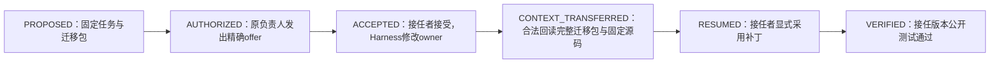

# v203 实验报告：项目—组织映射与责任迁移

日期：2026-11-12。依据用户提供的 v202 审计开展。本轮没有新模型调用、真实 SWE 任务运行、训练或现金支出。

## 1. 结论先行

**本轮已从“组织调整候选”推进到可追溯的多成员映射，以及原有 Harness 中实际执行的 CPU 责任迁移控制；还没有证明双图联动能提高真实任务效果。**

- 找到 **12 个不同历史任务、4 种组织模式**，核验 959 份实际请求、855 个受管动作记录；任务负责人、补丁作者、交接、采用和测试版本可逐源追踪。
- 完整源码不足的问题得到部分缓解：利用原始基线和此前成功操作，**84 次源码／补丁记录的完整树哈希与原回执一致**，获得 105 次完整文件材料。99 次 Python 源码解析检查包含 **27 次真实连续旧树编辑**，与新树解析一致。
- 17 次交接中，12 次在接收者捕获的模型输入中可见，7 次有交接后的显式源码回读，6 次有随后实际采用和同采用版本测试，4 次该公开测试通过。**发送、呈现、回读、采用和验证确实不是同一个指标。**
- 复用了原有 REVIEW2 Harness，CPU 控制中真实执行了一次责任转交，再通过合法回读取得迁移包、采用补丁并完成当前版本公开测试。没有重新实现任务管理系统，也没有取消原权限或交付规则。
- O0–O4 的 32 个结构场景诊断完成，但场景和规则同属本轮开发。**G2 独立失配识别、G5 对照收益仍未通过，不能把控制题结果当作算法优越性。**

最重要的数据缺口是：本轮主盘点的 v131 **194 份原始控制器记录中，没有成功的 `declare_dependency`、`offer_transfer` 或 `accept_transfer`**。有消息与补丁合作，却没有真实任务依赖声明和动态任务转交材料。责任迁移的执行正确性现可用 CPU 验证；真实组织失配及调岗收益仍缺独立证据。

## 2. 阶段、边界与已有结果保留

v202 的实现、材料及结果保持不变，F1 不再调参。本轮按审计顺序完成：P0 材料盘点与源核验、P1 显式关系映射、P2 开发性结构对照、P3 状态继承 CPU 控制。

历史回放不进行组织干预。不能把原模型做过的代码操作换一个成员名重放后，声称测出了新组织的任务正确率。此次也没有使用最终官方评分来选材或评价 O0–O4。

| 证据类型 | 本轮实际操作 | 可以支持 | 不能支持 |
| --- | --- | --- | --- |
| 真实历史 | 只读旧控制器、模型请求、用量和来源树 | 映射、呈现、采用和版本的可追溯性 | 新组织下的反事实正确率 |
| 合成结构控制 | 32 场景 × 5 条件，共160次诊断 | 规则行为、约束与反例检查 | 独立语义准确率、模型收益 |
| 实际 Harness CPU 控制 | 两名脚本调用者，原受管工具与两个微型 pytest | 真实任务所有权转移、原文恢复与同版本验证 | 模型理解、完整 SWE 任务效果 |

## 3. P0：实际材料盘点

### 3.1 盘点和抽取方法

主盘点限定为 v131 原定 250 个团队身份；其中194份保留控制器记录。逐份只读取实际成功／拒绝回执、成员和私有会话、用量及来源身份，不读取官方终局评分。

材料要求至少两名实际发生模型调用的成员、有不同的私有会话和观察到的私有工作区对象、成功代码修改、绑定作者及版本的跨成员补丁交接、公开测试或提交证据，以及显式认领的任务。不能把角色名称或消息中的“我是负责人”当成所有权。

按事前封存的固定 SHA256 排序，在五模式之间轮转选材；全局禁止重复 instance。未按得分、是否代码修复成功或是否现金耗尽选择。本批是证据可追溯的机制样本，不是随机总体样本。

| 模式 | 原始控制器记录 | 满足本轮材料条件的回合 | 最终选取的不同任务 |
| --- | ---: | ---: | ---: |
| CHIEF | 40 | 0 | 0 |
| PIPELINE | 44 | 18 | 4 |
| REVIEW | 38 | 7 | 4 |
| SPRINT | 40 | 1 | 1 |
| MATRIX | 32 | 3 | 3 |
| 合计 | 194 | 29 | 12 |

29 个可用回合对应24个不同任务。最终12题覆盖8个仓库、四模式；三／四人成员轨迹用于关系与来源审计，**不混入后面固定两成员结构控制的效果比较**。

250 个原定身份的非互斥排除原因：56 个无控制器记录、134 个缺绑定来源的跨成员交接、100 个缺终态明确负责人任务、46 个缺测试或提交记录、27 个无成功代码编辑、4 个未确认不同私有工作区、3 个不足两名实际执行成员。数字有重叠，不能相加当排除总数。

“缺交接证据”不等于完全没有协作；固定补丁可能由其他成员直接访问或采用。筛选只是判断能否进入本轮需要交接链的主材料。CHIEF 不入选也不表示该组织更差。

证据：[事前选材规则](../../artifacts/software-benchmark-v203/material-admission-r1/preinventory-policy.json)、[全部盘点](../../artifacts/software-benchmark-v203/material-admission-r1/inventory.json)、[12题清单](../../artifacts/software-benchmark-v203/material-admission-r1/selection.json)。

### 3.2 具体题单与实际源核验

| 历史槽位 | 任务 | 模式 | 受管动作记录 | 已核验历史请求 | 完整树记录 | 旧树编辑 |
| --- | --- | --- | ---: | ---: | ---: | ---: |
| 9086 | sympy-15017 | PIPELINE | 68 | 72 | 9 | 4 |
| 9172 | requests-5414 | REVIEW | 78 | 93 | 9 | 3 |
| 9063 | flask-5014 | SPRINT | 91 | 98 | 6 | 0 |
| 9149 | sympy-15345 | MATRIX | 88 | 102 | 9 | 3 |
| 9046 | astropy-14995 | PIPELINE | 69 | 75 | 8 | 2 |
| 9012 | sympy-21930 | REVIEW | 77 | 83 | 13 | 8 |
| 9214 | xarray-4966 | MATRIX | 87 | 98 | 5 | 2 |
| 9066 | astropy-7606 | PIPELINE | 27 | 31 | 3 | 0 |
| 9177 | pytest-7432 | REVIEW | 73 | 84 | 5 | 1 |
| 9184 | sphinx-9698 | MATRIX | 83 | 97 | 6 | 2 |
| 9021 | pytest-7571 | PIPELINE | 69 | 76 | 9 | 2 |
| 9197 | pylint-4604 | REVIEW | 45 | 50 | 2 | 0 |
| 合计 | 12 个不同任务 | 4模式 | 855 | 959 | 84 | 27 |

动作记录包括实际拒绝，只有成功且语义明确的回执更新关系。959份请求逐份与原账本请求文件哈希和大小绑定；用量按原始 usage 验算并对齐原团队合计。成员身份与输入观察的 actor 也进行了核对。未发现来源或用量算术异常。

本批请求对应历史实际输入 **48,278,740 token**、输出 **193,253 token**，合计 **48,471,993 token**。这是旧实验消费，**不是本轮新增费用**，也不是新 O0–O4 的 token 比较。

### 3.3 可追溯链：交接不等于采用

| 阶段 | 17次交接中的记录数 | 本轮证据口径 |
| --- | ---: | --- |
| Harness接受交接 | 17 | 成功 `handoff_patch`，作者、接收者、patch及版本绑定 |
| 在接收者模型请求中呈现 | 12 | 实际请求 observation 中有相同序号、patch和源版本 |
| 交接后显式读取原源码 | 7 | 接收者成功 `read_file(patch_id=...)`，源版本一致 |
| 交接后实际采用 | 6 | 接收者成功 `integrate_patch` |
| 采用版本实际公开测试 | 6 | 同接收者、同采用版本、之后真正执行 |
| 上述公开测试通过 | 4 | 原报告 passed=True，范围仅为实际公开测试 |

这些行不是强制漏斗：显式源码回读并非采用的唯一前提，不能把没有 `read_file` 的采用判为非法。全批另有7次采用，其中一次不属于“对应交接之后”的链；因此7次采用与表中6条链不矛盾。12次呈现也只表示输入包含该事件记录，不表示完整消息内容呈现、模型理解或使用。

其他5次交接没有找到相应捕获输入的呈现证据。**这里记为未证明呈现，不推断接收者已经读到，也不统一归为投递故障。** 具体请求见各题 `presentation_witness`。

证据：[逐源核验汇总](../../artifacts/software-benchmark-v203/source-audit-r1/summary.json)及同目录逐题文件。

## 4. 完整工程证据与四级完整性

### 4.1 如何恢复完整源码

本轮没有用任务终止后的工作树反向填充早期状态。恢复从原始 baseline snapshot 开始，只应用当时已接受的精确写入、唯一替换、创建、删除、重命名及可确定的合并。每个结果必须与**原回执的完整 files SHA256 和 metadata SHA256**一致。

非平凡冲突合并若无法从原件确定，程序保留未知，不猜测。此次选中材料的84次相关回执全部匹配，没有遇到需要猜测的后像。该结果只覆盖本批材料，不能外推所有历史合并均可恢复。

105次完整文件材料中99次为 Python；完整源码属于**评测侧／观察器侧的恢复证据**。不宣称这些全文当时已进入 Agent 输入，也没有通过本轮重放给 Agent 免费增加信息。未来在线图如果使用此类完整状态，必须将信息边界及实际呈现成本在新实验中冻结。

### 4.2 分离完整性轴

新增四个明确字段：

| 字段 | 本轮解释 |
| --- | --- |
| Span Complete | 输出字节范围能够逐字恢复 |
| Statement Complete | 输出对象确为完整小语句；表达式子节点本身不冒称语句 |
| Scope Complete | 解析所需的限定作用域来源完整；不是依赖语义完备 |
| File Complete | 该版本整个文件有完整来源 |

对99次完整 Python 材料运行 A2，得到 **141,478次事实输出**；按稳定事实 ID 为125,188个，来自88个不同文件版本。全部片段可映射到来源；其中32,832次输出属于完整小语句，其余多数是表达式、绑定或定义子项。不能把所有语法子节点当成独立有用事实。

这一步用了约 **68.94 CPU秒**，明显说明全文件细粒度提取有实际成本。没有将这些事实全部加入模型上下文，也没有测量 token 节省或任务收益。后续应保留按变更和任务需求选择的机制，不能用“事实更多”代表“信息更有效”。

完整文件来源让99次解析检查中实际发生27次旧树编辑，全部与重新解析的树一致；这是对 v202 历史旧树编辑为0的补充。**本轮没有做完整／增量解析的计时配对，因此不报告新的 Tree-sitter 提速比例。**

证据：[完整性轴汇总](../../artifacts/software-benchmark-v203/completeness-axes-r1/summary.json)。

## 5. P1：跨图映射及仍缺少的关系

观察器从成功受管回执生成带事件来源、任务版本和有效起止步的关系。`owns`来自实际claim／accept后的任务记录；`assigned_to`来自明确派工批准，二者不互相替代；任务owner也不等于文件独占权限。作者、采用者和复核者分别保存。

本批有12条所有权建立、3条明确指派、12条产物作者关系、10条产物—任务关联、17条交接、7条采用、64条测试验证、6条显式复核。它们是实际出现的事件关系，不是独立任务数。未从自然语言里的“负责某文件”自动生成排他的文件所有权。

映射发布r2进一步区分证据等级：显式任务／产物记录为 Confirmed Structural；实际交接、采用、测试与复核回执为 Confirmed Dynamic，后者只确认相应 Harness 操作，不证明运行时程序调用链。静态猜测应保留 Inferred，材料不足为 Unknown；没有把组织反馈升级为强证据。任务revision改变会使旧指派失效；`crosses_region`只可由有来源的任务依赖及双方owner推导，不能凭同文件编辑生成。该修订复用已封存的855条事件重新投影，没有重读API请求或重算源码；[发布核验](../../artifacts/software-benchmark-v203/mapping-release-r2/summary.json)。

**明确任务依赖和责任转交都是0。** 不能把 import 边、同路径操作或消息自述补成 Confirmed task dependency。本批因而无法验证真实的 `crosses_region` 调整策略，也不能估计真实责任迁移的失败率、震荡频率或收益。

状态维护正确性与结构发现正确性继续分开。本轮能核验显式拥有、交接、采用与测试是否被忠实映射，仍未建立真实完整调用图、def-use 或独立的必要依赖金标准。

## 6. P2：32个结构场景与五条件诊断

### 6.1 固定边界

两名成员；同样允许 Reassign、Split、Merge、AddHandoff、AddReviewer，使用相同合法性检查和每场景最多4个候选。没有新增成员、改变模型或工具权限，没有私有工作区自动合并。

O0固定组织；O1是一次性初始拓扑交接映射；O2更新项目信号但组织固定；O3根据 blocked 次数及同路径成员数提议；O4结合结构、执行证据、成本上限与稳定窗口提议。

**O1只是非常简化的初始拓扑控制，不是完整ToCoMAS，也不是成熟的拓扑分区算法。** 本轮使用合成状态描述，不是对真实 REVIEW2 模型团队进行干预。

场景覆盖新依赖、明确责任缺口、合法共同编辑、排他责任冲突、成果采用和复核、旧测试、环境故障与合理等待、容量阻塞、依赖解除、合并成本、独立复核、工具缺口和责任震荡。32个场景中7个预期产生合法干预，25个不应产生合法干预。

### 6.2 结果及解释

| 条件 | 原始候选 | 共同规则拒绝 | 合法候选 | 符合开发期望／不符合 | 漏掉预期干预 |
| --- | ---: | ---: | ---: | ---: | ---: |
| O0 | 0 | 0 | 0 | 0／0 | 7 |
| O1 | 4 | 2 | 2 | 0／2 | 7 |
| O2 | 0 | 0 | 0 | 0／0 | 7 |
| O3 | 15 | 4 | 11 | 1／10 | 6 |
| O4 | 11 | 4 | 7 | 7／0 | 0 |

在这个开发控制集上，O4的合法干预 Precision／Recall 均为1；O3分别为1/11和1/7。**这些数字不得解释为独立算法准确率或真实组织收益。** 场景由本轮开发者编制，专门包含次数规则容易误报的负例；没有独立专家标注或未见场景确认。

同样，O1的4个初始拓扑候选出现在检验依赖解除／更新的场景中，样本不足以公平评价成熟的静态拓扑方案。O0和O2本来就不调整组织，零候选是条件定义，不能将其称为运行失败。

本轮直接证明的是：次数规则会在所列环境故障、合法共同编辑等反例上建议不必要调整；结合明确原因和约束可以避开这些开发反例。**还不能证明这些原因在真实轨迹中可以被可靠识别。** 当前历史数据尤其缺少显式依赖和转交，这是独立验证的前置缺口。

候选成本是结构控制中的抽象单位，不是token、人民币或墙钟。最小持有窗口2步、切换上限2次等仅是CPU机制参数，没有被验证为最优部署值。候选没有执行，因此真实 Org Churn 为0，实际 Dependency Satisfaction 和任务结果记为未测量。

证据：[冻结场景与规则](../../artifacts/software-benchmark-v203/policy-controls-r1/protocol.json)、[逐场景结果](../../artifacts/software-benchmark-v203/policy-controls-r1/rows.json)、[汇总](../../artifacts/software-benchmark-v203/policy-controls-r1/summary.json)。

## 7. P3：通过原有 Harness 完成责任和状态迁移

本轮没有新建任务管理器。CPU控制复用原有 REVIEW2 World、HarnessPort、`offer_transfer/accept_transfer`、定向消息、`read_work_event`、固定补丁、`integrate_patch`及公开测试。

迁移包包含任务ID／revision、双方成员、相关区域、精确代码版本、产物、原测试证据、必需事实、未解决事项、来源和权限说明。没有复制原负责人的完整私有上下文。

规范r2控制执行20次受管调用，其中一次真实owner转移、两次微型实际pytest；13项断言通过：offer不提前转移、accept精确绑定、原文可回读、采用前私有树不变、作者身份保留、原作者测试不自动继承、接任版本实际测试、没有自动交付，以及重复接受和过期revision接受被拒绝等。

**发现并修订的具体问题：默认消息观察提供预览，不能当成完整迁移包。** r1控制因此失败；r2通过原本已有的、按接收者授权的 `read_work_event` 恢复完整包，并核对JSON全值。新迁移观察器要求先有完整包读取证据，才能标记 CONTEXT_TRANSFERRED；只读预览无法推进状态。

原负责人在发布后额外创建了未发布私有文件。接收者观察和迁移包不包含该内容；接收者仍只能取得原固定补丁版本。这验证了本控制中的权限边界，没有扩大项目访问权限。

这里的 VERIFIED 仅指该CPU例子的同版本公开测试通过，不代表官方任务正确、合法最终交付或模型理解。脚本完成了恢复动作，**实际模型是否会自主发现预览不全并主动回读仍待后续实验**。

责任迁移只改变任务owner，固定交付人仍是member_001，原独立复核规则也没有改变。本轮没有验证迁移后如何闭合完整团队交付；不能把接任者的测试通过填成合法交付。

r1失败、源码和原始世界记录保留；r2没有覆盖它。r1在失败前执行过一次微型pytest，连同r2两次，本轮该控制总计3次本地pytest，无API费用。

证据：[迁移包](../../artifacts/software-benchmark-v203/harness-migration-r2/transfer-package.json)、[逐步回执](../../artifacts/software-benchmark-v203/harness-migration-r2/transfer-state-history.json)、[控制结果](../../artifacts/software-benchmark-v203/harness-migration-r2/summary.json)、[r1失败说明](../../artifacts/software-benchmark-v203/harness-migration-r1/failure.json)。

## 8. 准入判断与后续执行路线

| 门 | 本轮判断 | 仍需解决 |
| --- | --- | --- |
| G0真实多成员材料 | 本批12题／4模式的来源准入通过 | 主历史系列没有显式依赖及责任转交；不代表全部研究历史都没有 |
| G1跨图映射 | 已观察到的显式关系通过 | 文件责任区域和真实任务依赖的结构发现未充分验证 |
| G2失配识别 | **未通过独立准入** | 开发控制不能代替独立参考；真实失配标签未建立 |
| G3候选合法性 | 开发控制通过 | 尚未把所有五类操作编译为真实干预；本轮实际迁移只验证Reassign路径 |
| G4状态迁移 | **限定CPU控制通过** | 单例单文件的真实受管恢复，不是多任务／多文件普遍保证 |
| G5对照增量 | **未通过** | 没有独立组织对照效果或真实任务收益 |

独立G2验证预注册门为失配Precision≥0.90、Recall≥0.80，干预Precision≥0.90、Recall≥0.80；它们是拟采用的筛选门，不是本轮已经通过的统计保证。后续需要独立材料及参考，不得根据同一32控制的结果反复调参后再宣称确认。

下一步应先建立真实／可独立审阅的依赖和失配证据，以及多文件迁移控制，再验证O4相对普通事件规则的增量。不要直接开展通信压缩，也不要恢复训练。真实模型阶段仍需单独冻结题单、条件、预算和代码／交付双端点；本轮不启动v205。

代码：[显式关系与完整源码恢复](../../src/proworksim/software_dual_graph_v203.py)、[失配规则和候选约束](../../src/proworksim/software_org_policy_v203.py)、[完整迁移包读取门](../../src/proworksim/software_responsibility_transfer_v203.py)。36项CPU回归及1项新增映射回归通过；[主测试日志](../../artifacts/software-benchmark-v203/cpu-controls-r2/pytest.log)、[映射回归](../../artifacts/software-benchmark-v203/mapping-release-r2/pytest.log)。

本轮没有新增模型token或现金支出，没有GPU、Docker、root操作或共享服务器配置修改。Codex开发与审阅成本无法独立取得，不声明为零。
