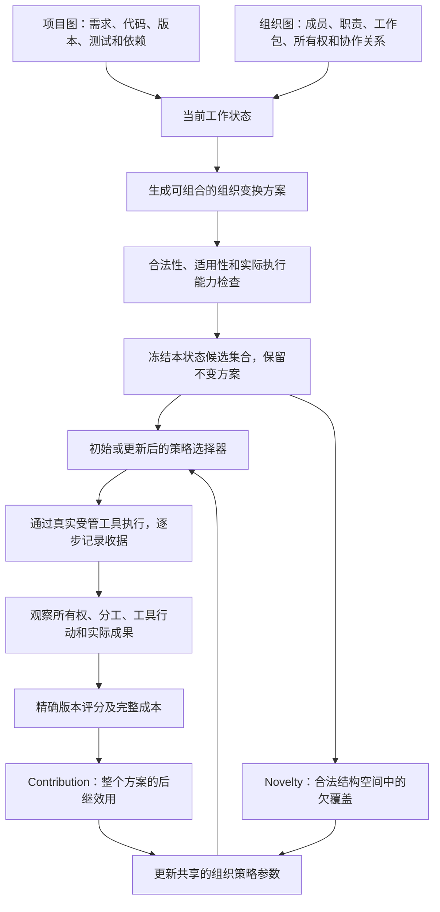

# v210：从固定候选选择转向可组合的组织结构进化

## 1. 本次调整

本方案合并v204–v209审计与最新补充设计。**下一轮研究对象改为：根据当前工作状态生成、选择并执行完整组织变换，再用后继结果改进这一策略。** 不再把KEEP／ASSIST／TRANSFER作为算法空间的全部内容。

已完成的三候选实验保留，不重跑、不用新公式改写旧q。此前拟定的16开发＋12确认、72条主续跑扩样在模型调用前撤下。700元新增预算已获用户同意，仍保留，但没有建立新收费账本或调用API；旧39.61元不转入。补充文件明确要求先确定组织表达、任务来源及比较机制，因此目前仅推进零API设计与原型。

本次状态：**离线审计通过；组合空间CPU原型通过；真实动态Harness接线及新任务面板尚未完成，不具备大规模付费启动条件。**

## 2. 组织状态、组织策略分开

组织状态是“现在谁在做什么、谁负责、工作如何相互依赖”；组织策略是“看到当前项目和资源状态后，如何提出并选择下一种组织方式”。

第一阶段仍用两个真实Agent，固定成员数以控制成本；**不固定001只能开发、002只能复核**。成员可按工作包承担不同职责。唯一最终导出身份可保持固定，以避免评分侧从多个工作区挑选最优补丁；固定导出身份不等于固定实现者。成员增减属于后续扩展，目前不自动开放。

每个目标配置必须同时描述五个维度：角色职责、工作包与依赖、所有权与贡献者、协作关系、执行与验证安排。评价完整配置，不能分别优化五个开关后假定收益可相加。

## 3. 可组合空间与实现边界

原型将变换表达为长度至多4的算子序列，工作包暂限8个。它们是CPU原型的复杂度边界，不是已冻结的真实评测参数。空序列表示保持当前组织，始终保留。

| 算子 | 目标效果 | 当前Harness实际能力与缺口 |
|---|---|---|
| CREATE_ROLE | 改变临时职责 | `org_declare_role`已有，但只记录本人职责；不会授予权限或自动改变执行 |
| ASSIGN_WORK | 给未认领工作分配责任 | `claim_task`已有，必须由实际承接者显式执行；不能由宿主替其认领 |
| SPLIT_WORK | 拆成有公共范围的子工作包 | 创建、修订、依赖工具已有；仍需实现范围守恒、版本绑定及多步收据 |
| MERGE_WORK | 合并相关工作包 | 缺少原子合并与依赖迁移协议；当前不得伪装成删除旧任务后完成 |
| TRANSFER_OWNERSHIP | 转移真实责任 | 原offer／accept／decline已存在；需逐步核对所有权改变及返回链 |
| ADD_COLLABORATION | 建立有实际工作含义的协作 | 消息工具存在；动态拓扑约束和工作关系接线尚缺 |
| REMOVE_COLLABORATION | 结束不再需要的协作 | 不能仅删除图边就声称权限或调度已改变 |
| CHANGE_DEPENDENCY | 调整工作依赖 | 原declare／remove工具存在，必须保留owner、任务版本和无环检查 |
| CHANGE_EXECUTION_ORDER | 改变实际先后或优先级 | 当前公平调度未接入动态优先级；标签变化不算实现 |
| ASSIGN_VERIFICATION | 调整验证责任 | 原采用、测试、复核证据工具存在；动态验证责任与最终交付门仍待接线 |
| CREATE_SUBTEAM | 建立临时工作组 | 目前缺少真实组生命周期／调度约束 |
| DISSOLVE_SUBTEAM | 解散临时组 | 必须结清在途工作与责任，不是简单删标签 |

`software_organization_space_v210.py`已实现这12类变换的**纯提案图表达和合法性检查**。所有结果明确返回`live_execution=False`及运行准入阻塞状态。它不会写入真实世界、调用工具、改变所有权或宣称上述缺口已经修复。

禁止将FREE2简单换名后冒称完成新动态Harness：FREE2虽允许更自主的分工，但其交付规则、调度、动态验证与拓扑能力并不自动满足新设计。真实接线要建立新组织模式，固定初始策略和进化策略使用同一套接口、权限、测试与交付门。

### 必须保持的不变量

- 原始任务目标与验收范围不减少；工作拆分应覆盖原要求，不能通过改图“完成”任务。
- 每个工作包保留唯一问责owner；其他成员可以是贡献者，但目前不声称支持多个并列owner。真正共同责任需要独立协议。
- 转交必须经过当前owner和接收者的实际动作；拒绝保留，不强制接受。
- 角色变化不洗掉代码作者身份。独立复核绑定实际作者、采用的精确内容和测试版本。
- 两成员都实现时，不能谎称还有第三个完全未参与实现的独立验证者。需要事前确定是按贡献交叉复核，还是要求整树独立复核；后一要求下某些两人配置可能不可行。真实付费协议前必须冻结这项语义。
- 原型禁止新增成员、虚构工作完成、依赖环、自我独立复核、丢失范围、无效新成员边，以及无实际结构变化的算子。
- 所有执行失败保留已经发生的事件；不宣称跨多个工具调用具有数据库式整体回滚。部分执行按冻结边界导出，不用图回滚抹去真实动作。

## 4. 候选生成自由，比较单位固定

一个候选是完整变换轨迹及其目标配置，不是某个动作名称。生成器只能读取Agent可用的公共任务与已获授权状态；参考补丁、隐藏测试和后继评分不能用于生成工作包、定位文件或筛选候选。

首版建议先为每个状态生成一个受限候选集合：保留不变配置，再生成少量不同的合法配置。候选数量、生成调用次数、失败回退和去重规则需在机制验证之后冻结，不立即把示例中的三张图变成新的固定三选一。

候选身份绑定源工作状态哈希、规范化目标图、完整操作序列和适用性检查。原型已对完全相同目标去重，并规范化无序边、职责集合等；**尚未实现任意图同构识别或任务语义等价判断**，不能仅用不同任务名称统计结构多样性。后续需将工作包ID绑定公共范围与版本，避免重命名套利。

CPU示例包括“拆分工作并分别认领”“协调／实现职责交换并指定复核”等组合，仅展示表达能力，不是三个预定组织模板，也不是已运行的真实仓库任务。

同状态候选与两种策略比较必须共享初始仓库、私有会话、可见证据、已用预算和时钟。候选生成器不是第三名自主Agent，但其实际API输入、输出和失败重试计入总成本；物理账本只计一次，共同前缀和生成成本的逻辑分摊规则须事前声明。

## 5. C/N如何在新空间中工作

### 5.1 评价完整方案，不评价成员名义贡献

对合法完整方案z使用后继效用，仍分别报告代码正确、合法交付和Token成本。首版可继续沿用`U=Y−0.1*T/B`，质量差与成本差分别展示。Contribution为方案效用减当前策略下的平均效用。

适用性在看到后继结果前检查。结构本来不合法或缺少可执行能力，列为适用性／覆盖缺口；合法分配后模型拒绝、未行动或没有完成工作，保留在部署效果估计中，不能只取执行成功的样本更新C。

### 5.2 覆盖参照不是对所有图均匀

原型使用“适用的联合结构变化类型分配覆盖质量，再在该类规范化、去重后的配置中分配”的有限集合参照。联合类型由目标图相对于源图的变化确定，不能让模型随意填写类别以获取奖励。

这是**给定冻结候选集合的条件参照**，不是整个不可穷举可达图空间的精确密度。候选生成概率与候选选择概率必须分开记录：若生成器从不提出某种结构，选择器的Novelty无法凭空探索到它。第一阶段冻结生成语法与生成器版本，先检验覆盖与执行能力；后续改变生成器必须单列条件。

### 5.3 新正值势与支持保护

补充方案将旧`exp(C)×exp(N)`改成有界变换：

- `C_tilde = eps + (1−2eps)*sigmoid(C/T_C)`；
- `N_tilde = eps + (1−2eps)*(1−exp(−N/T_N))`；
- `q_next ∝ q^rho * r^(1−rho) * (C_tilde^alpha * N_tilde^beta)^eta`。

已实现通用有限候选集合的CPU原型，明确不重算旧实验q。温度与eps等当前仅为单元测试示例值，尚未用于真实收益比较。q=r时N为0，而N的正值势为eps，不会将全部权重乘为0。

旧“每个候选至少5%”不能直接推广到任意大候选集合。新原型使用`q_final=(1−delta)*q_next+delta*r`，delta表示**总探索质量**，例如5%，从而各合法候选下界是`delta*r(z)`。这是一项新的支持保护定义，需在正式协议中登记，不冒称旧规则完全不变。

### 5.4 跨任务进化不能靠搬运配置ID

各任务的工作包和图ID不同，不能把任务A的一组图概率直接重命名成任务B的概率，便称策略学到了可迁移知识。

建议用共享、低维的状态—整体结构特征选择器，例如`q_theta(z|xi) ∝ r(z|xi)*exp(theta·f(xi,z))`，包含任务依赖、所有权负载及跨维度交互特征；对同状态完整方案获得的目标分布进行受限拟合。这里的参数更新属于组织选择器，不是底座模型训练。**该跨任务选择器目前是设计，尚未实现或验证，不能用CPU候选集合更新替代其科学验证。**

小样本下先固定特征，不自动划出大量类别。贡献度置信区间、仓库聚类、单题删除敏感度和分布漂移持续报告；保守C只作诊断，不临时用它挑成功任务或改变后验权重。

## 6. 更有组织自由度的真实任务

任务来源尚未冻结，不直接把现有Verified题随机凑成54题。优先审查现有公开仓库任务是否确有多个工作包和至少两种合理的组织执行方式；若不足，再考虑独立的repository-level任务包。不能按gold补丁改了几个文件来定义“多模块复杂”。

每个任务包需保存：

1. 固定仓库提交及完整原始公开需求；
2. 至少两个有公共依据的工作范围，说明依赖与可替代分解；
3. 未修改的验收规则、公开测试入口和评测侧独立验收；
4. 两个以上合法且可产生实际执行差异的组织配置；
5. 隐藏材料隔离、工具适用性、版本／作者／责任追踪；
6. 仓库、任务复杂度、资源需求及历史曝光标记。

不能把多个不兼容Issue或不同base commit机械合并，再沿用任意一题评分器。若构建新任务包，必须冻结完整验收及公共/隐藏边界，先验证环境和评分，不能把新任务包成绩称为SWE-bench Verified分数。

开发与确认优先仓库隔离；独立统计单位是任务状态，仓库是聚类单位，同状态不同候选不是多个独立任务。当前没有完成真实任务清单，因此不得声称新任务数据已准备完毕。

## 7. 修订后的阶段与700元预算

| 阶段 | 建议规模 | 当前状态 |
|---|---:|---|
| v210设计与离线控制 | 不调用模型 | 旧更新审计、动作链审计、组合图与公式CPU原型已完成 |
| v211真实机制验证 | 6个真实任务 | 待任务及动态Harness接线；与CPU合成样例分开 |
| v212两轮开发 | 12＋12个不同状态 | 待候选数量、共享选择器及比较单位冻结 |
| v213独立确认 | 24个不同状态 | 待开发、冻结配置和可识别性评估 |
| v214条件化与长期闭环 | 另行设计 | 不提前启动，不声称收敛 |

12＋12＋24＝**48个主状态**；另6个机制任务，总计**54个状态**。状态数不是模型回合数。例如每个开发状态3个候选、每个确认状态2组，就有72＋48＝120条主续跑；机制若每题2条，再加12条，总132条，生成器与前缀另计。

按旧轮约8元／完整运行粗估，上述示例可能超过1,000元，**700元不能被视为足够完成全部目标的承诺**。新结构任务可能更贵，这只是可行性提醒，不是报价。当前不扩额、不自动转旧余额；先完成零调用准备，之后按具体机制任务和完整比较块核算首阶段。已开始回合不中途按现金截断，但新块准入仍按整块预约，不能为凑预算只跑其中一组。

旧三候选扩样题单准备曾因旧config索引与公开题单排序不一致而被本地断言拒绝，尚未生成冻结题单、没有API或容器。该准备入口已撤下，不会误启动旧72条方案。后续任务清单必须按instance_id关联配置，不再按位置推算。

## 8. 两项需要保留的历史审计修正

1. 独立实现从注册开发题单、原始候选评分、合法提交及完整Token重算两轮C、N、q，与原文件的浮点值完全一致；未引入确认数据或旧污染轨迹。
2. 对旧q0与q2，TV＝0.0245285；共同随机数逆CDF动作差异概率＝**0.0355442**，不是TV本身。三题全同概率约89.71%。独立抽样即使q相同，也可有较高动作不一致率，所以“不同行动更多”本身不证明分布更有价值。固定配额也必须总数守恒；例如30题不能用10／10／11。

这两项支持修正实验设计，不构成新策略收益。新版状态条件化空间应在每个冻结候选集合内报告TV／KL／熵及行为差异，不能继续拿一个全局三分类TV门替代所有状态的可识别性检查。

动作链审计进一步确认：旧实验真实转交的责任变化有证据，但未检出完整的“接收方再次offer、原负责人accept”的严格返还链；`task_returned`或生命周期结束不能替代它。所有判断保留事件ID、源码原件及限定语，不将时间上后续的读取自动判为有效新诊断。

## 9. 交付与下一步准入

已交付：历史独立复算、五阶段动作证据审计、12算子提案图原型、通用有限集合新C/N正值势、CPU控制和本设计文档。没有调用新API、创建Docker对象、使用GPU或改共享服务器。

后续付费机制验证前必须完成：新组织模式的真实工具与调度接线、恢复后动作链控制、不可伪造的作者／验证约束、至少6个具体真实任务的环境与验收清单，以及按700元账本核算的完整比较块方案。未接线算子必须显式拒绝；不能只为了按期启动而把图标签当真实组织变化。

工件：

- [范围与预算记录](../../artifacts/software-benchmark-v210/protocol-r2/authorization-and-scope.json)
- [新版协议状态](../../artifacts/software-benchmark-v210/protocol-r2/protocol.json)
- [合成组合图示例](../../artifacts/software-benchmark-v210/protocol-r2/synthetic-examples.json)
- [独立更新复算](../../artifacts/software-benchmark-v210/offline-audit-r1/update-audit.json)
- [实际动作链审计](../../artifacts/software-benchmark-v210/offline-audit-r1/action-chains.json)
- [SymPy原始机制案例材料](../../artifacts/software-benchmark-v210/offline-audit-r1/sympy-case.json)
