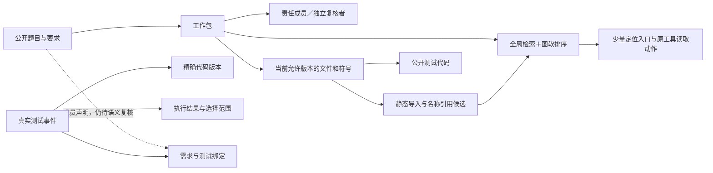

# v221：项目图辅助定位与公开验证证据修订

**可以把定位与项目图结合，而且比单纯增加上下文更贴合当前问题。本次已经实现受管定位入口和测试证据绑定，完成CPU与离线验证；没有启动新的收费评测。**

它的作用是把“我要到哪里继续读、为什么那里相关、证据对应哪个版本”说清楚。图不替模型作修复决定，不缩小可访问代码树，也不把测试通过自动当成任务已验证。

## 1. 调研依据与适用边界

| 一手来源 | 可借鉴之处 | 本项目的处理 |
|---|---|---|
| [Agentless](https://github.com/OpenAutoCoder/Agentless) | 逐层定位到文件、函数和编辑位置；将复现/回归验证独立组织 | 返回文件、符号、行号与下一条读取动作，保留原模型自己修复和最终候选规则 |
| [RepoGraph](https://github.com/ozyyshr/RepoGraph)／[ICLR论文](https://proceedings.iclr.cc/paper_files/paper/2025/hash/4a4a3c197deac042461c677219efd36c-Abstract-Conference.html) | 用仓库关系组织可检索上下文 | 在现有项目事件图之上增加代码静态关系层，关系推断与实际执行事实分开 |
| [Aider仓库地图](https://aider.chat/docs/repomap.html) | 用紧凑文件/符号/签名提供入口，限制呈现规模 | 默认最多8项、约8000字符，不把整张图塞进每次输入 |
| [SWE-agent ACI](https://github.com/SWE-agent/SWE-agent/blob/main/docs/background/aci.md) | 搜索与有限窗口的文件浏览 | 结果直接给出原`read_file`的路径和行范围，继续使用受管工具 |

这些是设计参考，不是完整复现，也不能引用其分数证明本项目有效。我们的v198历史结果还提示：局部路径或图邻居不能作为候选资格门；缺少关系可能只是尚未观察到。v220的35.4%定位整请求Token说明定位值得优化，但不能把它全部当成可被节省的成本。

## 2. 设计：项目图连接“任务—代码—证据—成员”

保留两类图的区别：组织图负责谁拥有工作、谁验证、如何交接；代码/项目关系图负责定位与证据来源。定位不会改变责任，静态引用不会自动变成执行依赖或根因。测试属于一个代码版本，产物被采用也不等于它已经通过验证。

## 3. 已实现的三个入口

**`locate_work`：定位辅助。** 先在当前成员合法可访问的完整文本快照中全局检索，再用实际工作关联、静态导入和名称引用候选补充软排序。结果包括文件、符号、行号、短签名、来源版本、选择理由，以及可直接调用的`read_file`参数。可指定已有合法`patch_id`定位固定候选，后续读取参数会绑定同一个补丁，避免复核者读回自己的另一版本。

**`record_public_check`：记录公开验证证据。** 把公开要求ID、原题输入/期望说明与本人实际执行的测试事件绑定；核验事件、文件树、路径可见性与成员身份。模型填写的覆盖解释继续标为成员声明。文件在测试树里，不代表这个具体检查被测试选择器执行；整个模块通过也不证明复现了题目场景。

**`public_check_status`：明确还缺什么。** 区分尚无绑定、历史版本、实际失败和“执行通过但语义覆盖尚未确认”。默认相对本成员当前工作区，也可明确查询固定补丁，避免把复核者的另一个私有版本与被审版本混淆。该工具不新增交付硬门槛，不自动接受、提交或给出官方成功判断。

三项均通过原Harness声明、模型调用、事务和计费路径，不提供不受管bash，不添加新Agent。模型调用这些入口仍消耗真实机会与Token；工具schema也会增加输入成本，未来必须计入净收益。

## 4. 定位优化与本轮实际修复

- **全局候选保留。** 图成员资格不决定能否检索；低相关或未连图时继续使用原全仓库搜索。输出预算内优先保留全局前三项，再进行图排序。
- **避免大文件压倒关键文件。** 使用长度归一化与稀有词匹配，保留`ColumnTransformer`、`set_output`等标识符精确匹配；符号得分取最匹配项，避免大文件因定义多而累加占优。
- **取消强制图补位。** 初版为了呈现图结果，会放进弱相关基准文件；现已取消，图没有增量时可以与普通检索完全相同。
- **二进制资源不挤占文本索引。** 初版误将base64资源当作文本，sklearn快照有877项因资源边界被跳过。现根据文件元数据过滤非UTF-8/非普通文件；最终索引1470个文本文件，403个非文本条目明确排除，0个文本文件因总量门限遗漏。
- **按版本增量维护。** 改动文件重新解析，未变文件复用；删除/重命名撤销旧节点和边。每次查询先走原权限解析，再访问缓存。固定补丁与成员私有版本分开，切换后不会沿用另一版本路径。
- **输出和失败可解释。** 单文件超过50万字符或解析失败时标记截断/未解析；仍可词项检索并回到原工具。静态名称引用明确标为推断，不伪造完整调用图。

本实现主要解析Python定义与导入；其他文本保留全局词项入口。它不是完整跨语言语义图，不执行或导入仓库代码，不用隐藏测试、参考修复或官方评分来给定位排序。

## 5. 离线验证结果

使用4个已有历史检查点中member_001实际拥有的快照，查询只由原公开题面标题和公开锚点组成。未读取参考修复或评分来选择位置。它是开发诊断，不是新的独立正确率测试。

| 快照 | 索引文本文件 | 冷构建秒 | 未改文件热更新秒 | 返回字符数 |
|---|---:|---:|---:|---:|
| SymPy-16792 | 1660 | 17.688 | 0.053 | 6754 |
| Astropy-13033 | 1838 | 7.202 | 0.054 | 7568 |
| Astropy-14539 | 1806 | 7.161 | 0.055 | 7083 |
| sklearn-26323 | 1470 | 8.640 | 0.132 | 7288 |

最终结果中，原公开题面提到的autowrap、TimeSeries、FITSDiff、ColumnTransformer对应实现或相关测试入口能够进入前列；这是可审阅的候选输出，**没有标注出必须修改的行，不能算定位正确率**。图还提供codegen、timeseries/core、fits工具与pipeline等候选，但它们是否对修复必要需要后续任务验证。

5项CPU控制覆盖全局发现、增量变化与删除、解析失败和资源边界、二进制隔离、成员私有文件权限、固定补丁导航、真实公开测试绑定及版本失效。原文件未修改，0模型API、0容器、0GPU。最终离线运行使用低优先级普通用户进程，单进程3 GiB地址空间和180秒CPU限制。

真实SDK控制使用新57工具检查点；详情见准入记录。旧54工具检查点直接恢复会被原兼容检查拒绝，本次保留该拒绝，不绕过工具身份检查。初版失败控制和三轮离线优化记录均保留。

## 6. 如何接到后续实验

**已冻结的v220 B/V方案保持不变。** B/V检验公开验证提示，仍使用原工具集；不能把这次新增图工具收益混进去。

图辅助定位另设后续对照：两组采用相同新工具集、相同新共同检查点、相同输出大小和预算，一组全局检索L，另一组全局检索加图G；固定验证条件、角色和C/N参数。当前已有同索引的离线L/G查询入口，真实运行的条件绑定与题单仍需单独冻结。因为新工具集与旧检查点不兼容，不能冒称可直接沿用旧16条的原样检查点。

应报告：定位请求次数与实际输入/输出Token、索引CPU/内存和冷启动成本、返回内容量、下一次读取命中、错误引用/旧版本误用、公开需求证据缺口、代码正确率及合法交付率。分别审计G新增候选是否有用；不把新增候选数或压缩字符数当算法收益。所有失败和未知保留，不按成绩换题或扩大C/N更新。

本次**完成实现、调研和离线工程验证，没有启动新收费回合**。当前不能保证整体Token减少或正确率提升；需将新增schema、定位调用和索引成本一并纳入实测。

## 7. 文件

- `src/proworksim/software_project_navigation_v221.py`：授权快照的增量索引与混合查询。
- `src/proworksim/software_public_requirement_evidence_v221.py`：执行、版本与覆盖声明分离。
- `src/proworksim/software_organization_world_v221.py`、`software_organization_runtime_v221.py`：新受管工具与私有SDK绑定。
- [最终离线证据](../../artifacts/software-benchmark-v221/offline-navigation-r3/summary.json)、[调研来源](../../artifacts/software-benchmark-v221/research-and-admission-r1/sources.json)。
- `tests/test_project_navigation_v221.py`、`tools/check_project_navigation_sdk_v221.py`：CPU与SDK机制控制。

## 最终工程准入

最终新57工具SDK控制完成：从同版本新检查点恢复，44次脚本响应中实际执行普通和固定补丁定位、公开证据绑定；4次真实CPU测试、1次合法交付，保留字段错误仍被拒绝并正常反馈，交付后0模型机会。测试通过没有自动提升为需求语义覆盖。CPU控制5项通过，4个真实快照离线检查通过。新工具定义比旧版增加约2002个JSON字符，未来净成本必须包含该输入开销。

本次模型API费用为0，累计账本仍689.70007472元；无Docker/GPU/共享服务器配置修改。旧v220方案所有冻结哈希核验不变。工程准入记录：[admission.json](../../artifacts/software-benchmark-v221/research-and-admission-r1/admission.json)，本记录不代表新付费实验已准入或算法收益通过。
