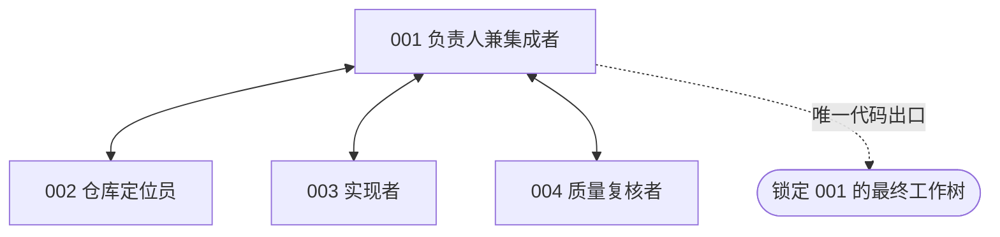
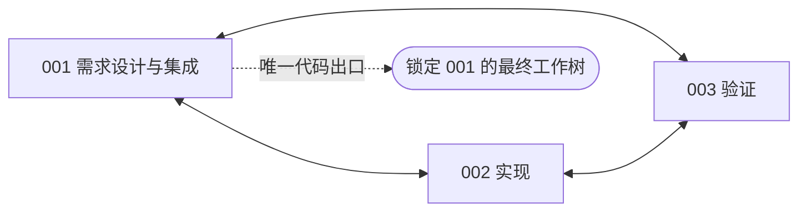
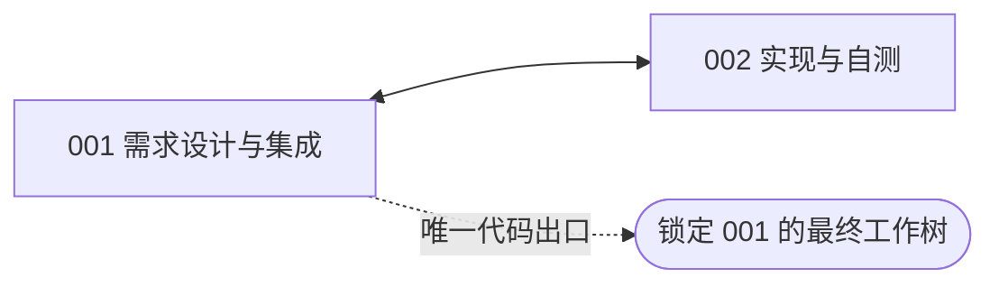
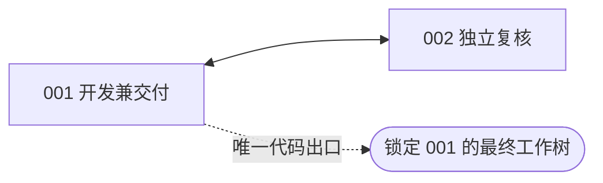
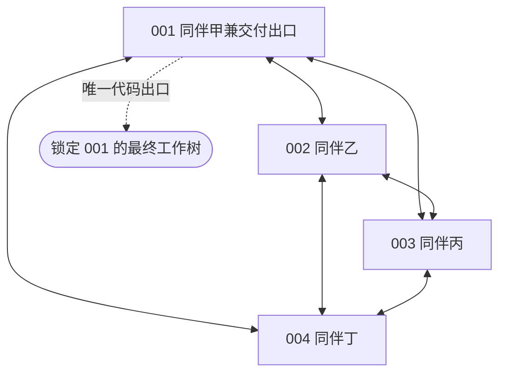
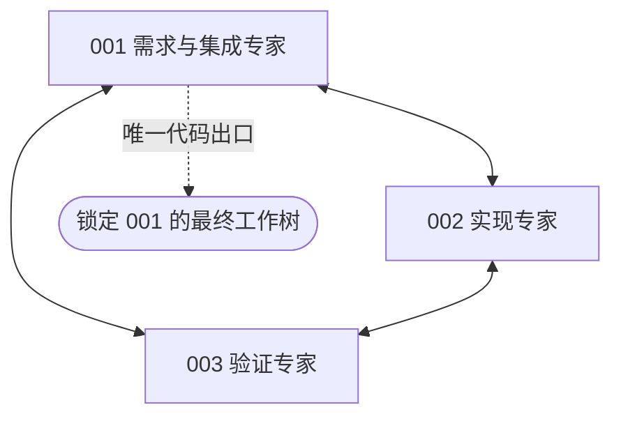

# 两至四成员 coding 组织对照审阅稿

六组改为覆盖 **2人、3人和4人** 的固定组织，保留适合单个仓库issue修复的典型分工。**本轮只实现与离线验证，不调用模型、不启动评测；团队总预算B等待单模型token上限实验后确定。** 全部继续使用OpenHands与ProWorkSim受管harness；角色和流程借鉴所列研究，属于项目适配方案，不是论文复现。

原统一四人稿已[逐文件封存](../../artifacts/software-fixed-organization-v065/superseded-four-member-r1/manifest.json)，状态改为已被本稿替代。原机制验证记录保留，v065正式评测仍为0。

## 六组配置

| 条件 | 固定人数 | 角色与协作方式 | 拟观察的取舍 |
| --- | ---: | --- | --- |
| CHIEF 集中负责人 | 4 | 负责人兼集成者、仓库定位员、实现者、质量复核者 | 集中协调的价值与中转成本 |
| SOP 职能流水线 | 3 | 需求设计与集成、实现、验证，按职能顺序交接 | 明确交接与返修等待 |
| DIALOGUE 阶段对话链 | 2 | 需求设计与集成、实现与自测，按阶段成对讨论 | 对话澄清与交流成本 |
| REVIEW 开发复核返修 | 2 | 开发兼交付、独立复核，开发后复核并返修 | 独立检查与实现预算的分配 |
| PEER 扁平同伴协作 | 4 | 四名同伴直接沟通、自主分工 | 自主分工、重复工作与冲突 |
| COUNCIL 专家会诊 | 3 | 需求与集成专家、实现专家、验证专家；先共同会诊，再集中行动 | 多角度讨论与组织开销 |

这样选择优先覆盖典型coding协作方式，不为了人数相同而增加重复岗位。主程序员制与职能分工分别合入CHIEF与SOP；Scrum完整迭代管理和矩阵制跨项目资源配置不另设组，AutoGen作为框架也不单独视为一种组织。

**本轮比较的是人数、职责、沟通和调度的组合。** 不能把不同组分差全部归因为组织拓扑，也不能单独归因为人数。将来若需分离人数效应，应在同一组织下另设人数消融；本次没有自动增加这类实验。

## 六张关系图

001等编号对应实际`member_001`等成员；只创建图中列明的成员，其职责表公开。实线表示允许的直接消息、定向补丁交接与责任转交通路，不代表自动发送。公开任务板和已固定版本仍是原harness的共同信息通道；读取或采用公开补丁无需沿每条边逐级传递，但合并必须显式执行。未固定工作树和私有历史保持隔离。虚线表示统一代码出口，不增加Agent。

### 1 集中负责人

保留四种明确职责，直接协调经负责人。固定公开补丁仍按原harness规则可见。MAGIS提供管理、仓库定位、开发和QA的组织参考；本组使用固定人数，不实现动态开发者招募。 [MAGIS原文](https://proceedings.neurips.cc/paper_files/paper/2024/file/5d1f02132ef51602adf07000ca5b6138-Paper-Conference.pdf)

### 2 职能流水线

将需求、设计和集成合为一个职责，由实现者和验证者接续工作。三人有双向返修通路，调度仍按需求设计→实现→验证→集成顺序推进；阶段到期不代表产物合格。 [MetaGPT原文](https://proceedings.iclr.cc/paper_files/paper/2024/hash/6507b115562bb0a305f1958ccc87355a-Abstract-Conference.html)

### 3 阶段对话链

两人持续围绕需求设计、实现自测和交付确认展开对话。001负责需求设计及最终集成，002负责实现与自测。这是ChatDev阶段对话思路的双角色适配，不复制其完整角色集合。 [ChatDev原文](https://aclanthology.org/2024.acl-long.810/)

### 4 开发复核返修

一名开发者产出补丁，一名独立复核者检查并反馈，然后由开发者返修和交付。与DIALOGUE同为双向两节点，但职责和行动窗口不同。复核意见不替代同版本测试，也不提供隐藏评分。 [现代代码复核研究](https://www.microsoft.com/en-us/research/publication/expectations-outcomes-and-challenges-of-modern-code-review/)

### 5 扁平同伴协作

保留四名同伴，按固定顺序轮转、自主安排工作和责任。001只是共同的最终导出地址，不获得额外管理权或私有信息。 [自管理团队研究](https://pubsonline.informs.org/doi/10.1287/orsc.12.5.559.10094)

### 6 专家会诊

三名成员先共同提出需求、实现和验证方面的判断，再由实现专家集中编码、验证专家检查、001集成。与SOP同为三节点互联，差别在于先共同会诊及其阶段分配；与四人PEER相比还同时改变人数。专业角色名称不代表模型具有已验证的专业优势。 [AgentVerse原文](https://proceedings.iclr.cc/paper_files/paper/2024/file/578e65cdee35d00c708d4c64bce32971-Paper-Conference.pdf)

## 与项目 harness 的一致性

- **同一基础能力**：OpenHands、HarnessPort和WorldCore保持；私有版本和历史、公开固定补丁、显式合并、同版本公开测试、固定与提交规则保留。不增加bash旁路、自动广播、自动合并或答案来源。角色职责是提示分工，复核者并没有另设只读ACL。
- **同一团队额度**：每组共享一个总预算B，不随2／3／4人倍增。上下文131072、完整输入98304、单次输出32768；全队共同512次决定、512次模型尝试、512次公开测试，6小时软／6.5小时硬期限。通信、返修、回读和格式修正仍消耗真实机会与token。
- **同一最终端点**：代码正确率只评001在闭合边界锁定的最终工作树；合法交付率另评001最后合法提交。不从多个成员的未合并末态中选最好补丁，不用后来工作树替代旧提交。
- **固定成员**：身份、工具参数中的合法成员、观察中的职责表、会话、预算消费者和调度都来自本组spec。两人组不存在003／004，三人组不存在004；禁止招人、替换或因组人数较小获得额外预算。

## 固定调度与待定实验

下表为循环行动窗口，数字是工作机会数；多人窗口内部轮转。配额是预设方案，尚未经过性能调优。窗口到期只切换调度，不自动发送、测试、合并或交付；等待和完成只可由真实可见事件唤醒同一会话。

当前按本组实际人数构造2／3／4个独立会话，经现有single-writer harness逐机会推进。此次没有验证同时发起多个模型请求或多个公开测试的物理并行部署。

| 条件 | 每轮窗口顺序 |
| --- | --- |
| CHIEF | 负责人规划 2 → 仓库定位 4 → 负责人分派 1 → 实现 8 → 负责人集成 3 → 质量复核 4 → 负责人闭合 2 |
| SOP | 需求与设计 4 → 实现 8 → 验证 6 → 集成交付 6 |
| DIALOGUE | 需求设计对话 8 → 实现自测对话 8 → 交付确认对话 8 |
| REVIEW | 开发 8 → 独立复核 4 → 返修与集成 8 → 复核反馈 4 |
| PEER | 同伴轮转 4 |
| COUNCIL | 专家会诊 6 → 集中实现 8 → 验证反馈 4 → 集成闭合 4 |

任务池仍为固定版本Verified完整500题身份，不按旧成绩选题。**模型、团队B、seed、重复次数和正式执行矩阵仍待单模型预算测试后确定**；六组并不自动扩成“六组织×两模型×三预算”。单人参照应与最终选择的底座、团队额度、公开环境和受管基础接口匹配。

未来报告应逐题配对、按仓库保留层级，分别给出代码正确率、合法交付率、全队实际平均token及每成员消耗、沟通／交接／合并成本、冲突、重复工作、等待和墙钟时间。未知及未开始单列，未完整闭合前不给完整500题的实际均值。解释分差时保留人数与组织规则共同变化这一边界。

[组织目录](../../src/proworksim/software_fixed_organization_v065.py)、[受管世界](../../src/proworksim/software_fixed_organization_world_v065.py)和[固定运行层](../../src/proworksim/software_fixed_organization_runtime_v065.py)构成实现；[准备脚本](../../tools/prepare_fixed_organizations_v065.py)只生成[六组配置](../../config/software-fixed-organizations-v065.json)及[新版待审阅计划](../../artifacts/software-fixed-organization-v065/preparation-r2/plan.json)，没有启动评测子命令，不继承现有实验的资源或API授权。六张图由同一catalog生成，见[独立图目录](diagrams/software-fixed-organization-v065/)和[图与配置绑定](../../artifacts/software-fixed-organization-v065/sources-r2/diagram-bindings.json)；原文来源见[一手资料记录](../../artifacts/software-fixed-organization-v065/sources-r1/facts.json)。

## 本轮验证与审阅范围

新版已通过22项必要定向CPU控制，覆盖2／3／4成员的真实World、共享预算、私有会话装配、角色与工具schema、固定调度、公开补丁语义和001双端点；9项未变旧检查未重复运行。另完成一次小规模SDK控制进程：DIALOGUE建立2个真实OpenHands会话、COUNCIL建立3个会话，各产生6次脚本响应；合计12次响应、12,204个人工token计数，验证实际成员顺序、共享记账、私有历史、无幽灵成员和公开测试绑定。原四会话SDK控制未重跑。见[新版验证记录](../../artifacts/software-fixed-organization-v065/validation-r2/validation.json)。

本轮真实模型、API、GPU、Docker和正式评分调用均为0。程序化响应及人工token计数只用于验证执行机制，不是模型成绩或实际模型消耗。原四人稿的旧证据保留为历史，不将其测试数字直接累加到新版。

审阅重点为六种代表性人数与组织组合、职责合并是否合理、行动窗口配额和001统一出口。后续人数消融与正式评测都须另行确定，不随本稿自动启动。
