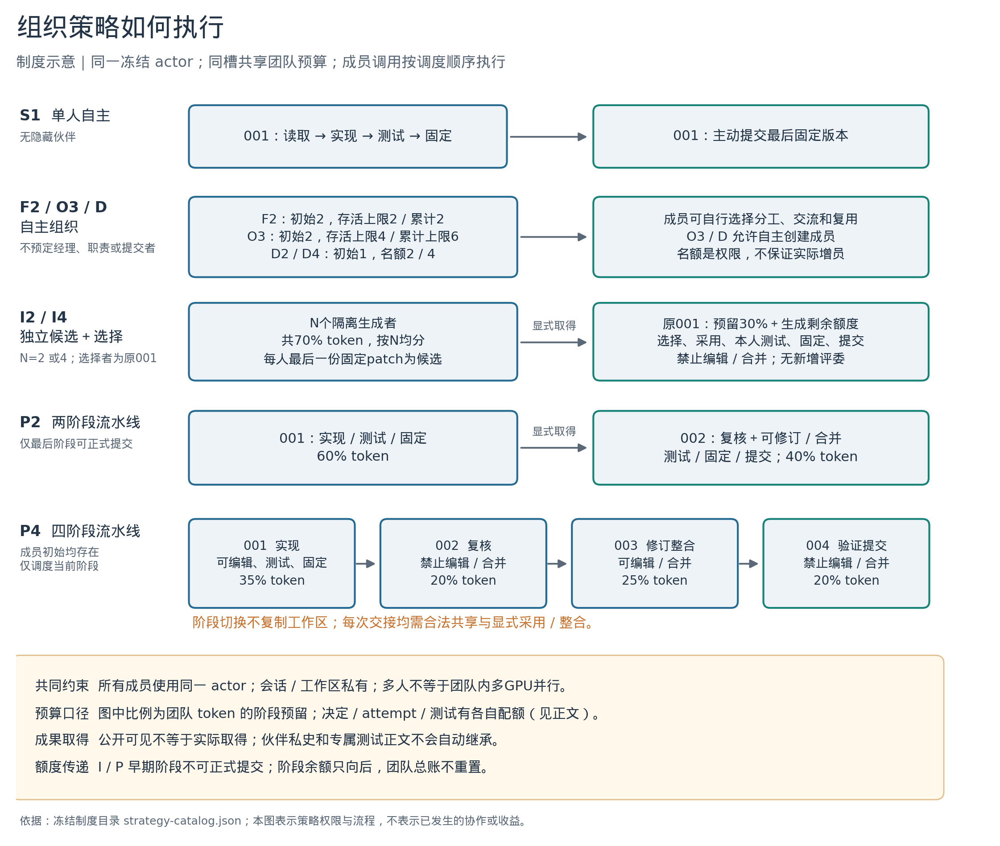
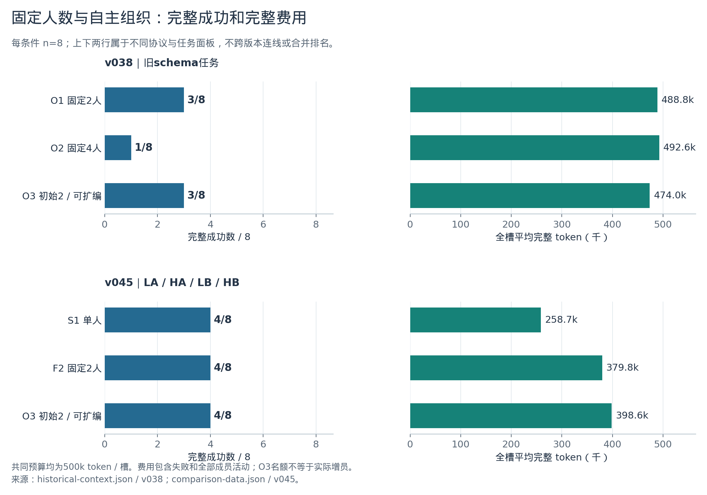
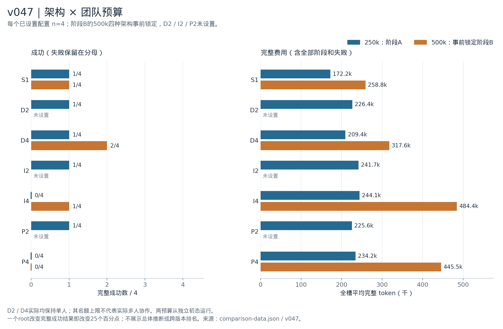
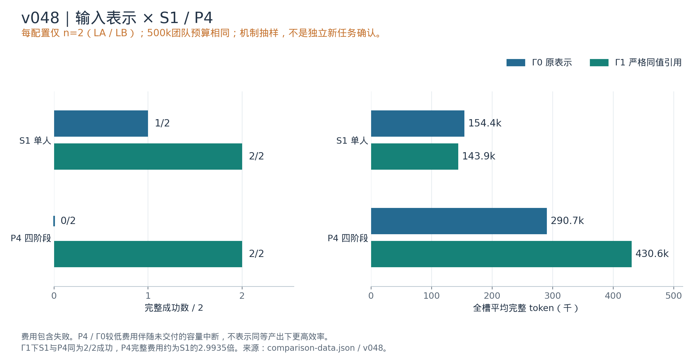

# 不同人数与组织策略的实验对比报告

**ProWorkSim · 截至2026年10月15日 · 冻结模型组织实验与学习实验分开解释**

固定双人、固定四人、允许自主增员、独立生成多个候选、按阶段复核修订，是不同的组织制度。现有结果没有显示“人数越多，完整交付越好”的一致关系：固定四人在早期同批对照中低于固定双人；单人、固定双人和可扩编团队在新业务面板上成功数相同；多个独立候选或固定流水线也未稳定超过单人。输入表示修订使所测四阶段流程恢复了交付机会，但在该两题面板上，单人与四阶段流程都成功，单人费用更低。

最直接的比较来自v038、v045、v047和v048。v044补充初始信息分布与共同交付说明的影响。每组都保留自己的任务、预算、输入表示、配对和固定分母；以下不把跨版本成功率拼成一个总体排名。

[TOC]

## 1 结果概览

| 组内比较 | 成功数与成本结果 | 可解释范围 |
| --- | --- | --- |
| v038 固定2人与固定4人 | 固定2人3/8；固定4人1/8；初始2人可扩编3/8 | 旧呈现协议下的八配对；可扩编组实际没有增员 |
| v045 S1/F2/O3 | 全部4/8；双人/可扩编组费用为S1的1.468/1.541倍 | 同规格同seed结果一致；不代表所有任务制度等效 |
| v047 七架构与两预算 | 250k下S1/D2/D4/I2/P2均1/4，I4/P4为0/4；500k下D4为2/4、I4为1/4 | D2/D4实际单人；500k仅预锁四配置 |
| v048 S1/P4 × Γ0/Γ1 | P4由0/2变为2/2；Γ1下S1也2/2，P4平均费用约2.99倍 | 两个既有root的机制对照；表示修订与人数效应分开 |
| v044 信息布局与工作说明 | split+team为3/4，其余三条件均2/4 | 人数保持；包含输入容量、取证和行为路径的综合结果 |

这些组内结果支持三个区别。第一，**增员权限不等于实际增员**：v038/v045的动态条件和v047的D2/D4均没有自主出生，D2/D4甚至始终只用初始一人。第二，**多人成立不等于成果互相使用**：两人分别修改同一问题，或某槽成功，不能证明伙伴成果进入了最终交付。第三，**组织流程的效果依赖可执行的输入与交付接口**：v048中四阶段流程的改善伴随硬context拒绝消失，不能仅以“配置四人”解释。

## 2 比较对象和评价口径

### 2.1 任务与模型范围

| 对比组 | 业务来源与配对 | 组织条件 | 每槽团队token上限 | context与表示 |
| --- | --- | --- | ---: | --- |
| v038 | 四个schema环境中的自建业务root，每root两seed | 固定2人、固定4人、初始2人可扩编 | 500000 | 16384，旧组织呈现协议 |
| v045 | LA/HA、LB/HB四个手写规格root，两个相关任务家族，每root两seed | S1、F2、O3 | 500000 | 16384，分页与格式反馈生命周期已修订 |
| v047 | 同四个人工root，每root一个新配对seed | 七种250k配置及四种预锁500k配置 | 250000或500000 | 18432，架构与阶段账协议 |
| v048 | 选定的LA/LB两个既有root，每root一新seed | S1/P4 × Γ0/Γ1 | 500000 | 18432；Γ1为同输入严格同值引用 |
| v044 | record-views/catalog两个承接态root，每root两seed | shared/split × base/team | 500000 | 16384，修订后的分页与反馈生命周期 |

以上主要组织对照均恢复同一个Qwen3.5-9B完整common，actor/critic步数3/3，实验中不更新参数。v038的schema环境源自固定仓库环境，但业务合同和起始应用是项目构造，不能当作四个原样上游issue；后续LA/HA/LB/HB是人工有界业务规格，也不是四个独立真实项目。[v038来源](software-organization-v038-final.md) [v045任务](software-organization-v045-protocol.md)

LA是带时区时间戳转UTC日期的局部接口维护；LB是规则边界、嵌套错误路径及旧语义保持。HA增加增量导入、revision、冲突、原子回滚、恢复与重放义务；HB增加v1到v2迁移、直接v2验证、missing/null区分及输入不变义务。后两者的规格约束更多，是事前设计区别；不能仅根据观察结果把它们视为统计上已验证的统一“难度等级”。

### 2.2 人数和并行的含义

“成员”是有独立私有历史、身份和工作副本的逻辑会话。成员使用同一个冻结actor，没有额外专家权重或隐藏经理。每个episode的一个resident依次服务成员调用；多个GPU worker并行的是不同episode。I4的“四个独立候选”因此表示信息与工作分支独立，不表示四张GPU同时推理。

报告同时区分初始人数、同时存活上限（等待仍占名额）、累计出生上限，以及有实际模型输出的成员数。累计出生含初始成员；“新增出生0”不表示没有成员。永久退出不会自动补员，初始人数较多也不保证各自都完成有效子任务。

### 2.3 成功和成本

- **R**：唯一最后固定交付是否通过完整合同验收，并满足原过程和合法性要求。公开测试通过、代码留在工作区、固定patch和正式提交是不同步骤。正常未提交按协议R=0，并不证明工作区代码全错。
- **Q**：v047/v048中，最后同一固定交付的私有合同通过比例；正常未提交为0。v045汇总没有对应可比较的Q数值，本报告留空，不将缺字段当作技术失败。
- **完整token费用**：全部实际输入与输出，包括失败尝试、所有成员/阶段和首次提交后的活动。阶段预算是共同团队账本的子上限；增加人数不会将总预算乘以人数。
- **缺失状态**：技术未知、未启动及未设置的配置分别列出；不补0，不删除失败后重算成功率。面板完整已知时，均值按原计划分母计算；未完整面板均值保持null。

本报告图表采用组内成功数和全槽平均完整token，不构造混合质量/成本总分，也不只计算成功槽均价。相同seed是配对设计的一部分，不保证不同说明、权限或预算下的模型输出一致。

## 3 每种方式的具体策略

### 3.1 人数与组织方式总表

| 方式 | 初始人数 | 同时存活上限 | 累计人数上限 | 核心策略 |
| --- | ---: | ---: | ---: | --- |
| S1 | 1 | 1 | 1 | 唯一成员自主求解、测试、固定并提交 |
| v038 O1 / v045 F2 | 2 | 2 | 2 | 固定出生集合，无预定职责；允许永久退出，不补员 |
| v038 O2 | 4 | 4 | 4 | 固定四名中性成员，无预定经理或职责 |
| v038 O3 / v045 O3 | 2 | 4 | 6 | 成员可在共同预算内邀请、创建、退出或重组 |
| D2 | 1 | 2 | 2 | 从一人出发，允许自主增加第二人 |
| D4 | 1 | 4 | 4 | 从一人出发，允许自主增加至四人；也允许保持单人 |
| I2 | 2 | 2 | 2 | 双人隔离生成候选，原001随后选择并提交 |
| I4 | 4 | 4 | 4 | 四人隔离生成候选，原001随后选择并提交 |
| P2 | 2 | 2 | 2 | 001实现，002复核、可修订并完成提交 |
| P4 | 4 | 4 | 4 | 001实现，002独立复核，003修订整合，004验证提交 |

O3是条件名，**不是三人团队**。v038 O1与v045 F2属于固定双人，但任务和呈现协议不同，不能合并样本。v049之后的严格O1还有不同的休眠语义，见第10节。I/P初始就有全部N个真实成员，阶段等待不减少这项初始配置。

### 3.2 S1 固定团队与自主增员

S1没有隐藏伙伴，唯一成员独立承担阅读、修改、测试、固定和提交，能够使用完整团队额度。F2与v038固定2/4人条件从空任务板开始，不预分经理、程序员、测试员或提交者。成员可集中完成、重叠探索，也可创建任务、认领、转交、发布成果和共享信息；共享任务责任不等于文件专属编辑锁。原调度与共同预算约束仍适用。

O3从两名中性成员开始，同时存活最多四名、累计最多六名；等待成员也占存活名额；D2/D4从一人开始，其活动与累计上限分别为二/四。它们提供的是组织选择权，**不强制使用名额、不奖励出生次数，也不以不增员判失败**。出生、退出和等待不会刷新团队预算。新成员使用同一actor，可从公共基线或明确授权的已发布固定patch初始化，不继承伙伴整段私有会话。不能把合法已发布成果当作免费共享全部私史。

固定团队与自主增员模式没有I/P那样的阶段配额。每槽共享128决定、128 attempt和32次成员公开测试；token池按对应实验的250k或500k设置。多个成员如何分配剩余额度由实际行动和原调度产生。

### 3.3 I2与I4 独立候选加选择

I先在权限和输入两层隔离候选生成分支：生成者不能读取其他分支代码、私史、专属报告、消息或任务。每名生成者最后一份合法固定patch构成一个候选，未固定就没有候选；多个历史patch不算额外独立尝试。

生成结束后，**原member_001**进入选择阶段，不增加额外选择者。001保留自己的会话，不继承其他成员私史或成员专属测试正文。选择者可依据合法候选和公开证据，付费采用、阅读和测试多个候选；不能编辑代码或进行三方合并。最终提交树必须等于最近一次实际采用的生成候选。私有验收只在最后固定交付锁定后执行，不能先验N个候选再挑答案。

| 项目 | I2 | I4 |
| --- | --- | --- |
| 生成token份额 | 团队70%，每人35% | 团队70%，每人17.5% |
| 每位生成者决定/attempt上限 | 44/44 | 22/22 |
| 每位生成者测试上限 | 12 | 6 |
| 选择阶段 | 原001；至少30% token、40决定/attempt、8测试 | 原001；同左 |
| 余额传递 | 生成分支之间不可借额；生成剩余只转选择 | 同左 |
| 选择者代码权限 | 显式采用候选；禁止编辑和合并 | 同左 |

以250k团队预算为例，I2每个生成者初始最多87,500token，I4每个生成者43,750token，选择预留均75,000token。500k下I4每位生成者87,500token、选择预留150,000token。因此增加候选数同时缩小单候选的团队份额，I2与I4是完整组织策略的比较，不是保持单候选预算不变的纯人数比较。

### 3.4 P2与P4 固定阶段协作

P初始即具备全部N个会话和独立工作区，但只调度当前阶段成员。后继不会自动继承前驱工作区；需要成员通过合法共享材料和显式采用/整合动作取得成果。没有前驱固定成果时，后继只能从自己的合法初态和已有公开资料出发。宿主不免费复制、修复或代为提交。

| 策略/阶段 | 执行成员 | token份额 | 决定/attempt | 测试上限 | 代码和交付职责 |
| --- | --- | --- | --- | --- | --- |
| P2 实现 | 001 | 60% | 76/76 | 20 | 可编辑、测试、固定候选；不正式提交 |
| P2 复核修订提交 | 002 | 40% | 52/52 | 12 | 显式取得成果，可复核、编辑/整合、测试、固定并提交 |
| P4 实现 | 001 | 35% | 44/44 | 8 | 可编辑、测试、固定候选；不正式提交 |
| P4 独立复核 | 002 | 20% | 26/26 | 8 | 可读取、采用、测试和反馈；禁止编辑/合并，不正式提交 |
| P4 修订整合 | 003 | 25% | 32/32 | 8 | 可编辑/整合并测试、固定修订候选；不正式提交 |
| P4 验证提交 | 004 | 20% | 26/26 | 8 | 禁止编辑/合并；本人同树测试、固定并提交 |

P2的第二人可以在复核后修改；P4的第二人和第四人在代码操作上禁止编辑或合并，可以读取、采用和测试；仍可执行合法消息、固定patch和阶段结束等动作，第四人负责最终提交，代码修订由第三阶段负责。因此P4的最后验证者即使发现问题，也不能自行修补为正确答案。该权限分配是事前策略选择，没有证据证明它是最优流水线。

以250k为例，P2两阶段token初始份额150,000/100,000；P4四阶段为87,500/50,000/62,500/50,000。500k的P4对应175,000/100,000/125,000/100,000。token、决定、attempt和测试的未用份额只能向后释放，不能借用后续阶段预留，也不能重置总账。

### 3.5 成果交接 测试与结束

`adopt_candidate(patch_id)`是成员实际调用的计费动作，精确替换为合法固定树，并留下新版本、来源和哈希记录；它不会自动测试、固定或提交。`integrate_patch`仍是三方合并，不能冒充候选精确切换。I的选择者禁止合并；P按上表分配合并和编辑权限。

I/P早期阶段可以固定候选，但不能正式提交。最终提交者必须对自己当前精确版本实际运行公开测试，再固定同一版本并主动提交；前驱的测试不能替代这一步。公开测试全部通过并非提交的硬门，最终完整合同仍由固定树验收决定。首次提交不会自动结束回合，正式结果取最后固定交付。

`finish_stage`只结束当前阶段并等待，不退休、不复制成果、不替下一阶段做工作。v047/v048的`staff_done`和显式退休仍是永久退出；已退休的001不会为I选择复活，也没有替补选择者。作者退休不撤销已合法公开的固定成果。[v047完整策略](software-organization-v047-protocol.md)

## 4 v038 固定双人 固定四人和可扩编双人

该组在同一旧呈现协议、同一500k团队预算下比较四个schema业务root，每root两seed，每条件8槽。所有结果已知；三组都无预设职责和经理，任务板初始为空。O3八槽均没有招募或替换，每槽实际产生过输出的成员共两人。

| 条件 | 实际有输出成员/槽 | 成功/8 | 平均完整token | 实际调用合计 | 硬context拒绝 |
| --- | --- | --- | --- | --- | --- |
| O1 固定双人 | 2 | 3/8 | 488,824.2 | 322 | 0 |
| O2固定四人 | 4 | 1/8 | 492,612 | 336 | 2 |
| O3可扩编双人 | 2 | 3/8 | 474,009.1 | 314 | 1 |

固定四人相对固定双人的成功率差为−25个百分点；可扩编双人相对固定双人为0。O3与固定双人的八配对为1胜、1负、6平。四个root中，job-policy固定双人2/2、固定四人0/2；command-set三组均0/2；其他root结果更混合。它说明本批增加初始会话没有带来更高交付率，不能外推固定四人通常更差。

三组平均token都接近500k上限。固定四人并没有获得额外token，但增加了会话、观察和潜在协调开销；格式拒绝输出分别为36/47/33，硬context拒绝分别0/2/1。它们是实际过程事实，不能仅凭这些计数把成功率差归因到某一个机制。本组全24槽工具级工作消息0、招募0；有3次整合动作，整合次数本身不能证明伙伴成果对交付有必要贡献。[v038结果](software-organization-v038-final.md)

## 5 v045 单人 固定双人和自主组织

该组改用LA/HA/LB/HB四个业务规格，每root两seed，共八个配对块；每个制度8槽，500k团队预算。S1只有一个真实成员，F2固定两人，O3从两人起步且允许活动4/累计6。两人条件先手在配对seed间轮换，S1先手始终是唯一001。

| 制度 | 成功/8 | 完整token合计 | 平均完整token | 实际调用 | 成员测试 | 相对S1费用 |
| --- | --- | --- | --- | --- | --- | --- |
| S1 | 4/8 | 2,069,513 | 258,689.1 | 151 | 12 | 1.000倍 |
| F2 | 4/8 | 3,038,435 | 379,804.4 | 225 | 14 | 1.468倍 |
| O3 | 4/8 | 3,188,608 | 398,576 | 236 | 16 | 1.541倍 |

| root | S1成功/2 | F2成功/2 | O3成功/2 |
| --- | --- | --- | --- |
| LA | 2/2 | 2/2 | 2/2 |
| HA | 0/2 | 0/2 | 0/2 |
| LB | 2/2 | 2/2 | 2/2 |
| HB | 0/2 | 0/2 | 0/2 |

所有八个配对块中，三制度的R都相同：LA/LB全部成功，HA/HB全部未提交。因此F2−S1=0、O3−F2=0；结果是同任务规格下的制度比较，不是将不同任务成功率直接相减。

F2和O3的完整费用分别为S1的约1.468倍、1.541倍。相同成功数下，单人总费用最低。本批O3没有自主增员，不能把O3−F2为0解释成实际增员无效。独立文件证据确认过一次非同值伙伴补丁应用，但发生于已有成功交付之后，接收者没有随后同版本复验或新的固定提交，不能归因交付收益。[v045结果](software-organization-v045-completion-final.md)

## 6 v047 人数名额 架构和团队预算

阶段A在250k预算下运行七种配置；阶段B在模型执行前固定S1/D4/I4/P4四种500k配置。每格均为同四个root，完整分母4。B从独立初态运行，不按A成绩选架构，也不是把同一条轨迹的预算事后延长。500k没有D2/I2/P2点，因此不存在完整的2人对4人预算交互面板。

| 架构 | 250k成功/4 | 500k成功/4 | 实际有输出人数 |
| --- | --- | --- | --- |
| S1 | 1/4 | 1/4 | 1 |
| D2 | 1/4 | 未设置 | 1 |
| D4 | 1/4 | 2/4 | 1 |
| I2 | 1/4 | 未设置 | 2 |
| I4 | 0/4 | 1/4 | 4 |
| P2 | 1/4 | 未设置 | 2 |
| P4 | 0/4 | 0/4 | 4 |

| 团队预算 | 架构 | 成功/4 | Q均值 | 平均完整token | 实际调用合计 | 相对同预算S1费用 |
| --- | --- | --- | --- | --- | --- | --- |
| 250k | S1 | 1/4 | 0.417 | 172,164.2 | 46 | 1.000倍 |
| 250k | D2 | 1/4 | 0.250 | 226,417.2 | 60 | 1.315倍 |
| 250k | D4 | 1/4 | 0.250 | 209,434.2 | 56 | 1.216倍 |
| 250k | I2 | 1/4 | 0.250 | 241,740.5 | 67 | 1.404倍 |
| 250k | I4 | 0/4 | 0.000 | 244,119.5 | 71 | 1.418倍 |
| 250k | P2 | 1/4 | 0.250 | 225,576.2 | 62 | 1.310倍 |
| 250k | P4 | 0/4 | 0.000 | 234,162.8 | 65 | 1.360倍 |
| 500k | S1 | 1/4 | 0.417 | 258,796.5 | 67 | 1.000倍 |
| 500k | D4 | 2/4 | 0.500 | 317,645.2 | 81 | 1.227倍 |
| 500k | I4 | 1/4 | 0.250 | 484,381.2 | 132 | 1.872倍 |
| 500k | P4 | 0/4 | 0.000 | 445,538 | 116 | 1.722倍 |

### 6.1 自主增员没有发生

D2/D4全部保持单人，全44槽自主出生0。D4的500k成功率2/4高于S1的1/4，但这比较的是“允许扩编的说明、工具和名额”与S1的完整制度；实际没有四人共同工作。LA/D4在500k条件成功时只消耗112,169token，低于250k上限，因此不能解释成原失败轨迹获得额外token后就成功。

### 6.2 独立候选与流水线

250k下，I2为1/4、I4为0/4，P2为1/4、P4为0/4。500k下，I4增至1/4，P4仍0/4。增加人数同时改变了每位生成者/阶段的份额、候选取得和验证成本；数据没有分离这些因素。把低预算下单候选或实现阶段份额缩小看作一种可能机制是合理假设，但本轮没有独立随机化这些中介因素，不能当作已证原因。

全44槽六次候选采用中，五次非同值、一次采用前已同值。只有A/LA/I2的记录把非同值伙伴文件采用、本人同树测试和最终成功交付连在一起。A/LA/P2虽然成功，却没有已证伙伴代码取得链，不能因P2标签就把这次成功归为协作收益。[v047采用证据](software-organization-v047-final.md)

### 6.3 预算翻倍的配对结果

| 架构 | 成功率差 500k−250k | Q均值差 | 每槽平均token增加 | 实际人数变化 |
| --- | --- | --- | --- | --- |
| S1 | +0个百分点 | +0.000 | 86,632.2 | 0 |
| D4 | +25个百分点 | +0.250 | 108,211 | 0 |
| I4 | +25个百分点 | +0.250 | 240,261.8 | 0 |
| P4 | +0个百分点 | +0.000 | 211,375.2 | 0 |

D4与I4各增加一个成功root；S1与P4成功数不变。全部配置的平均完整token都增加。250k下S1的平均完整费用最低，成功率与D2/D4/I2/P2并列最高；500k下D4多一个成功，但它仍实际单人。每个差值只基于四个root，一个二元结果变化就是25个百分点，不足以确定稳定的架构优劣。

## 7 v048 在统一表示下重新看单人与四阶段流程

v048保持S1/P4人数、阶段权限、500k团队预算和18432容量，比较原表示Γ0与Γ1。Γ1仅在同一输入的首末观察严格同值时，将五个重复字段的末次出现改为可精确还原的引用；没有增加模型容量、输出、工具权限或团队预算。

八槽是LA/LB两个人工旧root上的同期新对照，Γ0也重新执行。它是看过先导结果后的机制抽样，不是独立新任务确认。两个root下每种配置只有2槽。

| 架构 | 表示 | 成功/2 | Q均值 | 平均完整token | 调用/测试 | 硬context拒绝 |
| --- | --- | --- | --- | --- | --- | --- |
| S1 | Γ0 | 1/2 | 0.917 | 154,388 | 21/3 | 0 |
| S1 | Γ1 | 2/2 | 1.000 | 143,857 | 20/3 | 0 |
| P4 | Γ0 | 0/2 | 0.000 | 290,669.5 | 40/9 | 6 |
| P4 | Γ1 | 2/2 | 1.000 | 430,639.5 | 60/12 | 0 |

| root | 架构/表示 | R | Q | 完整token | 首次提交token | 首次提交后token |
| --- | --- | --- | --- | --- | --- | --- |
| LA | S1/Γ0 | 0 | 0.833 | 115,736 | 67,323 | 48,413 |
| LA | S1/Γ1 | 1 | 1.000 | 113,784 | 65,949 | 47,835 |
| LA | P4/Γ0 | 0 | 0.000 | 271,526 | — | — |
| LA | P4/Γ1 | 1 | 1.000 | 439,581 | 424,719 | 14,862 |
| LB | P4/Γ1 | 1 | 1.000 | 421,698 | 406,131 | 15,567 |
| LB | P4/Γ0 | 0 | 0.000 | 309,813 | — | — |
| LB | S1/Γ1 | 1 | 1.000 | 173,930 | 127,936 | 45,994 |
| LB | S1/Γ0 | 1 | 1.000 | 193,040 | 130,057 | 62,983 |

两条P4/Γ0各三次硬context拒绝，共六次；P4/Γ1均零次且全部交付成功。两条Γ1/P4均记录到003的非同值伙伴固定树被004采用、004本人同树测试、同树固定交付。该结果支持“表示容量影响了这两题的交付机会”；没有证明每段节省文字或某个伙伴不可替代。

**同为Γ1时，S1和P4都是2/2成功，平均完整token分别143,857和430,639.5，P4约为S1的2.9935倍。** P4/Γ1比P4/Γ0平均多139,970token，增加约48.15%；原Γ0较低费用伴随无交付的提前中断，不能当作同等产出下更高效率。另一方面，本面板也没有证明四人比单人更经济。

LA/S1的Γ0未全过、Γ1成功，但两者都没有硬context拒绝，不能把这一差异也归因于解除容量中断。LB/P4/Γ0后来取得的工作树与对应Γ1成功树相同，却没有完成采用后的本人测试、固定和提交；工作区拥有正确版本与形成合法交付仍是两件事。[v048结果](software-organization-v048-final.md)

## 8 v044 信息分布与共同交付说明

这一组保持初始两人、同时存活上限4、累计上限6，只改变两种初始诊断信息布局与两种工作说明。实际没有增员，故它是组织信息与说明的补充，不是人数比较。

**shared**：两名初始成员各获环境真实公开检查的A+B两份初始诊断。**split**：两名初始成员各获一份，A/B分配和先手预先平衡；通过真实消息/公开代码/相同公开测试可再取得另一份，不是永久隐藏知识。后来出生成员不自动继承初始诊断。

**base**：原业务任务与工具说明，仅统一错误政策与环境准备事实的必要标记；不是禁止协作或单人要求。

**team**额外说明：最终评估针对一个共同团队交付。成员不必每人各做一套完整解；自行判断分工、分享发现、复用伙伴成果、交叉检查或增员是否有帮助；集中完成也合法，不要求最低任务/消息/人数，全部消耗同一共享预算，系统不分配职责。

team明确提示共同交付与可选协作，但不给任务分解、岗位、顺序或正确代码，也不强制首轮通信。

| 条件 | 初始信息 | 工作说明 | 成功/4 | 平均完整token | 实际调用 | 新增出生 |
| --- | --- | --- | --- | --- | --- | --- |
| SB | shared | base | 2/4 | 419,419.5 | 127 | 0 |
| ST | shared | team | 2/4 | 494,152.8 | 148 | 0 |
| PB | split | base | 2/4 | 488,825.8 | 153 | 0 |
| PT | split | team | 3/4 | 475,667.2 | 149 | 0 |

四配对块等权后，split−shared主效应+0.125、team−base主效应+0.125、交互+0.25。块间方向并不一致，全16槽也没有已证跨成员使用链。这些差异反映初始信息、取得成本、输入容量、行为与交付流程的共同结果，不能解释为排除了容量影响的纯协作能力。原16槽经过明确披露的批次停止作用域修订才完成，不能称执行协议全过程毫无变化。[v044结果](software-organization-v044-completion-final.md)

## 9 哪些协作行为实际发生

| 实验 | 真实组织行为 | 与交付的关系 |
| --- | --- | --- |
| v038 | 全24招募0、工具级工作消息0；3次整合动作 | 动作次数本身不证明伙伴代码进入最终交付 |
| v045 | O3招募0；1次独立文件证据确认的非同值伙伴应用 | 成功交付早于应用，没有接收者新的同树复验/固定提交 |
| v047 | D2/D4实际单人；6次采用含5次非同值 | 仅A/LA/I2确认非同值伙伴采用→本人同树测试→成功固定交付 |
| v048 | 四个P4中有5次非同值伙伴代码应用 | 两条Γ1/P4确认伙伴代码进入接收者测试及最终成功交付 |

这里采用“实际产生→合法发布→伙伴取得→具体使用→同版本验证→固定交付”的证据层次。公开可访问不等于已取得，已读不等于使用，代码相似不等于相互传递。既有符号跟踪器的覆盖边界与独立整文件证据分列，不能用旧布尔false抹去真实文件应用，也不能用一次采用事件直接证明因果贡献。

## 10 与严格O1学习实验的关系

v049/v050的严格O1固定两个稳定身份，空任务板，职责自主产生。`staff_done`表示休眠；有新的真实伙伴可见事件时，仍具运行资格的同一休眠会话可被唤醒，不重置历史或预算；因context或成员/共享预算限制已不可运行的会话不能因此恢复。它不同于旧v038 O1与v045 F2的永久退出，也不同于I2的生成隔离和P2的强制阶段。编号相同或人数相同，不代表同一组织制度。[v049协议](software-learning-v049-protocol.md)

这些学习实验改变了模型参数，不能接到上述冻结模型人数表中比较。v049完成真实B更新，但没有更新前同面板，开发有一项技术未知；v050的S_star与B八单位面板分别5/8和4/8，Q±截至2026年10月15日仍在执行。它们回答参数更新和组成权重的问题，不构成新的1人/2人/4人因果对照。

## 11 当前证据支持的判断

1. **单人是本批成本较低的基准。** v045三制度成功数相同而S1费用最低；v047的250k面板S1成功率并列最高且费用最低；v048/Γ1中S1和P4同为2/2，P4约三倍费用。范围限于对应面板。
2. **提供名额尚未产生动态组织样本。** 多次允许自主增员却没有出生，能观察名额与权限制度的结果，不能估计实际招募之后的收益。
3. **固定多人流程没有稳定超越单人。** I/P有真实多会话与部分成果交接，但多数配置未改善完整交付，预算增加也没有一致改进。
4. **表示与交付规则会影响人数策略的可执行性。** v048为P4的局部机制改善提供了证据；同一组中四阶段流程仍没有成功率或成本优势超过单人。
5. **小样本不支持永久排名。** 各版本任务与协议不同，已有root被多次使用；每配置2、4或8槽，二元结果的变化粒度很大。所有比较都是有限开发结果，不是外部独立确认。

这些判断不要求先假定协作必须有收益，也不从一次小样本负差推出多人或学习永久无效。后续若要识别人数的独立作用，需要明确固定哪些权限、每成员/团队预算、输入表示和交接规则；当前结果保留这些差异作为解释边界。

## 附录A 未作为主排名的历史对照

**v039 F2/A3/X3。** F2固定两人；A3初始两人、活动≤4、累计≤6，自主创建；X3在同样制度外，预定在第8次团队决定完成后，按容量与终止规则尝试一次外生中性出生。决定包含未生成的决定；该操作不提供解答、角色、私史或新预算。实际A3/X3自主出生均0，七条已执行X3均触发了一次外生出生，新增者均为003；003是本次实际身份，不是协议保证的固定新ID。因此X3不能作为自主招募证据。原24计划执行22条，21条正式已知、1条技术未知、2条未启动，完整八配对主效应保持null。[v039结果](software-organization-v039-final.md)

**v040 shared/split与base/team。** 四条件各0/4，但32名成员最终均遭硬context拒绝，17份成员测试反馈没有进入任何后续实际selected输入。这里的全零和低费用是受输入阻断约束的结果，不能据此宣称四种组织策略能力相同或team说明无效。[v040结果](software-organization-v040-final.md)

**v046容量诊断。** 中性18432资格通过，业务比较却因首槽时间守卫中断形成1技术未知、3未启动。它不能给出人数或容量收益估计，也不是四个已知失败。[v046结果](software-organization-v046-final.md)

## 附录B 逐任务结果

### B1 v038 八个配对块

| 业务root | seed尾号 | 固定2人O1 | 固定4人O2 | 可扩编O3 |
| --- | --- | --- | --- | --- |
| job-policy | 101 | 1 | 0 | 0 |
| job-policy | 102 | 1 | 0 | 1 |
| command-set | 101 | 0 | 0 | 0 |
| command-set | 102 | 0 | 0 | 0 |
| room-bookings | 101 | 1 | 0 | 1 |
| room-bookings | 102 | 0 | 1 | 0 |
| order-totals | 101 | 0 | 0 | 0 |
| order-totals | 102 | 0 | 0 | 1 |

### B2 v045 八个配对块

| root | 完整seed | S1 R | F2 R | O3 R |
| --- | --- | --- | --- | --- |
| LA | 202610100451 | 1 | 1 | 1 |
| LA | 202610100452 | 1 | 1 | 1 |
| HA | 202610100451 | 0 | 0 | 0 |
| HA | 202610100452 | 0 | 0 | 0 |
| LB | 202610100451 | 1 | 1 | 1 |
| LB | 202610100452 | 1 | 1 | 1 |
| HB | 202610100451 | 0 | 0 | 0 |
| HB | 202610100452 | 0 | 0 | 0 |

### B3 v047 250k逐槽

| root | 架构 | R | Q | 输出成员数 | 完整token | 首次提交token |
| --- | --- | --- | --- | --- | --- | --- |
| LA | S1 | 0 | 0.667 | 1 | 95,528 | 79,481 |
| LA | D2 | 0 | 0.000 | 1 | 241,420 | — |
| LA | D4 | 0 | 0.000 | 1 | 245,562 | — |
| LA | I2 | 1 | 1.000 | 2 | 241,353 | 241,353 |
| LA | I4 | 0 | 0.000 | 4 | 240,710 | — |
| LA | P2 | 1 | 1.000 | 2 | 197,562 | 183,134 |
| LA | P4 | 0 | 0.000 | 4 | 220,402 | — |
| HA | S1 | 0 | 0.000 | 1 | 234,750 | — |
| HA | D2 | 0 | 0.000 | 1 | 233,921 | — |
| HA | D4 | 0 | 0.000 | 1 | 243,504 | — |
| HA | I2 | 0 | 0.000 | 2 | 241,983 | — |
| HA | I4 | 0 | 0.000 | 4 | 243,265 | — |
| HA | P2 | 0 | 0.000 | 2 | 232,172 | — |
| HA | P4 | 0 | 0.000 | 4 | 224,502 | — |
| LB | S1 | 1 | 1.000 | 1 | 113,205 | 96,719 |
| LB | D2 | 1 | 1.000 | 1 | 185,306 | 94,277 |
| LB | D4 | 1 | 1.000 | 1 | 114,223 | 81,905 |
| LB | I2 | 0 | 0.000 | 2 | 240,081 | — |
| LB | I4 | 0 | 0.000 | 4 | 247,795 | — |
| LB | P2 | 0 | 0.000 | 2 | 239,815 | — |
| LB | P4 | 0 | 0.000 | 4 | 246,682 | — |
| HB | S1 | 0 | 0.000 | 1 | 245,174 | — |
| HB | D2 | 0 | 0.000 | 1 | 245,022 | — |
| HB | D4 | 0 | 0.000 | 1 | 234,448 | — |
| HB | I2 | 0 | 0.000 | 2 | 243,545 | — |
| HB | I4 | 0 | 0.000 | 4 | 244,708 | — |
| HB | P2 | 0 | 0.000 | 2 | 232,756 | — |
| HB | P4 | 0 | 0.000 | 4 | 245,065 | — |

### B4 v047 500k逐槽

| root | 架构 | R | Q | 输出成员数 | 完整token | 首次提交token |
| --- | --- | --- | --- | --- | --- | --- |
| LA | S1 | 0 | 0.667 | 1 | 110,941 | 79,371 |
| LA | D4 | 1 | 1.000 | 1 | 112,169 | 96,149 |
| LA | I4 | 0 | 0.000 | 4 | 495,331 | — |
| LA | P4 | 0 | 0.000 | 4 | 371,082 | — |
| HA | S1 | 0 | 0.000 | 1 | 190,189 | — |
| HA | D4 | 0 | 0.000 | 1 | 497,846 | — |
| HA | I4 | 0 | 0.000 | 4 | 487,690 | — |
| HA | P4 | 0 | 0.000 | 4 | 490,599 | — |
| LB | S1 | 1 | 1.000 | 1 | 236,962 | 171,702 |
| LB | D4 | 1 | 1.000 | 1 | 164,578 | 69,272 |
| LB | I4 | 1 | 1.000 | 4 | 457,112 | 442,754 |
| LB | P4 | 0 | 0.000 | 4 | 428,925 | — |
| HB | S1 | 0 | 0.000 | 1 | 497,094 | — |
| HB | D4 | 0 | 0.000 | 1 | 495,988 | — |
| HB | I4 | 0 | 0.000 | 4 | 497,392 | — |
| HB | P4 | 0 | 0.000 | 4 | 491,546 | — |

v048全部八槽已列于第7节。首次提交token的横线表示无提交或该字段未提供，不能按0计。完整逐槽数据还包括v038和v045的全部费用，见附件CSV/JSON。

## 附录C 来源和复现

| 主题 | 结果来源 | 策略来源 |
| --- | --- | --- |
| v038人数对照 | [报告](software-organization-v038-final.md) / [机器结果](software-organization-v038-final.json) | [协议](software-organization-v038-protocol.md) |
| v039外生出生补充 | [报告](software-organization-v039-final.md) / [机器结果](software-organization-v039-final.json) | [协议](software-organization-v039-protocol.md) |
| v040容量反例 | [报告](software-organization-v040-final.md) / [机器结果](software-organization-v040-final.json) | [协议](software-organization-v040-protocol.md) |
| v044信息与说明 | [报告](software-organization-v044-completion-final.md) / [机器结果](software-organization-v044-completion-final.json) | [协议](software-organization-v044-protocol.md) |
| v045人数制度 | [报告](software-organization-v045-completion-final.md) / [机器结果](software-organization-v045-completion-final.json) | [协议](software-organization-v045-protocol.md) |
| v047架构预算 | [报告](software-organization-v047-final.md) / [机器结果](software-organization-v047-final.json) | [协议](software-organization-v047-protocol.md) |
| v048表示对照 | [报告](software-organization-v048-final.md) / [机器结果](software-organization-v048-final.json) | [协议](software-organization-v048-protocol.md) |
| v046未完容量诊断 | [报告](software-organization-v046-final.md) / [机器结果](software-organization-v046-final.json) | [协议](software-organization-v046-protocol.md) |
| 严格O1语义 | [报告](software-learning-v049-final.md) / [机器结果](software-learning-v049-final.json) | [协议](software-learning-v049-protocol.md) |

逐条策略事实的源码行和协议定位见[strategy-catalog.json](software-organization-strategies-comparison-20261015-assets/strategy-catalog.json)；历史范围见[historical-context.json](software-organization-strategies-comparison-20261015-assets/historical-context.json)。

归一化表保留原槽ID、来源JSON字段指针、文件SHA、缺字段与未设置配置。平均费用使用全槽完整实际token除以固定分母；v047预算差按同root先配对再等权汇总；v048的Γ差在同root同架构内计算。首次提交成本只在有真实提交的槽中有定义，不能替代完整回合费用。

数据与生成材料位于[报告附件目录](software-organization-strategies-comparison-20261015-assets/manifest.json)。本次制作只读取已有报告和必要策略源码，未启动新模型、测试、验收或参数更新。图中没有置信区间；缺设置不绘成零，有限面板均值不外推为总体估计。
