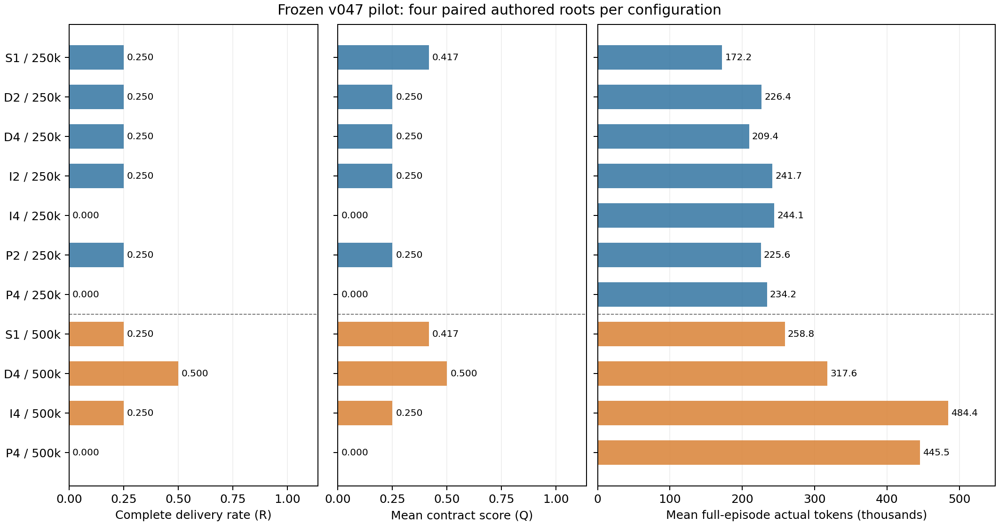

# v047 架构、成员名额与预算效率先导：原44槽完整结案

> 正式冻结批次于北京时间2026-10-12 02:09:56结束；本报告只读整理已保存证据，没有补跑或再验收。

## 正式结案

原44槽全部闭合：**9次完整成功、2槽提交后验收未完整通过、33槽未提交**。正式结果技术未知、行政删失、未启动和费用未知均为0；A为5/28成功，B为4/16成功。全部R_joint=R_token、Q_joint=Q_token，原有限面板的11配置与16预算配对均完整。

实际915决定、823次模型调用，输入11,880,180、输出359,723，合计**12,239,903 token**，与扣账一致；59次成员公开测试。8个worker占用共27,385.047338秒（**7.606957594 GPU小时**），实际只用物理GPU4/5，并发峰值2。参数、RNG、软件/actor/容量绑定及零更新守卫通过；没有全局暂停。15,000,000上限内剩余2,760,097 token不转移。

250k下，S1的平均完整费用最低、成功率与D2/D4/I2/P2并列为1/4。500k相对250k，D4、I4各增加一个成功root，S1、P4不变。**所有D2/D4均实际只用一人，全部44槽自主增员为0**；因此D4的完成度变化不能解释为实际多人协作收益。六次候选采用中，五次非同值、一次采用前已经同值；具体使用、测试通过和完整交付分开报告。

本轮是冻结原 9B 完整 common 3/3 的组织与预算先导。没有 actor/critic 参数更新或反向传播，没有恢复旧 v046 中断槽或未启动槽，也没有恢复训练、Contribution、正式更新、独立确认及缓存生产队列。44 槽结束或预定完整性暂停后无自动追加。

## 问题、授权与固定处理

四个 root 均为人工编写的有界业务规格。事件接口家族中，LA 在单文件 `event_time.py` 维护 `utc_date_key`，将严格合法的带时区时间戳转换为 UTC 日期，处理跨日/月/年并统一拒绝非法输入；HA 扩展为 `event_store/recovery` 的增量导入与恢复，要求最高 revision、幂等重放、同 revision 冲突、跨账户替换、整批原子回滚、快照独立复制和恢复后继续重放保持一致。规则接口家族中，LB 在单文件 `rules.evaluate` 修复 `between` 两端包含和嵌套错误位置，同时保持 v1 验证、missing/null、严格类型与输入不变；HB 实现 `migration.migrate_v1_to_v2` 和 `rule_v2.evaluate_v2`，在只读 v1 基础上产生新的规范 v2 树，保持全部合法 v1 语义、原始错误路径与输入不变，并验证直接传入的 v2 结构。高规格增加跨 API、跨文件一致性义务；这是事前规格区别，不是本轮统计验证的难度差异或协作收益。

本轮依据用户随 v046 审计提出的“参照审计修订并开展后续实验”，执行新的 44 槽清单。原审计、冻结协议、准备记录与启动记录分别保存在：

- `docs/reference/audit-v046-next-v047-architecture.md`
- `docs/experiments/software-organization-v047-protocol.md`
- `docs/experiments/software-organization-v047-preparation.md/json`
- `docs/experiments/software-organization-v047-launch.md`

阶段 A 为 LA/HA/LB/HB 四 root × S1/D2/D4/I2/I4/P2/P4，共 28 槽，每槽 250,000 token。阶段 B 为同四 root × 事前锁定的 S1/D4/I4/P4，共 16 槽，每槽 500,000 token，从独立初态启动；不根据 A 的结果、增员或合作情况选择。每槽 128 决定、128 attempt、32 次成员公开测试；全批上限分别为 5,632、5,632、1,408，实际模型 token 上限 15,000,000。旧未用额度不转入。

| 配置 | 初始/最大存活/累计成员 | 执行规则 |
| --- | --- | --- |
| S1 | 1/1/1 | 自主求解、测试、固定提交 |
| D2 | 1/2/2 | 自主增员、分工、共享、退出；允许保持一人 |
| D4 | 1/4/4 | 同上，提供四名额 |
| I2 | 2/2/2 | 独立生成候选，原 member_001 计费选择 |
| I4 | 4/4/4 | 同上，四条独立生成分支 |
| P2 | 2/2/2 | 实现 → 复核修订并提交 |
| P4 | 4/4/4 | 实现 → 独立复核 → 修订整合 → 验证提交 |

I 的生成阶段使用 70% token、88 决定/attempt、24 测试，按 N 均分；选择保留 30%、40、8，并承接生成剩余。P2 token 为 60/40，决定/attempt 为 76/52，测试为 20/12；P4 分别为 35/20/25/20、44/26/32/26、8/8/8/8。各维度余额只向后传递，全队账本不重置。早期阶段只能固定候选，不能正式提交。

`adopt_candidate` 是真实计费动作，绑定精确固定树；没有宿主免费拷贝或修复。I 选择者不能编辑或合并，最终文件必须等于实际采用的生成候选；缺少生成固定 patch 即缺少候选。P 后继没有自动继承前驱工作区。最终提交者必须自己测试当前精确版本、固定并提交；公开测试通过不是提交前提。`finish_stage` 不退休；真实退休不会复活。首次提交不结束回合，正式验收仍取唯一最后固定交付。

## 冻结、资格与实际资源

冻结代码为 `c3f3c4c459ff29f3a973c7b6dff6a83492926f6c`，源码树摘要为 `0b593bd39137ed7c4db8a067d661539688b479dfc5491ad64db18d1481ff6908`；原 878 个来源文件保持同字节。计划摘要为 `6f648410516f4d101b23943fa26f32afb640197029084046e207354c0d440bc7`，准入摘要为 `365e105bc74da8148f28dc4f3af910851a2a52bb81bd57246f4763283add29e3`。

上下文 18,432、输出预约 2,048、正文页 3,072 Unicode 字符，原参数、tokenizer、BF16/FP32、RoPE、注意力后端与数值路径保持。精确复用旧 v046 的一次中性资格：输入 16,384、输出 28、实际 16,412 token；这是历史成本，本轮新资格模型调用与费用均为 0。每个 resident 仍按原 16K 构造、迁移、恢复完整 common 后绑定已有容量身份。

新配对 seed 分别为 LA=202610110471、HA=202610110472、LB=202610110473、HB=202610110474，全部先手 member_001。同 root 的 A/B 配对 seed 相同但初态独立，实例标识和预算说明不同；不能由相同 seed 推断动作相同。用户没有提供审计中链接的机器 JSON，这些 seed 和顺序是模型执行前另行冻结的本地清单，不冒称来自附件。

阶段 A 基本顺序 S1,D2,D4,I2,I4,P2,P4，四 root 循环移位 0/2/4/6；阶段 B 基本顺序 S1,D4,I4,P4，移位 0/1/2/3。仅物理 GPU3/4/5/7，最多三驻留，容量不足按原门等待。

| worker/root | GPU | 开始（北京时间） | 结束（北京时间） | 完整占用秒 |
| --- | --- | --- | --- | --- |
| stage-A-r0 | 4 | 2026-10-11 20:00:14.262 | 2026-10-11 21:08:12.785 | 4078.523213 |
| stage-A-r1 | 5 | 2026-10-11 20:44:40.454 | 2026-10-11 22:19:57.861 | 5717.406494 |
| stage-A-r2 | 5 | 2026-10-11 22:21:01.576 | 2026-10-11 23:16:31.015 | 3329.438455 |
| stage-A-r3 | 5 | 2026-10-11 23:17:35.005 | 2026-10-12 00:18:57.913 | 3682.908115 |
| stage-B-r0 | 5 | 2026-10-12 00:19:04.843 | 2026-10-12 00:37:49.751 | 1124.907489 |
| stage-B-r1 | 4 | 2026-10-12 00:20:08.556 | 2026-10-12 01:27:49.511 | 4060.954822 |
| stage-B-r2 | 5 | 2026-10-12 00:39:00.182 | 2026-10-12 01:03:39.331 | 1479.149523 |
| stage-B-r3 | 5 | 2026-10-12 01:04:44.872 | 2026-10-12 02:09:56.631 | 3911.759226 |

A四worker合计16,808.276277秒（4.668965633小时），B四worker合计10,576.771060秒（2.937991961小时）。A最后关闭00:18:57.913，B首次启动00:19:04.843，四个B worker都在全部A关闭后启动；没有用A结果选择B。全部worker exit=0，原3/3恢复、容量身份和终态来源凭据完整。实际并行峰2，保留原资源门；未借用其他卡或按结果调度。

既有3,928条资源采样全部fresh，无采样失败或资源守卫停止；采样内自用GPU内存峰34,954 MiB，整卡空闲最小6,196 MiB，RSS峰14,159,339,520字节，卷空闲最小432,684,183,552字节。artifact守卫峰81,989,726,607字节包含历史目录，不是本轮新增文件体积。没有为报告重新查询GPU。

原生调用墙钟25,828.846361秒嵌套于worker占用，不能相加。下表也是已保存执行墙钟，**CPU核秒未测/null**；沙箱CPU限制不是实际用量。

| 执行类别 | 次数 | 已保存墙钟秒 |
| --- | --- | --- |
| 成员公开测试 | 59 | 6.762867 |
| 成员脚本 | 0 | 0 |
| 初态公开driver | 16 | 1.783296 |
| 最终固定树公开验收 | 11 | 1.208802 |
| 最终固定树私有验收 | 11 | 1.260459 |

初态8次新制备各运行2个公开driver，36槽复用缓存；prepare函数墙钟1.993664秒已包含其driver。11个提交槽各对唯一最后固定树执行一次公开验收与一次私有验收，并非重复私有验收；13次submit事件也不是13次终态验收。全部子时间均嵌套于worker，不重复累加。

## CPU 准备与保留的失败

131 项不同 CPU 控制与全项目 Ruff 通过，控制涵盖人口/权限、I 隔离、阶段账、精确采用、完整提交、SDK 衔接、双 dispatch 门、90/100 分钟边界、R/Q 删失及来源绑定。它们是有限机械控制，不是模型成绩。

新材料首轮 44 路线有 34 通过、10 路线共 16 次安全硬 context 拒绝，定位到新观察在顶层 `patches` 与 `architecture.candidates` 重复发送完整目录。修订仅去掉模型观察重复副本，仍保留完整授权目录、candidate IDs、宿主快照和权限，原失败与 22 个新源码快照保留。第二轮 42/44 通过；HA/P4 两预算路线在重复读已完整进入初态的 2,090 字符合同后超限 175/179 token。该可选读取不是提交前提，CPU 正例改读随后实际修改的小文件，只重测两条；生产 Γ 不再变化。

最终证据为原样复用 42 条加两条新正例，共 468 次准备、452 次程序回包，最小硬余量 49 token。全部实际 CPU 批次合计 944 次准备、894 次程序回包，不能将证据集合再算一次，也不能将程序回包计作模型调用。旧 false 不改写，合同重复读取仍保留为局部容量反例。这些有限路线不保证所有未来模型历史都能容纳。

其余开发失败（夹具状态名、SDK fixture 标签、只读来源命令参数与 Ruff）详见准备记录。只读分析期间，监听接管曾因PYTHONPATH遗漏失败，在原件枚举前退出，随后仅修正分析环境；旧输出、两次接管回执及源码摘要保留。配置显示中“正常未提交”的标签曾窄修，旧稿另存；LB/I2的动作尝试与实际效果说明独立补充。紧凑投影草稿在最终来源绑定前另存归档。报告图依赖隔离安装在分析目录，原模型环境未改。另一次只读字段探查误用slots键报错，没有写入报告或改变原件。这些是报告层操作，不是正式模型源、Γ、候选或R的热改；终态分析read_errors/analysis_errors/review_errors及待绑定依赖均为空。

## 结果与成本口径

`R_joint` 是共同 token 和时间策略下唯一最后固定交付的正式成功。`Q_joint` 是同一固定交付通过私有合同条目数的比例；正常无提交为 0，不能据此宣称原始代码质量为零。没有对未提交工作区补验，也没有验收全部候选后挑选。

90 分钟软截止后不派发新请求或进入新阶段，只允许已派发在途请求及其合法动作、清算、原关闭、唯一验收和 guard 在 10 分钟窗口闭合。安全行政删失可有已知 R_joint，但 R_token/Q_token 仍为 null；技术未知及未启动不填 0。完整性问题暂停未开库存，充分绑定的安全局部 context 或预算终止保留并继续独立槽。

每配置固定分母 m=4，未知结局形成的 [s/4,(s+u)/4] 是识别边界，不是置信区间。所有成员、阶段、失败工作及提交后工作计入完整实际费用。首次/最终采用提交的费用是累计切点，不能再次加到总费，也不能将首次提交称为首次正确解。

| 预算 | 配置 | 成功/4 | Q均值 | 4槽完整token | 平均完整token | 有提交槽 |
| --- | --- | --- | --- | --- | --- | --- |
| 250,000 | S1 | 1/4 | 0.416667 | 688,657 | 172164.25 | 2 |
| 250,000 | D2 | 1/4 | 0.25 | 905,669 | 226417.25 | 1 |
| 250,000 | D4 | 1/4 | 0.25 | 837,737 | 209434.25 | 1 |
| 250,000 | I2 | 1/4 | 0.25 | 966,962 | 241740.5 | 1 |
| 250,000 | I4 | 0/4 | 0 | 976,478 | 244119.5 | 0 |
| 250,000 | P2 | 1/4 | 0.25 | 902,305 | 225576.25 | 1 |
| 250,000 | P4 | 0/4 | 0 | 936,651 | 234162.75 | 0 |
| 500,000 | S1 | 1/4 | 0.416667 | 1,035,186 | 258796.5 | 2 |
| 500,000 | D4 | 2/4 | 0.5 | 1,270,581 | 317645.25 | 2 |
| 500,000 | I4 | 1/4 | 0.25 | 1,937,525 | 484381.25 | 1 |
| 500,000 | P4 | 0/4 | 0 | 1,782,152 | 445538 | 0 |

图按相同四root等权聚合，包含未提交、验收失败及成功槽的全部费用；文字数值为显示舍入，机器JSON保留精度。当前未知数为0，识别区间退化为点值，仍不是置信区间。

### 250,000预算：原清单逐槽

| root | 配置 | 正式状态 | R | Q | 完整实际token | 首次提交token | 末次提交token | 出生/调用/峰存活 |
| --- | --- | --- | --- | --- | --- | --- | --- | --- |
| LA | S1 | 提交验收未完整通过 | 0 | 0.666667 | 95,528 | 79,481 | 79,481 | 1/1/1 |
| LA | D2 | 未提交 | 0 | 0 | 241,420 | null | null | 1/1/1 |
| LA | D4 | 未提交 | 0 | 0 | 245,562 | null | null | 1/1/1 |
| LA | I2 | 完整成功 | 1 | 1 | 241,353 | 241,353 | 241,353 | 2/2/2 |
| LA | I4 | 未提交 | 0 | 0 | 240,710 | null | null | 4/4/4 |
| LA | P2 | 完整成功 | 1 | 1 | 197,562 | 183,134 | 183,134 | 2/2/2 |
| LA | P4 | 未提交 | 0 | 0 | 220,402 | null | null | 4/4/4 |
| HA | S1 | 未提交 | 0 | 0 | 234,750 | null | null | 1/1/1 |
| HA | D2 | 未提交 | 0 | 0 | 233,921 | null | null | 1/1/1 |
| HA | D4 | 未提交 | 0 | 0 | 243,504 | null | null | 1/1/1 |
| HA | I2 | 未提交 | 0 | 0 | 241,983 | null | null | 2/2/2 |
| HA | I4 | 未提交 | 0 | 0 | 243,265 | null | null | 4/4/4 |
| HA | P2 | 未提交 | 0 | 0 | 232,172 | null | null | 2/2/2 |
| HA | P4 | 未提交 | 0 | 0 | 224,502 | null | null | 4/4/4 |
| LB | S1 | 完整成功 | 1 | 1 | 113,205 | 96,719 | 96,719 | 1/1/1 |
| LB | D2 | 完整成功 | 1 | 1 | 185,306 | 94,277 | 154,841 | 1/1/1 |
| LB | D4 | 完整成功 | 1 | 1 | 114,223 | 81,905 | 81,905 | 1/1/1 |
| LB | I2 | 未提交 | 0 | 0 | 240,081 | null | null | 2/2/2 |
| LB | I4 | 未提交 | 0 | 0 | 247,795 | null | null | 4/4/4 |
| LB | P2 | 未提交 | 0 | 0 | 239,815 | null | null | 2/2/2 |
| LB | P4 | 未提交 | 0 | 0 | 246,682 | null | null | 4/4/4 |
| HB | S1 | 未提交 | 0 | 0 | 245,174 | null | null | 1/1/1 |
| HB | D2 | 未提交 | 0 | 0 | 245,022 | null | null | 1/1/1 |
| HB | D4 | 未提交 | 0 | 0 | 234,448 | null | null | 1/1/1 |
| HB | I2 | 未提交 | 0 | 0 | 243,545 | null | null | 2/2/2 |
| HB | I4 | 未提交 | 0 | 0 | 244,708 | null | null | 4/4/4 |
| HB | P2 | 未提交 | 0 | 0 | 232,756 | null | null | 2/2/2 |
| HB | P4 | 未提交 | 0 | 0 | 245,065 | null | null | 4/4/4 |

### 500,000预算：原清单逐槽

| root | 配置 | 正式状态 | R | Q | 完整实际token | 首次提交token | 末次提交token | 出生/调用/峰存活 |
| --- | --- | --- | --- | --- | --- | --- | --- | --- |
| LA | S1 | 提交验收未完整通过 | 0 | 0.666667 | 110,941 | 79,371 | 79,371 | 1/1/1 |
| LA | D4 | 完整成功 | 1 | 1 | 112,169 | 96,149 | 96,149 | 1/1/1 |
| LA | I4 | 未提交 | 0 | 0 | 495,331 | null | null | 4/4/4 |
| LA | P4 | 未提交 | 0 | 0 | 371,082 | null | null | 4/4/4 |
| HA | S1 | 未提交 | 0 | 0 | 190,189 | null | null | 1/1/1 |
| HA | D4 | 未提交 | 0 | 0 | 497,846 | null | null | 1/1/1 |
| HA | I4 | 未提交 | 0 | 0 | 487,690 | null | null | 4/4/4 |
| HA | P4 | 未提交 | 0 | 0 | 490,599 | null | null | 4/4/4 |
| LB | S1 | 完整成功 | 1 | 1 | 236,962 | 171,702 | 171,702 | 1/1/1 |
| LB | D4 | 完整成功 | 1 | 1 | 164,578 | 69,272 | 148,937 | 1/1/1 |
| LB | I4 | 完整成功 | 1 | 1 | 457,112 | 442,754 | 442,754 | 4/4/4 |
| LB | P4 | 未提交 | 0 | 0 | 428,925 | null | null | 4/4/4 |
| HB | S1 | 未提交 | 0 | 0 | 497,094 | null | null | 1/1/1 |
| HB | D4 | 未提交 | 0 | 0 | 495,988 | null | null | 1/1/1 |
| HB | I4 | 未提交 | 0 | 0 | 497,392 | null | null | 4/4/4 |
| HB | P4 | 未提交 | 0 | 0 | 491,546 | null | null | 4/4/4 |

### 预算配对：500k − 250k

| 配置 | ΔR_joint=ΔR_token | ΔQ | 平均实际token差 | 平均出生/调用/峰存活差 |
| --- | --- | --- | --- | --- |
| S1 | 0 | 0 | 86632.25 | 0/0/0 |
| D4 | 0.25 | 0.25 | 108211 | 0/0/0 |
| I4 | 0.25 | 0.25 | 240261.75 | 0/0/0 |
| P4 | 0 | 0 | 211375.25 | 0/0/0 |

| 配置 | root | ΔR | ΔQ | 完整实际token差 |
| --- | --- | --- | --- | --- |
| S1 | LA | 0 | 0 | 15,413 |
| S1 | HA | 0 | 0 | -44,561 |
| S1 | LB | 0 | 0 | 123,757 |
| S1 | HB | 0 | 0 | 251,920 |
| D4 | LA | 1 | 1 | -133,393 |
| D4 | HA | 0 | 0 | 254,342 |
| D4 | LB | 0 | 0 | 50,355 |
| D4 | HB | 0 | 0 | 261,540 |
| I4 | LA | 0 | 0 | 254,621 |
| I4 | HA | 0 | 0 | 244,425 |
| I4 | LB | 1 | 1 | 209,317 |
| I4 | HB | 0 | 0 | 252,684 |
| P4 | LA | 0 | 0 | 150,680 |
| P4 | HA | 0 | 0 | 266,097 |
| P4 | LB | 0 | 0 | 182,243 |
| P4 | HB | 0 | 0 | 246,481 |

D4的唯一新增成功来自LA，其高预算槽实际仅112,169 token，低于旧250k上限；I4的唯一新增成功来自LB。两者都是从独立初态运行的完整预算条件差，不能解释为原失败轨迹原地续跑。HA/HB全部22槽均未提交；没有根据工作区看起来可用而额外验收。LA/LB分别3/11、6/11完整成功，不能把两个任务家族当作44个独立实务样本。

阶段 A 的 28 槽全部已知闭合，完整成功 5、未完整成功 23；无行政删失或技术未知。七配置各四 root 的 R 均值依次为 S1=.25、D2=.25、D4=.25、I2=.25、I4=0、P2=.25、P4=0。S1 的平均完整实际费用为 172,164.25 token，是本面板七配置中最低，同时与四个配置并列最高 R；Q 均值 .4167，其余有成功配置为 .25。这个有限面板支持 S1 的较低费用描述，不足以外推架构优劣。D2/D4 全部保持单成员，因此不能将其结果解释为两人或四人协作的效果。

I4 在 A 的 16 个生成成员中没有形成可供选择的固定候选；I2 的八个生成成员只有 LA 的 member_002 形成一个。固定 patch、公开测试成功、正式候选和最终交付是不同事实：LB/A/I2 两个生成成员的公开测试通过，但均未在生成阶段固定候选；选择阶段的自有 patch 不能追溯变为生成候选，其 submit 和 adopt 分别被原业务规则拒绝，后续输入均实际呈现了拒绝正文。没有为此放宽选择定义或补验未提交工作区。

P4 的四组预算配对完整：250k 与 500k 均为 0/4 完整成功、Q 均值 0；平均完整实际费用从 234,162.75 增至 445,538 token，平均增加 211,375.25。LA 的高预算 P4 出现两次伙伴文件采用和同树复测，但没有固定交付；HA/HB 的高预算 P4 有读取和修改、没有成员测试或固定补丁。这说明所测策略下增加的活动和费用未转成完整交付，不能简化为没有任何具体工作，也不能外推为所有流水线策略均无收益。

## 时间、预算与 context 终止

| 执行前拒绝 | A | B | 全批 |
| --- | --- | --- | --- |
| 团队总token预约不足 | 19 | 5 | 24 |
| 阶段预算 | 36 | 19 | 55 |
| 硬context | 4 | 6 | 10 |
| 成员fixed先于shared | 0 | 3 | 3 |
| 合计 | 59 | 33 | 92 |

92次拒绝=915决定−823实际调用，均在生成前拒绝，无不确定attempt费用。行政预派发取消0、全局暂停0、未启动0。context表中的每次输出预约均为2,048，上限18,432；完整请求/渲染/input_ids/prepare摘要与call_id见主JSON每槽cost_detail及紧凑工作链。

| 槽 | 成员 | 阶段 | 反馈ID | 最后工具 | 准备输入P | P+2048超限 |
| --- | --- | --- | --- | --- | --- | --- |
| A/LA/P4 | 003 | revise_integrate | feedback-328 | run_tests | 16,544 | 160 |
| A/LA/P4 | 004 | validate_submit | feedback-411 | run_tests | 16,444 | 60 |
| A/HA/P4 | 004 | validate_submit | feedback-388 | run_tests | 16,559 | 175 |
| A/LB/P4 | 004 | validate_submit | feedback-434 | run_tests | 16,850 | 466 |
| B/LA/P4 | 002 | review | feedback-348 | run_tests | 16,816 | 432 |
| B/LA/P4 | 003 | revise_integrate | feedback-454 | run_tests | 16,832 | 448 |
| B/LA/P4 | 004 | validate_submit | feedback-606 | run_tests | 16,816 | 432 |
| B/HA/S1 | 001 | free | feedback-273 | work_history_read | 18,872 | 2,488 |
| B/LB/P4 | 002 | review | feedback-325 | run_tests | 16,664 | 280 |
| B/LB/P4 | 004 | validate_submit | feedback-675 | run_tests | 16,695 | 311 |

这些真实硬拒绝保留为原制度下的局部资源终止；没有丢弃未呈现反馈、恢复成员、转移余额或重采。它们与CPU工程余量诊断不同，也不能由CPU有限正例全部fit推断任意模型历史都可容纳。三个fixed先拒绝为HA/B/D4、HB/B/S1、HB/B/D4，其准备请求分别15,280+2,048、16,300+2,048、14,587+2,048，都fit；余额分别2,154、2,906、4,012不足预约，各自attempt=false且收费0。

## 反馈、成员与具体工作链

费用、反馈与工作链由三个只读分析入口分别核对，均来自同一批保存的原始请求、响应、世界记录和费用账本；这些不是独立实验重复，也不构成原运行的完整重放。分析没有新增模型调用、分词资格、业务动作、公开测试或私有验收。

反馈保存、确实出现在后续模型输入、实际正文页、具体失败反例、版本修改、同版本公开测试/复验、固定提交分别报告。无后续请求不自动等于丢失反馈，阅读不自动等于理解，静态接口对应不等于动态覆盖。

原反馈的无后继归属和费用终止类别分别保存。例如 HA/B/D4 的最后反馈原归属为 `stage_boundary`，宿主边界原因为 `model_budget_exhausted`；费用记录则绑定成员 fixed meter 在共享准入之前拒绝。其准备输入 15,280 + 输出预约 2,048 能容纳于 18,432，但成员/团队余额均仅 2,154，不足 17,328 预约。该次 attempt 未启动、实际费用和新副作用为 0。这里的阶段边界不是正常人工流程切换，也不应重命名为 context 拒绝。

| 证据层 | A | B | 合计 |
| --- | --- | --- | --- |
| 保存且精确保留反馈 | 427 | 396 | 823 |
| 首次后续实际呈现 | 367 | 356 | 723 |
| 无同成员后续生成 | 60 | 40 | 100 |
| 初态成员×失败case实见 | 210 | 140 | 350 |
| 成员公开测试 | 33 | 26 | 59 |
| 报告目录和至少一页实见 | 23 | 19 | 42 |
| 整份报告历史完整实见 | 0 | 1 | 1 |
| 分页返回/显式读页 | 36/3 | 32/6 | 68/9 |
| 新失败报告实例/完整正文实见 | 42/10 | 10/4 | 52/14 |
| 版本变更/本人成员同版测试 | 101/26 | 77/22 | 178/48 |
| 固定补丁/固定提交事件 | 11/7 | 11/6 | 22/13 |

823份反馈全部保存并精确核对；723份均出现在首个同成员实际后继输入。100份无后继按原归属为正常结束7、直接自退役1、团队预算24、阶段边界58、context10。阶段边界包含资源结束，不全是正常人工流程切换。没有将“无后续”填成反馈丢失。

59份测试报告存储均核对，68次正文页返回包含自动首包；9次显式read_test_result，历史全页实见1份。全读不是协议要求。新失败case计52个报告实例，其中14个正文完整实见、38个部分或未实见；不是52个独立任务。HB/B/I4末次失败报告中missing-versus-null及not-and正文完整实见，nested-present-null仅部分或未见；不据此推断理解或修复。

320次源码读取/搜索中293次反馈实见。178次版本变化中48个改动版本有本人成员同版本公开测试；59次测试40通过、19失败。13次固定提交均绑定本人成员精确版本测试，本批这13条测试均通过，但两个LA/S1槽最后私有验收仅8/12、R0、Q=2/3。公开测试通过与完整业务交付不同。

100个真实初始成员实例（A60/B40）全部实际调用，额外出生0；真实退休8、finish_stage12，各自单列。I/P多成员是事前架构安排，D2/D4全部保持单人；没有把未招募D删去。84个制度阶段、100个成员的完整费用分别导出stage-costs.csv/member-costs.csv，和唯一12,239,903账本逐项相加一致，不形成第二预算。

| 槽/方向 | 采用前后变化 | 接收者同树公开测试 | 最后固定提交 | 证据界限 |
| --- | --- | --- | --- | --- |
| A LA/I2：002→001 | 非同值 | 执行且通过 | 有，R1 | 具体伙伴文件使用到交付；非因果收益证明 |
| A LA/P4：001→002 | 非同值 | 未执行 | 无 | 应用未形成验证/交付闭环 |
| B LA/P4：001→002 | 非同值 | 执行且通过 | 无 | 有复测，未提交 |
| B LA/P4：001→004 | 非同值 | 执行且通过 | 无 | 有复测，未提交 |
| B LB/I4：002→001 | 采用前已同值 | 两次执行且通过 | 有，R1 | 候选绑定有效；不是新增伙伴代码 |
| B LB/P4：001→002 | 非同值 | 执行且通过 | 无 | 有复测，未提交 |

六条采用分布于五槽，五次非同值、一次采用前已同值；非同值后同树公开测试通过四次，只有A LA/I2随后固定交付保留了该文件。原冻结符号跟踪仍为40 false、4 null（A LA/I2、A LA/I4、B LA/I4、B HA/I4），未用新的文件证据回写。历史跟踪覆盖范围和当前整文件来源分析不同，false不应解释成全文件层面必无使用；null也不填false。具体链成立不单独识别其因果贡献。

另有完整来源绑定的对照例子：LA/A/I2 中 member_002 的固定候选由原 member_001 明确采用、自己测试并提交，形成跨成员文件应用到交付的链；它证明具体使用，不单独证明协作的因果增益。LA/A/P2 的成功来自第 2 成员自己修改并测试的版本，未见采用/整合或取得伙伴补丁代码的证据，不能由成功直接推断伙伴贡献。LA/A/P4 存在前驱到复核成员的精确采用，但缺少接收版本测试/提交，不与完整交付链合并。

## 解释边界与后续范围

四个人工 root 来自两家族且已反复观察，每配置仅四块，一个结果改变 25 个百分点。44 回合不是 44 个独立真实任务。D 的实际人数由策略内生决定；D4 不招人仍留在 D4 分母，识别的是部署名额与整体制度。I/P 是事前固定人工策略，没有证明最优。本设计没有 N=2 的 500k 点，不声称完整人数×预算交互。

token、时间与工作链证据支持的是这组冻结模型、人工任务和预算下的观察。预算配对中预算说明/标识等也进入真实输入，不能把差异理解为单条轨迹在更晚时刻继续运行；500k 的前 250k 轨迹不代替独立的 250k 条件。初态反例按成员×case，后续失败按每份报告实例，不是独立样本量。

没有训练或 Contribution 收益结论，没有自动追加新 seed、预算、架构或模型资格。下一轮需新的具体授权与冻结协议。

## 产物与复核入口

- [终态机器明细](software-organization-v047-final.json)：44槽结果、费用、各成员/阶段、反馈、工作链及来源摘要。
- [44槽表](software-organization-v047-artifacts/slots.csv)、[11配置表](software-organization-v047-artifacts/configurations.csv)、[16预算配对](software-organization-v047-artifacts/budget-pairs.csv)、[预算汇总](software-organization-v047-artifacts/budget-summary.csv)。
- [100成员费用](software-organization-v047-artifacts/member-costs.csv)、[84阶段费用](software-organization-v047-artifacts/stage-costs.csv)、[8个worker](software-organization-v047-artifacts/workers.csv)。
- [完整反馈/工作链JSON](software-organization-v047-artifacts/work-chain-compact.json)及[逐槽CSV](software-organization-v047-artifacts/work-chain-compact.csv)。
- [轨迹与精确采用索引](software-organization-v047-artifacts/trace-final-index.json)、[费用/提交切点/时长凭据](software-organization-v047-artifacts/final-cost-delivery.json)、[费用和资源补充](software-organization-v047-artifacts/final-cost-supplement.json)。
- 标准图：[SVG](software-organization-v047-artifacts/completion-cost.svg)、[PDF](software-organization-v047-artifacts/completion-cost.pdf)、[PNG](software-organization-v047-artifacts/completion-cost.png)。
- [文件SHA256清单](software-organization-v047-artifacts/manifest.json)；原始运行位于`runs/software-organization-v047/`，只读分析缓存位于`runs/v047-final-analysis/`，正式冻结工作树位于`runs/v047-frozen-source/`。

131项不同CPU控制及Ruff的原通过凭据保留；本次收口通过库存/账单/来源/阶段先后等10项必要检查及最终导出覆盖检查，未重跑这些CPU资格或模型实验。原v046及更早unknown/pending、失败和未启动身份保持。本轮44槽收口后无自动后继；旧训练、Contribution、正式更新、独立确认及缓存生产继续暂停。
