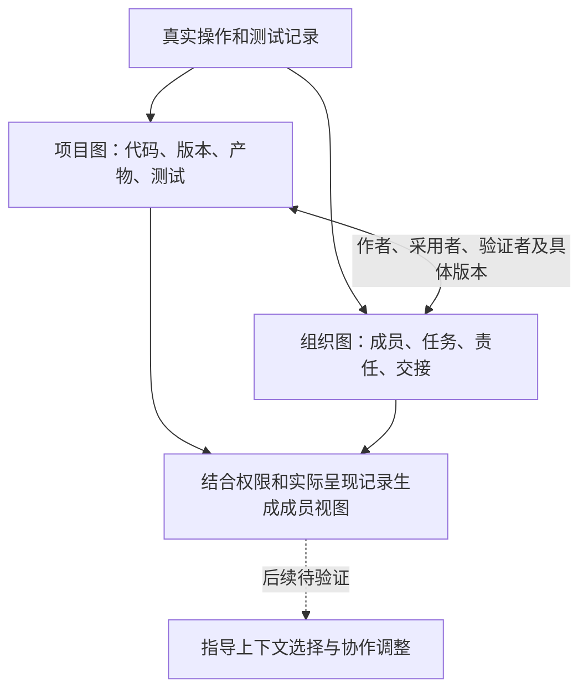

# 近期通信压缩 上下文压缩与图构建实验汇报

**汇报日期：2026年11月12日。** 近期实验围绕两个问题展开：怎样减少Agent反复读取历史信息的成本，以及怎样用项目、责任和证据关系帮助后续协作。当前结果支持优先保留短窗口上下文压缩；通信压缩仍需修复机制后重测；图的构建与观测能力已有进展，任务收益尚待验证。

## 实验范围与指标

基础框架均为**OpenHands＋ProWorkSim受管环境**，使用DeepSeek Flash非思考模式。已完成的完整任务对照统一采用131,072 Token上下文、98,304输入上限、32,768单次输出上限，以及每回合累计500万输入＋输出Token预算。双Agent条件共享团队预算，单Agent条件由一个成员使用；摘要器和压缩器的调用也计入预算。

**代码通过**指最终候选通过官方测试；**合法交付**还要求有符合项目规则的提交及验收证据，两者可能对应不同版本。下表平均Token包含成功和失败任务的输入、输出及实际摘要／压缩消耗。通信实验与上下文实验的题目、成员数不同，只在各自实验内部比较；重复运行不混入主测平均。

## 通信压缩比较

本轮固定24题、双Agent开发—复核流程：001负责开发、返修和最终交付，002负责复核。三组的角色、工具权限、通信路由、发送规则和历史摘要机制保持一致，实际发送行为由Agent自主决定；**实验只改变协作消息与补丁交接信息的呈现方式**。

- **C0 原始通信：**沿用原文预览。接口默认展示最近4条消息／交接记录，每条最多500字符，需要时读取完整原件；它不是默认展示全部通信全文。
- **C1 通用结构化摘要：**把协作内容整理成统一的事实、结果和引用字段，不按接收者角色区别组织。
- **C2 角色感知分层通信：**在接收者看到伙伴消息前，尝试按其职责整理要点。先检查消息能否逐条对照原文，再由模型挑选和排列事实：给复核者突出“改了什么、测试结果和风险”，给开发者突出“复核结论、下一步怎么改”。默认展示简短要点和原文入口，详细证据需要时再读。**本轮这些整理结果均未通过准入或输出校验，实际全部回退为原文预览。**

| 条件 | 代码通过 | 合法交付 | 每队平均总Token | 相对C0 |
|---|---:|---:|---:|---:|
| C0 原始通信 | 16/24（66.7%） | 11/24（45.8%） | 405.13万 | 基准 |
| C1 通用结构化摘要 | 16/24（66.7%） | 11/24（45.8%） | 421.45万 | +4.03% |
| C2 角色感知分层通信 | 15/24（62.5%） | 12/24（50.0%） | 396.94万 | −2.02% |

**本轮尚未形成有效的通信压缩对照。** C1的76条通信中75条回退为原文，C2的84条全部回退；唯一接受的C1结构化表示还因字段和引用开销而变长。主要问题在自然语言准入和输出协议，不能把表中小幅分差解释为角色感知压缩的收益或损失。预算边界、公开测试兼容性和交付流程也影响了结果。[通信实验报告](https://github.com/haoyueliuzhao/ProWorkSim/blob/d509ed1/docs/experiments/software-benchmark-v174-communication-pilot-final-report.md)

## 上下文压缩比较

最近一轮固定12题、12个仓库，使用**单Agent**。四组保持模型、工具、公开测试反馈和交付规则一致，**只改变每次请求如何携带自己的历史信息**。这里“一轮”指一次完整动作及其返回结果。**这些实验尚未按开发者、复核者等角色职责选择上下文，因此验证的是通用历史管理，尚未验证角色分工与上下文压缩结合的效果。**

- **M0 原有摘要：**沿用OpenHands现有历史摘要机制，历史过长时总结；它本身已经有压缩，不是无限保留原文的基线。
- **M1-5 最近5轮：**保留最近5轮完整观察，较旧观察换成可回读引用；动作链保留，不额外生成自动摘要。
- **M1-10 最近10轮：**机制与M1-5相同，将完整观察窗口扩大到10轮，用来检验多保留历史是否值得。
- **M1-5K 最近5轮加关键卡片：**最近5轮仍看完整原文；对更早记录，不只保留原文入口，还由程序挑选测试、代码变化等事件，留下最多8张短记录。例如“某版本测试未通过，完整报告见这个引用”。这些记录按固定字段抽取，不另调用模型写摘要，也不依据成员角色筛选。本轮主要保住了版本、状态和报告位置，具体失败原因、代码差异等细节仍不足。

**C2整理伙伴消息与交接信息；M1-5K补充当前Agent已看过的旧历史。** 前者想让不同接收者先看到各自需要的内容，后者想让旧事件退出最近5轮后，仍有少量状态提醒留在上下文中。增加提醒也会增加后续请求的输入成本。

| 条件 | 代码通过 | 合法交付 | 平均总Token | 相对M0 |
|---|---:|---:|---:|---:|
| M0 原有摘要 | 9/12（75.0%） | 9/12 | 256.07万 | 基准 |
| M1-5 最近5轮 | 10/12（83.3%） | 10/12 | **145.26万** | **−43.27%** |
| M1-10 最近10轮 | 9/12（75.0%） | 8/12 | 225.30万 | −12.02% |
| M1-5K 最近5轮加关键卡片 | 10/12（83.3%） | 10/12 | 207.49万 | −18.97% |

**5轮方案目前显示出较好的成本与完成率组合。** 相对M0，请求次数只减少6.2%，平均每次输入减少39.3%，节省主要来自减少重复携带的历史。另一轮12题实验中，它在通过数相同的情况下也节省了36.26% Token。两轮题单不同，小样本结果仍需扩大验证。[本轮报告](https://github.com/haoyueliuzhao/ProWorkSim/blob/d509ed1/docs/experiments/software-benchmark-v195-critical-context-report.md)；[上一轮报告](https://github.com/haoyueliuzhao/ProWorkSim/blob/d509ed1/docs/experiments/software-benchmark-v190-context-pilot-report.md)。

**关键卡片尚未带来额外净收益。** 相对普通5轮方案，关键卡片组通过数相同，Token多42.84%，请求数多29.4%。已发现同一测试报告重复入卡、卡片缺少具体失败诊断等问题；但卡片文字本身只能解释部分额外输入，更多消耗伴随修复路径和调用次数变化，具体因果仍需单项对照。

此前还测试过**持久摘要M3-R**。M0的SDK摘要本来也会进入后续请求；M3-R的区别在于显式管理摘要覆盖的旧历史范围、来源状态与原文回读入口，在来源状态一致时复用，并保留最近10轮原文。共同可评分的10题上，其总Token比原有摘要多4.59%；另2题因保护窗口与输入容量冲突未正常完成，尚未显示优于简单窗口的净成本优势。早期48个固定决策点回放中，旧观察遮蔽、编码器排序保留观察块、遮蔽后混合摘要分别节省34.14%、14.51%、32.78%的净输入；这些是下一步决策的成本结果，不能当作整题正确率。[回放实验报告](https://github.com/haoyueliuzhao/ProWorkSim/blob/d509ed1/docs/experiments/software-benchmark-v175-context-compression-results.md)。

## 为什么两类压缩都需要

**通信压缩处理“怎样把信息告诉伙伴”，上下文压缩处理“每次决策还要带上多少旧信息”。** 一条消息即使发送时很短，进入历史后仍可能反复占用输入；代码、文件列表、测试日志和环境状态也会反复出现，即使只有一个Agent也存在这类成本。

历史请求的来源估算中，工具及环境反馈约占输入71.5%，伙伴消息约占1.7%；这是本地估算分账。最近一轮单Agent实验中，实际总Token约99.6%是输入。这些结果说明，当前主要优化空间在于减少旧材料的重复呈现；把伙伴的全部阅读、测试和复核成本都归为通信成本，会误判重点。[来源分析](https://github.com/haoyueliuzhao/ProWorkSim/blob/d509ed1/docs/experiments/software-benchmark-v175-context-compression-results.md)。

后续可让两者配合：消息发送时组织清楚、保留证据引用；进入历史后按当前任务需要保留、遮蔽或回读。压缩效果应同时计入压缩器成本、回读和返工，并观察正确率与合法交付，不能只比较摘要长度。

## 角色分工与上下文压缩结合的意义

**角色分工决定成员负责什么，上下文管理决定成员实际依据什么作出判断。** 如果不同成员虽然分工不同，却持续携带大量相似的完整历史，就可能重复付出阅读成本；只按新旧删除信息，又可能遗漏某个角色特别需要的旧证据。结合两者的目标，是让有限上下文优先服务于当前职责。

| 角色 | 当前主要决策 | 应优先保留的信息 |
|---|---|---|
| 开发者 | 如何定位问题并形成完整修复 | 复现条件、相关代码、最新修改、失败原因及尚未解决的问题 |
| 复核者 | 修改是否正确完整，是否具备交付条件 | 变更差异与依据、验收要求、精确版本的测试覆盖、未验证风险及返修项 |

两者仍须共享任务要求、候选版本和关键验证状态，也都应能够查阅合法原件。**差异在默认呈现的重点，不在取消另一类信息的访问权。** 复核者尤其需要独立检查代码和证据，不能只依赖开发者提供的摘要。

预期价值包括：减少双方重复携带无关历史，让修复和复核各自获得更有用的证据，并在交接时保留版本、待办和验证缺口。这些目前是待验证的假设；角色筛选过窄也可能遗漏跨领域线索、增加回读和返工，或让复核过度沿用开发者的解释。

已有角色感知通信C2只处理伙伴消息，不能替代对文件、代码、测试反馈和自身历史的整体管理；已有双图记录了角色、责任和证据，但尚未证明用这些关系选择上下文能够改善协作。下一步需要让角色信息真正参与选择，并单独测量其增量作用。

## 图的设计与构建进展

简单窗口能省Token，但可能遗漏更早的关键证据。图的目标是把**工作对象、版本、证据和成员责任**连接起来，为判断哪些信息值得保留、何时需要交接提供依据。

| 组成 | 记录什么 | 要回答的问题 |
|---|---|---|
| 项目图 | 代码与符号、版本、补丁、测试及其来源关系 | 改了哪里，哪个版本测过，依据是什么 |
| 组织图 | 成员、任务、责任、成果与交接关系 | 谁负责，谁产生、采用或验证了成果 |
| 成员可见视图 | 当前成员实际收到、读取的信息 | 哪些信息可以合法进入他的下一次决策 |

图目前用于记录与核查，图示虚线表示后续待验证的用途，尚未改变试跑中的模型输入和组织策略。

已经完成三方面建设：**源码事实提取与去重**，修复多行代码遗漏及重复测试证据；**版本和责任的动态维护**，随真实事件更新，换版后旧测试不再算当前有效；**可追溯观测**，区分“消息已发出、对方已看到、已读取、已采用”，全局评测信息不会直接补给成员。[图设计](https://github.com/haoyueliuzhao/ProWorkSim/blob/d509ed1/docs/experiments/software-benchmark-v202-project-graph-design.md)；[观测与交付验证](https://github.com/haoyueliuzhao/ProWorkSim/blob/d509ed1/docs/experiments/software-benchmark-v203-2-passive-observation-report.md)。

已取得的实证包括：增量图在456个历史事件检查点上与全量重建一致；责任转移后的原双人复核、集成和交付流程通过受控测试。历史留出中，单卡和多卡都覆盖33/34条必要参考，普通近期上下文覆盖29/34；多卡没有进一步增加必要覆盖，图关系也尚未证明优于简单检索。这里的必要参考来自AI审阅，结构与信息覆盖结果不等于真实任务完成率提升。[图维护结果](https://github.com/haoyueliuzhao/ProWorkSim/blob/d509ed1/docs/experiments/software-benchmark-v202-project-graph-report.md)；[证据呈现比较](https://github.com/haoyueliuzhao/ProWorkSim/blob/d509ed1/docs/experiments/software-benchmark-v201-frozen-f1-holdout-report.md)。

目前正在开展12题真实被动观测试跑，保持原双人协作流程，先验证记录完整性和自然事件采集。**近期选择是保留5轮上下文方案作为低成本基线，修复通信压缩的实际生效问题，并继续验证图能否带来有用信息和协作收益。** 尚未完成的试跑不计入上述对照成绩。

## 后续实验验证方案

建议先固定双Agent开发—复核流程，比较以下三组。三组使用同一模型、每队500万Token预算、上下文与输出上限、工具权限、消息呈现、复核和交付规则；实际动作仍由Agent自主决定。角色名称和角色提示也相同，实验改变的是历史信息的选择器。

| 条件 | 如何组织上下文 | 要回答的问题 |
|---|---|---|
| A 通用短窗口 | 两名成员都保留最近5轮观察，旧材料留回读引用 | 单Agent中有效的低成本机制，进入双人协作后表现如何 |
| B 任务感知补充 | 在A上，按当前问题和工作状态，从合法历史中补充相关证据，不使用角色职责排序 | 补充旧证据本身是否值得 |
| C 角色与任务感知补充 | 与B使用相同候选池、呈现格式及附加历史Token上限，额外按当前角色职责调整优先级 | 在已有任务相关性选择之上，角色分工是否带来净收益 |

**核心比较是B与C。** 直接把A与C的差异全部称为“角色收益”，会混入补充旧证据的作用。B与C必须采用相同的事实提取、版本校验、共同必留信息和回读能力；不能给C额外权限、隐藏验收信息或更大的上下文预算，也不在同一轮改变组织结构或通信压缩策略。

先用历史材料验证：实际输入是否体现了角色差异，关键事实与原文入口是否保留，是否存在私有信息或未来信息泄露。通过后再开展小规模同题配对，统一统计团队输入与输出Token、选择器成本、回读、测试和返工，以及官方代码正确率、合法交付率和每次成功交付的成本。

题单、样本量、附加历史额度和现金预算应在正式调用前冻结。只有输入节省在计入回读和返工后仍然存在，且任务质量没有出现值得警惕的损失，才值得扩大验证。该部分是后续方案，尚未执行，不占用当前观测试跑的预算。
